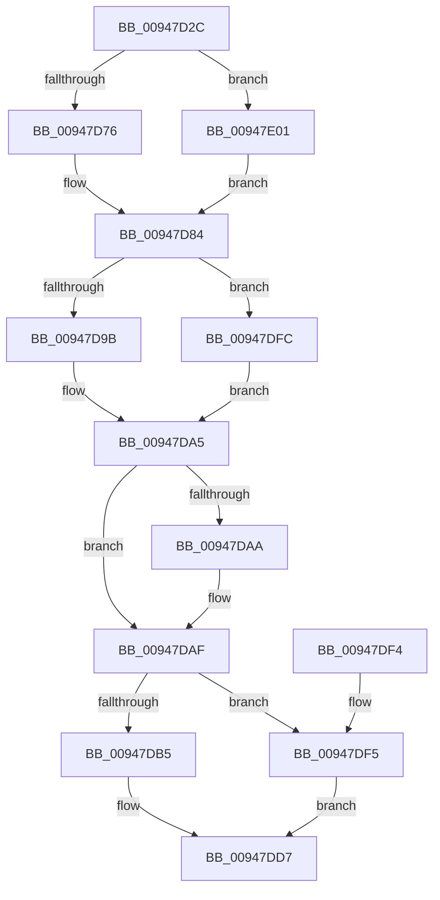

# CmpSetAccessStateForBackupRestore

- RVA: `0x00947D2C`–`0x00947E09` (길이 `221` bytes)
- VA: `0x0000000140947D2C`
- 실행 섹션: `PAGE`
- PDB 이름 있음: `예`; PDB Function 태그: `아니요`
- unwind 정보 RVA: `0x00090BC4`
- 디코드: `65`개 명령, `221/221` bytes 표시
- 미해석 바이트: `0` (있으면 어셈블리에 `.byte`로 보존)

> 이 문서는 커널 이미지의 기계어와 PDB 기호를 분석해 생성했습니다. 4번과 5번은 함수 원형과 자료형을 바이너리 사용 방식에서 추정한 C 해석이며 원본 소스 복구 결과는 아닙니다.

## 1. Dependencies

- 직접 호출 지점: **3**; 고유 호출 대상: **2**
- 직접 호출자로 확인된 함수: **2**
- RIP 상대 이미지 참조: **3**

### Outgoing calls
- `0x00947D69` → [SeSinglePrivilegeCheckEx](../87/SeSinglePrivilegeCheckEx_function_00871AC0.md) (function, `0x00871AC0`)
- `0x00947D92` → [SeSinglePrivilegeCheckEx](../87/SeSinglePrivilegeCheckEx_function_00871AC0.md) (function, `0x00871AC0`)
- `0x00947DC5` → [SepAdjustAccessStateForConstraints](SepAdjustAccessStateForConstraints_function_00947E10.md) (function, `0x00947E10`)

### Direct callers
- [CmpCheckCreateAccessOnKcbStack](../8C/CmpCheckCreateAccessOnKcbStack_function_008C7010.md) at `0x008C7104`
- [CmpCheckKeySecurityDescriptorAccess](CmpCheckKeySecurityDescriptorAccess_function_0094715C.md) at `0x0094721B`

### Static image references
- `0x00947D62` → RVA `0x00FD9AC0` (`PAGEDATA`; read)
- `0x00947D84` → RVA `0x00FD9AE0` (`PAGEDATA`; read)
- `0x00947DB5` → RVA `0x00FC6AC0` (`ALMOSTRO`; read)

## 2. Other-region calls and transfers

- 다른 실행 섹션으로 향하는 call: **0**
- 별도 외부 분기/꼬리 이동을 확인하지 못했습니다.

## 3. Assembly (complete function range)

```asm
00947D2C  48 89 5C 24 08                  mov qword ptr [rsp + 8], rbx
00947D31  48 89 6C 24 10                  mov qword ptr [rsp + 0x10], rbp
00947D36  48 89 74 24 18                  mov qword ptr [rsp + 0x18], rsi
00947D3B  57                              push rdi
00947D3C  41 54                           push r12
00947D3E  41 55                           push r13
00947D40  41 56                           push r14
00947D42  41 57                           push r15
00947D44  48 83 EC 20                     sub rsp, 0x20
00947D48  48 8D 59 14                     lea rbx, [rcx + 0x14]
00947D4C  4D 8B E8                        mov r13, r8
00947D4F  83 23 00                        and dword ptr [rbx], 0
00947D52  44 8A C2                        mov r8b, dl
00947D55  44 8A FA                        mov r15b, dl
00947D58  48 8B F1                        mov rsi, rcx
00947D5B  48 8D 51 20                     lea rdx, [rcx + 0x20]
00947D5F  41 8A E9                        mov bpl, r9b
00947D62  48 8B 0D 57 1D 69 00            mov rcx, qword ptr [rip + 0x691d57]
00947D69  E8 52 9D F2 FF                  call 0x140871ac0
00947D6E  84 C0                           test al, al
00947D70  0F 84 8B 00 00 00               je 0x140947e01
00947D76  83 4E 0C 02                     or dword ptr [rsi + 0xc], 2
00947D7A  4C 8D 76 14                     lea r14, [rsi + 0x14]
00947D7E  81 0B 19 00 02 01               or dword ptr [rbx], 0x1020019
00947D84  48 8B 0D 55 1D 69 00            mov rcx, qword ptr [rip + 0x691d55]
00947D8B  48 8D 56 20                     lea rdx, [rsi + 0x20]
00947D8F  45 8A C7                        mov r8b, r15b
00947D92  E8 29 9D F2 FF                  call 0x140871ac0
00947D97  84 C0                           test al, al
00947D99  74 61                           je 0x140947dfc
00947D9B  83 4E 0C 04                     or dword ptr [rsi + 0xc], 4
00947D9F  81 0B 06 00 0F 01               or dword ptr [rbx], 0x10f0006
00947DA5  40 84 ED                        test bpl, bpl
00947DA8  74 05                           je 0x140947daf
00947DAA  8B 03                           mov eax, dword ptr [rbx]
00947DAC  89 46 18                        mov dword ptr [rsi + 0x18], eax
00947DAF  41 83 3E 00                     cmp dword ptr [r14], 0
00947DB3  74 40                           je 0x140947df5
00947DB5  48 8B 0D 04 ED 67 00            mov rcx, qword ptr [rip + 0x67ed04]
00947DBC  4C 8B CE                        mov r9, rsi
00947DBF  41 B0 01                        mov r8b, 1
00947DC2  49 8B D5                        mov rdx, r13
00947DC5  E8 46 00 00 00                  call 0x140947e10
00947DCA  41 8B 06                        mov eax, dword ptr [r14]
00947DCD  F7 D0                           not eax
00947DCF  23 46 18                        and eax, dword ptr [rsi + 0x18]
00947DD2  89 46 10                        mov dword ptr [rsi + 0x10], eax
00947DD5  33 C0                           xor eax, eax
00947DD7  48 8B 5C 24 50                  mov rbx, qword ptr [rsp + 0x50]
00947DDC  48 8B 6C 24 58                  mov rbp, qword ptr [rsp + 0x58]
00947DE1  48 8B 74 24 60                  mov rsi, qword ptr [rsp + 0x60]
00947DE6  48 83 C4 20                     add rsp, 0x20
00947DEA  41 5F                           pop r15
00947DEC  41 5E                           pop r14
00947DEE  41 5D                           pop r13
00947DF0  41 5C                           pop r12
00947DF2  5F                              pop rdi
00947DF3  C3                              ret
00947DF4  CC                              int3
00947DF5  B8 22 00 00 C0                  mov eax, 0xc0000022
00947DFA  EB DB                           jmp 0x140947dd7
00947DFC  4C 8B F3                        mov r14, rbx
00947DFF  EB A4                           jmp 0x140947da5
00947E01  4C 8B F3                        mov r14, rbx
00947E04  E9 7B FF FF FF                  jmp 0x140947d84
```

## 4. C-style interpretation (structured pseudocode)

```c
__int64 __fastcall CmpSetAccessStateForBackupRestore(__int64 a1, unsigned __int8 a2, __int64 a3, unsigned __int8 a4)
{
    __int64 result;
    __int64 v_rsp;
    unsigned __int64 v_stack_p10;
    unsigned __int64 v_stack_p18;
    unsigned __int64 v_stack_p8;

    v_stack_p8 = v_rbx;
    v_stack_p10 = v_rbp;
    v_stack_p18 = v_rsi;
    v_rsp = (v_rsp) - (32);
    result = SeSinglePrivilegeCheckEx(*(unsigned __int64 *)(v_rip + 6888791), a1 + 32, a2, a4);
    if ((unsigned __int8)(result) == 0) goto loc_00947E01;
loc_00947D84:
    result = SeSinglePrivilegeCheckEx(*(unsigned __int64 *)(v_rip + 6888789), a1 + 32, a2, a4);
    if ((unsigned __int8)(result) == 0) goto loc_00947DFC;
loc_00947DA5:
    if (a4 != 0) {
        result = *(unsigned int *)(a1 + 20);
        *(unsigned int *)(a1 + 24) = (unsigned int)(result);
    }
    if ((*(unsigned int *)(a1 + 20)) == 0) goto loc_00947DF5;
    result = SepAdjustAccessStateForConstraints(*(unsigned __int64 *)(v_rip + 6810884), a3, 1, a1);
    result = (unsigned int)(~((unsigned int)(*(unsigned int *)(a1 + 20))));
    result = (unsigned int)((result) & (*(unsigned int *)(a1 + 24)));
    *(unsigned int *)(a1 + 16) = (unsigned int)(result);
    result = 0;
loc_00947DD7:
    v_rsp = (v_rsp) + (32);
    return result;
loc_00947DF5:
    goto loc_00947DD7;
loc_00947DFC:
    goto loc_00947DA5;
loc_00947E01:
    goto loc_00947D84;
}
```

## 5. (Beta) C Style

```c
int64_t CmpSetAccessStateForBackupRestore(void *Arg1, uint8_t Arg2, int64_t Arg3, uint8_t Arg4)
{
    uint8_t *arg1 = (uint8_t *)Arg1;

    int64_t result;
    int64_t local_rsp;
    uint64_t v_stack_p10;
    uint64_t v_stack_p18;
    uint64_t v_stack_p8;

    v_stack_p8 = local_rbx;
    v_stack_p10 = local_rbp;
    v_stack_p18 = local_rsi;
    local_rsp = (local_rsp) - (32);
    result = SeSinglePrivilegeCheckEx(*(uint64_t *)(v_rip + 0x691D57), Arg1 + 32, Arg2, Arg4);
    if ((uint8_t)(result) == 0) goto loc_00947E01;
loc_00947D84:
    result = SeSinglePrivilegeCheckEx(*(uint64_t *)(v_rip + 0x691D55), Arg1 + 32, Arg2, Arg4);
    if ((uint8_t)(result) == 0) goto loc_00947DFC;
loc_00947DA5:
    if (Arg4 != 0) {
        result = *(uint32_t *)(arg1 + 0x14);
        *(uint32_t *)(arg1 + 0x18) = (uint32_t)(result);
    }
    if ((*(uint32_t *)(arg1 + 0x14)) == 0) goto loc_00947DF5;
    result = SepAdjustAccessStateForConstraints(*(uint64_t *)(v_rip + 0x67ED04), Arg3, 1, Arg1);
    result = (uint32_t)(~((uint32_t)(*(uint32_t *)(arg1 + 0x14))));
    result = (uint32_t)((result) & (*(uint32_t *)(arg1 + 0x18)));
    *(uint32_t *)(arg1 + 0x10) = (uint32_t)(result);
    result = 0;
loc_00947DD7:
    local_rsp = (local_rsp) + (32);
    return result;
loc_00947DF5:
    goto loc_00947DD7;
loc_00947DFC:
    goto loc_00947DA5;
loc_00947E01:
    goto loc_00947D84;
}
```

### 관측된 메모리 오프셋

구조체 형식이 확인되지 않은 접근은 인자 기준의 오프셋으로만 기록했습니다.

| 기준 인자 | 오프셋 표현 | 폭 (bit) | 접근 |
|---|---:|---:|---|
| `Arg1` | `+ 0x0` | `32` | `R` |
| `Arg1` | `+ 0x0` | `32` | `R/W` |
| `Arg1` | `+ 0xC` | `32` | `R/W` |
| `Arg1` | `+ 0x10` | `32` | `W` |
| `Arg1` | `+ 0x14` | `64` | `R` |
| `Arg1` | `+ 0x18` | `32` | `R` |
| `Arg1` | `+ 0x18` | `32` | `W` |
| `Arg1` | `+ 0x20` | `64` | `R` |

## 6. Execution-region graph

[열기: 2D/3D 그래프와 함수 탐색 컨트롤 패널](../../../control-panel.html?section=page&rva=0x00947D2C&view=graph)

- 2D 그래프는 위에서 아래로 흐르고, 3D 그래프는 빈 공간을 드래그해 회전합니다. Shift+드래그는 이동, 휠은 확대·축소, 함수 노드 선택은 대상 보고서 이동입니다.

### Static fallback


