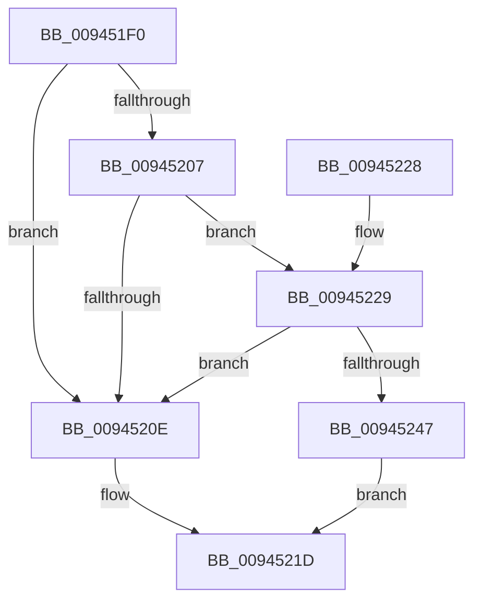

# CmpStartKcbStack

- RVA: `0x009451F0`–`0x0094524E` (길이 `94` bytes)
- VA: `0x00000001409451F0`
- 실행 섹션: `PAGE`
- PDB 이름 있음: `예`; PDB Function 태그: `아니요`
- unwind 정보 RVA: `0x0009082C`
- 디코드: `30`개 명령, `94/94` bytes 표시
- 미해석 바이트: `0` (있으면 어셈블리에 `.byte`로 보존)

> 이 문서는 커널 이미지의 기계어와 PDB 기호를 분석해 생성했습니다. 4번과 5번은 함수 원형과 자료형을 바이너리 사용 방식에서 추정한 C 해석이며 원본 소스 복구 결과는 아닙니다.

## 1. Dependencies

- 직접 호출 지점: **1**; 고유 호출 대상: **1**
- 직접 호출자로 확인된 함수: **4**
- RIP 상대 이미지 참조: **0**

### Outgoing calls
- `0x0094523A` → [CmpAllocatePool](../../text/3C/CmpAllocatePool_function_003CD504.md) (function, `0x003CD504`)

### Direct callers
- [CmpDoBuildVirtualStack](../7E/CmpDoBuildVirtualStack_function_007EB4C4.md) at `0x007EB621`
- [CmpPartialPromoteSubkeys](../7F/CmpPartialPromoteSubkeys_function_007F4070.md) at `0x007F40F4`
- [CmpPromoteKey](../84/CmpPromoteKey_function_00844388.md) at `0x008443D6`
- [CmpPromoteKey](../84/CmpPromoteKey_function_00844388.md) at `0x008443EC`
- [CmpSubtreeEnumeratorStart](CmpSubtreeEnumeratorStart_function_009450E0.md) at `0x0094518B`

### Static image references
- 디코드된 RIP-relative 메모리 참조가 없습니다.

## 2. Other-region calls and transfers

- 다른 실행 섹션으로 향하는 call: **1**
  - `0x0094523A` → [CmpAllocatePool](../../text/3C/CmpAllocatePool_function_003CD504.md) (`PAGE` → `.text`)
- 별도 외부 분기/꼬리 이동을 확인하지 못했습니다.

## 3. Assembly (complete function range)

```asm
009451F0  48 89 5C 24 08                  mov qword ptr [rsp + 8], rbx
009451F5  57                              push rdi
009451F6  48 83 EC 20                     sub rsp, 0x20
009451FA  48 8B F9                        mov rdi, rcx
009451FD  0F BF DA                        movsx ebx, dx
00945200  33 C9                           xor ecx, ecx
00945202  83 FB 02                        cmp ebx, 2
00945205  7C 07                           jl 0x14094520e
00945207  8B C3                           mov eax, ebx
00945209  83 E8 01                        sub eax, 1
0094520C  75 1B                           jne 0x140945229
0094520E  66 C7 47 02 FF FF               mov word ptr [rdi + 2], 0xffff
00945214  33 C0                           xor eax, eax
00945216  66 89 1F                        mov word ptr [rdi], bx
00945219  48 89 4F 18                     mov qword ptr [rdi + 0x18], rcx
0094521D  48 8B 5C 24 30                  mov rbx, qword ptr [rsp + 0x30]
00945222  48 83 C4 20                     add rsp, 0x20
00945226  5F                              pop rdi
00945227  C3                              ret
00945228  CC                              int3
00945229  8B D0                           mov edx, eax
0094522B  B9 00 01 00 00                  mov ecx, 0x100
00945230  48 C1 E2 03                     shl rdx, 3
00945234  41 B8 43 4D 36 35               mov r8d, 0x35364d43
0094523A  E8 C5 82 A8 FF                  call 0x1403cd504
0094523F  48 8B C8                        mov rcx, rax
00945242  48 85 C0                        test rax, rax
00945245  75 C7                           jne 0x14094520e
00945247  B8 9A 00 00 C0                  mov eax, 0xc000009a
0094524C  EB CF                           jmp 0x14094521d
```

## 4. C-style interpretation (structured pseudocode)

```c
__int64 __fastcall CmpStartKcbStack(__int64 a1, unsigned __int16 a2)
{
    __int64 result;
    __int64 v_rsp;
    unsigned __int64 v_stack_p8;

    v_stack_p8 = v_rbx;
    v_rsp = (v_rsp) - (32);
    a1 = 0;
    if (((unsigned int)((__int16)(a2))) < 2) goto loc_0094520E;
    result = (unsigned int)(((unsigned int)((unsigned int)((__int16)(a2)))) - (1));
    if (condition_is_not_equal) goto loc_00945229;
loc_0094520E:
    *(unsigned __int16 *)(a1 + 2) = 0xFFFFULL;
    result = 0;
    *(unsigned __int16 *)(a1) = (unsigned __int16)((__int16)(a2));
    *(unsigned __int64 *)(a1 + 24) = 0;
loc_0094521D:
    v_rsp = (v_rsp) + (32);
    return result;
loc_00945229:
    a2 = (0) << (3);
    result = CmpAllocatePool(256, a2, (unsigned int)(0x35364D43ULL), a4);
    if (result != 0) goto loc_0094520E;
    goto loc_0094521D;
}
```

## 5. (Beta) C Style

```c
int64_t CmpStartKcbStack(void *Arg1, uint16_t Arg2)
{
    uint8_t *arg1 = (uint8_t *)Arg1;

    int64_t result;
    int64_t local_rsp;
    uint64_t v_stack_p8;

    v_stack_p8 = local_rbx;
    local_rsp = (local_rsp) - (32);
    Arg1 = 0;
    if (((uint32_t)((int16_t)(Arg2))) < 2) goto loc_0094520E;
    result = (uint32_t)(((uint32_t)((uint32_t)((int16_t)(Arg2)))) - (1));
    if (condition_is_not_equal) goto loc_00945229;
loc_0094520E:
    *(uint16_t *)(arg1 + 0x2) = 0xFFFFULL;
    result = 0;
    *(uint16_t *)(arg1) = (uint16_t)((int16_t)(Arg2));
    *(uint64_t *)(arg1 + 0x18) = 0;
loc_0094521D:
    local_rsp = (local_rsp) + (32);
    return result;
loc_00945229:
    Arg2 = (0) << (3);
    result = CmpAllocatePool(256, Arg2, (uint32_t)(0x35364D43ULL), a4);
    if (result != 0) goto loc_0094520E;
    goto loc_0094521D;
}
```

### 관측된 메모리 오프셋

구조체 형식이 확인되지 않은 접근은 인자 기준의 오프셋으로만 기록했습니다.

| 기준 인자 | 오프셋 표현 | 폭 (bit) | 접근 |
|---|---:|---:|---|
| `Arg1` | `+ 0x0` | `16` | `W` |
| `Arg1` | `+ 0x2` | `16` | `W` |
| `Arg1` | `+ 0x18` | `64` | `W` |

## 6. Execution-region graph

[열기: 2D/3D 그래프와 함수 탐색 컨트롤 패널](../../../control-panel.html?section=page&rva=0x009451F0&view=graph)

- 2D 그래프는 위에서 아래로 흐르고, 3D 그래프는 빈 공간을 드래그해 회전합니다. Shift+드래그는 이동, 휠은 확대·축소, 함수 노드 선택은 대상 보고서 이동입니다.

### Static fallback


