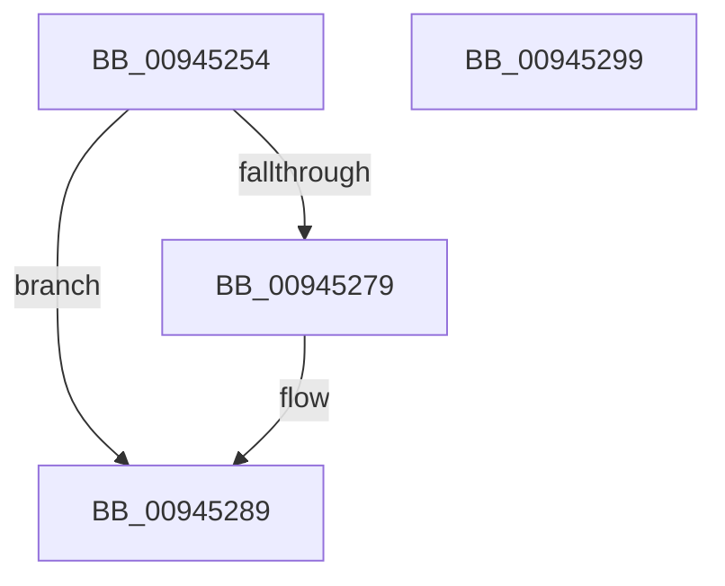

# CmpStartKeyNodeStackFromKcbStack

- RVA: `0x00945254`–`0x0094529A` (길이 `70` bytes)
- VA: `0x0000000140945254`
- 실행 섹션: `PAGE`
- PDB 이름 있음: `예`; PDB Function 태그: `아니요`
- unwind 정보 RVA: `0x00060BC4`
- 디코드: `22`개 명령, `70/70` bytes 표시
- 미해석 바이트: `0` (있으면 어셈블리에 `.byte`로 보존)

> 이 문서는 커널 이미지의 기계어와 PDB 기호를 분석해 생성했습니다. 4번과 5번은 함수 원형과 자료형을 바이너리 사용 방식에서 추정한 C 해석이며 원본 소스 복구 결과는 아닙니다.

## 1. Dependencies

- 직접 호출 지점: **2**; 고유 호출 대상: **2**
- 직접 호출자로 확인된 함수: **4**
- RIP 상대 이미지 참조: **0**

### Outgoing calls
- `0x00945270` → [CmpStartKeyNodeStack](CmpStartKeyNodeStack_function_00945338.md) (function, `0x00945338`)
- `0x00945282` → [CmpPopulateKeyNodeStackFromKcbStack](CmpPopulateKeyNodeStackFromKcbStack_function_009453CC.md) (function, `0x009453CC`)

### Direct callers
- [CmQueryLayeredKey](../../text/46/CmQueryLayeredKey_function_0046A930.md) at `0x0046AB64`
- [CmpFullPromoteHiveRootFromKcbStack](../7F/CmpFullPromoteHiveRootFromKcbStack_function_007F3F90.md) at `0x007F3FF3`
- [CmpPromoteSingleKeyFromParentKcbAndChildKeyNode](../7F/CmpPromoteSingleKeyFromParentKcbAndChildKeyNode_function_007F426C.md) at `0x007F42E4`
- [CmpPromoteSingleKeyFromKcbStacks](CmpPromoteSingleKeyFromKcbStacks_function_009446E8.md) at `0x00944860`

### Static image references
- 디코드된 RIP-relative 메모리 참조가 없습니다.

## 2. Other-region calls and transfers

- 다른 실행 섹션으로 향하는 call: **0**
- 별도 외부 분기/꼬리 이동을 확인하지 못했습니다.

## 3. Assembly (complete function range)

```asm
00945254  48 89 5C 24 08                  mov qword ptr [rsp + 8], rbx
00945259  48 89 74 24 10                  mov qword ptr [rsp + 0x10], rsi
0094525E  57                              push rdi
0094525F  48 83 EC 20                     sub rsp, 0x20
00945263  48 8B DA                        mov rbx, rdx
00945266  49 8B F0                        mov rsi, r8
00945269  0F B7 52 02                     movzx edx, word ptr [rdx + 2]
0094526D  48 8B F9                        mov rdi, rcx
00945270  E8 C3 00 00 00                  call 0x140945338
00945275  85 C0                           test eax, eax
00945277  78 10                           js 0x140945289
00945279  4C 8B C6                        mov r8, rsi
0094527C  48 8B D3                        mov rdx, rbx
0094527F  48 8B CF                        mov rcx, rdi
00945282  E8 45 01 00 00                  call 0x1409453cc
00945287  33 C0                           xor eax, eax
00945289  48 8B 5C 24 30                  mov rbx, qword ptr [rsp + 0x30]
0094528E  48 8B 74 24 38                  mov rsi, qword ptr [rsp + 0x38]
00945293  48 83 C4 20                     add rsp, 0x20
00945297  5F                              pop rdi
00945298  C3                              ret
00945299  CC                              int3
```

## 4. C-style interpretation (structured pseudocode)

```c
__int64 __fastcall CmpStartKeyNodeStackFromKcbStack(__int64 a1, __int64 a2, __int64 a3)
{
    __int64 result;
    __int64 v_rsp;
    unsigned __int64 v_stack_p10;
    unsigned __int64 v_stack_p8;

    v_stack_p8 = v_rbx;
    v_stack_p10 = v_rsi;
    v_rsp = (v_rsp) - (32);
    result = CmpStartKeyNodeStack(a1, *(unsigned __int16 *)(a2 + 2), a3, a4);
    if (!(sign_flag)) {
        a3 = a3;
        a2 = a2;
        a1 = a1;
        result = CmpPopulateKeyNodeStackFromKcbStack(a1, a2, a3, a4);
        result = 0;
    }
    v_rsp = (v_rsp) + (32);
    return result;
}
```

## 5. (Beta) C Style

```c
int64_t CmpStartKeyNodeStackFromKcbStack(int64_t Arg1, void *Arg2, int64_t Arg3)
{
    uint8_t *arg2 = (uint8_t *)Arg2;

    int64_t result;
    int64_t local_rsp;
    uint64_t v_stack_p10;
    uint64_t v_stack_p8;

    v_stack_p8 = local_rbx;
    v_stack_p10 = local_rsi;
    local_rsp = (local_rsp) - (32);
    result = CmpStartKeyNodeStack(Arg1, *(uint16_t *)(arg2 + 0x2), Arg3, a4);
    if (!(sign_flag)) {
        Arg3 = Arg3;
        Arg2 = Arg2;
        Arg1 = Arg1;
        result = CmpPopulateKeyNodeStackFromKcbStack(Arg1, Arg2, Arg3, a4);
        result = 0;
    }
    local_rsp = (local_rsp) + (32);
    return result;
}
```

### 관측된 메모리 오프셋

구조체 형식이 확인되지 않은 접근은 인자 기준의 오프셋으로만 기록했습니다.

| 기준 인자 | 오프셋 표현 | 폭 (bit) | 접근 |
|---|---:|---:|---|
| `Arg2` | `+ 0x2` | `16` | `R` |

## 6. Execution-region graph

[열기: 2D/3D 그래프와 함수 탐색 컨트롤 패널](../../../control-panel.html?section=page&rva=0x00945254&view=graph)

- 2D 그래프는 위에서 아래로 흐르고, 3D 그래프는 빈 공간을 드래그해 회전합니다. Shift+드래그는 이동, 휠은 확대·축소, 함수 노드 선택은 대상 보고서 이동입니다.

### Static fallback


