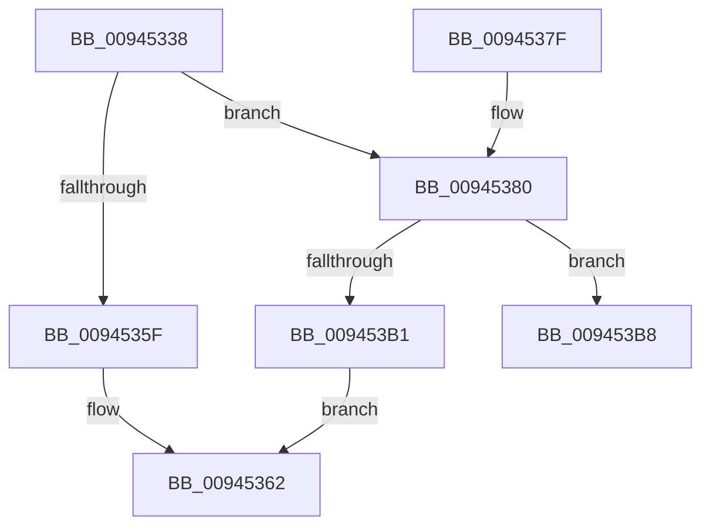

# CmpStartKeyNodeStack

- RVA: `0x00945338`–`0x009453C4` (길이 `140` bytes)
- VA: `0x0000000140945338`
- 실행 섹션: `PAGE`
- PDB 이름 있음: `예`; PDB Function 태그: `예`
- unwind 정보 RVA: `0x00090868`
- 디코드: `39`개 명령, `140/140` bytes 표시
- 미해석 바이트: `0` (있으면 어셈블리에 `.byte`로 보존)

> 이 문서는 커널 이미지의 기계어와 PDB 기호를 분석해 생성했습니다. 4번과 5번은 함수 원형과 자료형을 바이너리 사용 방식에서 추정한 C 해석이며 원본 소스 복구 결과는 아닙니다.

## 1. Dependencies

- 직접 호출 지점: **1**; 고유 호출 대상: **1**
- 직접 호출자로 확인된 함수: **8**
- RIP 상대 이미지 참조: **0**

### Outgoing calls
- `0x009453A3` → [CmpAllocatePool](../../text/3C/CmpAllocatePool_function_003CD504.md) (function, `0x003CD504`)

### Direct callers
- [CmSaveKey](../7D/CmSaveKey_function_007DDBDC.md) at `0x007DDD34`
- [CmpGetSubKeyCountForKcbStack](CmpGetSubKeyCountForKcbStack_function_00944628.md) at `0x00944682`
- [CmpPromoteSingleKeyFromKcbStacks](CmpPromoteSingleKeyFromKcbStacks_function_009446E8.md) at `0x009447AC`
- [CmpValueEnumStackStartFromKcbStack](CmpValueEnumStackStartFromKcbStack_function_00944AA4.md) at `0x00944B07`
- [CmpKeyEnumStackStartFromKcbStack](CmpKeyEnumStackStartFromKcbStack_function_00944F18.md) at `0x00944F89`
- [CmpSubtreeEnumeratorStart](CmpSubtreeEnumeratorStart_function_009450E0.md) at `0x009451D4`
- [CmpStartKeyNodeStackFromKcbStack](CmpStartKeyNodeStackFromKcbStack_function_00945254.md) at `0x00945270`
- [CmpKeyEnumStackStart](CmpKeyEnumStackStart_function_009452A0.md) at `0x009452CF`

### Static image references
- 디코드된 RIP-relative 메모리 참조가 없습니다.

## 2. Other-region calls and transfers

- 다른 실행 섹션으로 향하는 call: **1**
  - `0x009453A3` → [CmpAllocatePool](../../text/3C/CmpAllocatePool_function_003CD504.md) (`PAGE` → `.text`)
- call이 아닌 외부 분기/꼬리 이동: **1**
  - `0x009453BF` → [sub_00B255A6](../B2/Unknown_function_00B255A6.md) (`tail-transfer`)

## 3. Assembly (complete function range)

```asm
00945338  48 8B C4                        mov rax, rsp
0094533B  48 89 58 08                     mov qword ptr [rax + 8], rbx
0094533F  48 89 68 10                     mov qword ptr [rax + 0x10], rbp
00945343  48 89 70 18                     mov qword ptr [rax + 0x18], rsi
00945347  48 89 78 20                     mov qword ptr [rax + 0x20], rdi
0094534B  41 56                           push r14
0094534D  48 83 EC 20                     sub rsp, 0x20
00945351  48 0F BF FA                     movsx rdi, dx
00945355  33 DB                           xor ebx, ebx
00945357  48 8B F1                        mov rsi, rcx
0094535A  83 FF 02                        cmp edi, 2
0094535D  7D 21                           jge 0x140945380
0094535F  66 89 3E                        mov word ptr [rsi], di
00945362  48 8B 6C 24 38                  mov rbp, qword ptr [rsp + 0x38]
00945367  8B C3                           mov eax, ebx
00945369  48 8B 5C 24 30                  mov rbx, qword ptr [rsp + 0x30]
0094536E  48 8B 74 24 40                  mov rsi, qword ptr [rsp + 0x40]
00945373  48 8B 7C 24 48                  mov rdi, qword ptr [rsp + 0x48]
00945378  48 83 C4 20                     add rsp, 0x20
0094537C  41 5E                           pop r14
0094537E  C3                              ret
0094537F  CC                              int3
00945380  48 8B D7                        mov rdx, rdi
00945383  0F B7 EF                        movzx ebp, di
00945386  48 C1 E2 05                     shl rdx, 5
0094538A  41 BE 01 00 00 00               mov r14d, 1
00945390  48 83 EA 20                     sub rdx, 0x20
00945394  B9 00 01 00 00                  mov ecx, 0x100
00945399  41 B8 43 4D 36 39               mov r8d, 0x39364d43
0094539F  66 41 2B EE                     sub bp, r14w
009453A3  E8 5C 81 A8 FF                  call 0x1403cd504
009453A8  48 89 46 48                     mov qword ptr [rsi + 0x48], rax
009453AC  48 85 C0                        test rax, rax
009453AF  75 07                           jne 0x1409453b8
009453B1  BB 9A 00 00 C0                  mov ebx, 0xc000009a
009453B6  EB AA                           jmp 0x140945362
009453B8  48 8B D3                        mov rdx, rbx
009453BB  44 0F B7 C5                     movzx r8d, bp
009453BF  E9 E2 01 1E 00                  jmp 0x140b255a6
```

## 4. C-style interpretation (structured pseudocode)

```c
__int64 __fastcall CmpStartKeyNodeStack(__int64 a1, unsigned __int16 a2)
{
    __int64 result;
    __int64 v_rbp;
    __int64 v_rbx;
    __int64 v_rsp;
    unsigned __int64 v_stack_p10;
    unsigned __int64 v_stack_p18;
    unsigned __int64 v_stack_p20;
    unsigned __int64 v_stack_p8;

    *(unsigned __int64 *)(v_rsp + 8) = v_rbx;
    *(unsigned __int64 *)(v_rsp + 16) = v_rbp;
    *(unsigned __int64 *)(v_rsp + 24) = v_rsi;
    *(unsigned __int64 *)(v_rsp + 32) = v_rdi;
    v_rsp = (v_rsp) - (32);
    v_rbx = 0;
    if (((unsigned int)((__int16)(a2))) >= 2) goto loc_00945380;
    *(unsigned __int16 *)(a1) = (unsigned __int16)((__int16)(a2));
loc_00945362:
    v_rsp = (v_rsp) + (32);
    return 0;
loc_00945380:
    a2 = (v_stack_p20) << (5);
    a2 = (a2) - (32);
    v_rbp = (unsigned __int16)(((unsigned __int16)(v_stack_p20)) - (1));
    result = CmpAllocatePool(256, a2, (unsigned int)(0x39364D43ULL), a4);
    *(unsigned __int64 *)(v_stack_p18 + 72) = result;
    if (result != 0) goto loc_009453B8;
    goto loc_00945362;
loc_009453B8:
}
```

## 5. (Beta) C Style

```c
int64_t CmpStartKeyNodeStack(void *Arg1, uint16_t Arg2)
{
    uint8_t *arg1 = (uint8_t *)Arg1;

    int64_t result;
    int64_t local_rbp;
    int64_t local_rbx;
    int64_t local_rsp;
    uint64_t v_stack_p10;
    uint64_t v_stack_p18;
    uint64_t v_stack_p20;
    uint64_t v_stack_p8;

    *(uint64_t *)(local_rsp + 0x8) = local_rbx;
    *(uint64_t *)(local_rsp + 0x10) = local_rbp;
    *(uint64_t *)(local_rsp + 0x18) = local_rsi;
    *(uint64_t *)(local_rsp + 0x20) = local_rdi;
    local_rsp = (local_rsp) - (32);
    local_rbx = 0;
    if (((uint32_t)((int16_t)(Arg2))) >= 2) goto loc_00945380;
    *(uint16_t *)(arg1) = (uint16_t)((int16_t)(Arg2));
loc_00945362:
    local_rsp = (local_rsp) + (32);
    return 0;
loc_00945380:
    Arg2 = (v_stack_p20) << (5);
    Arg2 = (Arg2) - (32);
    local_rbp = (uint16_t)(((uint16_t)(v_stack_p20)) - (1));
    result = CmpAllocatePool(256, Arg2, (uint32_t)(0x39364D43ULL), a4);
    *(uint64_t *)(v_stack_p18 + 0x48) = result;
    if (result != 0) goto loc_009453B8;
    goto loc_00945362;
loc_009453B8:
}
```

### 관측된 메모리 오프셋

구조체 형식이 확인되지 않은 접근은 인자 기준의 오프셋으로만 기록했습니다.

| 기준 인자 | 오프셋 표현 | 폭 (bit) | 접근 |
|---|---:|---:|---|
| `Arg1` | `+ 0x0` | `16` | `W` |
| `Arg1` | `+ 0x48` | `64` | `W` |

## 6. Execution-region graph

[열기: 2D/3D 그래프와 함수 탐색 컨트롤 패널](../../../control-panel.html?section=page&rva=0x00945338&view=graph)

- 2D 그래프는 위에서 아래로 흐르고, 3D 그래프는 빈 공간을 드래그해 회전합니다. Shift+드래그는 이동, 휠은 확대·축소, 함수 노드 선택은 대상 보고서 이동입니다.

### Static fallback


