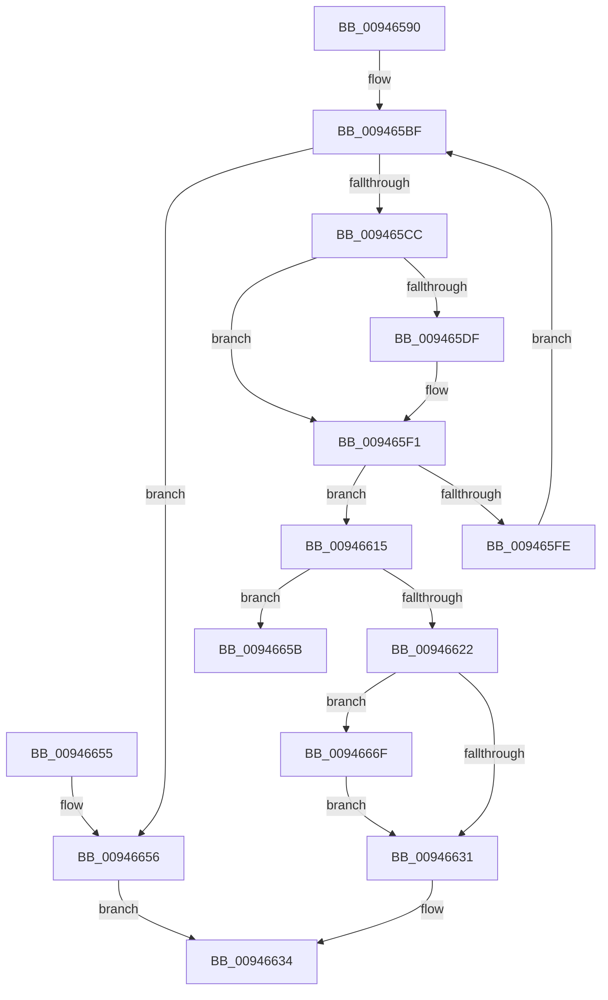

# CmpSubtreeEnumeratorAdvance

- RVA: `0x00946590`–`0x00946684` (길이 `244` bytes)
- VA: `0x0000000140946590`
- 실행 섹션: `PAGE`
- PDB 이름 있음: `예`; PDB Function 태그: `예`
- unwind 정보 RVA: `0x000909AC`
- 디코드: `70`개 명령, `244/244` bytes 표시
- 미해석 바이트: `0` (있으면 어셈블리에 `.byte`로 보존)

> 이 문서는 커널 이미지의 기계어와 PDB 기호를 분석해 생성했습니다. 4번과 5번은 함수 원형과 자료형을 바이너리 사용 방식에서 추정한 C 해석이며 원본 소스 복구 결과는 아닙니다.

## 1. Dependencies

- 직접 호출 지점: **5**; 고유 호출 대상: **5**
- 직접 호출자로 확인된 함수: **3**
- RIP 상대 이미지 참조: **0**

### Outgoing calls
- `0x009465E9` → [CmpKeyEnumStackBeginEnumerationForKeyNodeStack](CmpKeyEnumStackBeginEnumerationForKeyNodeStack_function_00946718.md) (function, `0x00946718`)
- `0x009465F4` → [CmpKeyEnumStackAdvance](CmpKeyEnumStackAdvance_function_0094668C.md) (function, `0x0094668C`)
- `0x00946601` → [CmpKeyEnumStackReset](CmpKeyEnumStackReset_function_0094648C.md) (function, `0x0094648C`)
- `0x0094665F` → [CmpGetKcbAtLayerHeight](CmpGetKcbAtLayerHeight_function_00949210.md) (function, `0x00949210`)
- `0x00946676` → [CmpPopulateKcbStack](../84/CmpPopulateKcbStack_function_00842550.md) (function, `0x00842550`)

### Direct callers
- [CmRenameKey](../7E/CmRenameKey_function_007E8F48.md) at `0x007E9ACF`
- [CmRenameKey](../7E/CmRenameKey_function_007E8F48.md) at `0x007E9F5B`
- [CmRenameKey](../7E/CmRenameKey_function_007E8F48.md) at `0x007E9FA1`
- [CmpPromoteSubtree](CmpPromoteSubtree_function_00944D60.md) at `0x00944DE0`
- [CmpDoAccessCheckOnLayeredSubtree](CmpDoAccessCheckOnLayeredSubtree_function_00945488.md) at `0x00945585`

### Static image references
- 디코드된 RIP-relative 메모리 참조가 없습니다.

## 2. Other-region calls and transfers

- 다른 실행 섹션으로 향하는 call: **0**
- call이 아닌 외부 분기/꼬리 이동: **1**
  - `0x0094666A` → [sub_00B255E8](../B2/Unknown_function_00B255E8.md) (`tail-transfer`)

## 3. Assembly (complete function range)

```asm
00946590  48 8B C4                        mov rax, rsp
00946593  48 89 58 08                     mov qword ptr [rax + 8], rbx
00946597  48 89 68 10                     mov qword ptr [rax + 0x10], rbp
0094659B  48 89 70 18                     mov qword ptr [rax + 0x18], rsi
0094659F  48 89 78 20                     mov qword ptr [rax + 0x20], rdi
009465A3  41 54                           push r12
009465A5  41 56                           push r14
009465A7  41 57                           push r15
009465A9  48 83 EC 40                     sub rsp, 0x40
009465AD  0F 57 C0                        xorps xmm0, xmm0
009465B0  48 8B F1                        mov rsi, rcx
009465B3  0F 11 40 D8                     movups xmmword ptr [rax - 0x28], xmm0
009465B7  33 DB                           xor ebx, ebx
009465B9  41 BE 1A 00 00 80               mov r14d, 0x8000001a
009465BF  48 0F BF 06                     movsx rax, word ptr [rsi]
009465C3  66 85 C0                        test ax, ax
009465C6  0F 88 8A 00 00 00               js 0x140946656
009465CC  48 69 F8 98 01 00 00            imul rdi, rax, 0x198
009465D3  48 03 7E 60                     add rdi, qword ptr [rsi + 0x60]
009465D7  48 8D 6F 38                     lea rbp, [rdi + 0x38]
009465DB  38 1F                           cmp byte ptr [rdi], bl
009465DD  75 12                           jne 0x1409465f1
009465DF  48 8B 57 10                     mov rdx, qword ptr [rdi + 0x10]
009465E3  45 33 C0                        xor r8d, r8d
009465E6  48 8B CD                        mov rcx, rbp
009465E9  E8 2A 01 00 00                  call 0x140946718
009465EE  C6 07 01                        mov byte ptr [rdi], 1
009465F1  48 8B CD                        mov rcx, rbp
009465F4  E8 93 00 00 00                  call 0x14094668c
009465F9  41 3B C6                        cmp eax, r14d
009465FC  75 17                           jne 0x140946615
009465FE  48 8B CD                        mov rcx, rbp
00946601  E8 86 FE FF FF                  call 0x14094648c
00946606  48 89 5F 10                     mov qword ptr [rdi + 0x10], rbx
0094660A  48 89 5F 08                     mov qword ptr [rdi + 8], rbx
0094660E  88 1F                           mov byte ptr [rdi], bl
00946610  66 FF 0E                        dec word ptr [rsi]
00946613  EB AA                           jmp 0x1409465bf
00946615  48 8B 4F 08                     mov rcx, qword ptr [rdi + 8]
00946619  4C 8D 7F 40                     lea r15, [rdi + 0x40]
0094661D  48 85 C9                        test rcx, rcx
00946620  75 39                           jne 0x14094665b
00946622  48 8B C3                        mov rax, rbx
00946625  4C 89 BF A8 01 00 00            mov qword ptr [rdi + 0x1a8], r15
0094662C  48 85 C0                        test rax, rax
0094662F  75 3E                           jne 0x14094666f
00946631  66 FF 06                        inc word ptr [rsi]
00946634  48 8B 6C 24 68                  mov rbp, qword ptr [rsp + 0x68]
00946639  8B C3                           mov eax, ebx
0094663B  48 8B 5C 24 60                  mov rbx, qword ptr [rsp + 0x60]
00946640  48 8B 74 24 70                  mov rsi, qword ptr [rsp + 0x70]
00946645  48 8B 7C 24 78                  mov rdi, qword ptr [rsp + 0x78]
0094664A  48 83 C4 40                     add rsp, 0x40
0094664E  41 5F                           pop r15
00946650  41 5E                           pop r14
00946652  41 5C                           pop r12
00946654  C3                              ret
00946655  CC                              int3
00946656  41 8B DE                        mov ebx, r14d
00946659  EB D9                           jmp 0x140946634
0094665B  0F B7 56 02                     movzx edx, word ptr [rsi + 2]
0094665F  E8 AC 2B 00 00                  call 0x140949210
00946664  4C 8B F0                        mov r14, rax
00946667  4C 8B CB                        mov r9, rbx
0094666A  E9 79 EF 1D 00                  jmp 0x140b255e8
0094666F  48 8D 4F 18                     lea rcx, [rdi + 0x18]
00946673  48 8B D0                        mov rdx, rax
00946676  E8 D5 BE EF FF                  call 0x140842550
0094667B  48 89 8F A0 01 00 00            mov qword ptr [rdi + 0x1a0], rcx
00946682  EB AD                           jmp 0x140946631
```

## 4. C-style interpretation (structured pseudocode)

```c
__int64 __fastcall CmpSubtreeEnumeratorAdvance(__int64 a1, __int64 a2, int a3)
{
    __int64 result;
    __int64 v_rbx;
    __int64 v_rdi;
    __int64 v_rsp;
    unsigned __int64 v_stack_p10;
    unsigned __int64 v_stack_p18;
    unsigned __int64 v_stack_p20;
    unsigned __int64 v_stack_p8;

    *(unsigned __int64 *)(v_rsp + 8) = v_rbx;
    *(unsigned __int64 *)(v_rsp + 16) = v_rbp;
    *(unsigned __int64 *)(v_rsp + 24) = v_rsi;
    *(unsigned __int64 *)(v_rsp + 32) = v_rdi;
    v_rsp = (v_rsp) - (64);
    *(unsigned __int64 *)(v_rsp - 40) = v_xmm0;
    v_rbx = 0;
loc_009465BF:
    if (sign_flag) goto loc_00946656;
    v_rdi = (v_rdi) * ((__int16)(*(unsigned __int16 *)(a1)));
    v_rdi = (v_rdi) + (*(unsigned __int64 *)(a1 + 96));
    result = (__int16)(*(unsigned __int16 *)(a1));
    if ((*(unsigned __int8 *)(v_rdi)) == 0) {
        a2 = *(unsigned __int64 *)(v_rdi + 16);
        a3 = 0;
        a1 = v_rdi + 56;
        result = CmpKeyEnumStackBeginEnumerationForKeyNodeStack(a1, a2, a3, a4);
        *(unsigned __int8 *)(v_rdi) = 1;
    }
    result = CmpKeyEnumStackAdvance(v_rdi + 56, a2, a3, a4);
    if (((unsigned int)(result)) != ((unsigned int)((unsigned int)(0x8000001AULL)))) goto loc_00946615;
    result = CmpKeyEnumStackReset(v_rdi + 56, a2, a3, a4);
    *(unsigned __int64 *)(v_rdi + 16) = 0;
    *(unsigned __int64 *)(v_rdi + 8) = 0;
    *(unsigned __int8 *)(v_rdi) = 0;
    goto loc_009465BF;
loc_00946615:
    if (*(unsigned __int64 *)(v_rdi + 8) != 0) goto loc_0094665B;
    *(unsigned __int64 *)(v_rdi + 424) = v_rdi + 64;
    if (0 != 0) goto loc_0094666F;
loc_00946631:
loc_00946634:
    v_rsp = (v_rsp) + (64);
    return 0;
loc_00946656:
    goto loc_00946634;
loc_0094665B:
    result = CmpGetKcbAtLayerHeight(*(unsigned __int64 *)(v_rdi + 8), *(unsigned __int16 *)(v_stack_p18 + 2), a3, a4);
loc_0094666F:
    result = CmpPopulateKcbStack(v_stack_p20 + 24, result, a3, (unsigned int)((unsigned int)((unsigned int)(0x8000001AULL))));
    *(unsigned __int64 *)(v_stack_p20 + 416) = v_stack_p20 + 24;
    goto loc_00946631;
}
```

## 5. (Beta) C Style

```c
int64_t CmpSubtreeEnumeratorAdvance(void *Arg1, int64_t Arg2, int32_t Arg3)
{
    uint8_t *arg1 = (uint8_t *)Arg1;

    int64_t result;
    int64_t local_rbx;
    int64_t local_rdi;
    int64_t local_rsp;
    uint64_t v_stack_p10;
    uint64_t v_stack_p18;
    uint64_t v_stack_p20;
    uint64_t v_stack_p8;

    *(uint64_t *)(local_rsp + 0x8) = local_rbx;
    *(uint64_t *)(local_rsp + 0x10) = local_rbp;
    *(uint64_t *)(local_rsp + 0x18) = local_rsi;
    *(uint64_t *)(local_rsp + 0x20) = local_rdi;
    local_rsp = (local_rsp) - (64);
    *(uint64_t *)(local_rsp - 0x28) = v_xmm0;
    local_rbx = 0;
loc_009465BF:
    if (sign_flag) goto loc_00946656;
    local_rdi = (local_rdi) * ((int16_t)(*(uint16_t *)(arg1)));
    local_rdi = (local_rdi) + (*(uint64_t *)(arg1 + 0x60));
    result = (int16_t)(*(uint16_t *)(arg1));
    if ((*(uint8_t *)(local_rdi)) == 0) {
        Arg2 = *(uint64_t *)(local_rdi + 0x10);
        Arg3 = 0;
        Arg1 = local_rdi + 56;
        result = CmpKeyEnumStackBeginEnumerationForKeyNodeStack(Arg1, Arg2, Arg3, a4);
        *(uint8_t *)(local_rdi) = 1;
    }
    result = CmpKeyEnumStackAdvance(local_rdi + 56, Arg2, Arg3, a4);
    if (((uint32_t)(result)) != ((uint32_t)((uint32_t)(0x8000001AULL)))) goto loc_00946615;
    result = CmpKeyEnumStackReset(local_rdi + 56, Arg2, Arg3, a4);
    *(uint64_t *)(local_rdi + 0x10) = 0;
    *(uint64_t *)(local_rdi + 0x8) = 0;
    *(uint8_t *)(local_rdi) = 0;
    goto loc_009465BF;
loc_00946615:
    if (*(uint64_t *)(local_rdi + 0x8) != 0) goto loc_0094665B;
    *(uint64_t *)(local_rdi + 0x1A8) = local_rdi + 64;
    if (0 != 0) goto loc_0094666F;
loc_00946631:
loc_00946634:
    local_rsp = (local_rsp) + (64);
    return 0;
loc_00946656:
    goto loc_00946634;
loc_0094665B:
    result = CmpGetKcbAtLayerHeight(*(uint64_t *)(local_rdi + 0x8), *(uint16_t *)(v_stack_p18 + 0x2), Arg3, a4);
loc_0094666F:
    result = CmpPopulateKcbStack(v_stack_p20 + 24, result, Arg3, (uint32_t)((uint32_t)((uint32_t)(0x8000001AULL))));
    *(uint64_t *)(v_stack_p20 + 0x1A0) = v_stack_p20 + 24;
    goto loc_00946631;
}
```

### 관측된 메모리 오프셋

구조체 형식이 확인되지 않은 접근은 인자 기준의 오프셋으로만 기록했습니다.

| 기준 인자 | 오프셋 표현 | 폭 (bit) | 접근 |
|---|---:|---:|---|
| `Arg1` | `+ 0x0` | `16` | `R` |
| `Arg1` | `+ 0x0` | `16` | `R/W` |
| `Arg1` | `+ 0x2` | `16` | `R` |
| `Arg1` | `+ 0x60` | `64` | `R` |

## 6. Execution-region graph

[열기: 2D/3D 그래프와 함수 탐색 컨트롤 패널](../../../control-panel.html?section=page&rva=0x00946590&view=graph)

- 2D 그래프는 위에서 아래로 흐르고, 3D 그래프는 빈 공간을 드래그해 회전합니다. Shift+드래그는 이동, 휠은 확대·축소, 함수 노드 선택은 대상 보고서 이동입니다.

### Static fallback


