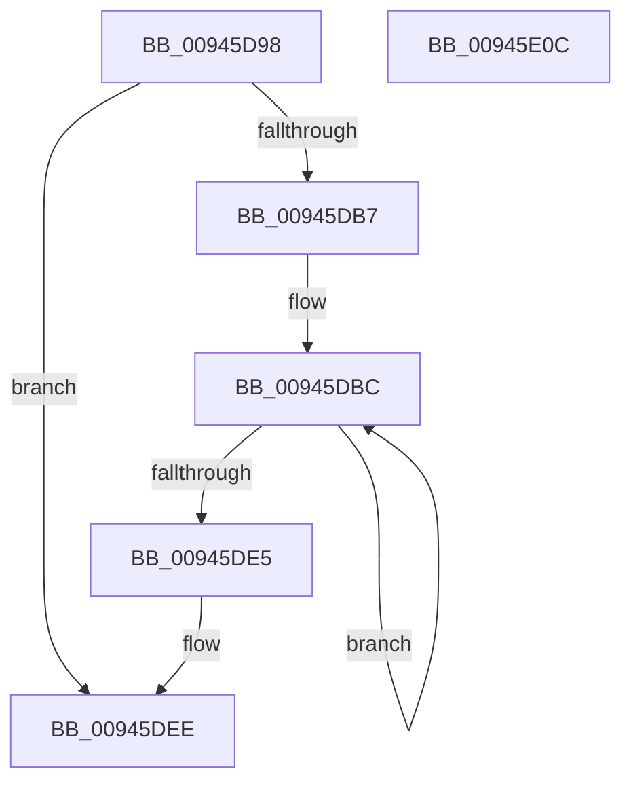

# CmpSubtreeEnumeratorCleanup

- RVA: `0x00945D98`–`0x00945E0D` (길이 `117` bytes)
- VA: `0x0000000140945D98`
- 실행 섹션: `PAGE`
- PDB 이름 있음: `예`; PDB Function 태그: `아니요`
- unwind 정보 RVA: `0x0005C954`
- 디코드: `31`개 명령, `117/117` bytes 표시
- 미해석 바이트: `0` (있으면 어셈블리에 `.byte`로 보존)

> 이 문서는 커널 이미지의 기계어와 PDB 기호를 분석해 생성했습니다. 4번과 5번은 함수 원형과 자료형을 바이너리 사용 방식에서 추정한 C 해석이며 원본 소스 복구 결과는 아닙니다.

## 1. Dependencies

- 직접 호출 지점: **4**; 고유 호출 대상: **4**
- 직접 호출자로 확인된 함수: **3**
- RIP 상대 이미지 참조: **0**

### Outgoing calls
- `0x00945DC7` → [CmpCleanupKcbStack](CmpCleanupKcbStack_function_009470A0.md) (function, `0x009470A0`)
- `0x00945DD3` → [CmpKeyEnumStackCleanup](CmpKeyEnumStackCleanup_function_00946868.md) (function, `0x00946868`)
- `0x00945DE9` → [CmSiFreeMemory](../../text/47/CmSiFreeMemory_function_00475D80.md) (function, `0x00475D80`)
- `0x00945DF2` → [CmpCleanupKeyNodeStack](CmpCleanupKeyNodeStack_function_00946A5C.md) (function, `0x00946A5C`)

### Direct callers
- [CmRenameKey](../7E/CmRenameKey_function_007E8F48.md) at `0x007E9B2E`
- [CmpPromoteSubtree](CmpPromoteSubtree_function_00944D60.md) at `0x00944E6F`
- [CmpDoAccessCheckOnLayeredSubtree](CmpDoAccessCheckOnLayeredSubtree_function_00945488.md) at `0x0094551A`

### Static image references
- 디코드된 RIP-relative 메모리 참조가 없습니다.

## 2. Other-region calls and transfers

- 다른 실행 섹션으로 향하는 call: **1**
  - `0x00945DE9` → [CmSiFreeMemory](../../text/47/CmSiFreeMemory_function_00475D80.md) (`PAGE` → `.text`)
- 별도 외부 분기/꼬리 이동을 확인하지 못했습니다.

## 3. Assembly (complete function range)

```asm
00945D98  48 89 5C 24 08                  mov qword ptr [rsp + 8], rbx
00945D9D  48 89 6C 24 10                  mov qword ptr [rsp + 0x10], rbp
00945DA2  48 89 74 24 18                  mov qword ptr [rsp + 0x18], rsi
00945DA7  57                              push rdi
00945DA8  48 83 EC 20                     sub rsp, 0x20
00945DAC  33 F6                           xor esi, esi
00945DAE  48 8B F9                        mov rdi, rcx
00945DB1  48 39 71 60                     cmp qword ptr [rcx + 0x60], rsi
00945DB5  74 37                           je 0x140945dee
00945DB7  BD 00 02 00 00                  mov ebp, 0x200
00945DBC  48 8B 5F 60                     mov rbx, qword ptr [rdi + 0x60]
00945DC0  48 8D 4B 18                     lea rcx, [rbx + 0x18]
00945DC4  48 03 CE                        add rcx, rsi
00945DC7  E8 D4 12 00 00                  call 0x1409470a0
00945DCC  48 8D 4B 38                     lea rcx, [rbx + 0x38]
00945DD0  48 03 CE                        add rcx, rsi
00945DD3  E8 90 0A 00 00                  call 0x140946868
00945DD8  48 81 C6 98 01 00 00            add rsi, 0x198
00945DDF  48 83 ED 01                     sub rbp, 1
00945DE3  75 D7                           jne 0x140945dbc
00945DE5  48 8B 4F 60                     mov rcx, qword ptr [rdi + 0x60]
00945DE9  E8 92 FF B2 FF                  call 0x140475d80
00945DEE  48 8D 4F 10                     lea rcx, [rdi + 0x10]
00945DF2  E8 65 0C 00 00                  call 0x140946a5c
00945DF7  48 8B 5C 24 30                  mov rbx, qword ptr [rsp + 0x30]
00945DFC  48 8B 6C 24 38                  mov rbp, qword ptr [rsp + 0x38]
00945E01  48 8B 74 24 40                  mov rsi, qword ptr [rsp + 0x40]
00945E06  48 83 C4 20                     add rsp, 0x20
00945E0A  5F                              pop rdi
00945E0B  C3                              ret
00945E0C  CC                              int3
```

## 4. C-style interpretation (structured pseudocode)

```c
__int64 __fastcall CmpSubtreeEnumeratorCleanup(__int64 a1)
{
    __int64 result;
    __int64 v_rbp;
    __int64 v_rsi;
    __int64 v_rsp;
    unsigned __int64 v_stack_p10;
    unsigned __int64 v_stack_p18;
    unsigned __int64 v_stack_p8;

    v_stack_p8 = v_rbx;
    v_stack_p10 = v_rbp;
    v_stack_p18 = v_rsi;
    v_rsp = (v_rsp) - (32);
    v_rsi = 0;
    if ((*(unsigned __int64 *)(a1 + 96)) == 0) goto loc_00945DEE;
loc_00945DBC:
    a1 = (*(unsigned __int64 *)(a1 + 96) + 24) + (0);
    result = CmpCleanupKcbStack(a1, a2, a3, a4);
    a1 = (*(unsigned __int64 *)(a1 + 96) + 56) + (0);
    result = CmpKeyEnumStackCleanup(a1, a2, a3, a4);
    v_rsi = (v_rsi) + (408);
    v_rbp = (512) - (1);
    if (condition_is_not_equal) goto loc_00945DBC;
    result = CmSiFreeMemory(*(unsigned __int64 *)(a1 + 96), a2, a3, a4);
loc_00945DEE:
    result = CmpCleanupKeyNodeStack(a1 + 16, a2, a3, a4);
    v_rsp = (v_rsp) + (32);
    return result;
}
```

## 5. (Beta) C Style

```c
int64_t CmpSubtreeEnumeratorCleanup(void *Arg1)
{
    uint8_t *arg1 = (uint8_t *)Arg1;

    int64_t result;
    int64_t local_rbp;
    int64_t local_rsi;
    int64_t local_rsp;
    uint64_t v_stack_p10;
    uint64_t v_stack_p18;
    uint64_t v_stack_p8;

    v_stack_p8 = local_rbx;
    v_stack_p10 = local_rbp;
    v_stack_p18 = local_rsi;
    local_rsp = (local_rsp) - (32);
    local_rsi = 0;
    if ((*(uint64_t *)(arg1 + 0x60)) == 0) goto loc_00945DEE;
loc_00945DBC:
    Arg1 = (*(uint64_t *)(arg1 + 0x60) + 24) + (0);
    result = CmpCleanupKcbStack(Arg1, a2, a3, a4);
    Arg1 = (*(uint64_t *)(arg1 + 0x60) + 56) + (0);
    result = CmpKeyEnumStackCleanup(Arg1, a2, a3, a4);
    local_rsi = (local_rsi) + (408);
    local_rbp = (512) - (1);
    if (condition_is_not_equal) goto loc_00945DBC;
    result = CmSiFreeMemory(*(uint64_t *)(arg1 + 0x60), a2, a3, a4);
loc_00945DEE:
    result = CmpCleanupKeyNodeStack(Arg1 + 16, a2, a3, a4);
    local_rsp = (local_rsp) + (32);
    return result;
}
```

### 관측된 메모리 오프셋

구조체 형식이 확인되지 않은 접근은 인자 기준의 오프셋으로만 기록했습니다.

| 기준 인자 | 오프셋 표현 | 폭 (bit) | 접근 |
|---|---:|---:|---|
| `Arg1` | `+ 0x10` | `64` | `R` |
| `Arg1` | `+ 0x60` | `64` | `R` |

## 6. Execution-region graph

[열기: 2D/3D 그래프와 함수 탐색 컨트롤 패널](../../../control-panel.html?section=page&rva=0x00945D98&view=graph)

- 2D 그래프는 위에서 아래로 흐르고, 3D 그래프는 빈 공간을 드래그해 회전합니다. Shift+드래그는 이동, 휠은 확대·축소, 함수 노드 선택은 대상 보고서 이동입니다.

### Static fallback


