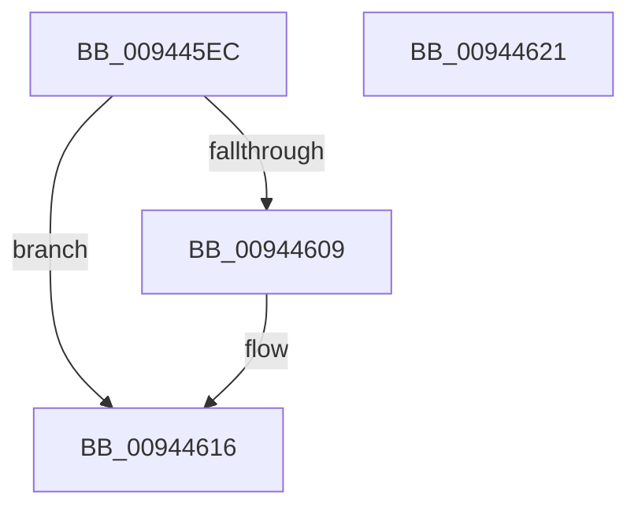

# CmpSubtreeEnumeratorStartForKcbStack

- RVA: `0x009445EC`–`0x00944622` (길이 `54` bytes)
- VA: `0x00000001409445EC`
- 실행 섹션: `PAGE`
- PDB 이름 있음: `예`; PDB Function 태그: `아니요`
- unwind 정보 RVA: `0x0005CAAC`
- 디코드: `18`개 명령, `54/54` bytes 표시
- 미해석 바이트: `0` (있으면 어셈블리에 `.byte`로 보존)

> 이 문서는 커널 이미지의 기계어와 PDB 기호를 분석해 생성했습니다. 4번과 5번은 함수 원형과 자료형을 바이너리 사용 방식에서 추정한 C 해석이며 원본 소스 복구 결과는 아닙니다.

## 1. Dependencies

- 직접 호출 지점: **2**; 고유 호출 대상: **2**
- 직접 호출자로 확인된 함수: **2**
- RIP 상대 이미지 참조: **0**

### Outgoing calls
- `0x00944600` → [CmpSubtreeEnumeratorStart](CmpSubtreeEnumeratorStart_function_009450E0.md) (function, `0x009450E0`)
- `0x0094460F` → [CmpSubtreeEnumeratorBeginForKcbStack](../7F/CmpSubtreeEnumeratorBeginForKcbStack_function_007F18DC.md) (function, `0x007F18DC`)

### Direct callers
- [CmRenameKey](../7E/CmRenameKey_function_007E8F48.md) at `0x007E9ABC`
- [CmpDoAccessCheckOnLayeredSubtree](CmpDoAccessCheckOnLayeredSubtree_function_00945488.md) at `0x00945575`

### Static image references
- 디코드된 RIP-relative 메모리 참조가 없습니다.

## 2. Other-region calls and transfers

- 다른 실행 섹션으로 향하는 call: **0**
- 별도 외부 분기/꼬리 이동을 확인하지 못했습니다.

## 3. Assembly (complete function range)

```asm
009445EC  48 89 5C 24 08                  mov qword ptr [rsp + 8], rbx
009445F1  57                              push rdi
009445F2  48 83 EC 20                     sub rsp, 0x20
009445F6  48 8B DA                        mov rbx, rdx
009445F9  48 8B F9                        mov rdi, rcx
009445FC  0F B7 52 02                     movzx edx, word ptr [rdx + 2]
00944600  E8 DB 0A 00 00                  call 0x1409450e0
00944605  85 C0                           test eax, eax
00944607  78 0D                           js 0x140944616
00944609  48 8B D3                        mov rdx, rbx
0094460C  48 8B CF                        mov rcx, rdi
0094460F  E8 C8 D2 EA FF                  call 0x1407f18dc
00944614  33 C0                           xor eax, eax
00944616  48 8B 5C 24 30                  mov rbx, qword ptr [rsp + 0x30]
0094461B  48 83 C4 20                     add rsp, 0x20
0094461F  5F                              pop rdi
00944620  C3                              ret
00944621  CC                              int3
```

## 4. C-style interpretation (structured pseudocode)

```c
__int64 __fastcall CmpSubtreeEnumeratorStartForKcbStack(__int64 a1, __int64 a2)
{
    __int64 result;
    __int64 v_rsp;
    unsigned __int64 v_stack_p8;

    v_stack_p8 = v_rbx;
    v_rsp = (v_rsp) - (32);
    result = CmpSubtreeEnumeratorStart(a1, *(unsigned __int16 *)(a2 + 2), a3, a4);
    if (!(sign_flag)) {
        a2 = a2;
        a1 = a1;
        result = CmpSubtreeEnumeratorBeginForKcbStack(a1, a2, a3, a4);
        result = 0;
    }
    v_rsp = (v_rsp) + (32);
    return result;
}
```

## 5. (Beta) C Style

```c
int64_t CmpSubtreeEnumeratorStartForKcbStack(int64_t Arg1, void *Arg2)
{
    uint8_t *arg2 = (uint8_t *)Arg2;

    int64_t result;
    int64_t local_rsp;
    uint64_t v_stack_p8;

    v_stack_p8 = local_rbx;
    local_rsp = (local_rsp) - (32);
    result = CmpSubtreeEnumeratorStart(Arg1, *(uint16_t *)(arg2 + 0x2), a3, a4);
    if (!(sign_flag)) {
        Arg2 = Arg2;
        Arg1 = Arg1;
        result = CmpSubtreeEnumeratorBeginForKcbStack(Arg1, Arg2, a3, a4);
        result = 0;
    }
    local_rsp = (local_rsp) + (32);
    return result;
}
```

### 관측된 메모리 오프셋

구조체 형식이 확인되지 않은 접근은 인자 기준의 오프셋으로만 기록했습니다.

| 기준 인자 | 오프셋 표현 | 폭 (bit) | 접근 |
|---|---:|---:|---|
| `Arg2` | `+ 0x2` | `16` | `R` |

## 6. Execution-region graph

[열기: 2D/3D 그래프와 함수 탐색 컨트롤 패널](../../../control-panel.html?section=page&rva=0x009445EC&view=graph)

- 2D 그래프는 위에서 아래로 흐르고, 3D 그래프는 빈 공간을 드래그해 회전합니다. Shift+드래그는 이동, 휠은 확대·축소, 함수 노드 선택은 대상 보고서 이동입니다.

### Static fallback


