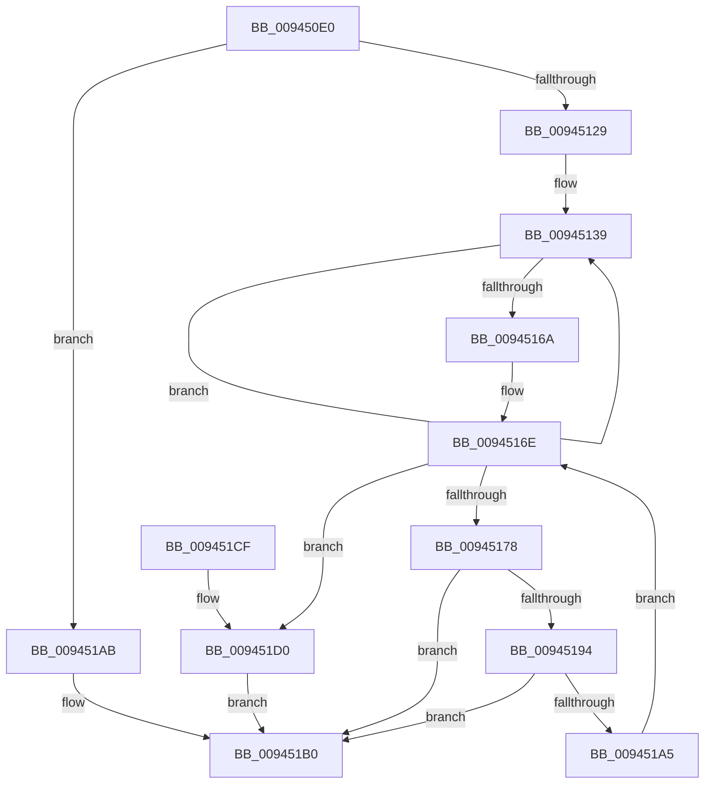

# CmpSubtreeEnumeratorStart

- RVA: `0x009450E0`–`0x009451DB` (길이 `251` bytes)
- VA: `0x00000001409450E0`
- 실행 섹션: `PAGE`
- PDB 이름 있음: `예`; PDB Function 태그: `아니요`
- unwind 정보 RVA: `0x0009080C`
- 디코드: `67`개 명령, `251/251` bytes 표시
- 미해석 바이트: `0` (있으면 어셈블리에 `.byte`로 보존)

> 이 문서는 커널 이미지의 기계어와 PDB 기호를 분석해 생성했습니다. 4번과 5번은 함수 원형과 자료형을 바이너리 사용 방식에서 추정한 C 해석이며 원본 소스 복구 결과는 아닙니다.

## 1. Dependencies

- 직접 호출 지점: **6**; 고유 호출 대상: **6**
- 직접 호출자로 확인된 함수: **3**
- RIP 상대 이미지 참조: **0**

### Outgoing calls
- `0x00945114` → [CmpAllocatePool](../../text/3C/CmpAllocatePool_function_003CD504.md) (function, `0x003CD504`)
- `0x0094514B` → [memset](../../text/6C/memset_function_006C6C40.md) (function, `0x006C6C40`)
- `0x00945159` → [CmpKeyEnumStackInitialize](CmpKeyEnumStackInitialize_function_00946D38.md) (function, `0x00946D38`)
- `0x0094518B` → [CmpStartKcbStack](CmpStartKcbStack_function_009451F0.md) (function, `0x009451F0`)
- `0x0094519C` → [CmpKeyEnumStackStart](CmpKeyEnumStackStart_function_009452A0.md) (function, `0x009452A0`)
- `0x009451D4` → [CmpStartKeyNodeStack](CmpStartKeyNodeStack_function_00945338.md) (function, `0x00945338`)

### Direct callers
- [CmpSubtreeEnumeratorStartForKcbStack](CmpSubtreeEnumeratorStartForKcbStack_function_009445EC.md) at `0x00944600`
- [CmpPromoteSubtree](CmpPromoteSubtree_function_00944D60.md) at `0x00944DC1`
- [CmpPromoteSubtree](CmpPromoteSubtree_function_00944D60.md) at `0x00944EE2`
- [CmpDoAccessCheckOnLayeredSubtree](CmpDoAccessCheckOnLayeredSubtree_function_00945488.md) at `0x00945506`

### Static image references
- 디코드된 RIP-relative 메모리 참조가 없습니다.

## 2. Other-region calls and transfers

- 다른 실행 섹션으로 향하는 call: **2**
  - `0x00945114` → [CmpAllocatePool](../../text/3C/CmpAllocatePool_function_003CD504.md) (`PAGE` → `.text`)
  - `0x0094514B` → [memset](../../text/6C/memset_function_006C6C40.md) (`PAGE` → `.text`)
- 별도 외부 분기/꼬리 이동을 확인하지 못했습니다.

## 3. Assembly (complete function range)

```asm
009450E0  48 8B C4                        mov rax, rsp
009450E3  48 89 58 08                     mov qword ptr [rax + 8], rbx
009450E7  48 89 68 10                     mov qword ptr [rax + 0x10], rbp
009450EB  48 89 70 18                     mov qword ptr [rax + 0x18], rsi
009450EF  48 89 78 20                     mov qword ptr [rax + 0x20], rdi
009450F3  41 54                           push r12
009450F5  41 56                           push r14
009450F7  41 57                           push r15
009450F9  48 83 EC 20                     sub rsp, 0x20
009450FD  66 89 51 02                     mov word ptr [rcx + 2], dx
00945101  48 8B F9                        mov rdi, rcx
00945104  BA 00 30 03 00                  mov edx, 0x33000
00945109  B9 00 01 00 00                  mov ecx, 0x100
0094510E  41 B8 43 4D 39 31               mov r8d, 0x31394d43
00945114  E8 EB 83 A8 FF                  call 0x1403cd504
00945119  45 33 F6                        xor r14d, r14d
0094511C  48 89 47 60                     mov qword ptr [rdi + 0x60], rax
00945120  48 85 C0                        test rax, rax
00945123  0F 84 82 00 00 00               je 0x1409451ab
00945129  41 BF 00 02 00 00               mov r15d, 0x200
0094512F  45 8D 66 01                     lea r12d, [r14 + 1]
00945133  41 8B EF                        mov ebp, r15d
00945136  41 8B F6                        mov esi, r14d
00945139  48 8B 5F 60                     mov rbx, qword ptr [rdi + 0x60]
0094513D  33 D2                           xor edx, edx
0094513F  48 03 DE                        add rbx, rsi
00945142  41 B8 98 01 00 00               mov r8d, 0x198
00945148  48 8B CB                        mov rcx, rbx
0094514B  E8 F0 1A D8 FF                  call 0x1406c6c40
00945150  66 83 4B 1A FF                  or word ptr [rbx + 0x1a], 0xffff
00945155  48 8D 4B 38                     lea rcx, [rbx + 0x38]
00945159  E8 DA 1B 00 00                  call 0x140946d38
0094515E  48 81 C6 98 01 00 00            add rsi, 0x198
00945165  49 2B EC                        sub rbp, r12
00945168  75 CF                           jne 0x140945139
0094516A  41 0F B7 DE                     movzx ebx, r14w
0094516E  0F B7 57 02                     movzx edx, word ptr [rdi + 2]
00945172  66 41 3B DF                     cmp bx, r15w
00945176  7D 58                           jge 0x1409451d0
00945178  48 0F BF C3                     movsx rax, bx
0094517C  48 69 F0 98 01 00 00            imul rsi, rax, 0x198
00945183  48 03 77 60                     add rsi, qword ptr [rdi + 0x60]
00945187  48 8D 4E 18                     lea rcx, [rsi + 0x18]
0094518B  E8 60 00 00 00                  call 0x1409451f0
00945190  85 C0                           test eax, eax
00945192  78 1C                           js 0x1409451b0
00945194  0F B7 57 02                     movzx edx, word ptr [rdi + 2]
00945198  48 8D 4E 38                     lea rcx, [rsi + 0x38]
0094519C  E8 FF 00 00 00                  call 0x1409452a0
009451A1  85 C0                           test eax, eax
009451A3  78 0B                           js 0x1409451b0
009451A5  66 41 03 DC                     add bx, r12w
009451A9  EB C3                           jmp 0x14094516e
009451AB  B8 9A 00 00 C0                  mov eax, 0xc000009a
009451B0  48 8B 5C 24 40                  mov rbx, qword ptr [rsp + 0x40]
009451B5  48 8B 6C 24 48                  mov rbp, qword ptr [rsp + 0x48]
009451BA  48 8B 74 24 50                  mov rsi, qword ptr [rsp + 0x50]
009451BF  48 8B 7C 24 58                  mov rdi, qword ptr [rsp + 0x58]
009451C4  48 83 C4 20                     add rsp, 0x20
009451C8  41 5F                           pop r15
009451CA  41 5E                           pop r14
009451CC  41 5C                           pop r12
009451CE  C3                              ret
009451CF  CC                              int3
009451D0  48 8D 4F 10                     lea rcx, [rdi + 0x10]
009451D4  E8 5F 01 00 00                  call 0x140945338
009451D9  EB D5                           jmp 0x1409451b0
```

## 4. C-style interpretation (structured pseudocode)

```c
__int64 __fastcall CmpSubtreeEnumeratorStart(__int64 a1, unsigned __int16 a2)
{
    __int64 result;
    __int64 v_r14;
    __int64 v_rbp;
    __int64 v_rbx;
    __int64 v_rsi;
    __int64 v_rsp;
    unsigned __int64 v_stack_p10;
    unsigned __int64 v_stack_p18;
    unsigned __int64 v_stack_p20;
    unsigned __int64 v_stack_p8;

    *(unsigned __int64 *)(v_rsp + 8) = v_rbx;
    *(unsigned __int64 *)(v_rsp + 16) = v_rbp;
    *(unsigned __int64 *)(v_rsp + 24) = v_rsi;
    *(unsigned __int64 *)(v_rsp + 32) = v_rdi;
    v_rsp = (v_rsp) - (32);
    *(unsigned __int16 *)(a1 + 2) = a2;
    result = CmpAllocatePool(256, (unsigned int)(0x33000ULL), (unsigned int)(0x31394D43ULL), a4);
    v_r14 = 0;
    *(unsigned __int64 *)(a1 + 96) = result;
    if (result == 0) goto loc_009451AB;
loc_00945139:
    a2 = 0;
    v_rbx = (*(unsigned __int64 *)(a1 + 96)) + (0);
    result = memset(v_rbx, a2, 408, a4);
    result = CmpKeyEnumStackInitialize(v_rbx + 56, a2, 408, a4);
    v_rsi = (0) + (408);
    v_rbp = (512) - (v_r14 + 1);
    if (condition_is_not_equal) goto loc_00945139;
loc_0094516E:
    if (0 >= 512) goto loc_009451D0;
    v_rsi = (v_rsi) * ((__int16)(0));
    v_rsi = (v_rsi) + (*(unsigned __int64 *)(a1 + 96));
    result = CmpStartKcbStack(v_rsi + 24, *(unsigned __int16 *)(a1 + 2), 408, a4);
    if (sign_flag) goto loc_009451B0;
    result = CmpKeyEnumStackStart(v_rsi + 56, *(unsigned __int16 *)(a1 + 2), 408, a4);
    if (sign_flag) goto loc_009451B0;
    v_rbx = (unsigned __int16)((0) + ((unsigned __int16)(v_r14 + 1)));
    goto loc_0094516E;
loc_009451AB:
loc_009451B0:
    v_rsp = (v_rsp) + (32);
    return (unsigned int)(0xC000009AULL);
loc_009451D0:
    result = CmpStartKeyNodeStack(v_stack_p20 + 16, *(unsigned __int16 *)(a1 + 2), 408, a4);
    goto loc_009451B0;
}
```

## 5. (Beta) C Style

```c
int64_t CmpSubtreeEnumeratorStart(void *Arg1, uint16_t Arg2)
{
    uint8_t *arg1 = (uint8_t *)Arg1;

    int64_t result;
    int64_t local_r14;
    int64_t local_rbp;
    int64_t local_rbx;
    int64_t local_rsi;
    int64_t local_rsp;
    uint64_t v_stack_p10;
    uint64_t v_stack_p18;
    uint64_t v_stack_p20;
    uint64_t v_stack_p8;

    *(uint64_t *)(local_rsp + 0x8) = local_rbx;
    *(uint64_t *)(local_rsp + 0x10) = local_rbp;
    *(uint64_t *)(local_rsp + 0x18) = local_rsi;
    *(uint64_t *)(local_rsp + 0x20) = local_rdi;
    local_rsp = (local_rsp) - (32);
    *(uint16_t *)(arg1 + 0x2) = Arg2;
    result = CmpAllocatePool(256, (uint32_t)(0x33000ULL), (uint32_t)(0x31394D43ULL), a4);
    local_r14 = 0;
    *(uint64_t *)(arg1 + 0x60) = result;
    if (result == 0) goto loc_009451AB;
loc_00945139:
    Arg2 = 0;
    local_rbx = (*(uint64_t *)(arg1 + 0x60)) + (0);
    result = memset(local_rbx, Arg2, 408, a4);
    result = CmpKeyEnumStackInitialize(local_rbx + 56, Arg2, 408, a4);
    local_rsi = (0) + (408);
    local_rbp = (512) - (local_r14 + 1);
    if (condition_is_not_equal) goto loc_00945139;
loc_0094516E:
    if (0 >= 512) goto loc_009451D0;
    local_rsi = (local_rsi) * ((int16_t)(0));
    local_rsi = (local_rsi) + (*(uint64_t *)(arg1 + 0x60));
    result = CmpStartKcbStack(local_rsi + 24, *(uint16_t *)(arg1 + 0x2), 408, a4);
    if (sign_flag) goto loc_009451B0;
    result = CmpKeyEnumStackStart(local_rsi + 56, *(uint16_t *)(arg1 + 0x2), 408, a4);
    if (sign_flag) goto loc_009451B0;
    local_rbx = (uint16_t)((0) + ((uint16_t)(local_r14 + 1)));
    goto loc_0094516E;
loc_009451AB:
loc_009451B0:
    local_rsp = (local_rsp) + (32);
    return (uint32_t)(0xC000009AULL);
loc_009451D0:
    result = CmpStartKeyNodeStack(v_stack_p20 + 16, *(uint16_t *)(arg1 + 0x2), 408, a4);
    goto loc_009451B0;
}
```

### 관측된 메모리 오프셋

구조체 형식이 확인되지 않은 접근은 인자 기준의 오프셋으로만 기록했습니다.

| 기준 인자 | 오프셋 표현 | 폭 (bit) | 접근 |
|---|---:|---:|---|
| `Arg1` | `+ 0x2` | `16` | `R` |
| `Arg1` | `+ 0x2` | `16` | `W` |
| `Arg1` | `+ 0x10` | `64` | `R` |
| `Arg1` | `+ 0x60` | `64` | `R` |
| `Arg1` | `+ 0x60` | `64` | `W` |

## 6. Execution-region graph

[열기: 2D/3D 그래프와 함수 탐색 컨트롤 패널](../../../control-panel.html?section=page&rva=0x009450E0&view=graph)

- 2D 그래프는 위에서 아래로 흐르고, 3D 그래프는 빈 공간을 드래그해 회전합니다. Shift+드래그는 이동, 휠은 확대·축소, 함수 노드 선택은 대상 보고서 이동입니다.

### Static fallback


