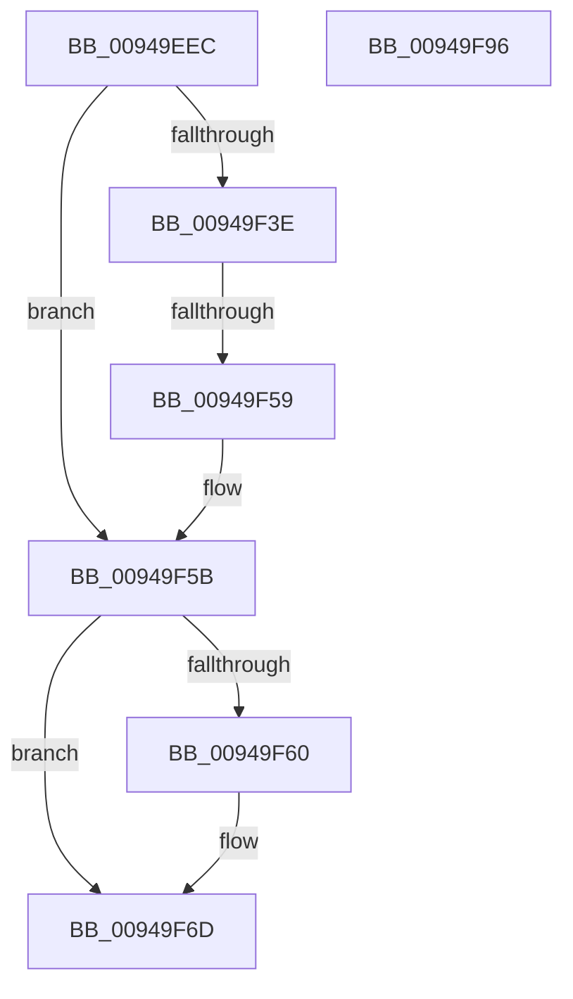

# CmpTraceSecurityChanging

- RVA: `0x00949EEC`–`0x00949F97` (길이 `171` bytes)
- VA: `0x0000000140949EEC`
- 실행 섹션: `PAGE`
- PDB 이름 있음: `예`; PDB Function 태그: `예`
- unwind 정보 RVA: `0x00090DB8`
- 디코드: `51`개 명령, `171/171` bytes 표시
- 미해석 바이트: `0` (있으면 어셈블리에 `.byte`로 보존)

> 이 문서는 커널 이미지의 기계어와 PDB 기호를 분석해 생성했습니다. 4번과 5번은 함수 원형과 자료형을 바이너리 사용 방식에서 추정한 C 해석이며 원본 소스 복구 결과는 아닙니다.

## 1. Dependencies

- 직접 호출 지점: **4**; 고유 호출 대상: **4**
- 직접 호출자로 확인된 함수: **1**
- RIP 상대 이미지 참조: **2**

### Outgoing calls
- `0x00949F2E` → [CmpConstructNameWithStatus](../85/CmpConstructNameWithStatus_function_008562A0.md) (function, `0x008562A0`)
- `0x00949F4B` → [RtlFindUnicodeSubstring](RtlFindUnicodeSubstring_function_00949FA0.md) (function, `0x00949FA0`)
- `0x00949F68` → [CmpFreePoolWithTag](../../text/44/CmpFreePoolWithTag_function_004489E0.md) (function, `0x004489E0`)
- `0x00949F76` → [_security_check_cookie](../../text/6A/_security_check_cookie_function_006AC640.md) (function, `0x006AC640`)

### Direct callers
- [CmpSetSecurityDescriptorInfo](CmpSetSecurityDescriptorInfo_function_00949688.md) at `0x00949810`

### Static image references
- `0x00949F08` → RVA `0x00E0A740` (`.data`; read)
- `0x00949F41` → RVA `0x00FDA378` (`PAGEDATA`; read)

## 2. Other-region calls and transfers

- 다른 실행 섹션으로 향하는 call: **2**
  - `0x00949F68` → [CmpFreePoolWithTag](../../text/44/CmpFreePoolWithTag_function_004489E0.md) (`PAGE` → `.text`)
  - `0x00949F76` → [_security_check_cookie](../../text/6A/_security_check_cookie_function_006AC640.md) (`PAGE` → `.text`)
- call이 아닌 외부 분기/꼬리 이동: **1**
  - `0x00949F53` → [sub_00B25D1A](../B2/Unknown_function_00B25D1A.md) (`tail-transfer`)

## 3. Assembly (complete function range)

```asm
00949EEC  48 89 5C 24 18                  mov qword ptr [rsp + 0x18], rbx
00949EF1  55                              push rbp
00949EF2  56                              push rsi
00949EF3  57                              push rdi
00949EF4  41 54                           push r12
00949EF6  41 55                           push r13
00949EF8  41 56                           push r14
00949EFA  41 57                           push r15
00949EFC  48 8D 6C 24 E1                  lea rbp, [rsp - 0x1f]
00949F01  48 81 EC 00 01 00 00            sub rsp, 0x100
00949F08  48 8B 05 31 08 4C 00            mov rax, qword ptr [rip + 0x4c0831]
00949F0F  48 33 C4                        xor rax, rsp
00949F12  48 89 45 0F                     mov qword ptr [rbp + 0xf], rax
00949F16  4C 8B 65 7F                     mov r12, qword ptr [rbp + 0x7f]
00949F1A  4C 8B F2                        mov r14, rdx
00949F1D  48 83 64 24 30 00               and qword ptr [rsp + 0x30], 0
00949F23  48 8D 54 24 30                  lea rdx, [rsp + 0x30]
00949F28  4D 8B F9                        mov r15, r9
00949F2B  45 8B E8                        mov r13d, r8d
00949F2E  E8 6D C3 F0 FF                  call 0x1408562a0
00949F33  48 8B 7C 24 30                  mov rdi, qword ptr [rsp + 0x30]
00949F38  8B D8                           mov ebx, eax
00949F3A  85 C0                           test eax, eax
00949F3C  78 1D                           js 0x140949f5b
00949F3E  41 B0 01                        mov r8b, 1
00949F41  48 8D 15 30 04 69 00            lea rdx, [rip + 0x690430]
00949F48  48 8B CF                        mov rcx, rdi
00949F4B  E8 50 00 00 00                  call 0x140949fa0
00949F50  48 85 C0                        test rax, rax
00949F53  0F 85 C1 BD 1D 00               jne 0x140b25d1a
00949F59  33 DB                           xor ebx, ebx
00949F5B  48 85 FF                        test rdi, rdi
00949F5E  74 0D                           je 0x140949f6d
00949F60  BA 43 4D 4E 62                  mov edx, 0x624e4d43
00949F65  48 8B CF                        mov rcx, rdi
00949F68  E8 73 EA AF FF                  call 0x1404489e0
00949F6D  8B C3                           mov eax, ebx
00949F6F  48 8B 4D 0F                     mov rcx, qword ptr [rbp + 0xf]
00949F73  48 33 CC                        xor rcx, rsp
00949F76  E8 C5 26 D6 FF                  call 0x1406ac640
00949F7B  48 8B 9C 24 50 01 00 00         mov rbx, qword ptr [rsp + 0x150]
00949F83  48 81 C4 00 01 00 00            add rsp, 0x100
00949F8A  41 5F                           pop r15
00949F8C  41 5E                           pop r14
00949F8E  41 5D                           pop r13
00949F90  41 5C                           pop r12
00949F92  5F                              pop rdi
00949F93  5E                              pop rsi
00949F94  5D                              pop rbp
00949F95  C3                              ret
00949F96  CC                              int3
```

## 4. C-style interpretation (structured pseudocode)

```c
__int64 __fastcall CmpTraceSecurityChanging(__int64 a1, __int64 a2, int a3, __int64 a4, __int64 a5)
{
    __int64 result;
    __int64 v_rbx;
    __int64 v_rsp;
    unsigned __int64 v_stack_m108;
    unsigned __int64 v_stack_m48;
    unsigned __int64 v_stack_m57;
    unsigned __int64 v_stack_p18;

    v_stack_p18 = v_rbx;
    v_rsp = (v_rsp) - (256);
    result = (*(unsigned __int64 *)(v_rip + 4982833)) ^ (v_rsp);
    v_stack_m48 = result;
    result = CmpConstructNameWithStatus(a1, v_stack_m108, a3, a4);
    if (sign_flag) goto loc_00949F5B;
    result = RtlFindUnicodeSubstring(v_stack_m108, v_rip + 6882352, 1, a4);
    v_rbx = 0;
loc_00949F5B:
    if (v_stack_m108 != 0) {
        a2 = 0x624E4D43ULL;
        a1 = v_stack_m108;
        result = CmpFreePoolWithTag(a1, a2, 1, a4);
    }
    a1 = (v_stack_m48) ^ (v_rsp);
    result = _security_check_cookie(a1, a2, 1, a4);
    v_rsp = (v_rsp) + (256);
    return result;
}
```

## 5. (Beta) C Style

```c
int64_t CmpTraceSecurityChanging(int64_t Arg1, int64_t Arg2, int32_t Arg3, int64_t Arg4, int64_t Arg5)
{
    int64_t result;
    int64_t local_rbx;
    int64_t local_rsp;
    uint64_t v_stack_m108;
    uint64_t v_stack_m48;
    uint64_t v_stack_m57;
    uint64_t v_stack_p18;

    v_stack_p18 = local_rbx;
    local_rsp = (local_rsp) - (256);
    result = (*(uint64_t *)(v_rip + 0x4C0831)) ^ (local_rsp);
    v_stack_m48 = result;
    result = CmpConstructNameWithStatus(Arg1, v_stack_m108, Arg3, Arg4);
    if (sign_flag) goto loc_00949F5B;
    result = RtlFindUnicodeSubstring(v_stack_m108, v_rip + 6882352, 1, Arg4);
    local_rbx = 0;
loc_00949F5B:
    if (v_stack_m108 != 0) {
        Arg2 = 0x624E4D43ULL;
        Arg1 = v_stack_m108;
        result = CmpFreePoolWithTag(Arg1, Arg2, 1, Arg4);
    }
    Arg1 = (v_stack_m48) ^ (local_rsp);
    result = _security_check_cookie(Arg1, Arg2, 1, Arg4);
    local_rsp = (local_rsp) + (256);
    return result;
}
```

## 6. Execution-region graph

[열기: 2D/3D 그래프와 함수 탐색 컨트롤 패널](../../../control-panel.html?section=page&rva=0x00949EEC&view=graph)

- 2D 그래프는 위에서 아래로 흐르고, 3D 그래프는 빈 공간을 드래그해 회전합니다. Shift+드래그는 이동, 휠은 확대·축소, 함수 노드 선택은 대상 보고서 이동입니다.

### Static fallback


