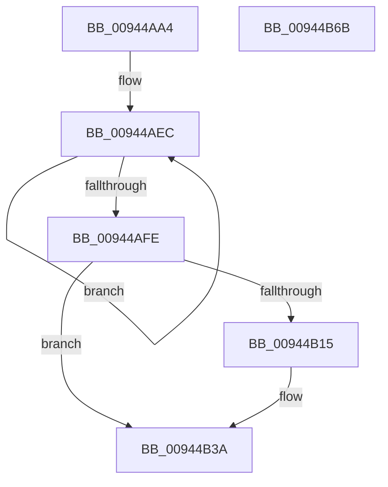

# CmpValueEnumStackStartFromKcbStack

- RVA: `0x00944AA4`–`0x00944B6C` (길이 `200` bytes)
- VA: `0x0000000140944AA4`
- 실행 섹션: `PAGE`
- PDB 이름 있음: `예`; PDB Function 태그: `아니요`
- unwind 정보 RVA: `0x00090764`
- 디코드: `55`개 명령, `200/200` bytes 표시
- 미해석 바이트: `0` (있으면 어셈블리에 `.byte`로 보존)

> 이 문서는 커널 이미지의 기계어와 PDB 기호를 분석해 생성했습니다. 4번과 5번은 함수 원형과 자료형을 바이너리 사용 방식에서 추정한 C 해석이며 원본 소스 복구 결과는 아닙니다.

## 1. Dependencies

- 직접 호출 지점: **7**; 고유 호출 대상: **7**
- 직접 호출자로 확인된 함수: **1**
- RIP 상대 이미지 참조: **1**

### Outgoing calls
- `0x00944ADC` → [memset](../../text/6C/memset_function_006C6C40.md) (function, `0x006C6C40`)
- `0x00944AEF` → [CmpKeyNodeStackEntryInitialize](CmpKeyNodeStackEntryInitialize_function_00946840.md) (function, `0x00946840`)
- `0x00944B07` → [CmpStartKeyNodeStack](CmpStartKeyNodeStack_function_00945338.md) (function, `0x00945338`)
- `0x00944B20` → [CmpPopulateKeyNodeStackFromKcbStack](CmpPopulateKeyNodeStackFromKcbStack_function_009453CC.md) (function, `0x009453CC`)
- `0x00944B2D` → [CmpValueEnumStackStartFromKeyNodeStack](../../text/46/CmpValueEnumStackStartFromKeyNodeStack_function_0046B2E0.md) (function, `0x0046B2E0`)
- `0x00944B3F` → [CmpCleanupKeyNodeStack](CmpCleanupKeyNodeStack_function_00946A5C.md) (function, `0x00946A5C`)
- `0x00944B4E` → [_security_check_cookie](../../text/6A/_security_check_cookie_function_006AC640.md) (function, `0x006AC640`)

### Direct callers
- [CmEnumerateValueFromLayeredKey](../8B/CmEnumerateValueFromLayeredKey_function_008B31FC.md) at `0x008B34DC`

### Static image references
- `0x00944AB9` → RVA `0x00E0A740` (`.data`; read)

## 2. Other-region calls and transfers

- 다른 실행 섹션으로 향하는 call: **3**
  - `0x00944ADC` → [memset](../../text/6C/memset_function_006C6C40.md) (`PAGE` → `.text`)
  - `0x00944B2D` → [CmpValueEnumStackStartFromKeyNodeStack](../../text/46/CmpValueEnumStackStartFromKeyNodeStack_function_0046B2E0.md) (`PAGE` → `.text`)
  - `0x00944B4E` → [_security_check_cookie](../../text/6A/_security_check_cookie_function_006AC640.md) (`PAGE` → `.text`)
- 별도 외부 분기/꼬리 이동을 확인하지 못했습니다.

## 3. Assembly (complete function range)

```asm
00944AA4  48 89 5C 24 18                  mov qword ptr [rsp + 0x18], rbx
00944AA9  48 89 6C 24 20                  mov qword ptr [rsp + 0x20], rbp
00944AAE  56                              push rsi
00944AAF  57                              push rdi
00944AB0  41 56                           push r14
00944AB2  48 81 EC 80 00 00 00            sub rsp, 0x80
00944AB9  48 8B 05 80 5C 4C 00            mov rax, qword ptr [rip + 0x4c5c80]
00944AC0  48 33 C4                        xor rax, rsp
00944AC3  48 89 44 24 70                  mov qword ptr [rsp + 0x70], rax
00944AC8  48 8B FA                        mov rdi, rdx
00944ACB  49 8B F0                        mov rsi, r8
00944ACE  33 D2                           xor edx, edx
00944AD0  48 8B E9                        mov rbp, rcx
00944AD3  48 8D 4C 24 20                  lea rcx, [rsp + 0x20]
00944AD8  44 8D 42 50                     lea r8d, [rdx + 0x50]
00944ADC  E8 5F 21 D8 FF                  call 0x1406c6c40
00944AE1  4C 8D 4C 24 28                  lea r9, [rsp + 0x28]
00944AE6  41 BA 02 00 00 00               mov r10d, 2
00944AEC  49 8B C9                        mov rcx, r9
00944AEF  E8 4C 1D 00 00                  call 0x140946840
00944AF4  49 83 C1 20                     add r9, 0x20
00944AF8  49 83 EA 01                     sub r10, 1
00944AFC  75 EE                           jne 0x140944aec
00944AFE  0F B7 57 02                     movzx edx, word ptr [rdi + 2]
00944B02  48 8D 4C 24 20                  lea rcx, [rsp + 0x20]
00944B07  E8 2C 08 00 00                  call 0x140945338
00944B0C  45 33 F6                        xor r14d, r14d
00944B0F  8B D8                           mov ebx, eax
00944B11  85 C0                           test eax, eax
00944B13  78 25                           js 0x140944b3a
00944B15  4C 8B C6                        mov r8, rsi
00944B18  48 8D 4C 24 20                  lea rcx, [rsp + 0x20]
00944B1D  48 8B D7                        mov rdx, rdi
00944B20  E8 A7 08 00 00                  call 0x1409453cc
00944B25  48 8D 54 24 20                  lea rdx, [rsp + 0x20]
00944B2A  48 8B CD                        mov rcx, rbp
00944B2D  E8 AE 67 B2 FF                  call 0x14046b2e0
00944B32  85 C0                           test eax, eax
00944B34  8B D8                           mov ebx, eax
00944B36  41 0F 49 DE                     cmovns ebx, r14d
00944B3A  48 8D 4C 24 20                  lea rcx, [rsp + 0x20]
00944B3F  E8 18 1F 00 00                  call 0x140946a5c
00944B44  8B C3                           mov eax, ebx
00944B46  48 8B 4C 24 70                  mov rcx, qword ptr [rsp + 0x70]
00944B4B  48 33 CC                        xor rcx, rsp
00944B4E  E8 ED 7A D6 FF                  call 0x1406ac640
00944B53  4C 8D 9C 24 80 00 00 00         lea r11, [rsp + 0x80]
00944B5B  49 8B 5B 30                     mov rbx, qword ptr [r11 + 0x30]
00944B5F  49 8B 6B 38                     mov rbp, qword ptr [r11 + 0x38]
00944B63  49 8B E3                        mov rsp, r11
00944B66  41 5E                           pop r14
00944B68  5F                              pop rdi
00944B69  5E                              pop rsi
00944B6A  C3                              ret
00944B6B  CC                              int3
```

## 4. C-style interpretation (structured pseudocode)

```c
__int64 __fastcall CmpValueEnumStackStartFromKcbStack(__int64 a1, __int64 a2, __int64 a3)
{
    __int64 result;
    __int64 v_r10;
    __int64 v_r14;
    __int64 v_rbx;
    __int64 v_rsp;
    unsigned __int64 v_stack_m18;
    unsigned __int64 v_stack_m28;
    unsigned __int64 v_stack_m70;
    unsigned __int64 v_stack_m78;
    unsigned __int64 v_stack_p18;
    unsigned __int64 v_stack_p20;

    v_stack_p18 = v_rbx;
    v_stack_p20 = v_rbp;
    v_rsp = (v_rsp) - (128);
    result = (*(unsigned __int64 *)(v_rip + 5004416)) ^ (v_rsp);
    v_stack_m28 = result;
    a2 = 0;
    result = memset(v_stack_m78, a2, a2 + 80, a4);
loc_00944AEC:
    result = CmpKeyNodeStackEntryInitialize(v_stack_m70, a2, a2 + 80, v_stack_m70);
    a4 = (v_stack_m70) + (32);
    v_r10 = (2) - (1);
    if (condition_is_not_equal) goto loc_00944AEC;
    result = CmpStartKeyNodeStack(v_stack_m78, *(unsigned __int16 *)(a2 + 2), a2 + 80, a4);
    v_r14 = 0;
    v_rbx = (unsigned int)((unsigned int)(result));
    if (!(sign_flag)) {
        a3 = a3;
        a1 = v_stack_m78;
        a2 = 0;
        result = CmpPopulateKeyNodeStackFromKcbStack(a1, a2, a3, a4);
        a2 = v_stack_m78;
        a1 = a1;
        result = CmpValueEnumStackStartFromKeyNodeStack(a1, a2, a3, a4);
        v_rbx = (unsigned int)(result);
        if (!sign_flag) { v_rbx = 0; }
    }
    result = CmpCleanupKeyNodeStack(v_stack_m78, a2, a3, a4);
    a1 = (v_stack_m28) ^ (v_rsp);
    result = _security_check_cookie(a1, a2, a3, a4);
    return result;
}
```

## 5. (Beta) C Style

```c
int64_t CmpValueEnumStackStartFromKcbStack(int64_t Arg1, void *Arg2, int64_t Arg3)
{
    uint8_t *arg2 = (uint8_t *)Arg2;

    int64_t result;
    int64_t local_r10;
    int64_t local_r14;
    int64_t local_rbx;
    int64_t local_rsp;
    uint64_t v_stack_m18;
    uint64_t v_stack_m28;
    uint64_t v_stack_m70;
    uint64_t v_stack_m78;
    uint64_t v_stack_p18;
    uint64_t v_stack_p20;

    v_stack_p18 = local_rbx;
    v_stack_p20 = local_rbp;
    local_rsp = (local_rsp) - (128);
    result = (*(uint64_t *)(v_rip + 0x4C5C80)) ^ (local_rsp);
    v_stack_m28 = result;
    Arg2 = 0;
    result = memset(v_stack_m78, Arg2, Arg2 + 80, a4);
loc_00944AEC:
    result = CmpKeyNodeStackEntryInitialize(v_stack_m70, Arg2, Arg2 + 80, v_stack_m70);
    a4 = (v_stack_m70) + (32);
    local_r10 = (2) - (1);
    if (condition_is_not_equal) goto loc_00944AEC;
    result = CmpStartKeyNodeStack(v_stack_m78, *(uint16_t *)(arg2 + 0x2), Arg2 + 80, a4);
    local_r14 = 0;
    local_rbx = (uint32_t)((uint32_t)(result));
    if (!(sign_flag)) {
        Arg3 = Arg3;
        Arg1 = v_stack_m78;
        Arg2 = 0;
        result = CmpPopulateKeyNodeStackFromKcbStack(Arg1, Arg2, Arg3, a4);
        Arg2 = v_stack_m78;
        Arg1 = Arg1;
        result = CmpValueEnumStackStartFromKeyNodeStack(Arg1, Arg2, Arg3, a4);
        local_rbx = (uint32_t)(result);
        if (!sign_flag) { local_rbx = 0; }
    }
    result = CmpCleanupKeyNodeStack(v_stack_m78, Arg2, Arg3, a4);
    Arg1 = (v_stack_m28) ^ (local_rsp);
    result = _security_check_cookie(Arg1, Arg2, Arg3, a4);
    return result;
}
```

### 관측된 메모리 오프셋

구조체 형식이 확인되지 않은 접근은 인자 기준의 오프셋으로만 기록했습니다.

| 기준 인자 | 오프셋 표현 | 폭 (bit) | 접근 |
|---|---:|---:|---|
| `Arg2` | `+ 0x2` | `16` | `R` |

## 6. Execution-region graph

[열기: 2D/3D 그래프와 함수 탐색 컨트롤 패널](../../../control-panel.html?section=page&rva=0x00944AA4&view=graph)

- 2D 그래프는 위에서 아래로 흐르고, 3D 그래프는 빈 공간을 드래그해 회전합니다. Shift+드래그는 이동, 휠은 확대·축소, 함수 노드 선택은 대상 보고서 이동입니다.

### Static fallback


