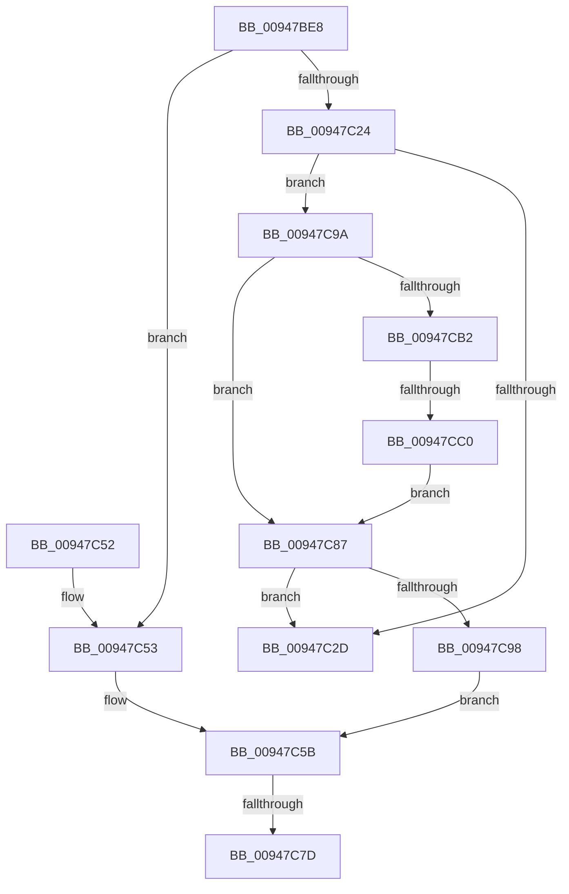

# DbgkCopyProcessDebugPort

- RVA: `0x00947BE8`–`0x00947CCA` (길이 `226` bytes)
- VA: `0x0000000140947BE8`
- 실행 섹션: `PAGE`
- PDB 이름 있음: `예`; PDB Function 태그: `예`
- unwind 정보 RVA: `0x00090B84`
- 디코드: `61`개 명령, `226/226` bytes 표시
- 미해석 바이트: `0` (있으면 어셈블리에 `.byte`로 보존)

> 이 문서는 커널 이미지의 기계어와 PDB 기호를 분석해 생성했습니다. 4번과 5번은 함수 원형과 자료형을 바이너리 사용 방식에서 추정한 C 해석이며 원본 소스 복구 결과는 아닙니다.

## 1. Dependencies

- 직접 호출 지점: **6**; 고유 호출 대상: **5**
- 직접 호출자로 확인된 함수: **1**
- RIP 상대 이미지 참조: **2**

### Outgoing calls
- `0x00947C3D` → [_security_check_cookie](../../text/6A/_security_check_cookie_function_006AC640.md) (function, `0x006AC640`)
- `0x00947C56` → [ObfReferenceObject](../../text/20/ObfReferenceObject_function_0020FA20.md) (function, `0x0020FA20`)
- `0x00947C70` → [PsTestProtectedProcessIncompatibility](../A1/PsTestProtectedProcessIncompatibility_function_00A1003C.md) (function, `0x00A1003C`)
- `0x00947C8E` → [ExReleaseFastMutex](../../text/25/ExReleaseFastMutex_function_002519C0.md) (function, `0x002519C0`)
- `0x00947CA1` → [ExAcquireFastMutex](../../text/20/ExAcquireFastMutex_function_0020E5A0.md) (function, `0x0020E5A0`)
- `0x00947CC3` → [ObfReferenceObject](../../text/20/ObfReferenceObject_function_0020FA20.md) (function, `0x0020FA20`)

### Direct callers
- [PspInsertProcess](PspInsertProcess_function_009472CC.md) at `0x0094740A`

### Static image references
- `0x00947BF8` → RVA `0x00E0A740` (`.data`; read)
- `0x00947C87` → RVA `0x00F8F220` (`.data`; read)

## 2. Other-region calls and transfers

- 다른 실행 섹션으로 향하는 call: **5**
  - `0x00947C3D` → [_security_check_cookie](../../text/6A/_security_check_cookie_function_006AC640.md) (`PAGE` → `.text`)
  - `0x00947C56` → [ObfReferenceObject](../../text/20/ObfReferenceObject_function_0020FA20.md) (`PAGE` → `.text`)
  - `0x00947C8E` → [ExReleaseFastMutex](../../text/25/ExReleaseFastMutex_function_002519C0.md) (`PAGE` → `.text`)
  - `0x00947CA1` → [ExAcquireFastMutex](../../text/20/ExAcquireFastMutex_function_0020E5A0.md) (`PAGE` → `.text`)
  - `0x00947CC3` → [ObfReferenceObject](../../text/20/ObfReferenceObject_function_0020FA20.md) (`PAGE` → `.text`)
- call이 아닌 외부 분기/꼬리 이동: **3**
  - `0x00947C77` → [sub_00B256F6 + 0x8](../B2/Unknown_function_00B256F6.md) (`tail-transfer`)
  - `0x00947C82` → [sub_00B256F6 + 0x7F](../B2/Unknown_function_00B256F6.md) (`tail-transfer`)
  - `0x00947CBA` → [sub_00B256F6](../B2/Unknown_function_00B256F6.md) (`tail-transfer`)

## 3. Assembly (complete function range)

```asm
00947BE8  40 53                           push rbx
00947BEA  55                              push rbp
00947BEB  56                              push rsi
00947BEC  57                              push rdi
00947BED  41 56                           push r14
00947BEF  41 57                           push r15
00947BF1  48 81 EC A8 00 00 00            sub rsp, 0xa8
00947BF8  48 8B 05 41 2B 4C 00            mov rax, qword ptr [rip + 0x4c2b41]
00947BFF  48 33 C4                        xor rax, rsp
00947C02  48 89 84 24 90 00 00 00         mov qword ptr [rsp + 0x90], rax
00947C0A  33 FF                           xor edi, edi
00947C0C  4D 8B F9                        mov r15, r9
00947C0F  48 89 B9 08 03 00 00            mov qword ptr [rcx + 0x308], rdi
00947C16  49 8B D8                        mov rbx, r8
00947C19  48 8B EA                        mov rbp, rdx
00947C1C  48 8B F1                        mov rsi, rcx
00947C1F  4D 85 C0                        test r8, r8
00947C22  75 2F                           jne 0x140947c53
00947C24  48 39 BA 08 03 00 00            cmp qword ptr [rdx + 0x308], rdi
00947C2B  75 6D                           jne 0x140947c9a
00947C2D  41 88 3F                        mov byte ptr [r15], dil
00947C30  33 C0                           xor eax, eax
00947C32  48 8B 8C 24 90 00 00 00         mov rcx, qword ptr [rsp + 0x90]
00947C3A  48 33 CC                        xor rcx, rsp
00947C3D  E8 FE 49 D6 FF                  call 0x1406ac640
00947C42  48 81 C4 A8 00 00 00            add rsp, 0xa8
00947C49  41 5F                           pop r15
00947C4B  41 5E                           pop r14
00947C4D  5F                              pop rdi
00947C4E  5E                              pop rsi
00947C4F  5D                              pop rbp
00947C50  5B                              pop rbx
00947C51  C3                              ret
00947C52  CC                              int3
00947C53  48 8B CB                        mov rcx, rbx
00947C56  E8 C5 7D 8C FF                  call 0x14020fa20
00947C5B  65 48 8B 04 25 88 01 00 00      mov rax, qword ptr gs:[0x188]
00947C64  4C 8B C6                        mov r8, rsi
00947C67  48 8B D5                        mov rdx, rbp
00947C6A  8A 88 32 02 00 00               mov cl, byte ptr [rax + 0x232]
00947C70  E8 C7 83 0C 00                  call 0x140a1003c
00947C75  84 C0                           test al, al
00947C77  0F 84 81 DA 1D 00               je 0x140b256fe
00947C7D  BD 12 07 00 C0                  mov ebp, 0xc0000712
00947C82  E9 EE DA 1D 00                  jmp 0x140b25775
00947C87  48 8D 0D 92 75 64 00            lea rcx, [rip + 0x647592]
00947C8E  E8 2D 9D 90 FF                  call 0x1402519c0
00947C93  48 85 DB                        test rbx, rbx
00947C96  74 95                           je 0x140947c2d
00947C98  EB C1                           jmp 0x140947c5b
00947C9A  48 8D 0D 7F 75 64 00            lea rcx, [rip + 0x64757f]
00947CA1  E8 FA 68 8C FF                  call 0x14020e5a0
00947CA6  48 8B 9D 08 03 00 00            mov rbx, qword ptr [rbp + 0x308]
00947CAD  48 85 DB                        test rbx, rbx
00947CB0  74 D5                           je 0x140947c87
00947CB2  8B 85 F4 01 00 00               mov eax, dword ptr [rbp + 0x1f4]
00947CB8  A8 02                           test al, 2
00947CBA  0F 85 36 DA 1D 00               jne 0x140b256f6
00947CC0  48 8B CB                        mov rcx, rbx
00947CC3  E8 58 7D 8C FF                  call 0x14020fa20
00947CC8  EB BD                           jmp 0x140947c87
```

## 4. C-style interpretation (structured pseudocode)

```c
__int64 __fastcall DbgkCopyProcessDebugPort(__int64 a1, __int64 a2, __int64 a3, __int64 a4)
{
    __int64 result;
    __int64 v_rdi;
    __int64 v_rsp;
    unsigned __int64 v_stack_m48;

    v_rsp = (v_rsp) - (168);
    result = (*(unsigned __int64 *)(v_rip + 4991809)) ^ (v_rsp);
    v_stack_m48 = result;
    v_rdi = 0;
    *(unsigned __int64 *)(a1 + 776) = 0;
    if (a3 != 0) goto loc_00947C53;
    if ((*(unsigned __int64 *)(a2 + 776)) != 0) goto loc_00947C9A;
loc_00947C2D:
    *(unsigned __int8 *)(a4) = 0;
    result = 0;
    a1 = (v_stack_m48) ^ (v_rsp);
    result = _security_check_cookie(a1, a2, a3, a4);
    v_rsp = (v_rsp) + (168);
    return result;
loc_00947C53:
    result = ObfReferenceObject(a3, a2, a3, a4);
loc_00947C5B:
    result = PsTestProtectedProcessIncompatibility(*(unsigned __int8 *)(*(unsigned __int64 *)(gs_base + (0 + 392)) + 562), a2, a1, a4);
loc_00947C87:
    result = ExReleaseFastMutex(v_rip + 6583698, a2, a1, a4);
    if (a3 == 0) goto loc_00947C2D;
    goto loc_00947C5B;
loc_00947C9A:
    result = ExAcquireFastMutex(v_rip + 6583679, a2, a1, a4);
    if (*(unsigned __int64 *)((unsigned int)(0xC0000712ULL) + 776) == 0) goto loc_00947C87;
    result = ObfReferenceObject(*(unsigned __int64 *)((unsigned int)(0xC0000712ULL) + 776), a2, a1, a4);
    goto loc_00947C87;
}
```

## 5. (Beta) C Style

```c
int64_t DbgkCopyProcessDebugPort(void *Arg1, void *Arg2, int64_t Arg3, void *Arg4)
{
    uint8_t *arg1 = (uint8_t *)Arg1;
    uint8_t *arg2 = (uint8_t *)Arg2;
    uint8_t *arg4 = (uint8_t *)Arg4;

    int64_t result;
    int64_t local_rdi;
    int64_t local_rsp;
    uint64_t v_stack_m48;

    local_rsp = (local_rsp) - (168);
    result = (*(uint64_t *)(v_rip + 0x4C2B41)) ^ (local_rsp);
    v_stack_m48 = result;
    local_rdi = 0;
    *(uint64_t *)(arg1 + 0x308) = 0;
    if (Arg3 != 0) goto loc_00947C53;
    if ((*(uint64_t *)(arg2 + 0x308)) != 0) goto loc_00947C9A;
loc_00947C2D:
    *(uint8_t *)(arg4) = 0;
    result = 0;
    Arg1 = (v_stack_m48) ^ (local_rsp);
    result = _security_check_cookie(Arg1, Arg2, Arg3, Arg4);
    local_rsp = (local_rsp) + (168);
    return result;
loc_00947C53:
    result = ObfReferenceObject(Arg3, Arg2, Arg3, Arg4);
loc_00947C5B:
    result = PsTestProtectedProcessIncompatibility(*(uint8_t *)(*(uint64_t *)(gs_base + (0 + 0x188)) + 0x232), Arg2, Arg1, Arg4);
loc_00947C87:
    result = ExReleaseFastMutex(v_rip + 6583698, Arg2, Arg1, Arg4);
    if (Arg3 == 0) goto loc_00947C2D;
    goto loc_00947C5B;
loc_00947C9A:
    result = ExAcquireFastMutex(v_rip + 6583679, Arg2, Arg1, Arg4);
    if (*(uint64_t *)((uint32_t)(0xC0000712ULL) + 0x308) == 0) goto loc_00947C87;
    result = ObfReferenceObject(*(uint64_t *)((uint32_t)(0xC0000712ULL) + 0x308), Arg2, Arg1, Arg4);
    goto loc_00947C87;
}
```

### 관측된 메모리 오프셋

구조체 형식이 확인되지 않은 접근은 인자 기준의 오프셋으로만 기록했습니다.

| 기준 인자 | 오프셋 표현 | 폭 (bit) | 접근 |
|---|---:|---:|---|
| `Arg1` | `+ 0x308` | `64` | `W` |
| `Arg2` | `+ 0x1F4` | `32` | `R` |
| `Arg2` | `+ 0x308` | `64` | `R` |
| `Arg4` | `+ 0x0` | `8` | `W` |

## 6. Execution-region graph

[열기: 2D/3D 그래프와 함수 탐색 컨트롤 패널](../../../control-panel.html?section=page&rva=0x00947BE8&view=graph)

- 2D 그래프는 위에서 아래로 흐르고, 3D 그래프는 빈 공간을 드래그해 회전합니다. Shift+드래그는 이동, 휠은 확대·축소, 함수 노드 선택은 대상 보고서 이동입니다.

### Static fallback


