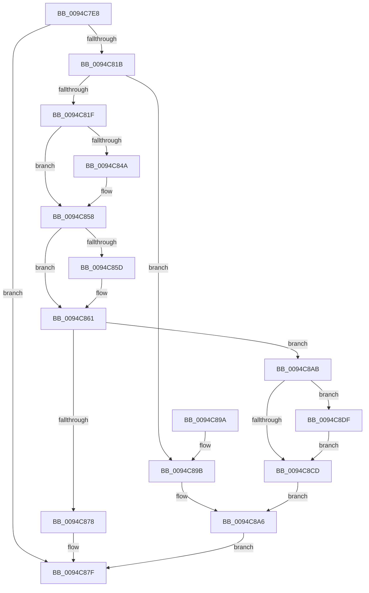

# ExCreateHandleTable

- RVA: `0x0094C7E8`–`0x0094C8E9` (길이 `257` bytes)
- VA: `0x000000014094C7E8`
- 실행 섹션: `PAGE`
- PDB 이름 있음: `예`; PDB Function 태그: `아니요`
- unwind 정보 RVA: `0x00091540`
- 디코드: `70`개 명령, `257/257` bytes 표시
- 미해석 바이트: `0` (있으면 어셈블리에 `.byte`로 보존)

> 이 문서는 커널 이미지의 기계어와 PDB 기호를 분석해 생성했습니다. 4번과 5번은 함수 원형과 자료형을 바이너리 사용 방식에서 추정한 C 해석이며 원본 소스 복구 결과는 아닙니다.

## 1. Dependencies

- 직접 호출 지점: **6**; 고유 호출 대상: **6**
- 직접 호출자로 확인된 함수: **7**
- RIP 상대 이미지 참조: **5**

### Outgoing calls
- `0x0094C80E` → [ExpAllocateHandleTable](ExpAllocateHandleTable_function_0094C8F0.md) (function, `0x0094C8F0`)
- `0x0094C83A` → [KeAbPreAcquire](../../text/21/KeAbPreAcquire_function_00210230.md) (function, `0x00210230`)
- `0x0094C853` → [ExfAcquirePushLockExclusiveEx](../../text/20/ExfAcquirePushLockExclusiveEx_function_0020FC90.md) (function, `0x0020FC90`)
- `0x0094C8D0` → [KeAbPostRelease](../../text/2E/KeAbPostRelease_function_002E1600.md) (function, `0x002E1600`)
- `0x0094C8D8` → [KiLeaveCriticalRegionUnsafe](../../text/25/KiLeaveCriticalRegionUnsafe_function_0025F010.md) (function, `0x0025F010`)
- `0x0094C8E2` → [ExfTryToWakePushLock](../../text/26/ExfTryToWakePushLock_function_00265DD0.md) (function, `0x00265DD0`)

### Direct callers
- [AlpcpAllocateMessageFromExtendedTables](../74/AlpcpAllocateMessageFromExtendedTables_function_0074C500.md) at `0x0074C58E`
- [AlpcpInitSystem](../74/AlpcpInitSystem_function_0074CB9C.md) at `0x0074CCF2`
- [ObInitProcess](ObInitProcess_function_0094C62C.md) at `0x0094C66C`
- [sub_0094D06F](Unknown_function_0094D06F.md) at `0x0094D074`
- [PspInitializeJobStructures](../../init/C4/PspInitializeJobStructures_function_00C465D4.md) at `0x00C465DC`
- [ObInitSystem](../../init/C7/ObInitSystem_function_00C71C7C.md) at `0x00C71DFE`
- [PspInitPhase0](../../init/C7/PspInitPhase0_function_00C77E2C.md) at `0x00C787D5`

### Static image references
- `0x0094C823` → RVA `0x00FD9BA0` (`PAGEDATA`; read)
- `0x0094C861` → RVA `0x00FD9FD0` (`PAGEDATA`; read)
- `0x0094C868` → RVA `0x00FD9FC8` (`PAGEDATA`; read)
- `0x0094C8B5` → RVA `0x00FD9FD0` (`PAGEDATA`; write)
- `0x0094C8BC` → RVA `0x00FD9BA0` (`PAGEDATA`; read/write)

## 2. Other-region calls and transfers

- 다른 실행 섹션으로 향하는 call: **5**
  - `0x0094C83A` → [KeAbPreAcquire](../../text/21/KeAbPreAcquire_function_00210230.md) (`PAGE` → `.text`)
  - `0x0094C853` → [ExfAcquirePushLockExclusiveEx](../../text/20/ExfAcquirePushLockExclusiveEx_function_0020FC90.md) (`PAGE` → `.text`)
  - `0x0094C8D0` → [KeAbPostRelease](../../text/2E/KeAbPostRelease_function_002E1600.md) (`PAGE` → `.text`)
  - `0x0094C8D8` → [KiLeaveCriticalRegionUnsafe](../../text/25/KiLeaveCriticalRegionUnsafe_function_0025F010.md) (`PAGE` → `.text`)
  - `0x0094C8E2` → [ExfTryToWakePushLock](../../text/26/ExfTryToWakePushLock_function_00265DD0.md) (`PAGE` → `.text`)
- 별도 외부 분기/꼬리 이동을 확인하지 못했습니다.

## 3. Assembly (complete function range)

```asm
0094C7E8  48 8B C4                        mov rax, rsp
0094C7EB  48 89 58 08                     mov qword ptr [rax + 8], rbx
0094C7EF  48 89 68 10                     mov qword ptr [rax + 0x10], rbp
0094C7F3  48 89 70 18                     mov qword ptr [rax + 0x18], rsi
0094C7F7  48 89 78 20                     mov qword ptr [rax + 0x20], rdi
0094C7FB  41 56                           push r14
0094C7FD  48 83 EC 20                     sub rsp, 0x20
0094C801  65 48 8B 2C 25 88 01 00 00      mov rbp, qword ptr gs:[0x188]
0094C80A  8B DA                           mov ebx, edx
0094C80C  B2 01                           mov dl, 1
0094C80E  E8 DD 00 00 00                  call 0x14094c8f0
0094C813  48 8B F8                        mov rdi, rax
0094C816  48 85 C0                        test rax, rax
0094C819  74 64                           je 0x14094c87f
0094C81B  85 DB                           test ebx, ebx
0094C81D  74 7C                           je 0x14094c89b
0094C81F  48 83 CB FF                     or rbx, 0xffffffffffffffff
0094C823  4C 8D 35 76 D3 68 00            lea r14, [rip + 0x68d376]
0094C82A  66 01 9D E4 01 00 00            add word ptr [rbp + 0x1e4], bx
0094C831  49 8B CE                        mov rcx, r14
0094C834  45 33 C0                        xor r8d, r8d
0094C837  33 D2                           xor edx, edx
0094C839  90                              nop
0094C83A  E8 F1 39 8C FF                  call 0x140210230
0094C83F  F0 49 0F BA 2E 00               lock bts qword ptr [r14], 0
0094C845  48 8B F0                        mov rsi, rax
0094C848  73 0E                           jae 0x14094c858
0094C84A  4D 8B C6                        mov r8, r14
0094C84D  48 8B D0                        mov rdx, rax
0094C850  49 8B CE                        mov rcx, r14
0094C853  E8 38 34 8C FF                  call 0x14020fc90
0094C858  48 85 F6                        test rsi, rsi
0094C85B  74 04                           je 0x14094c861
0094C85D  C6 46 0A 01                     mov byte ptr [rsi + 0xa], 1
0094C861  48 8B 0D 68 D7 68 00            mov rcx, qword ptr [rip + 0x68d768]
0094C868  48 8D 15 59 D7 68 00            lea rdx, [rip + 0x68d759]
0094C86F  48 8D 47 18                     lea rax, [rdi + 0x18]
0094C873  48 39 11                        cmp qword ptr [rcx], rdx
0094C876  74 33                           je 0x14094c8ab
0094C878  B9 03 00 00 00                  mov ecx, 3
0094C87D  CD 29                           int 0x29
0094C87F  48 8B 5C 24 30                  mov rbx, qword ptr [rsp + 0x30]
0094C884  48 8B 6C 24 38                  mov rbp, qword ptr [rsp + 0x38]
0094C889  48 8B 74 24 40                  mov rsi, qword ptr [rsp + 0x40]
0094C88E  48 8B 7C 24 48                  mov rdi, qword ptr [rsp + 0x48]
0094C893  48 83 C4 20                     add rsp, 0x20
0094C897  41 5E                           pop r14
0094C899  C3                              ret
0094C89A  CC                              int3
0094C89B  48 83 C0 18                     add rax, 0x18
0094C89F  48 89 40 08                     mov qword ptr [rax + 8], rax
0094C8A3  48 89 00                        mov qword ptr [rax], rax
0094C8A6  48 8B C7                        mov rax, rdi
0094C8A9  EB D4                           jmp 0x14094c87f
0094C8AB  48 89 10                        mov qword ptr [rax], rdx
0094C8AE  48 89 48 08                     mov qword ptr [rax + 8], rcx
0094C8B2  48 89 01                        mov qword ptr [rcx], rax
0094C8B5  48 89 05 14 D7 68 00            mov qword ptr [rip + 0x68d714], rax
0094C8BC  F0 48 0F C1 1D DB D2 68 00      lock xadd qword ptr [rip + 0x68d2db], rbx
0094C8C5  80 E3 06                        and bl, 6
0094C8C8  80 FB 02                        cmp bl, 2
0094C8CB  74 12                           je 0x14094c8df
0094C8CD  49 8B CE                        mov rcx, r14
0094C8D0  E8 2B 4D 99 FF                  call 0x1402e1600
0094C8D5  48 8B CD                        mov rcx, rbp
0094C8D8  E8 33 27 91 FF                  call 0x14025f010
0094C8DD  EB C7                           jmp 0x14094c8a6
0094C8DF  49 8B CE                        mov rcx, r14
0094C8E2  E8 E9 94 91 FF                  call 0x140265dd0
0094C8E7  EB E4                           jmp 0x14094c8cd
```

## 4. C-style interpretation (structured pseudocode)

```c
__int64 __fastcall ExCreateHandleTable(__int64 a1, int a2, int a3)
{
    __int64 result;
    __int64 v_rbx;
    __int64 v_rsp;
    unsigned __int64 v_stack_p10;
    unsigned __int64 v_stack_p18;
    unsigned __int64 v_stack_p20;
    unsigned __int64 v_stack_p8;

    *(unsigned __int64 *)(v_rsp + 8) = v_rbx;
    *(unsigned __int64 *)(v_rsp + 16) = v_rbp;
    *(unsigned __int64 *)(v_rsp + 24) = v_rsi;
    *(unsigned __int64 *)(v_rsp + 32) = v_rdi;
    v_rsp = (v_rsp) - (32);
    result = ExpAllocateHandleTable(a1, 1, a3, a4);
    if (result == 0) goto loc_0094C87F;
    if ((unsigned int)((unsigned int)(a2)) == 0) goto loc_0094C89B;
    v_rbx = ((unsigned int)(a2)) | (-1);
    a3 = 0;
    a2 = 0;
    result = KeAbPreAcquire(v_rip + 6869878, a2, a3, a4);
    if (!(condition_is_above_or_equal)) {
        a3 = v_rip + 6869878;
        a2 = result;
        a1 = v_rip + 6869878;
        result = ExfAcquirePushLockExclusiveEx(a1, a2, a3, a4);
    }
    if (result != 0) {
        *(unsigned __int8 *)(result + 10) = 1;
    }
    if ((*(unsigned __int64 *)(*(unsigned __int64 *)(v_rip + 6870888))) == (v_rip + 6870873)) goto loc_0094C8AB;
loc_0094C87F:
    v_rsp = (v_rsp) + (32);
    return result + 24;
loc_0094C89B:
    result = (result + 24) + (24);
    *(unsigned __int64 *)(result + 8) = result;
    *(unsigned __int64 *)(result) = result;
loc_0094C8A6:
    goto loc_0094C87F;
loc_0094C8AB:
    *(unsigned __int64 *)(v_stack_p20) = v_rip + 6870873;
    *(unsigned __int64 *)(v_stack_p20 + 8) = 3;
    *(unsigned __int64 *)(3) = v_stack_p20;
    *(unsigned __int64 *)(v_rip + 6870804) = v_stack_p20;
    v_rbx = (unsigned __int8)((v_stack_p8) & (6));
    if (((unsigned __int8)(v_rbx)) == 2) goto loc_0094C8DF;
loc_0094C8CD:
    result = KeAbPostRelease(v_rip + 6869878, v_rip + 6870873, a3, a4);
    result = KiLeaveCriticalRegionUnsafe(v_stack_p10, v_rip + 6870873, a3, a4);
    goto loc_0094C8A6;
loc_0094C8DF:
    result = ExfTryToWakePushLock(v_rip + 6869878, v_rip + 6870873, a3, a4);
    goto loc_0094C8CD;
}
```

## 5. (Beta) C Style

```c
int64_t ExCreateHandleTable(int64_t Arg1, int32_t Arg2, int32_t Arg3)
{
    int64_t result;
    int64_t local_rbx;
    int64_t local_rsp;
    uint64_t v_stack_p10;
    uint64_t v_stack_p18;
    uint64_t v_stack_p20;
    uint64_t v_stack_p8;

    *(uint64_t *)(local_rsp + 0x8) = local_rbx;
    *(uint64_t *)(local_rsp + 0x10) = local_rbp;
    *(uint64_t *)(local_rsp + 0x18) = local_rsi;
    *(uint64_t *)(local_rsp + 0x20) = local_rdi;
    local_rsp = (local_rsp) - (32);
    result = ExpAllocateHandleTable(Arg1, 1, Arg3, a4);
    if (result == 0) goto loc_0094C87F;
    if ((uint32_t)((uint32_t)(Arg2)) == 0) goto loc_0094C89B;
    local_rbx = ((uint32_t)(Arg2)) | (-1);
    Arg3 = 0;
    Arg2 = 0;
    result = KeAbPreAcquire(v_rip + 6869878, Arg2, Arg3, a4);
    if (!(condition_is_above_or_equal)) {
        Arg3 = v_rip + 6869878;
        Arg2 = result;
        Arg1 = v_rip + 6869878;
        result = ExfAcquirePushLockExclusiveEx(Arg1, Arg2, Arg3, a4);
    }
    if (result != 0) {
        *(uint8_t *)(result + 0xA) = 1;
    }
    if ((*(uint64_t *)(*(uint64_t *)(v_rip + 0x68D768))) == (v_rip + 6870873)) goto loc_0094C8AB;
loc_0094C87F:
    local_rsp = (local_rsp) + (32);
    return result + 24;
loc_0094C89B:
    result = (result + 24) + (24);
    *(uint64_t *)(result + 0x8) = result;
    *(uint64_t *)(result) = result;
loc_0094C8A6:
    goto loc_0094C87F;
loc_0094C8AB:
    *(uint64_t *)(v_stack_p20) = v_rip + 6870873;
    *(uint64_t *)(v_stack_p20 + 0x8) = 3;
    *(uint64_t *)(3) = v_stack_p20;
    *(uint64_t *)(v_rip + 0x68D714) = v_stack_p20;
    local_rbx = (uint8_t)((v_stack_p8) & (6));
    if (((uint8_t)(local_rbx)) == 2) goto loc_0094C8DF;
loc_0094C8CD:
    result = KeAbPostRelease(v_rip + 6869878, v_rip + 6870873, Arg3, a4);
    result = KiLeaveCriticalRegionUnsafe(v_stack_p10, v_rip + 6870873, Arg3, a4);
    goto loc_0094C8A6;
loc_0094C8DF:
    result = ExfTryToWakePushLock(v_rip + 6869878, v_rip + 6870873, Arg3, a4);
    goto loc_0094C8CD;
}
```

## 6. Execution-region graph

[열기: 2D/3D 그래프와 함수 탐색 컨트롤 패널](../../../control-panel.html?section=page&rva=0x0094C7E8&view=graph)

- 2D 그래프는 위에서 아래로 흐르고, 3D 그래프는 빈 공간을 드래그해 회전합니다. Shift+드래그는 이동, 휠은 확대·축소, 함수 노드 선택은 대상 보고서 이동입니다.

### Static fallback


