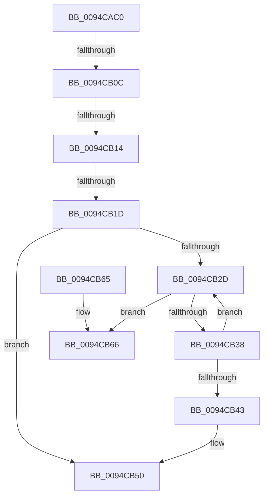

# ExDupHandleTable

- RVA: `0x0094CAC0`–`0x0094CB76` (길이 `182` bytes)
- VA: `0x000000014094CAC0`
- 실행 섹션: `PAGE`
- PDB 이름 있음: `예`; PDB Function 태그: `아니요`
- unwind 정보 RVA: `0x00091574`
- 디코드: `55`개 명령, `182/182` bytes 표시
- 미해석 바이트: `0` (있으면 어셈블리에 `.byte`로 보존)

> 이 문서는 커널 이미지의 기계어와 PDB 기호를 분석해 생성했습니다. 4번과 5번은 함수 원형과 자료형을 바이너리 사용 방식에서 추정한 C 해석이며 원본 소스 복구 결과는 아닙니다.

## 1. Dependencies

- 직접 호출 지점: **3**; 고유 호출 대상: **3**
- 직접 호출자로 확인된 함수: **1**
- RIP 상대 이미지 참조: **0**

### Outgoing calls
- `0x0094CB1F` → [ExpAllocateHandleTable](ExpAllocateHandleTable_function_0094C8F0.md) (function, `0x0094C8F0`)
- `0x0094CB3A` → [ExpAllocateHandleTableEntrySlow](ExpAllocateHandleTableEntrySlow_function_0094D2FC.md) (function, `0x0094D2FC`)
- `0x0094CB47` → [ExpFreeHandleTable](../90/ExpFreeHandleTable_function_00903B70.md) (function, `0x00903B70`)

### Direct callers
- [ObInitProcess](ObInitProcess_function_0094C62C.md) at `0x0094C6F8`

### Static image references
- 디코드된 RIP-relative 메모리 참조가 없습니다.

## 2. Other-region calls and transfers

- 다른 실행 섹션으로 향하는 call: **0**
- call이 아닌 외부 분기/꼬리 이동: **3**
  - `0x0094CB06` → [sub_0094CEB4](Unknown_function_0094CEB4.md) (`tail-transfer`)
  - `0x0094CB0E` → [sub_0094CEB4 + 0x2C](Unknown_function_0094CEB4.md) (`tail-transfer`)
  - `0x0094CB17` → [sub_0094D06F](Unknown_function_0094D06F.md) (`tail-transfer`)

## 3. Assembly (complete function range)

```asm
0094CAC0  4C 89 4C 24 20                  mov qword ptr [rsp + 0x20], r9
0094CAC5  44 89 44 24 18                  mov dword ptr [rsp + 0x18], r8d
0094CACA  48 89 54 24 10                  mov qword ptr [rsp + 0x10], rdx
0094CACF  48 89 4C 24 08                  mov qword ptr [rsp + 8], rcx
0094CAD4  53                              push rbx
0094CAD5  55                              push rbp
0094CAD6  56                              push rsi
0094CAD7  57                              push rdi
0094CAD8  41 56                           push r14
0094CADA  41 57                           push r15
0094CADC  48 81 EC 88 00 00 00            sub rsp, 0x88
0094CAE3  8B 02                           mov eax, dword ptr [rdx]
0094CAE5  33 FF                           xor edi, edi
0094CAE7  48 8B AC 24 E0 00 00 00         mov rbp, qword ptr [rsp + 0xe0]
0094CAEF  4D 8B F9                        mov r15, r9
0094CAF2  48 89 44 24 50                  mov qword ptr [rsp + 0x50], rax
0094CAF7  45 8B F0                        mov r14d, r8d
0094CAFA  48 8B F2                        mov rsi, rdx
0094CAFD  8B D8                           mov ebx, eax
0094CAFF  48 89 7D 00                     mov qword ptr [rbp], rdi
0094CB03  45 85 C0                        test r8d, r8d
0094CB06  0F 85 A8 03 00 00               jne 0x14094ceb4
0094CB0C  85 C0                           test eax, eax
0094CB0E  0F 85 CC 03 00 00               jne 0x14094cee0
0094CB14  48 85 DB                        test rbx, rbx
0094CB17  0F 84 52 05 00 00               je 0x14094d06f
0094CB1D  33 D2                           xor edx, edx
0094CB1F  E8 CC FD FF FF                  call 0x14094c8f0
0094CB24  48 89 45 00                     mov qword ptr [rbp], rax
0094CB28  48 85 C0                        test rax, rax
0094CB2B  74 23                           je 0x14094cb50
0094CB2D  48 8B 4D 00                     mov rcx, qword ptr [rbp]
0094CB31  8B 01                           mov eax, dword ptr [rcx]
0094CB33  48 3B C3                        cmp rax, rbx
0094CB36  73 2E                           jae 0x14094cb66
0094CB38  33 D2                           xor edx, edx
0094CB3A  E8 BD 07 00 00                  call 0x14094d2fc
0094CB3F  84 C0                           test al, al
0094CB41  75 EA                           jne 0x14094cb2d
0094CB43  48 8B 4D 00                     mov rcx, qword ptr [rbp]
0094CB47  E8 24 70 FB FF                  call 0x140903b70
0094CB4C  48 89 7D 00                     mov qword ptr [rbp], rdi
0094CB50  B8 9A 00 00 C0                  mov eax, 0xc000009a
0094CB55  48 81 C4 88 00 00 00            add rsp, 0x88
0094CB5C  41 5F                           pop r15
0094CB5E  41 5E                           pop r14
0094CB60  5F                              pop rdi
0094CB61  5E                              pop rsi
0094CB62  5D                              pop rbp
0094CB63  5B                              pop rbx
0094CB64  C3                              ret
0094CB65  CC                              int3
0094CB66  80 49 2C 08                     or byte ptr [rcx + 0x2c], 8
0094CB6A  45 33 DB                        xor r11d, r11d
0094CB6D  65 48 8B 04 25 88 01 00 00      mov rax, qword ptr gs:[0x188]
```

## 4. C-style interpretation (structured pseudocode)

```c
__int64 __fastcall ExDupHandleTable(__int64 a1, __int64 a2, int a3, __int64 a4, __int64 a5)
{
    __int64 result;
    __int64 v_r11;
    __int64 v_rdi;
    __int64 v_rsp;
    unsigned __int64 v_stack_m68;
    unsigned __int64 v_stack_p10;
    unsigned int v_stack_p18;
    unsigned __int64 v_stack_p20;
    unsigned __int64 v_stack_p8;

    v_stack_p20 = a4;
    v_stack_p18 = a3;
    v_stack_p10 = a2;
    v_stack_p8 = a1;
    v_rsp = (v_rsp) - (136);
    v_rdi = 0;
    v_stack_m68 = (unsigned int)(*(unsigned int *)(a2));
    *(unsigned __int64 *)(a5) = 0;
    a2 = 0;
    result = ExpAllocateHandleTable(a1, a2, a3, a4);
    *(unsigned __int64 *)(a5) = result;
    if (result == 0) goto loc_0094CB50;
loc_0094CB2D:
    if (((unsigned int)(*(unsigned int *)(*(unsigned __int64 *)(a5)))) >= ((unsigned int)((unsigned int)((unsigned int)(*(unsigned int *)(a2)))))) goto loc_0094CB66;
    a2 = 0;
    result = ExpAllocateHandleTableEntrySlow(*(unsigned __int64 *)(a5), a2, a3, a4);
    if ((unsigned __int8)(result) != 0) goto loc_0094CB2D;
    result = ExpFreeHandleTable(*(unsigned __int64 *)(a5), a2, a3, a4);
    *(unsigned __int64 *)(a5) = 0;
loc_0094CB50:
    v_rsp = (v_rsp) + (136);
    return (unsigned int)(0xC000009AULL);
loc_0094CB66:
    v_r11 = 0;
    return *(unsigned __int64 *)(gs_base + (0 + 392));
}
```

## 5. (Beta) C Style

```c
int64_t ExDupHandleTable(int64_t Arg1, void *Arg2, int32_t Arg3, int64_t Arg4, void *Arg5)
{
    uint8_t *arg2 = (uint8_t *)Arg2;
    uint8_t *arg5 = (uint8_t *)Arg5;

    int64_t result;
    int64_t local_r11;
    int64_t local_rdi;
    int64_t local_rsp;
    uint64_t v_stack_m68;
    uint64_t v_stack_p10;
    uint32_t v_stack_p18;
    uint64_t v_stack_p20;
    uint64_t v_stack_p8;

    v_stack_p20 = Arg4;
    v_stack_p18 = Arg3;
    v_stack_p10 = Arg2;
    v_stack_p8 = Arg1;
    local_rsp = (local_rsp) - (136);
    local_rdi = 0;
    v_stack_m68 = (uint32_t)(*(uint32_t *)(arg2));
    *(uint64_t *)(arg5) = 0;
    Arg2 = 0;
    result = ExpAllocateHandleTable(Arg1, Arg2, Arg3, Arg4);
    *(uint64_t *)(arg5) = result;
    if (result == 0) goto loc_0094CB50;
loc_0094CB2D:
    if (((uint32_t)(*(uint32_t *)(*(uint64_t *)(arg5)))) >= ((uint32_t)((uint32_t)((uint32_t)(*(uint32_t *)(arg2)))))) goto loc_0094CB66;
    Arg2 = 0;
    result = ExpAllocateHandleTableEntrySlow(*(uint64_t *)(arg5), Arg2, Arg3, Arg4);
    if ((uint8_t)(result) != 0) goto loc_0094CB2D;
    result = ExpFreeHandleTable(*(uint64_t *)(arg5), Arg2, Arg3, Arg4);
    *(uint64_t *)(arg5) = 0;
loc_0094CB50:
    local_rsp = (local_rsp) + (136);
    return (uint32_t)(0xC000009AULL);
loc_0094CB66:
    local_r11 = 0;
    return *(uint64_t *)(gs_base + (0 + 0x188));
}
```

### 관측된 메모리 오프셋

구조체 형식이 확인되지 않은 접근은 인자 기준의 오프셋으로만 기록했습니다.

| 기준 인자 | 오프셋 표현 | 폭 (bit) | 접근 |
|---|---:|---:|---|
| `Arg2` | `+ 0x0` | `32` | `R` |
| `Arg5` | `+ 0x0` | `64` | `R` |
| `Arg5` | `+ 0x0` | `64` | `W` |

## 6. Execution-region graph

[열기: 2D/3D 그래프와 함수 탐색 컨트롤 패널](../../../control-panel.html?section=page&rva=0x0094CAC0&view=graph)

- 2D 그래프는 위에서 아래로 흐르고, 3D 그래프는 빈 공간을 드래그해 회전합니다. Shift+드래그는 이동, 휠은 확대·축소, 함수 노드 선택은 대상 보고서 이동입니다.

### Static fallback


