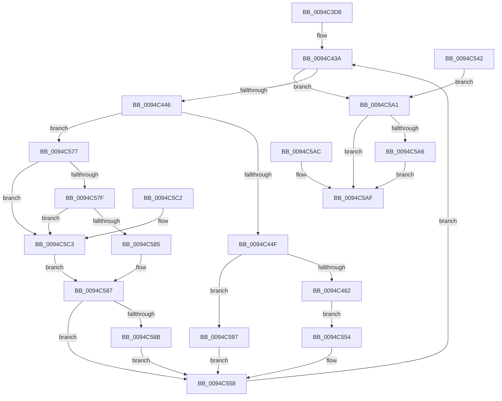

# ExQueryProcessHandleInformation

- RVA: `0x0094C3D8`–`0x0094C5C7` (길이 `495` bytes)
- VA: `0x000000014094C3D8`
- 실행 섹션: `PAGE`
- PDB 이름 있음: `예`; PDB Function 태그: `아니요`
- unwind 정보 RVA: `0x000914D4`
- 디코드: `133`개 명령, `495/495` bytes 표시
- 미해석 바이트: `0` (있으면 어셈블리에 `.byte`로 보존)

> 이 문서는 커널 이미지의 기계어와 PDB 기호를 분석해 생성했습니다. 4번과 5번은 함수 원형과 자료형을 바이너리 사용 방식에서 추정한 C 해석이며 원본 소스 복구 결과는 아닙니다.

## 1. Dependencies

- 직접 호출 지점: **5**; 고유 호출 대상: **5**
- 직접 호출자로 확인된 함수: **1**
- RIP 상대 이미지 참조: **2**

### Outgoing calls
- `0x0094C430` → [ExpLookupHandleTableEntry](../86/ExpLookupHandleTableEntry_function_00869DB0.md) (function, `0x00869DB0`)
- `0x0094C455` → [ExLockHandleTableEntry](../../text/40/ExLockHandleTableEntry_function_0040DAA0.md) (function, `0x0040DAA0`)
- `0x0094C465` → [ExGetHandlePointer](../../text/43/ExGetHandlePointer_function_00430C90.md) (function, `0x00430C90`)
- `0x0094C4E0` → [ExUnlockHandleTableEntry](ExUnlockHandleTableEntry_function_0094D2D0.md) (function, `0x0094D2D0`)
- `0x0094C563` → [ExpGetNextHandleTableEntry](ExpGetNextHandleTableEntry_function_0094C5D0.md) (function, `0x0094C5D0`)

### Direct callers
- [NtQueryInformationProcess](../9A/NtQueryInformationProcess_function_009AA250.md) at `0x009AC386`

### Static image references
- `0x0094C4A0` → RVA `0x00FC6E4C` (`ALMOSTRO`; read)
- `0x0094C4AA` → RVA `0x00FC7800` (`ALMOSTRO`; read)

## 2. Other-region calls and transfers

- 다른 실행 섹션으로 향하는 call: **2**
  - `0x0094C455` → [ExLockHandleTableEntry](../../text/40/ExLockHandleTableEntry_function_0040DAA0.md) (`PAGE` → `.text`)
  - `0x0094C465` → [ExGetHandlePointer](../../text/43/ExGetHandlePointer_function_00430C90.md) (`PAGE` → `.text`)
- 별도 외부 분기/꼬리 이동을 확인하지 못했습니다.

## 3. Assembly (complete function range)

```asm
0094C3D8  4C 89 4C 24 20                  mov qword ptr [rsp + 0x20], r9
0094C3DD  48 89 54 24 10                  mov qword ptr [rsp + 0x10], rdx
0094C3E2  53                              push rbx
0094C3E3  56                              push rsi
0094C3E4  57                              push rdi
0094C3E5  41 54                           push r12
0094C3E7  41 55                           push r13
0094C3E9  41 56                           push r14
0094C3EB  41 57                           push r15
0094C3ED  48 83 EC 50                     sub rsp, 0x50
0094C3F1  4D 8B E1                        mov r12, r9
0094C3F4  4C 8B E9                        mov r13, rcx
0094C3F7  48 8D 7A 10                     lea rdi, [rdx + 0x10]
0094C3FB  41 83 C0 F0                     add r8d, -0x10
0094C3FF  48 B8 CD CC CC CC CC CC CC CC   movabs rax, 0xcccccccccccccccd
0094C409  49 F7 E0                        mul r8
0094C40C  4C 8B CA                        mov r9, rdx
0094C40F  49 C1 E9 05                     shr r9, 5
0094C413  4C 89 4C 24 48                  mov qword ptr [rsp + 0x48], r9
0094C418  45 33 DB                        xor r11d, r11d
0094C41B  44 89 9C 24 A0 00 00 00         mov dword ptr [rsp + 0xa0], r11d
0094C423  45 8D 73 10                     lea r14d, [r11 + 0x10]
0094C427  45 33 FF                        xor r15d, r15d
0094C42A  41 8D 5B 04                     lea ebx, [r11 + 4]
0094C42E  8B D3                           mov edx, ebx
0094C430  E8 7B D9 F1 FF                  call 0x140869db0
0094C435  48 89 5C 24 30                  mov qword ptr [rsp + 0x30], rbx
0094C43A  48 8B F0                        mov rsi, rax
0094C43D  48 85 C0                        test rax, rax
0094C440  0F 84 5B 01 00 00               je 0x14094c5a1
0094C446  45 3B D9                        cmp r11d, r9d
0094C449  0F 83 28 01 00 00               jae 0x14094c577
0094C44F  48 8B D0                        mov rdx, rax
0094C452  49 8B CD                        mov rcx, r13
0094C455  E8 46 16 AC FF                  call 0x14040daa0
0094C45A  84 C0                           test al, al
0094C45C  0F 84 35 01 00 00               je 0x14094c597
0094C462  48 8B CE                        mov rcx, rsi
0094C465  E8 26 48 AE FF                  call 0x140430c90
0094C46A  4C 8B C0                        mov r8, rax
0094C46D  8B 16                           mov edx, dword ptr [rsi]
0094C46F  48 C1 FA 11                     sar rdx, 0x11
0094C473  83 E2 07                        and edx, 7
0094C476  44 8B 4E 08                     mov r9d, dword ptr [rsi + 8]
0094C47A  8B C2                           mov eax, edx
0094C47C  83 C8 08                        or eax, 8
0094C47F  41 0F BA E1 19                  bt r9d, 0x19
0094C484  0F 43 C2                        cmovae eax, edx
0094C487  83 E0 07                        and eax, 7
0094C48A  89 44 24 28                     mov dword ptr [rsp + 0x28], eax
0094C48E  49 8B C0                        mov rax, r8
0094C491  48 C1 E8 08                     shr rax, 8
0094C495  0F B6 C8                        movzx ecx, al
0094C498  41 0F B6 40 18                  movzx eax, byte ptr [r8 + 0x18]
0094C49D  48 33 C8                        xor rcx, rax
0094C4A0  0F B6 05 A5 A9 67 00            movzx eax, byte ptr [rip + 0x67a9a5]
0094C4A7  48 33 C8                        xor rcx, rax
0094C4AA  48 8D 05 4F B3 67 00            lea rax, [rip + 0x67b34f]
0094C4B1  48 8B 04 C8                     mov rax, qword ptr [rax + rcx*8]
0094C4B5  0F B6 40 28                     movzx eax, byte ptr [rax + 0x28]
0094C4B9  89 44 24 24                     mov dword ptr [rsp + 0x24], eax
0094C4BD  49 8B 00                        mov rax, qword ptr [r8]
0094C4C0  48 89 44 24 40                  mov qword ptr [rsp + 0x40], rax
0094C4C5  49 8B 40 08                     mov rax, qword ptr [r8 + 8]
0094C4C9  48 89 44 24 38                  mov qword ptr [rsp + 0x38], rax
0094C4CE  41 81 E1 FF FF FF 01            and r9d, 0x1ffffff
0094C4D5  44 89 4C 24 20                  mov dword ptr [rsp + 0x20], r9d
0094C4DA  48 8B D6                        mov rdx, rsi
0094C4DD  49 8B CD                        mov rcx, r13
0094C4E0  E8 EB 0D 00 00                  call 0x14094d2d0
0094C4E5  41 83 C6 28                     add r14d, 0x28
0094C4E9  44 89 74 24 2C                  mov dword ptr [rsp + 0x2c], r14d
0094C4EE  44 8B 9C 24 A0 00 00 00         mov r11d, dword ptr [rsp + 0xa0]
0094C4F6  41 FF C3                        inc r11d
0094C4F9  44 89 9C 24 A0 00 00 00         mov dword ptr [rsp + 0xa0], r11d
0094C501  48 89 1F                        mov qword ptr [rdi], rbx
0094C504  48 8B 44 24 38                  mov rax, qword ptr [rsp + 0x38]
0094C509  48 89 47 08                     mov qword ptr [rdi + 8], rax
0094C50D  48 8B 44 24 40                  mov rax, qword ptr [rsp + 0x40]
0094C512  48 89 47 10                     mov qword ptr [rdi + 0x10], rax
0094C516  8B 44 24 20                     mov eax, dword ptr [rsp + 0x20]
0094C51A  89 47 18                        mov dword ptr [rdi + 0x18], eax
0094C51D  8B 44 24 24                     mov eax, dword ptr [rsp + 0x24]
0094C521  89 47 1C                        mov dword ptr [rdi + 0x1c], eax
0094C524  8B 44 24 28                     mov eax, dword ptr [rsp + 0x28]
0094C528  89 47 20                        mov dword ptr [rdi + 0x20], eax
0094C52B  C7 47 24 00 00 00 00            mov dword ptr [rdi + 0x24], 0
0094C532  41 8B C3                        mov eax, r11d
0094C535  48 8B 8C 24 98 00 00 00         mov rcx, qword ptr [rsp + 0x98]
0094C53D  48 89 01                        mov qword ptr [rcx], rax
0094C540  EB 12                           jmp 0x14094c554
0094C542  44 8B F8                        mov r15d, eax
0094C545  4C 8B A4 24 A8 00 00 00         mov r12, qword ptr [rsp + 0xa8]
0094C54D  44 8B 74 24 2C                  mov r14d, dword ptr [rsp + 0x2c]
0094C552  EB 4D                           jmp 0x14094c5a1
0094C554  48 83 C7 28                     add rdi, 0x28
0094C558  4C 8D 44 24 30                  lea r8, [rsp + 0x30]
0094C55D  48 8B D6                        mov rdx, rsi
0094C560  49 8B CD                        mov rcx, r13
0094C563  E8 68 00 00 00                  call 0x14094c5d0
0094C568  48 8B 5C 24 30                  mov rbx, qword ptr [rsp + 0x30]
0094C56D  4C 8B 4C 24 48                  mov r9, qword ptr [rsp + 0x48]
0094C572  E9 C3 FE FF FF                  jmp 0x14094c43a
0094C577  F7 C3 FC 03 00 00               test ebx, 0x3fc
0094C57D  74 44                           je 0x14094c5c3
0094C57F  48 83 3E 00                     cmp qword ptr [rsi], 0
0094C583  74 3E                           je 0x14094c5c3
0094C585  B0 01                           mov al, 1
0094C587  84 C0                           test al, al
0094C589  74 CD                           je 0x14094c558
0094C58B  41 83 C6 28                     add r14d, 0x28
0094C58F  41 BF 04 00 00 C0               mov r15d, 0xc0000004
0094C595  EB C1                           jmp 0x14094c558
0094C597  44 8B 9C 24 A0 00 00 00         mov r11d, dword ptr [rsp + 0xa0]
0094C59F  EB B7                           jmp 0x14094c558
0094C5A1  4D 85 E4                        test r12, r12
0094C5A4  74 09                           je 0x14094c5af
0094C5A6  45 89 34 24                     mov dword ptr [r12], r14d
0094C5AA  EB 03                           jmp 0x14094c5af
0094C5AC  44 8B F8                        mov r15d, eax
0094C5AF  41 8B C7                        mov eax, r15d
0094C5B2  48 83 C4 50                     add rsp, 0x50
0094C5B6  41 5F                           pop r15
0094C5B8  41 5E                           pop r14
0094C5BA  41 5D                           pop r13
0094C5BC  41 5C                           pop r12
0094C5BE  5F                              pop rdi
0094C5BF  5E                              pop rsi
0094C5C0  5B                              pop rbx
0094C5C1  C3                              ret
0094C5C2  CC                              int3
0094C5C3  32 C0                           xor al, al
0094C5C5  EB C0                           jmp 0x14094c587
```

## 4. C-style interpretation (structured pseudocode)

```c
__int64 __fastcall ExQueryProcessHandleInformation(__int64 a1, __int64 a2, int a3, __int64 a4)
{
    __int64 result;
    __int64 v_r11;
    __int64 v_r14;
    __int64 v_r15;
    __int64 v_rdi;
    __int64 v_rsp;
    unsigned __int64 v_stack_m40;
    unsigned __int64 v_stack_m48;
    unsigned __int64 v_stack_m50;
    unsigned __int64 v_stack_m58;
    unsigned int v_stack_m5C;
    unsigned int v_stack_m60;
    unsigned int v_stack_m64;
    unsigned int v_stack_m68;
    unsigned __int64 v_stack_p10;
    unsigned int v_stack_p18;
    unsigned __int64 v_stack_p20;

    v_stack_p20 = a4;
    v_stack_p10 = a2;
    v_rsp = (v_rsp) - (80);
    a3 = (unsigned int)((a3) + (-16));
    a4 = (a2) >> (5);
    v_stack_m40 = a4;
    v_r11 = 0;
    v_stack_p18 = 0;
    v_r15 = 0;
    result = ExpLookupHandleTableEntry(a1, (unsigned int)((unsigned int)(v_r11 + 4)), a3, a4);
    v_stack_m58 = v_r11 + 4;
loc_0094C43A:
    if (result == 0) goto loc_0094C5A1;
    if (0 >= ((unsigned int)(a4))) goto loc_0094C577;
    result = ExLockHandleTableEntry(a1, result, a3, a4);
    if ((unsigned __int8)(result) == 0) goto loc_0094C597;
    result = ExGetHandlePointer(result, result, a3, a4);
    a2 = ((unsigned int)(*(unsigned int *)(result))) >> (17);
    a2 = (unsigned int)((a2) & (7));
    result = (unsigned int)(((unsigned int)((unsigned int)(a2))) | (8));
    if (condition_is_above_or_equal) { result = (unsigned int)(a2); }
    result = (unsigned int)((result) & (7));
    v_stack_m60 = (unsigned int)(result);
    result = (result) >> (8);
    a1 = ((unsigned __int8)(result)) ^ (*(unsigned __int8 *)(result + 24));
    a1 = (a1) ^ (*(unsigned __int8 *)(v_rip + 6793637));
    v_stack_m64 = (unsigned int)(*(unsigned __int8 *)(*(unsigned __int64 *)(v_rip + 6796111 + a1 * 8) + 40));
    v_stack_m48 = *(unsigned __int64 *)(result);
    v_stack_m50 = *(unsigned __int64 *)(result + 8);
    a4 = (unsigned int)(((unsigned int)(*(unsigned int *)(result + 8))) & (0x1FFFFFFULL));
    v_stack_m68 = (unsigned int)(a4);
    result = ExUnlockHandleTableEntry(a1, result, result, a4);
    v_r14 = (unsigned int)((v_r11 + 16) + (40));
    v_stack_m5C = (unsigned int)(v_r14);
    v_r11 = (unsigned int)(((unsigned int)(v_stack_p18)) + 1);
    v_stack_p18 = (unsigned int)(v_r11);
    *(unsigned __int64 *)(a2 + 16) = v_r11 + 4;
    *(unsigned __int64 *)(a2 + 16 + 8) = v_stack_m50;
    *(unsigned __int64 *)(a2 + 16 + 16) = v_stack_m48;
    *(unsigned int *)(a2 + 16 + 24) = (unsigned int)((unsigned int)(v_stack_m68));
    *(unsigned int *)(a2 + 16 + 28) = (unsigned int)((unsigned int)(v_stack_m64));
    *(unsigned int *)(a2 + 16 + 32) = (unsigned int)((unsigned int)(v_stack_m60));
    *(unsigned int *)(a2 + 16 + 36) = 0;
    *(unsigned __int64 *)(v_stack_p10) = (unsigned int)((unsigned int)(v_r11));
    goto loc_0094C554;
loc_0094C554:
    v_rdi = (a2 + 16) + (40);
loc_0094C558:
    result = ExpGetNextHandleTableEntry(a1, result, v_stack_m58, a4);
    goto loc_0094C43A;
loc_0094C577:
    if ((((unsigned int)(v_stack_m58)) & (0x3FCULL)) == 0) goto loc_0094C5C3;
    if ((*(unsigned __int64 *)(result)) == 0) goto loc_0094C5C3;
loc_0094C587:
    if (1 == 0) goto loc_0094C558;
    v_r14 = (unsigned int)((v_r14) + (40));
    goto loc_0094C558;
loc_0094C597:
    goto loc_0094C558;
loc_0094C5A1:
    if (a4 == 0) goto loc_0094C5AF;
    *(unsigned int *)(a4) = (unsigned int)(v_r14);
    goto loc_0094C5AF;
loc_0094C5AF:
    v_rsp = (v_rsp) + (80);
    return (unsigned int)((unsigned int)((unsigned int)(0xC0000004ULL)));
loc_0094C5C3:
    result = 0;
    goto loc_0094C587;
}
```

## 5. (Beta) C Style

```c
int64_t ExQueryProcessHandleInformation(int64_t Arg1, void *Arg2, int32_t Arg3, int64_t Arg4)
{
    uint8_t *arg2 = (uint8_t *)Arg2;

    int64_t result;
    int64_t local_r11;
    int64_t local_r14;
    int64_t local_r15;
    int64_t local_rdi;
    int64_t local_rsp;
    uint64_t v_stack_m40;
    uint64_t v_stack_m48;
    uint64_t v_stack_m50;
    uint64_t v_stack_m58;
    uint32_t v_stack_m5C;
    uint32_t v_stack_m60;
    uint32_t v_stack_m64;
    uint32_t v_stack_m68;
    uint64_t v_stack_p10;
    uint32_t v_stack_p18;
    uint64_t v_stack_p20;

    v_stack_p20 = Arg4;
    v_stack_p10 = Arg2;
    local_rsp = (local_rsp) - (80);
    Arg3 = (uint32_t)((Arg3) + (-16));
    Arg4 = (Arg2) >> (5);
    v_stack_m40 = Arg4;
    local_r11 = 0;
    v_stack_p18 = 0;
    local_r15 = 0;
    result = ExpLookupHandleTableEntry(Arg1, (uint32_t)((uint32_t)(local_r11 + 4)), Arg3, Arg4);
    v_stack_m58 = local_r11 + 4;
loc_0094C43A:
    if (result == 0) goto loc_0094C5A1;
    if (0 >= ((uint32_t)(Arg4))) goto loc_0094C577;
    result = ExLockHandleTableEntry(Arg1, result, Arg3, Arg4);
    if ((uint8_t)(result) == 0) goto loc_0094C597;
    result = ExGetHandlePointer(result, result, Arg3, Arg4);
    Arg2 = ((uint32_t)(*(uint32_t *)(result))) >> (17);
    Arg2 = (uint32_t)((Arg2) & (7));
    result = (uint32_t)(((uint32_t)((uint32_t)(Arg2))) | (8));
    if (condition_is_above_or_equal) { result = (uint32_t)(Arg2); }
    result = (uint32_t)((result) & (7));
    v_stack_m60 = (uint32_t)(result);
    result = (result) >> (8);
    Arg1 = ((uint8_t)(result)) ^ (*(uint8_t *)(result + 0x18));
    Arg1 = (Arg1) ^ (*(uint8_t *)(v_rip + 0x67A9A5));
    v_stack_m64 = (uint32_t)(*(uint8_t *)(*(uint64_t *)(v_rip + 0x67B34F + Arg1 * 8) + 0x28));
    v_stack_m48 = *(uint64_t *)(result);
    v_stack_m50 = *(uint64_t *)(result + 0x8);
    Arg4 = (uint32_t)(((uint32_t)(*(uint32_t *)(result + 0x8))) & (0x1FFFFFFULL));
    v_stack_m68 = (uint32_t)(Arg4);
    result = ExUnlockHandleTableEntry(Arg1, result, result, Arg4);
    local_r14 = (uint32_t)((local_r11 + 16) + (40));
    v_stack_m5C = (uint32_t)(local_r14);
    local_r11 = (uint32_t)(((uint32_t)(v_stack_p18)) + 1);
    v_stack_p18 = (uint32_t)(local_r11);
    *(uint64_t *)(arg2 + 0x10) = local_r11 + 4;
    *(uint64_t *)(arg2 + 0x10 + 0x8) = v_stack_m50;
    *(uint64_t *)(arg2 + 0x10 + 0x10) = v_stack_m48;
    *(uint32_t *)(arg2 + 0x10 + 0x18) = (uint32_t)((uint32_t)(v_stack_m68));
    *(uint32_t *)(arg2 + 0x10 + 0x1C) = (uint32_t)((uint32_t)(v_stack_m64));
    *(uint32_t *)(arg2 + 0x10 + 0x20) = (uint32_t)((uint32_t)(v_stack_m60));
    *(uint32_t *)(arg2 + 0x10 + 0x24) = 0;
    *(uint64_t *)(v_stack_p10) = (uint32_t)((uint32_t)(local_r11));
    goto loc_0094C554;
loc_0094C554:
    local_rdi = (Arg2 + 16) + (40);
loc_0094C558:
    result = ExpGetNextHandleTableEntry(Arg1, result, v_stack_m58, Arg4);
    goto loc_0094C43A;
loc_0094C577:
    if ((((uint32_t)(v_stack_m58)) & (0x3FCULL)) == 0) goto loc_0094C5C3;
    if ((*(uint64_t *)(result)) == 0) goto loc_0094C5C3;
loc_0094C587:
    if (1 == 0) goto loc_0094C558;
    local_r14 = (uint32_t)((local_r14) + (40));
    goto loc_0094C558;
loc_0094C597:
    goto loc_0094C558;
loc_0094C5A1:
    if (Arg4 == 0) goto loc_0094C5AF;
    *(uint32_t *)(Arg4) = (uint32_t)(local_r14);
    goto loc_0094C5AF;
loc_0094C5AF:
    local_rsp = (local_rsp) + (80);
    return (uint32_t)((uint32_t)((uint32_t)(0xC0000004ULL)));
loc_0094C5C3:
    result = 0;
    goto loc_0094C587;
}
```

### 관측된 메모리 오프셋

구조체 형식이 확인되지 않은 접근은 인자 기준의 오프셋으로만 기록했습니다.

| 기준 인자 | 오프셋 표현 | 폭 (bit) | 접근 |
|---|---:|---:|---|
| `Arg2` | `+ 0x0` | `64` | `W` |
| `Arg2` | `+ 0x8` | `64` | `W` |
| `Arg2` | `+ 0x10` | `64` | `R` |
| `Arg2` | `+ 0x10` | `64` | `W` |
| `Arg2` | `+ 0x18` | `32` | `W` |
| `Arg2` | `+ 0x1C` | `32` | `W` |
| `Arg2` | `+ 0x20` | `32` | `W` |
| `Arg2` | `+ 0x24` | `32` | `W` |

## 6. Execution-region graph

[열기: 2D/3D 그래프와 함수 탐색 컨트롤 패널](../../../control-panel.html?section=page&rva=0x0094C3D8&view=graph)

- 2D 그래프는 위에서 아래로 흐르고, 3D 그래프는 빈 공간을 드래그해 회전합니다. Shift+드래그는 이동, 휠은 확대·축소, 함수 노드 선택은 대상 보고서 이동입니다.

### Static fallback


