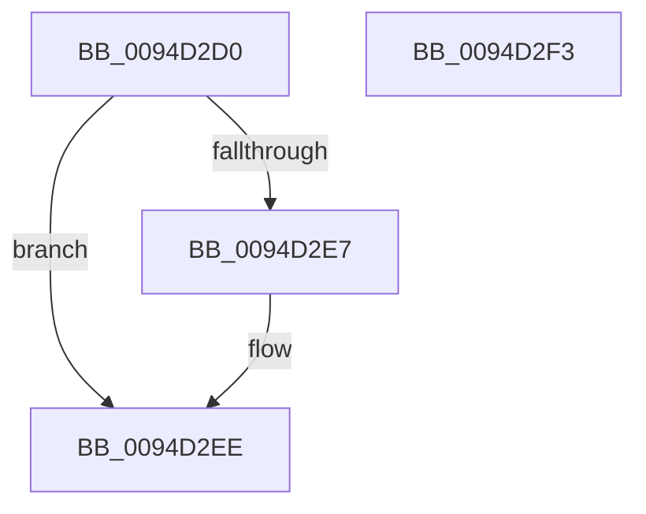

# ExUnlockHandleTableEntry

- RVA: `0x0094D2D0`–`0x0094D2F4` (길이 `36` bytes)
- VA: `0x000000014094D2D0`
- 실행 섹션: `PAGE`
- PDB 이름 있음: `예`; PDB Function 태그: `아니요`
- unwind 정보 RVA: `0x0005C788`
- 디코드: `11`개 명령, `36/36` bytes 표시
- 미해석 바이트: `0` (있으면 어셈블리에 `.byte`로 보존)

> 이 문서는 커널 이미지의 기계어와 PDB 기호를 분석해 생성했습니다. 4번과 5번은 함수 원형과 자료형을 바이너리 사용 방식에서 추정한 C 해석이며 원본 소스 복구 결과는 아닙니다.

## 1. Dependencies

- 직접 호출 지점: **1**; 고유 호출 대상: **1**
- 직접 호출자로 확인된 함수: **13**
- RIP 상대 이미지 참조: **0**

### Outgoing calls
- `0x0094D2E9` → [ExfUnblockPushLock](../../text/2A/ExfUnblockPushLock_function_002A3FE0.md) (function, `0x002A3FE0`)

### Direct callers
- [IopCheckHandleForRevocation](../../text/59/IopCheckHandleForRevocation_function_00598340.md) at `0x005983DE`
- [ObAuditInheritedHandleProcedure](../74/ObAuditInheritedHandleProcedure_function_0074D6E0.md) at `0x0074D6F8`
- [ObpShutdownCloseHandleProcedure](../74/ObpShutdownCloseHandleProcedure_function_0074E7C0.md) at `0x0074E7F6`
- [EtwpObjectHandleEnumCallback](../7C/EtwpObjectHandleEnumCallback_function_007C0240.md) at `0x007C032D`
- [EtwpObjectHandleEnumCallback](../7C/EtwpObjectHandleEnumCallback_function_007C0240.md) at `0x007C034A`
- [ObCloseHandleTableEntry](../86/ObCloseHandleTableEntry_function_00869E20.md) at `0x0086A642`
- [AlpcpSendMessage](../88/AlpcpSendMessage_function_0088BD40.md) at `0x0088CD05`
- [sub_00895B6D](../89/Unknown_function_00895B6D.md) at `0x00895D2C`
- [NtAlpcImpersonateClientOfPort](../89/NtAlpcImpersonateClientOfPort_function_008961A0.md) at `0x00896666`
- [ObpAuditObjectAccess](ObpAuditObjectAccess_function_0094C270.md) at `0x0094C2FF`
- [ExQueryProcessHandleInformation](ExQueryProcessHandleInformation_function_0094C3D8.md) at `0x0094C4E0`
- [sub_0094D08D](Unknown_function_0094D08D.md) at `0x0094D098`
- [ExpDuplicateSingleHandle](ExpDuplicateSingleHandle_function_0094D0E4.md) at `0x0094D1B5`
- [ObInheritObjectHandle](ObInheritObjectHandle_function_0094D1C4.md) at `0x0094D215`

### Static image references
- 디코드된 RIP-relative 메모리 참조가 없습니다.

## 2. Other-region calls and transfers

- 다른 실행 섹션으로 향하는 call: **1**
  - `0x0094D2E9` → [ExfUnblockPushLock](../../text/2A/ExfUnblockPushLock_function_002A3FE0.md) (`PAGE` → `.text`)
- 별도 외부 분기/꼬리 이동을 확인하지 못했습니다.

## 3. Assembly (complete function range)

```asm
0094D2D0  48 83 EC 28                     sub rsp, 0x28
0094D2D4  F0 48 FF 02                     lock inc qword ptr [rdx]
0094D2D8  48 83 C1 30                     add rcx, 0x30
0094D2DC  F0 83 0C 24 00                  lock or dword ptr [rsp], 0
0094D2E1  48 83 39 00                     cmp qword ptr [rcx], 0
0094D2E5  74 07                           je 0x14094d2ee
0094D2E7  33 D2                           xor edx, edx
0094D2E9  E8 F2 6C 95 FF                  call 0x1402a3fe0
0094D2EE  48 83 C4 28                     add rsp, 0x28
0094D2F2  C3                              ret
0094D2F3  CC                              int3
```

## 4. C-style interpretation (structured pseudocode)

```c
__int64 __fastcall ExUnlockHandleTableEntry(__int64 a1, __int64 a2)
{
    __int64 result;
    __int64 v_rsp;
    unsigned int v_stack_m28;

    v_rsp = (v_rsp) - (40);
    a1 = (a1) + (48);
    if ((*(unsigned __int64 *)(a1)) != 0) {
        a2 = 0;
        result = ExfUnblockPushLock(a1, a2, a3, a4);
    }
    v_rsp = (v_rsp) + (40);
    return result;
}
```

## 5. (Beta) C Style

```c
int64_t ExUnlockHandleTableEntry(void *Arg1, void *Arg2)
{
    uint8_t *arg1 = (uint8_t *)Arg1;
    uint8_t *arg2 = (uint8_t *)Arg2;

    int64_t result;
    int64_t local_rsp;
    uint32_t v_stack_m28;

    local_rsp = (local_rsp) - (40);
    Arg1 = (Arg1) + (48);
    if ((*(uint64_t *)(arg1)) != 0) {
        Arg2 = 0;
        result = ExfUnblockPushLock(Arg1, Arg2, a3, a4);
    }
    local_rsp = (local_rsp) + (40);
    return result;
}
```

### 관측된 메모리 오프셋

구조체 형식이 확인되지 않은 접근은 인자 기준의 오프셋으로만 기록했습니다.

| 기준 인자 | 오프셋 표현 | 폭 (bit) | 접근 |
|---|---:|---:|---|
| `Arg1` | `+ 0x0` | `64` | `R` |
| `Arg2` | `+ 0x0` | `64` | `R/W` |

## 6. Execution-region graph

[열기: 2D/3D 그래프와 함수 탐색 컨트롤 패널](../../../control-panel.html?section=page&rva=0x0094D2D0&view=graph)

- 2D 그래프는 위에서 아래로 흐르고, 3D 그래프는 빈 공간을 드래그해 회전합니다. Shift+드래그는 이동, 휠은 확대·축소, 함수 노드 선택은 대상 보고서 이동입니다.

### Static fallback


