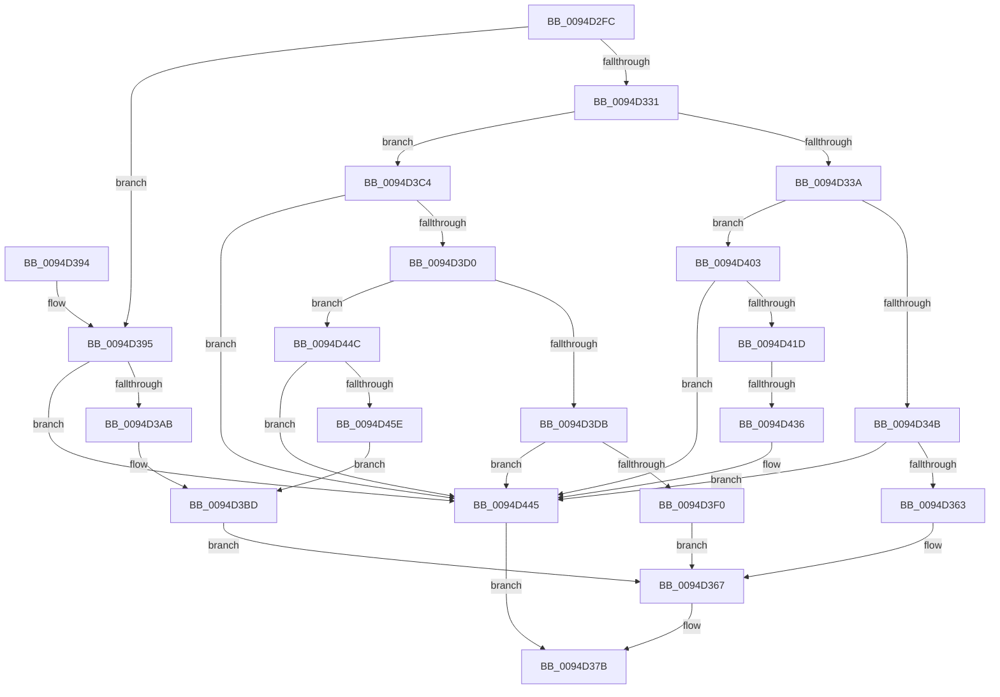

# ExpAllocateHandleTableEntrySlow

- RVA: `0x0094D2FC`–`0x0094D467` (길이 `363` bytes)
- VA: `0x000000014094D2FC`
- 실행 섹션: `PAGE`
- PDB 이름 있음: `예`; PDB Function 태그: `예`
- unwind 정보 RVA: `0x000916B0`
- 디코드: `101`개 명령, `363/363` bytes 표시
- 미해석 바이트: `0` (있으면 어셈블리에 `.byte`로 보존)

> 이 문서는 커널 이미지의 기계어와 PDB 기호를 분석해 생성했습니다. 4번과 5번은 함수 원형과 자료형을 바이너리 사용 방식에서 추정한 C 해석이며 원본 소스 복구 결과는 아닙니다.

## 1. Dependencies

- 직접 호출 지점: **8**; 고유 호출 대상: **5**
- 직접 호출자로 확인된 함수: **4**
- RIP 상대 이미지 참조: **0**

### Outgoing calls
- `0x0094D34D` → [ExpAllocateLowLevelTable](ExpAllocateLowLevelTable_function_0094CA14.md) (function, `0x0094CA14`)
- `0x0094D374` → [ExpInsertLowLevelTableIntoFreeList](ExpInsertLowLevelTableIntoFreeList_function_0094D470.md) (function, `0x0094D470`)
- `0x0094D39D` → [ExpAllocateMidLevelTable](ExpAllocateMidLevelTable_function_0094D5B4.md) (function, `0x0094D5B4`)
- `0x0094D3DE` → [ExpAllocateLowLevelTable](ExpAllocateLowLevelTable_function_0094CA14.md) (function, `0x0094CA14`)
- `0x0094D410` → [ExpAllocateTablePagedPool](ExpAllocateTablePagedPool_function_0094D634.md) (function, `0x0094D634`)
- `0x0094D428` → [ExpAllocateMidLevelTable](ExpAllocateMidLevelTable_function_0094D5B4.md) (function, `0x0094D5B4`)
- `0x0094D440` → [ExpFreeTablePagedPool](../86/ExpFreeTablePagedPool_function_0086B410.md) (function, `0x0086B410`)
- `0x0094D454` → [ExpAllocateMidLevelTable](ExpAllocateMidLevelTable_function_0094D5B4.md) (function, `0x0094D5B4`)

### Direct callers
- [sub_0086B0A5](../86/Unknown_function_0086B0A5.md) at `0x0086B11A`
- [ObpCreateHandle](../86/ObpCreateHandle_function_0086B950.md) at `0x0086D10B`
- [ObDuplicateObject](../8C/ObDuplicateObject_function_008C4FA0.md) at `0x008C5E53`
- [ExDupHandleTable](ExDupHandleTable_function_0094CAC0.md) at `0x0094CB3A`

### Static image references
- 디코드된 RIP-relative 메모리 참조가 없습니다.

## 2. Other-region calls and transfers

- 다른 실행 섹션으로 향하는 call: **0**
- call이 아닌 외부 분기/꼬리 이동: **1**
  - `0x0094D430` → [sub_00B25F60](../B2/Unknown_function_00B25F60.md) (`tail-transfer`)

## 3. Assembly (complete function range)

```asm
0094D2FC  48 8B C4                        mov rax, rsp
0094D2FF  48 89 58 10                     mov qword ptr [rax + 0x10], rbx
0094D303  48 89 68 18                     mov qword ptr [rax + 0x18], rbp
0094D307  48 89 70 20                     mov qword ptr [rax + 0x20], rsi
0094D30B  57                              push rdi
0094D30C  41 56                           push r14
0094D30E  41 57                           push r15
0094D310  48 83 EC 20                     sub rsp, 0x20
0094D314  4C 8B 71 08                     mov r14, qword ptr [rcx + 8]
0094D318  48 8B EA                        mov rbp, rdx
0094D31B  48 83 60 08 00                  and qword ptr [rax + 8], 0
0094D320  48 8B F9                        mov rdi, rcx
0094D323  8B 19                           mov ebx, dword ptr [rcx]
0094D325  41 8B C6                        mov eax, r14d
0094D328  49 83 E6 FC                     and r14, 0xfffffffffffffffc
0094D32C  83 E0 03                        and eax, 3
0094D32F  74 64                           je 0x14094d395
0094D331  83 F8 01                        cmp eax, 1
0094D334  0F 85 8A 00 00 00               jne 0x14094d3c4
0094D33A  8B F3                           mov esi, ebx
0094D33C  C1 EE 0A                        shr esi, 0xa
0094D33F  81 FE 00 02 00 00               cmp esi, 0x200
0094D345  0F 83 B8 00 00 00               jae 0x14094d403
0094D34B  8B D3                           mov edx, ebx
0094D34D  E8 C2 F6 FF FF                  call 0x14094ca14
0094D352  48 89 44 24 40                  mov qword ptr [rsp + 0x40], rax
0094D357  48 8B D0                        mov rdx, rax
0094D35A  48 85 C0                        test rax, rax
0094D35D  0F 84 E2 00 00 00               je 0x14094d445
0094D363  49 89 04 F6                     mov qword ptr [r14 + rsi*8], rax
0094D367  48 85 ED                        test rbp, rbp
0094D36A  4C 8B C5                        mov r8, rbp
0094D36D  48 8B CF                        mov rcx, rdi
0094D370  41 0F 95 C1                     setne r9b
0094D374  E8 F7 00 00 00                  call 0x14094d470
0094D379  B0 01                           mov al, 1
0094D37B  48 8B 5C 24 48                  mov rbx, qword ptr [rsp + 0x48]
0094D380  48 8B 6C 24 50                  mov rbp, qword ptr [rsp + 0x50]
0094D385  48 8B 74 24 58                  mov rsi, qword ptr [rsp + 0x58]
0094D38A  48 83 C4 20                     add rsp, 0x20
0094D38E  41 5F                           pop r15
0094D390  41 5E                           pop r14
0094D392  5F                              pop rdi
0094D393  C3                              ret
0094D394  CC                              int3
0094D395  4C 8B C3                        mov r8, rbx
0094D398  48 8D 54 24 40                  lea rdx, [rsp + 0x40]
0094D39D  E8 12 02 00 00                  call 0x14094d5b4
0094D3A2  48 85 C0                        test rax, rax
0094D3A5  0F 84 9A 00 00 00               je 0x14094d445
0094D3AB  48 8B 08                        mov rcx, qword ptr [rax]
0094D3AE  48 89 48 08                     mov qword ptr [rax + 8], rcx
0094D3B2  4C 89 30                        mov qword ptr [rax], r14
0094D3B5  48 83 C8 01                     or rax, 1
0094D3B9  48 87 47 08                     xchg qword ptr [rdi + 8], rax
0094D3BD  48 8B 54 24 40                  mov rdx, qword ptr [rsp + 0x40]
0094D3C2  EB A3                           jmp 0x14094d367
0094D3C4  8B C3                           mov eax, ebx
0094D3C6  C1 E8 13                        shr eax, 0x13
0094D3C9  3D 80 00 00 00                  cmp eax, 0x80
0094D3CE  73 75                           jae 0x14094d445
0094D3D0  4D 8B 3C C6                     mov r15, qword ptr [r14 + rax*8]
0094D3D4  8B F0                           mov esi, eax
0094D3D6  4D 85 FF                        test r15, r15
0094D3D9  74 71                           je 0x14094d44c
0094D3DB  48 8B D3                        mov rdx, rbx
0094D3DE  E8 31 F6 FF FF                  call 0x14094ca14
0094D3E3  48 89 44 24 40                  mov qword ptr [rsp + 0x40], rax
0094D3E8  48 8B D0                        mov rdx, rax
0094D3EB  48 85 C0                        test rax, rax
0094D3EE  74 55                           je 0x14094d445
0094D3F0  48 C1 EB 0A                     shr rbx, 0xa
0094D3F4  81 E3 FF 01 00 00               and ebx, 0x1ff
0094D3FA  49 89 04 DF                     mov qword ptr [r15 + rbx*8], rax
0094D3FE  E9 64 FF FF FF                  jmp 0x14094d367
0094D403  48 8B 49 10                     mov rcx, qword ptr [rcx + 0x10]
0094D407  41 BF 00 04 00 00               mov r15d, 0x400
0094D40D  41 8B D7                        mov edx, r15d
0094D410  E8 1F 02 00 00                  call 0x14094d634
0094D415  48 8B F0                        mov rsi, rax
0094D418  48 85 C0                        test rax, rax
0094D41B  74 28                           je 0x14094d445
0094D41D  4C 8B C3                        mov r8, rbx
0094D420  48 8D 54 24 40                  lea rdx, [rsp + 0x40]
0094D425  48 8B CF                        mov rcx, rdi
0094D428  E8 87 01 00 00                  call 0x14094d5b4
0094D42D  48 85 C0                        test rax, rax
0094D430  0F 85 2A 8B 1D 00               jne 0x140b25f60
0094D436  48 8B 4F 10                     mov rcx, qword ptr [rdi + 0x10]
0094D43A  45 8B C7                        mov r8d, r15d
0094D43D  48 8B D6                        mov rdx, rsi
0094D440  E8 CB DF F1 FF                  call 0x14086b410
0094D445  32 C0                           xor al, al
0094D447  E9 2F FF FF FF                  jmp 0x14094d37b
0094D44C  4C 8B C3                        mov r8, rbx
0094D44F  48 8D 54 24 40                  lea rdx, [rsp + 0x40]
0094D454  E8 5B 01 00 00                  call 0x14094d5b4
0094D459  48 85 C0                        test rax, rax
0094D45C  74 E7                           je 0x14094d445
0094D45E  49 89 04 F6                     mov qword ptr [r14 + rsi*8], rax
0094D462  E9 56 FF FF FF                  jmp 0x14094d3bd
```

## 4. C-style interpretation (structured pseudocode)

```c
__int64 __fastcall ExpAllocateHandleTableEntrySlow(__int64 a1, __int64 a2)
{
    __int64 result;
    __int64 v_r14;
    __int64 v_rbx;
    __int64 v_rsi;
    __int64 v_rsp;
    unsigned __int64 v_stack_p10;
    unsigned __int64 v_stack_p18;
    unsigned __int64 v_stack_p20;
    unsigned __int64 v_stack_p40;
    unsigned __int64 v_stack_p8;

    *(unsigned __int64 *)(v_rsp + 16) = v_rbx;
    *(unsigned __int64 *)(v_rsp + 24) = v_rbp;
    *(unsigned __int64 *)(v_rsp + 32) = v_rsi;
    v_rsp = (v_rsp) - (32);
    v_r14 = (*(unsigned __int64 *)(a1 + 8)) & (-4);
    result = (unsigned int)(((unsigned int)((unsigned int)(*(unsigned __int64 *)(a1 + 8)))) & (3));
    if (condition_is_equal) goto loc_0094D395;
    if (((unsigned int)(result)) != 1) goto loc_0094D3C4;
    v_rsi = (unsigned int)(((unsigned int)((unsigned int)((unsigned int)(*(unsigned int *)(a1))))) >> (10));
    if (((unsigned int)(v_rsi)) >= 512) goto loc_0094D403;
    result = ExpAllocateLowLevelTable(a1, (unsigned int)((unsigned int)((unsigned int)(*(unsigned int *)(a1)))), a3, a4);
    v_stack_p8 = result;
    if (result == 0) goto loc_0094D445;
    *(unsigned __int64 *)(v_r14 + v_rsi * 8) = result;
loc_0094D367:
    a4 = (a2 != 0) ? 1 : 0;
    result = ExpInsertLowLevelTableIntoFreeList(a1, result, a2, a4);
loc_0094D37B:
    v_rsp = (v_rsp) + (32);
    return 1;
loc_0094D395:
    result = ExpAllocateMidLevelTable(a1, v_stack_p40, v_stack_p10, a4);
    if (result == 0) goto loc_0094D445;
    *(unsigned __int64 *)(result + 8) = *(unsigned __int64 *)(result);
    *(unsigned __int64 *)(result) = v_r14;
    result = (result) | (1);
loc_0094D3BD:
    goto loc_0094D367;
loc_0094D3C4:
    result = (unsigned int)(((unsigned int)((unsigned int)(v_stack_p10))) >> (19));
    if (((unsigned int)(result)) >= 128) goto loc_0094D445;
    if (*(unsigned __int64 *)(v_r14 + result * 8) == 0) goto loc_0094D44C;
    result = ExpAllocateLowLevelTable(*(unsigned __int64 *)(result), v_stack_p10, v_stack_p10, a4);
    v_stack_p40 = result;
    if (result == 0) goto loc_0094D445;
    v_rbx = (v_stack_p10) >> (10);
    v_rbx = (unsigned int)((v_rbx) & (511));
    *(unsigned __int64 *)(*(unsigned __int64 *)(v_r14 + result * 8) + v_rbx * 8) = result;
    goto loc_0094D367;
loc_0094D403:
    result = ExpAllocateTablePagedPool(*(unsigned __int64 *)(*(unsigned __int64 *)(result) + 16), (unsigned int)((unsigned int)((unsigned int)(0x400ULL))), v_stack_p10, a4);
    if (result == 0) goto loc_0094D445;
    result = ExpAllocateMidLevelTable(a1, v_stack_p40, v_rbx, a4);
    result = ExpFreeTablePagedPool(*(unsigned __int64 *)(a1 + 16), result, (unsigned int)((unsigned int)((unsigned int)(0x400ULL))), a4);
loc_0094D445:
    result = 0;
    goto loc_0094D37B;
loc_0094D44C:
    result = ExpAllocateMidLevelTable(*(unsigned __int64 *)(a1 + 16), v_stack_p40, v_rbx, a4);
    if (result == 0) goto loc_0094D445;
    *(unsigned __int64 *)(v_r14 + result * 8) = result;
    goto loc_0094D3BD;
}
```

## 5. (Beta) C Style

```c
int64_t ExpAllocateHandleTableEntrySlow(void *Arg1, int64_t Arg2)
{
    uint8_t *arg1 = (uint8_t *)Arg1;

    int64_t result;
    int64_t local_r14;
    int64_t local_rbx;
    int64_t local_rsi;
    int64_t local_rsp;
    uint64_t v_stack_p10;
    uint64_t v_stack_p18;
    uint64_t v_stack_p20;
    uint64_t v_stack_p40;
    uint64_t v_stack_p8;

    *(uint64_t *)(local_rsp + 0x10) = local_rbx;
    *(uint64_t *)(local_rsp + 0x18) = local_rbp;
    *(uint64_t *)(local_rsp + 0x20) = local_rsi;
    local_rsp = (local_rsp) - (32);
    local_r14 = (*(uint64_t *)(arg1 + 0x8)) & (-4);
    result = (uint32_t)(((uint32_t)((uint32_t)(*(uint64_t *)(arg1 + 0x8)))) & (3));
    if (condition_is_equal) goto loc_0094D395;
    if (((uint32_t)(result)) != 1) goto loc_0094D3C4;
    local_rsi = (uint32_t)(((uint32_t)((uint32_t)((uint32_t)(*(uint32_t *)(arg1))))) >> (10));
    if (((uint32_t)(local_rsi)) >= 512) goto loc_0094D403;
    result = ExpAllocateLowLevelTable(Arg1, (uint32_t)((uint32_t)((uint32_t)(*(uint32_t *)(arg1)))), a3, a4);
    v_stack_p8 = result;
    if (result == 0) goto loc_0094D445;
    *(uint64_t *)(local_r14 + local_rsi * 8) = result;
loc_0094D367:
    a4 = (Arg2 != 0) ? 1 : 0;
    result = ExpInsertLowLevelTableIntoFreeList(Arg1, result, Arg2, a4);
loc_0094D37B:
    local_rsp = (local_rsp) + (32);
    return 1;
loc_0094D395:
    result = ExpAllocateMidLevelTable(Arg1, v_stack_p40, v_stack_p10, a4);
    if (result == 0) goto loc_0094D445;
    *(uint64_t *)(result + 0x8) = *(uint64_t *)(result);
    *(uint64_t *)(result) = local_r14;
    result = (result) | (1);
loc_0094D3BD:
    goto loc_0094D367;
loc_0094D3C4:
    result = (uint32_t)(((uint32_t)((uint32_t)(v_stack_p10))) >> (19));
    if (((uint32_t)(result)) >= 128) goto loc_0094D445;
    if (*(uint64_t *)(local_r14 + result * 8) == 0) goto loc_0094D44C;
    result = ExpAllocateLowLevelTable(*(uint64_t *)(result), v_stack_p10, v_stack_p10, a4);
    v_stack_p40 = result;
    if (result == 0) goto loc_0094D445;
    local_rbx = (v_stack_p10) >> (10);
    local_rbx = (uint32_t)((local_rbx) & (511));
    *(uint64_t *)(*(uint64_t *)(local_r14 + result * 8) + local_rbx * 8) = result;
    goto loc_0094D367;
loc_0094D403:
    result = ExpAllocateTablePagedPool(*(uint64_t *)(*(uint64_t *)(result) + 0x10), (uint32_t)((uint32_t)((uint32_t)(0x400ULL))), v_stack_p10, a4);
    if (result == 0) goto loc_0094D445;
    result = ExpAllocateMidLevelTable(Arg1, v_stack_p40, local_rbx, a4);
    result = ExpFreeTablePagedPool(*(uint64_t *)(arg1 + 0x10), result, (uint32_t)((uint32_t)((uint32_t)(0x400ULL))), a4);
loc_0094D445:
    result = 0;
    goto loc_0094D37B;
loc_0094D44C:
    result = ExpAllocateMidLevelTable(*(uint64_t *)(arg1 + 0x10), v_stack_p40, local_rbx, a4);
    if (result == 0) goto loc_0094D445;
    *(uint64_t *)(local_r14 + result * 8) = result;
    goto loc_0094D3BD;
}
```

### 관측된 메모리 오프셋

구조체 형식이 확인되지 않은 접근은 인자 기준의 오프셋으로만 기록했습니다.

| 기준 인자 | 오프셋 표현 | 폭 (bit) | 접근 |
|---|---:|---:|---|
| `Arg1` | `+ 0x0` | `32` | `R` |
| `Arg1` | `+ 0x8` | `64` | `R` |
| `Arg1` | `+ 0x8` | `64` | `R/W` |
| `Arg1` | `+ 0x10` | `64` | `R` |

## 6. Execution-region graph

[열기: 2D/3D 그래프와 함수 탐색 컨트롤 패널](../../../control-panel.html?section=page&rva=0x0094D2FC&view=graph)

- 2D 그래프는 위에서 아래로 흐르고, 3D 그래프는 빈 공간을 드래그해 회전합니다. Shift+드래그는 이동, 휠은 확대·축소, 함수 노드 선택은 대상 보고서 이동입니다.

### Static fallback


