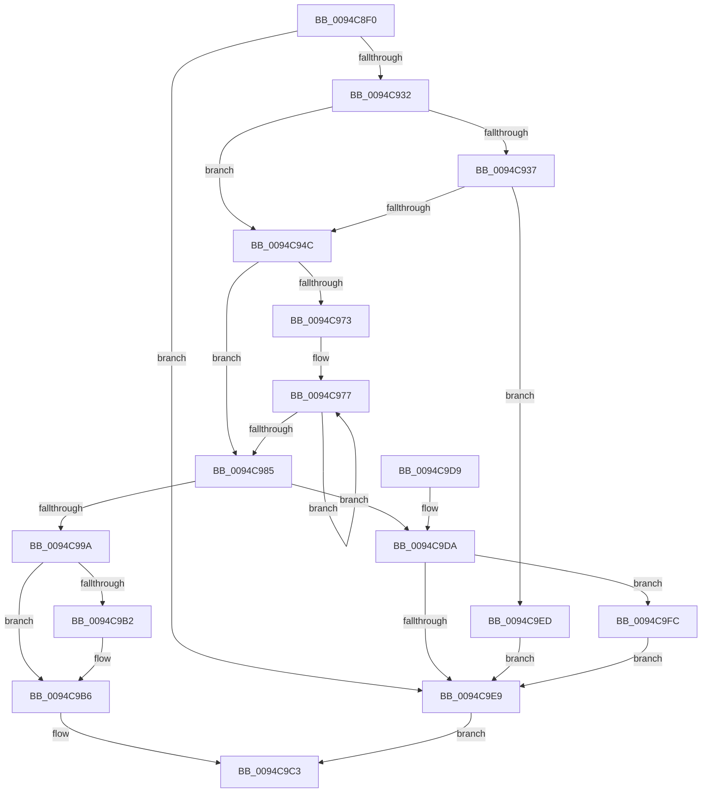

# ExpAllocateHandleTable

- RVA: `0x0094C8F0`–`0x0094CA0B` (길이 `283` bytes)
- VA: `0x000000014094C8F0`
- 실행 섹션: `PAGE`
- PDB 이름 있음: `예`; PDB Function 태그: `아니요`
- unwind 정보 RVA: `0x0009155C`
- 디코드: `75`개 명령, `283/283` bytes 표시
- 미해석 바이트: `0` (있으면 어셈블리에 `.byte`로 보존)

> 이 문서는 커널 이미지의 기계어와 PDB 기호를 분석해 생성했습니다. 4번과 5번은 함수 원형과 자료형을 바이너리 사용 방식에서 추정한 C 해석이며 원본 소스 복구 결과는 아닙니다.

## 1. Dependencies

- 직접 호출 지점: **7**; 고유 호출 대상: **6**
- 직접 호출자로 확인된 함수: **3**
- RIP 상대 이미지 참조: **1**

### Outgoing calls
- `0x0094C921` → [ExAllocatePool2](../../poolcode/B8/ExAllocatePool2_function_00B820F0.md) (function, `0x00B820F0`)
- `0x0094C93F` → [PsChargeProcessPagedPoolQuota](../89/PsChargeProcessPagedPoolQuota_function_00891170.md) (function, `0x00891170`)
- `0x0094C98A` → [ExpAllocateLowLevelTable](ExpAllocateLowLevelTable_function_0094CA14.md) (function, `0x0094CA14`)
- `0x0094C9A4` → [ExpInsertLowLevelTableIntoFreeList](ExpInsertLowLevelTableIntoFreeList_function_0094D470.md) (function, `0x0094D470`)
- `0x0094C9DF` → [ExFreePoolWithTag](../../poolcode/B8/ExFreePoolWithTag_function_00B82870.md) (function, `0x00B82870`)
- `0x0094C9F5` → [ExFreePoolWithTag](../../poolcode/B8/ExFreePoolWithTag_function_00B82870.md) (function, `0x00B82870`)
- `0x0094CA04` → [PsReturnProcessPagedPoolQuota](../../text/2A/PsReturnProcessPagedPoolQuota_function_002A6860.md) (function, `0x002A6860`)

### Direct callers
- [RtlpInitializeHandleTableForAtomTable](RtlpInitializeHandleTableForAtomTable_function_0094C398.md) at `0x0094C3A5`
- [ExCreateHandleTable](ExCreateHandleTable_function_0094C7E8.md) at `0x0094C80E`
- [ExDupHandleTable](ExDupHandleTable_function_0094CAC0.md) at `0x0094CB1F`

### Static image references
- `0x0094C90B` → RVA `0x00FD9B18` (`PAGEDATA`; read)

## 2. Other-region calls and transfers

- 다른 실행 섹션으로 향하는 call: **4**
  - `0x0094C921` → [ExAllocatePool2](../../poolcode/B8/ExAllocatePool2_function_00B820F0.md) (`PAGE` → `POOLCODE`)
  - `0x0094C9DF` → [ExFreePoolWithTag](../../poolcode/B8/ExFreePoolWithTag_function_00B82870.md) (`PAGE` → `POOLCODE`)
  - `0x0094C9F5` → [ExFreePoolWithTag](../../poolcode/B8/ExFreePoolWithTag_function_00B82870.md) (`PAGE` → `POOLCODE`)
  - `0x0094CA04` → [PsReturnProcessPagedPoolQuota](../../text/2A/PsReturnProcessPagedPoolQuota_function_002A6860.md) (`PAGE` → `.text`)
- 별도 외부 분기/꼬리 이동을 확인하지 못했습니다.

## 3. Assembly (complete function range)

```asm
0094C8F0  48 89 6C 24 08                  mov qword ptr [rsp + 8], rbp
0094C8F5  48 89 74 24 10                  mov qword ptr [rsp + 0x10], rsi
0094C8FA  48 89 7C 24 18                  mov qword ptr [rsp + 0x18], rdi
0094C8FF  41 56                           push r14
0094C901  48 83 EC 20                     sub rsp, 0x20
0094C905  44 8A F2                        mov r14b, dl
0094C908  48 8B F1                        mov rsi, rcx
0094C90B  8B 15 07 D2 68 00               mov edx, dword ptr [rip + 0x68d207]
0094C911  B9 08 01 00 00                  mov ecx, 0x108
0094C916  FF C2                           inc edx
0094C918  41 B8 4F 62 74 62               mov r8d, 0x6274624f
0094C91E  C1 E2 06                        shl edx, 6
0094C921  E8 CA 57 23 00                  call 0x140b820f0
0094C926  48 8B F8                        mov rdi, rax
0094C929  48 85 C0                        test rax, rax
0094C92C  0F 84 B7 00 00 00               je 0x14094c9e9
0094C932  48 85 F6                        test rsi, rsi
0094C935  74 15                           je 0x14094c94c
0094C937  BA 80 00 00 00                  mov edx, 0x80
0094C93C  48 8B CE                        mov rcx, rsi
0094C93F  E8 2C 48 F4 FF                  call 0x140891170
0094C944  85 C0                           test eax, eax
0094C946  0F 88 A1 00 00 00               js 0x14094c9ed
0094C94C  48 89 77 10                     mov qword ptr [rdi + 0x10], rsi
0094C950  65 48 8B 04 25 88 01 00 00      mov rax, qword ptr gs:[0x188]
0094C959  48 8B 88 B8 00 00 00            mov rcx, qword ptr [rax + 0xb8]
0094C960  8B 81 D0 01 00 00               mov eax, dword ptr [rcx + 0x1d0]
0094C966  8B 0D AC D1 68 00               mov ecx, dword ptr [rip + 0x68d1ac]
0094C96C  89 47 28                        mov dword ptr [rdi + 0x28], eax
0094C96F  85 C9                           test ecx, ecx
0094C971  74 12                           je 0x14094c985
0094C973  48 8D 47 40                     lea rax, [rdi + 0x40]
0094C977  48 83 20 00                     and qword ptr [rax], 0
0094C97B  48 8D 40 40                     lea rax, [rax + 0x40]
0094C97F  48 83 E9 01                     sub rcx, 1
0094C983  75 F2                           jne 0x14094c977
0094C985  33 D2                           xor edx, edx
0094C987  48 8B CF                        mov rcx, rdi
0094C98A  E8 85 00 00 00                  call 0x14094ca14
0094C98F  48 8B E8                        mov rbp, rax
0094C992  48 8B CF                        mov rcx, rdi
0094C995  48 85 C0                        test rax, rax
0094C998  74 40                           je 0x14094c9da
0094C99A  4C 8D 47 40                     lea r8, [rdi + 0x40]
0094C99E  45 8A CE                        mov r9b, r14b
0094C9A1  48 8B D0                        mov rdx, rax
0094C9A4  E8 C7 0A 00 00                  call 0x14094d470
0094C9A9  48 89 6F 08                     mov qword ptr [rdi + 8], rbp
0094C9AD  48 85 F6                        test rsi, rsi
0094C9B0  74 04                           je 0x14094c9b6
0094C9B2  80 4F 2C 10                     or byte ptr [rdi + 0x2c], 0x10
0094C9B6  48 83 67 38 00                  and qword ptr [rdi + 0x38], 0
0094C9BB  48 8B C7                        mov rax, rdi
0094C9BE  48 83 67 30 00                  and qword ptr [rdi + 0x30], 0
0094C9C3  48 8B 6C 24 30                  mov rbp, qword ptr [rsp + 0x30]
0094C9C8  48 8B 74 24 38                  mov rsi, qword ptr [rsp + 0x38]
0094C9CD  48 8B 7C 24 40                  mov rdi, qword ptr [rsp + 0x40]
0094C9D2  48 83 C4 20                     add rsp, 0x20
0094C9D6  41 5E                           pop r14
0094C9D8  C3                              ret
0094C9D9  CC                              int3
0094C9DA  BA 4F 62 74 62                  mov edx, 0x6274624f
0094C9DF  E8 8C 5E 23 00                  call 0x140b82870
0094C9E4  48 85 F6                        test rsi, rsi
0094C9E7  75 13                           jne 0x14094c9fc
0094C9E9  33 C0                           xor eax, eax
0094C9EB  EB D6                           jmp 0x14094c9c3
0094C9ED  BA 4F 62 74 62                  mov edx, 0x6274624f
0094C9F2  48 8B CF                        mov rcx, rdi
0094C9F5  E8 76 5E 23 00                  call 0x140b82870
0094C9FA  EB ED                           jmp 0x14094c9e9
0094C9FC  BA 80 00 00 00                  mov edx, 0x80
0094CA01  48 8B CE                        mov rcx, rsi
0094CA04  E8 57 9E 95 FF                  call 0x1402a6860
0094CA09  EB DE                           jmp 0x14094c9e9
```

## 4. C-style interpretation (structured pseudocode)

```c
__int64 __fastcall ExpAllocateHandleTable(__int64 a1, unsigned __int8 a2)
{
    __int64 result;
    __int64 v_rsp;
    unsigned __int64 v_stack_p10;
    unsigned __int64 v_stack_p18;
    unsigned __int64 v_stack_p8;

    v_stack_p8 = v_rbp;
    v_stack_p10 = v_rsi;
    v_stack_p18 = v_rdi;
    v_rsp = (v_rsp) - (32);
    a2 = (unsigned int)(((unsigned int)(*(unsigned int *)(v_rip + 6869511))) + 1);
    a2 = (unsigned int)((a2) << (6));
    result = ExAllocatePool2(264, a2, (unsigned int)(0x6274624FULL), a4);
    if (result == 0) goto loc_0094C9E9;
    if (a1 == 0) goto loc_0094C94C;
    result = PsChargeProcessPagedPoolQuota(a1, 128, (unsigned int)(0x6274624FULL), a4);
    if (sign_flag) goto loc_0094C9ED;
loc_0094C94C:
    *(unsigned __int64 *)(result + 16) = a1;
    *(unsigned int *)(result + 40) = (unsigned int)((unsigned int)(*(unsigned int *)(*(unsigned __int64 *)(*(unsigned __int64 *)(gs_base + (0 + 392)) + 184) + 464)));
    if ((unsigned int)((unsigned int)(*(unsigned int *)(v_rip + 6869420))) == 0) goto loc_0094C985;
loc_0094C977:
    a1 = ((unsigned int)(*(unsigned int *)(v_rip + 6869420))) - (1);
    if (condition_is_not_equal) goto loc_0094C977;
loc_0094C985:
    a2 = 0;
    result = ExpAllocateLowLevelTable(result, a2, (unsigned int)(0x6274624FULL), a4);
    if (result == 0) goto loc_0094C9DA;
    result = ExpInsertLowLevelTableIntoFreeList(result, result, result + 64, 0);
    *(unsigned __int64 *)(result + 8) = result;
    if (a1 != 0) {
    }
loc_0094C9C3:
    v_rsp = (v_rsp) + (32);
    return result;
loc_0094C9DA:
    result = ExFreePoolWithTag(result, (unsigned int)(0x6274624FULL), result + 64, 0);
    if (v_stack_p10 != 0) goto loc_0094C9FC;
loc_0094C9E9:
    result = 0;
    goto loc_0094C9C3;
loc_0094C9ED:
    result = ExFreePoolWithTag(v_stack_p18, (unsigned int)(0x6274624FULL), result + 64, 0);
    goto loc_0094C9E9;
loc_0094C9FC:
    result = PsReturnProcessPagedPoolQuota(v_stack_p10, 128, result + 64, 0);
    goto loc_0094C9E9;
}
```

## 5. (Beta) C Style

```c
int64_t ExpAllocateHandleTable(int64_t Arg1, uint8_t Arg2)
{
    int64_t result;
    int64_t local_rsp;
    uint64_t v_stack_p10;
    uint64_t v_stack_p18;
    uint64_t v_stack_p8;

    v_stack_p8 = local_rbp;
    v_stack_p10 = local_rsi;
    v_stack_p18 = local_rdi;
    local_rsp = (local_rsp) - (32);
    Arg2 = (uint32_t)(((uint32_t)(*(uint32_t *)(v_rip + 0x68D207))) + 1);
    Arg2 = (uint32_t)((Arg2) << (6));
    result = ExAllocatePool2(264, Arg2, (uint32_t)(0x6274624FULL), a4);
    if (result == 0) goto loc_0094C9E9;
    if (Arg1 == 0) goto loc_0094C94C;
    result = PsChargeProcessPagedPoolQuota(Arg1, 128, (uint32_t)(0x6274624FULL), a4);
    if (sign_flag) goto loc_0094C9ED;
loc_0094C94C:
    *(uint64_t *)(result + 0x10) = Arg1;
    *(uint32_t *)(result + 0x28) = (uint32_t)((uint32_t)(*(uint32_t *)(*(uint64_t *)(*(uint64_t *)(gs_base + (0 + 0x188)) + 0xB8) + 0x1D0)));
    if ((uint32_t)((uint32_t)(*(uint32_t *)(v_rip + 0x68D1AC))) == 0) goto loc_0094C985;
loc_0094C977:
    Arg1 = ((uint32_t)(*(uint32_t *)(v_rip + 0x68D1AC))) - (1);
    if (condition_is_not_equal) goto loc_0094C977;
loc_0094C985:
    Arg2 = 0;
    result = ExpAllocateLowLevelTable(result, Arg2, (uint32_t)(0x6274624FULL), a4);
    if (result == 0) goto loc_0094C9DA;
    result = ExpInsertLowLevelTableIntoFreeList(result, result, result + 64, 0);
    *(uint64_t *)(result + 0x8) = result;
    if (Arg1 != 0) {
    }
loc_0094C9C3:
    local_rsp = (local_rsp) + (32);
    return result;
loc_0094C9DA:
    result = ExFreePoolWithTag(result, (uint32_t)(0x6274624FULL), result + 64, 0);
    if (v_stack_p10 != 0) goto loc_0094C9FC;
loc_0094C9E9:
    result = 0;
    goto loc_0094C9C3;
loc_0094C9ED:
    result = ExFreePoolWithTag(v_stack_p18, (uint32_t)(0x6274624FULL), result + 64, 0);
    goto loc_0094C9E9;
loc_0094C9FC:
    result = PsReturnProcessPagedPoolQuota(v_stack_p10, 128, result + 64, 0);
    goto loc_0094C9E9;
}
```

## 6. Execution-region graph

[열기: 2D/3D 그래프와 함수 탐색 컨트롤 패널](../../../control-panel.html?section=page&rva=0x0094C8F0&view=graph)

- 2D 그래프는 위에서 아래로 흐르고, 3D 그래프는 빈 공간을 드래그해 회전합니다. Shift+드래그는 이동, 휠은 확대·축소, 함수 노드 선택은 대상 보고서 이동입니다.

### Static fallback


