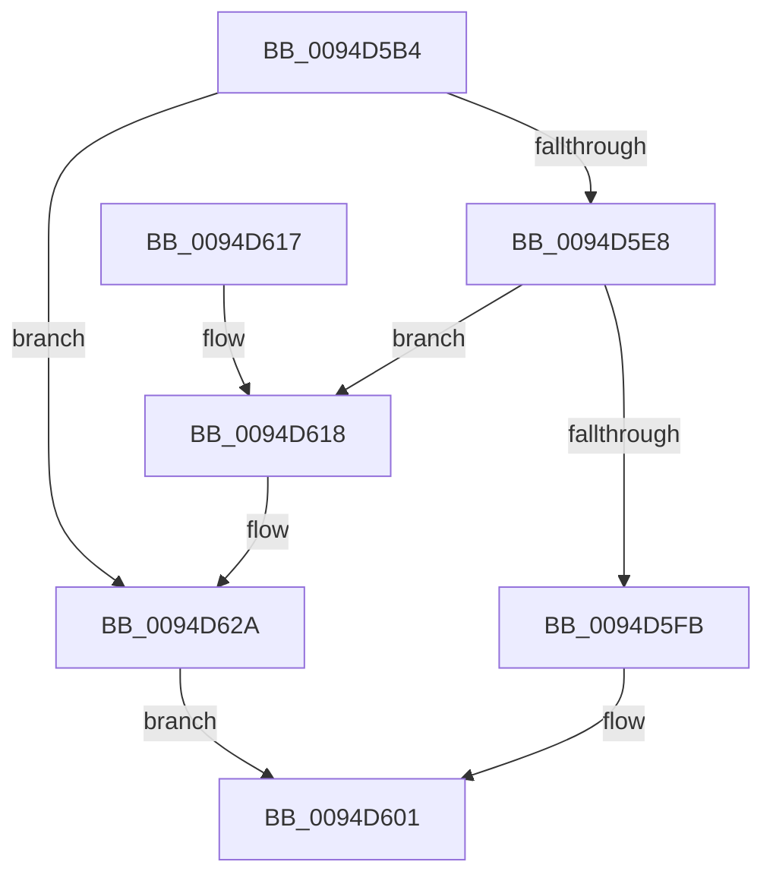

# ExpAllocateMidLevelTable

- RVA: `0x0094D5B4`–`0x0094D62E` (길이 `122` bytes)
- VA: `0x000000014094D5B4`
- 실행 섹션: `PAGE`
- PDB 이름 있음: `예`; PDB Function 태그: `아니요`
- unwind 정보 RVA: `0x000916F0`
- 디코드: `35`개 명령, `122/122` bytes 표시
- 미해석 바이트: `0` (있으면 어셈블리에 `.byte`로 보존)

> 이 문서는 커널 이미지의 기계어와 PDB 기호를 분석해 생성했습니다. 4번과 5번은 함수 원형과 자료형을 바이너리 사용 방식에서 추정한 C 해석이며 원본 소스 복구 결과는 아닙니다.

## 1. Dependencies

- 직접 호출 지점: **3**; 고유 호출 대상: **3**
- 직접 호출자로 확인된 함수: **1**
- RIP 상대 이미지 참조: **0**

### Outgoing calls
- `0x0094D5DB` → [ExpAllocateTablePagedPool](ExpAllocateTablePagedPool_function_0094D634.md) (function, `0x0094D634`)
- `0x0094D5EE` → [ExpAllocateLowLevelTable](ExpAllocateLowLevelTable_function_0094CA14.md) (function, `0x0094CA14`)
- `0x0094D625` → [ExpFreeTablePagedPool](../86/ExpFreeTablePagedPool_function_0086B410.md) (function, `0x0086B410`)

### Direct callers
- [ExpAllocateHandleTableEntrySlow](ExpAllocateHandleTableEntrySlow_function_0094D2FC.md) at `0x0094D39D`
- [ExpAllocateHandleTableEntrySlow](ExpAllocateHandleTableEntrySlow_function_0094D2FC.md) at `0x0094D428`
- [ExpAllocateHandleTableEntrySlow](ExpAllocateHandleTableEntrySlow_function_0094D2FC.md) at `0x0094D454`

### Static image references
- 디코드된 RIP-relative 메모리 참조가 없습니다.

## 2. Other-region calls and transfers

- 다른 실행 섹션으로 향하는 call: **0**
- 별도 외부 분기/꼬리 이동을 확인하지 못했습니다.

## 3. Assembly (complete function range)

```asm
0094D5B4  48 89 5C 24 08                  mov qword ptr [rsp + 8], rbx
0094D5B9  48 89 74 24 10                  mov qword ptr [rsp + 0x10], rsi
0094D5BE  48 89 7C 24 18                  mov qword ptr [rsp + 0x18], rdi
0094D5C3  41 56                           push r14
0094D5C5  48 83 EC 20                     sub rsp, 0x20
0094D5C9  4C 8B F2                        mov r14, rdx
0094D5CC  48 8B F1                        mov rsi, rcx
0094D5CF  48 8B 49 10                     mov rcx, qword ptr [rcx + 0x10]
0094D5D3  BA 00 10 00 00                  mov edx, 0x1000
0094D5D8  49 8B D8                        mov rbx, r8
0094D5DB  E8 54 00 00 00                  call 0x14094d634
0094D5E0  48 8B F8                        mov rdi, rax
0094D5E3  48 85 C0                        test rax, rax
0094D5E6  74 42                           je 0x14094d62a
0094D5E8  48 8B D3                        mov rdx, rbx
0094D5EB  48 8B CE                        mov rcx, rsi
0094D5EE  E8 21 F4 FF FF                  call 0x14094ca14
0094D5F3  49 89 06                        mov qword ptr [r14], rax
0094D5F6  48 85 C0                        test rax, rax
0094D5F9  74 1D                           je 0x14094d618
0094D5FB  48 89 07                        mov qword ptr [rdi], rax
0094D5FE  48 8B C7                        mov rax, rdi
0094D601  48 8B 5C 24 30                  mov rbx, qword ptr [rsp + 0x30]
0094D606  48 8B 74 24 38                  mov rsi, qword ptr [rsp + 0x38]
0094D60B  48 8B 7C 24 40                  mov rdi, qword ptr [rsp + 0x40]
0094D610  48 83 C4 20                     add rsp, 0x20
0094D614  41 5E                           pop r14
0094D616  C3                              ret
0094D617  CC                              int3
0094D618  48 8B 4E 10                     mov rcx, qword ptr [rsi + 0x10]
0094D61C  41 B8 00 10 00 00               mov r8d, 0x1000
0094D622  48 8B D7                        mov rdx, rdi
0094D625  E8 E6 DD F1 FF                  call 0x14086b410
0094D62A  33 C0                           xor eax, eax
0094D62C  EB D3                           jmp 0x14094d601
```

## 4. C-style interpretation (structured pseudocode)

```c
__int64 __fastcall ExpAllocateMidLevelTable(__int64 a1, __int64 a2, __int64 a3)
{
    __int64 result;
    __int64 v_rsp;
    unsigned __int64 v_stack_p10;
    unsigned __int64 v_stack_p18;
    unsigned __int64 v_stack_p8;

    v_stack_p8 = v_rbx;
    v_stack_p10 = v_rsi;
    v_stack_p18 = v_rdi;
    v_rsp = (v_rsp) - (32);
    result = ExpAllocateTablePagedPool(*(unsigned __int64 *)(a1 + 16), (unsigned int)(0x1000ULL), a3, a4);
    if (result == 0) goto loc_0094D62A;
    result = ExpAllocateLowLevelTable(a1, a3, a3, a4);
    *(unsigned __int64 *)(a2) = result;
    if (result == 0) goto loc_0094D618;
    *(unsigned __int64 *)(result) = result;
loc_0094D601:
    v_rsp = (v_rsp) + (32);
    return result;
loc_0094D618:
    result = ExpFreeTablePagedPool(*(unsigned __int64 *)(v_stack_p10 + 16), v_stack_p18, (unsigned int)(0x1000ULL), a4);
loc_0094D62A:
    result = 0;
    goto loc_0094D601;
}
```

## 5. (Beta) C Style

```c
int64_t ExpAllocateMidLevelTable(void *Arg1, void *Arg2, int64_t Arg3)
{
    uint8_t *arg1 = (uint8_t *)Arg1;
    uint8_t *arg2 = (uint8_t *)Arg2;

    int64_t result;
    int64_t local_rsp;
    uint64_t v_stack_p10;
    uint64_t v_stack_p18;
    uint64_t v_stack_p8;

    v_stack_p8 = local_rbx;
    v_stack_p10 = local_rsi;
    v_stack_p18 = local_rdi;
    local_rsp = (local_rsp) - (32);
    result = ExpAllocateTablePagedPool(*(uint64_t *)(arg1 + 0x10), (uint32_t)(0x1000ULL), Arg3, a4);
    if (result == 0) goto loc_0094D62A;
    result = ExpAllocateLowLevelTable(Arg1, Arg3, Arg3, a4);
    *(uint64_t *)(arg2) = result;
    if (result == 0) goto loc_0094D618;
    *(uint64_t *)(result) = result;
loc_0094D601:
    local_rsp = (local_rsp) + (32);
    return result;
loc_0094D618:
    result = ExpFreeTablePagedPool(*(uint64_t *)(v_stack_p10 + 0x10), v_stack_p18, (uint32_t)(0x1000ULL), a4);
loc_0094D62A:
    result = 0;
    goto loc_0094D601;
}
```

### 관측된 메모리 오프셋

구조체 형식이 확인되지 않은 접근은 인자 기준의 오프셋으로만 기록했습니다.

| 기준 인자 | 오프셋 표현 | 폭 (bit) | 접근 |
|---|---:|---:|---|
| `Arg1` | `+ 0x10` | `64` | `R` |
| `Arg2` | `+ 0x0` | `64` | `W` |

## 6. Execution-region graph

[열기: 2D/3D 그래프와 함수 탐색 컨트롤 패널](../../../control-panel.html?section=page&rva=0x0094D5B4&view=graph)

- 2D 그래프는 위에서 아래로 흐르고, 3D 그래프는 빈 공간을 드래그해 회전합니다. Shift+드래그는 이동, 휠은 확대·축소, 함수 노드 선택은 대상 보고서 이동입니다.

### Static fallback


