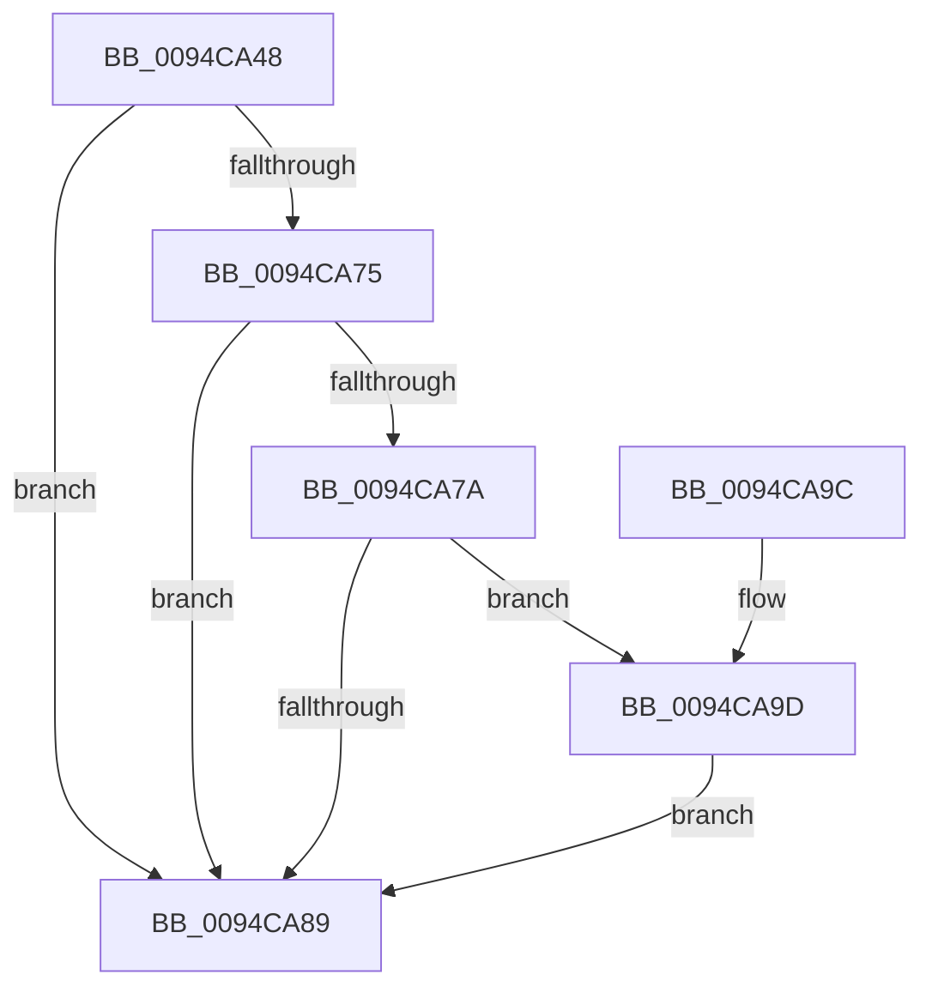

# ExpAllocateTablePagedPoolNoZero

- RVA: `0x0094CA48`–`0x0094CAAE` (길이 `102` bytes)
- VA: `0x000000014094CA48`
- 실행 섹션: `PAGE`
- PDB 이름 있음: `예`; PDB Function 태그: `아니요`
- unwind 정보 RVA: `0x00078D6C`
- 디코드: `31`개 명령, `102/102` bytes 표시
- 미해석 바이트: `0` (있으면 어셈블리에 `.byte`로 보존)

> 이 문서는 커널 이미지의 기계어와 PDB 기호를 분석해 생성했습니다. 4번과 5번은 함수 원형과 자료형을 바이너리 사용 방식에서 추정한 C 해석이며 원본 소스 복구 결과는 아닙니다.

## 1. Dependencies

- 직접 호출 지점: **3**; 고유 호출 대상: **3**
- 직접 호출자로 확인된 함수: **2**
- RIP 상대 이미지 참조: **0**

### Outgoing calls
- `0x0094CA68` → [ExAllocatePool2](../../poolcode/B8/ExAllocatePool2_function_00B820F0.md) (function, `0x00B820F0`)
- `0x0094CA80` → [PsChargeProcessPagedPoolQuota](../89/PsChargeProcessPagedPoolQuota_function_00891170.md) (function, `0x00891170`)
- `0x0094CAA5` → [ExFreePoolWithTag](../../poolcode/B8/ExFreePoolWithTag_function_00B82870.md) (function, `0x00B82870`)

### Direct callers
- [ExpAllocateLowLevelTable](ExpAllocateLowLevelTable_function_0094CA14.md) at `0x0094CA26`
- [ExpAllocateTablePagedPool](ExpAllocateTablePagedPool_function_0094D634.md) at `0x0094D641`

### Static image references
- 디코드된 RIP-relative 메모리 참조가 없습니다.

## 2. Other-region calls and transfers

- 다른 실행 섹션으로 향하는 call: **2**
  - `0x0094CA68` → [ExAllocatePool2](../../poolcode/B8/ExAllocatePool2_function_00B820F0.md) (`PAGE` → `POOLCODE`)
  - `0x0094CAA5` → [ExFreePoolWithTag](../../poolcode/B8/ExFreePoolWithTag_function_00B82870.md) (`PAGE` → `POOLCODE`)
- 별도 외부 분기/꼬리 이동을 확인하지 못했습니다.

## 3. Assembly (complete function range)

```asm
0094CA48  48 89 5C 24 08                  mov qword ptr [rsp + 8], rbx
0094CA4D  48 89 74 24 10                  mov qword ptr [rsp + 0x10], rsi
0094CA52  57                              push rdi
0094CA53  48 83 EC 20                     sub rsp, 0x20
0094CA57  48 8B F9                        mov rdi, rcx
0094CA5A  41 B8 4F 62 74 62               mov r8d, 0x6274624f
0094CA60  B9 00 01 00 00                  mov ecx, 0x100
0094CA65  48 8B F2                        mov rsi, rdx
0094CA68  E8 83 56 23 00                  call 0x140b820f0
0094CA6D  48 8B D8                        mov rbx, rax
0094CA70  48 85 C0                        test rax, rax
0094CA73  74 14                           je 0x14094ca89
0094CA75  48 85 FF                        test rdi, rdi
0094CA78  74 0F                           je 0x14094ca89
0094CA7A  48 8B D6                        mov rdx, rsi
0094CA7D  48 8B CF                        mov rcx, rdi
0094CA80  E8 EB 46 F4 FF                  call 0x140891170
0094CA85  85 C0                           test eax, eax
0094CA87  78 14                           js 0x14094ca9d
0094CA89  48 8B 74 24 38                  mov rsi, qword ptr [rsp + 0x38]
0094CA8E  48 8B C3                        mov rax, rbx
0094CA91  48 8B 5C 24 30                  mov rbx, qword ptr [rsp + 0x30]
0094CA96  48 83 C4 20                     add rsp, 0x20
0094CA9A  5F                              pop rdi
0094CA9B  C3                              ret
0094CA9C  CC                              int3
0094CA9D  BA 4F 62 74 62                  mov edx, 0x6274624f
0094CAA2  48 8B CB                        mov rcx, rbx
0094CAA5  E8 C6 5D 23 00                  call 0x140b82870
0094CAAA  33 DB                           xor ebx, ebx
0094CAAC  EB DB                           jmp 0x14094ca89
```

## 4. C-style interpretation (structured pseudocode)

```c
__int64 __fastcall ExpAllocateTablePagedPoolNoZero(__int64 a1, __int64 a2)
{
    __int64 result;
    __int64 v_rbx;
    __int64 v_rsp;
    unsigned __int64 v_stack_p10;
    unsigned __int64 v_stack_p8;

    v_stack_p8 = v_rbx;
    v_stack_p10 = v_rsi;
    v_rsp = (v_rsp) - (32);
    result = ExAllocatePool2(256, a2, (unsigned int)(0x6274624FULL), a4);
    if (result == 0) goto loc_0094CA89;
    if (a1 == 0) goto loc_0094CA89;
    result = PsChargeProcessPagedPoolQuota(a1, a2, (unsigned int)(0x6274624FULL), a4);
    if (sign_flag) goto loc_0094CA9D;
loc_0094CA89:
    v_rsp = (v_rsp) + (32);
    return result;
loc_0094CA9D:
    result = ExFreePoolWithTag(v_stack_p8, (unsigned int)(0x6274624FULL), (unsigned int)(0x6274624FULL), a4);
    v_rbx = 0;
    goto loc_0094CA89;
}
```

## 5. (Beta) C Style

```c
int64_t ExpAllocateTablePagedPoolNoZero(int64_t Arg1, int64_t Arg2)
{
    int64_t result;
    int64_t local_rbx;
    int64_t local_rsp;
    uint64_t v_stack_p10;
    uint64_t v_stack_p8;

    v_stack_p8 = local_rbx;
    v_stack_p10 = local_rsi;
    local_rsp = (local_rsp) - (32);
    result = ExAllocatePool2(256, Arg2, (uint32_t)(0x6274624FULL), a4);
    if (result == 0) goto loc_0094CA89;
    if (Arg1 == 0) goto loc_0094CA89;
    result = PsChargeProcessPagedPoolQuota(Arg1, Arg2, (uint32_t)(0x6274624FULL), a4);
    if (sign_flag) goto loc_0094CA9D;
loc_0094CA89:
    local_rsp = (local_rsp) + (32);
    return result;
loc_0094CA9D:
    result = ExFreePoolWithTag(v_stack_p8, (uint32_t)(0x6274624FULL), (uint32_t)(0x6274624FULL), a4);
    local_rbx = 0;
    goto loc_0094CA89;
}
```

## 6. Execution-region graph

[열기: 2D/3D 그래프와 함수 탐색 컨트롤 패널](../../../control-panel.html?section=page&rva=0x0094CA48&view=graph)

- 2D 그래프는 위에서 아래로 흐르고, 3D 그래프는 빈 공간을 드래그해 회전합니다. Shift+드래그는 이동, 휠은 확대·축소, 함수 노드 선택은 대상 보고서 이동입니다.

### Static fallback


