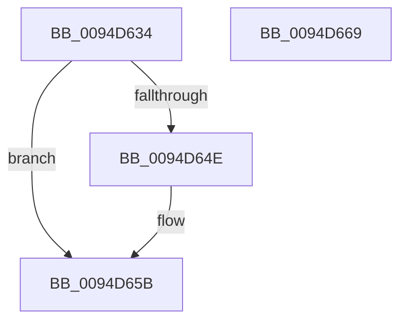

# ExpAllocateTablePagedPool

- RVA: `0x0094D634`–`0x0094D66A` (길이 `54` bytes)
- VA: `0x000000014094D634`
- 실행 섹션: `PAGE`
- PDB 이름 있음: `예`; PDB Function 태그: `아니요`
- unwind 정보 RVA: `0x0005CAAC`
- 디코드: `18`개 명령, `54/54` bytes 표시
- 미해석 바이트: `0` (있으면 어셈블리에 `.byte`로 보존)

> 이 문서는 커널 이미지의 기계어와 PDB 기호를 분석해 생성했습니다. 4번과 5번은 함수 원형과 자료형을 바이너리 사용 방식에서 추정한 C 해석이며 원본 소스 복구 결과는 아닙니다.

## 1. Dependencies

- 직접 호출 지점: **2**; 고유 호출 대상: **2**
- 직접 호출자로 확인된 함수: **6**
- RIP 상대 이미지 참조: **0**

### Outgoing calls
- `0x0094D641` → [ExpAllocateTablePagedPoolNoZero](ExpAllocateTablePagedPoolNoZero_function_0094CA48.md) (function, `0x0094CA48`)
- `0x0094D656` → [memset](../../text/6C/memset_function_006C6C40.md) (function, `0x006C6C40`)

### Direct callers
- [sub_0086AEAF](../86/Unknown_function_0086AEAF.md) at `0x0086AF43`
- [ObpCreateHandle](../86/ObpCreateHandle_function_0086B950.md) at `0x0086CB64`
- [ObDuplicateObject](../8C/ObDuplicateObject_function_008C4FA0.md) at `0x008C5B57`
- [ExpSetHandleExtraInfo](ExpSetHandleExtraInfo_function_0094C1B4.md) at `0x0094C227`
- [ExpAllocateHandleTableEntrySlow](ExpAllocateHandleTableEntrySlow_function_0094D2FC.md) at `0x0094D410`
- [ExpAllocateMidLevelTable](ExpAllocateMidLevelTable_function_0094D5B4.md) at `0x0094D5DB`

### Static image references
- 디코드된 RIP-relative 메모리 참조가 없습니다.

## 2. Other-region calls and transfers

- 다른 실행 섹션으로 향하는 call: **1**
  - `0x0094D656` → [memset](../../text/6C/memset_function_006C6C40.md) (`PAGE` → `.text`)
- 별도 외부 분기/꼬리 이동을 확인하지 못했습니다.

## 3. Assembly (complete function range)

```asm
0094D634  48 89 5C 24 08                  mov qword ptr [rsp + 8], rbx
0094D639  57                              push rdi
0094D63A  48 83 EC 20                     sub rsp, 0x20
0094D63E  48 8B FA                        mov rdi, rdx
0094D641  E8 02 F4 FF FF                  call 0x14094ca48
0094D646  48 8B D8                        mov rbx, rax
0094D649  48 85 C0                        test rax, rax
0094D64C  74 0D                           je 0x14094d65b
0094D64E  4C 8B C7                        mov r8, rdi
0094D651  33 D2                           xor edx, edx
0094D653  48 8B C8                        mov rcx, rax
0094D656  E8 E5 95 D7 FF                  call 0x1406c6c40
0094D65B  48 8B C3                        mov rax, rbx
0094D65E  48 8B 5C 24 30                  mov rbx, qword ptr [rsp + 0x30]
0094D663  48 83 C4 20                     add rsp, 0x20
0094D667  5F                              pop rdi
0094D668  C3                              ret
0094D669  CC                              int3
```

## 4. C-style interpretation (structured pseudocode)

```c
__int64 __fastcall ExpAllocateTablePagedPool(__int64 a1, __int64 a2)
{
    __int64 result;
    __int64 v_rsp;
    unsigned __int64 v_stack_p8;

    v_stack_p8 = v_rbx;
    v_rsp = (v_rsp) - (32);
    result = ExpAllocateTablePagedPoolNoZero(a1, a2, a3, a4);
    if (result != 0) {
        a3 = a2;
        a2 = 0;
        a1 = result;
        result = memset(a1, a2, a3, a4);
    }
    v_rsp = (v_rsp) + (32);
    return result;
}
```

## 5. (Beta) C Style

```c
int64_t ExpAllocateTablePagedPool(int64_t Arg1, int64_t Arg2)
{
    int64_t result;
    int64_t local_rsp;
    uint64_t v_stack_p8;

    v_stack_p8 = local_rbx;
    local_rsp = (local_rsp) - (32);
    result = ExpAllocateTablePagedPoolNoZero(Arg1, Arg2, a3, a4);
    if (result != 0) {
        a3 = Arg2;
        Arg2 = 0;
        Arg1 = result;
        result = memset(Arg1, Arg2, a3, a4);
    }
    local_rsp = (local_rsp) + (32);
    return result;
}
```

## 6. Execution-region graph

[열기: 2D/3D 그래프와 함수 탐색 컨트롤 패널](../../../control-panel.html?section=page&rva=0x0094D634&view=graph)

- 2D 그래프는 위에서 아래로 흐르고, 3D 그래프는 빈 공간을 드래그해 회전합니다. Shift+드래그는 이동, 휠은 확대·축소, 함수 노드 선택은 대상 보고서 이동입니다.

### Static fallback


