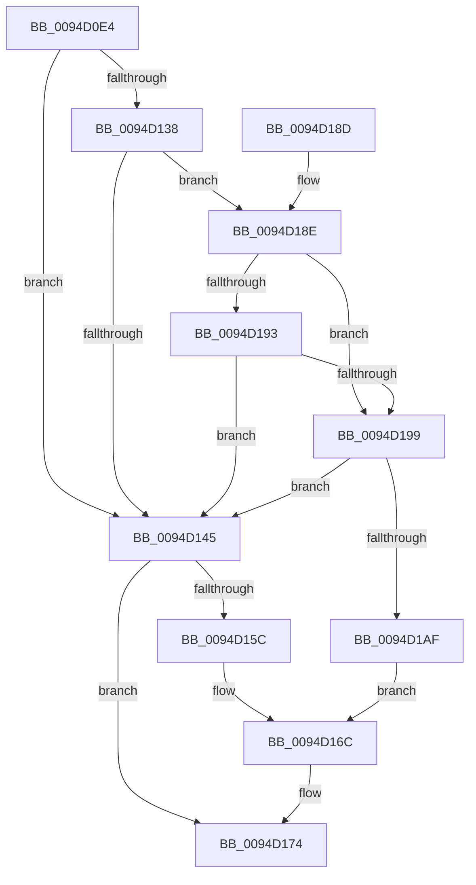

# ExpDuplicateSingleHandle

- RVA: `0x0094D0E4`–`0x0094D1BC` (길이 `216` bytes)
- VA: `0x000000014094D0E4`
- 실행 섹션: `PAGE`
- PDB 이름 있음: `예`; PDB Function 태그: `아니요`
- unwind 정보 RVA: `0x00091678`
- 디코드: `66`개 명령, `216/216` bytes 표시
- 미해석 바이트: `0` (있으면 어셈블리에 `.byte`로 보존)

> 이 문서는 커널 이미지의 기계어와 PDB 기호를 분석해 생성했습니다. 4번과 5번은 함수 원형과 자료형을 바이너리 사용 방식에서 추정한 C 해석이며 원본 소스 복구 결과는 아닙니다.

## 1. Dependencies

- 직접 호출 지점: **4**; 고유 호출 대상: **4**
- 직접 호출자로 확인된 함수: **1**
- RIP 상대 이미지 참조: **0**

### Outgoing calls
- `0x0094D13B` → [ExpGetHandleExtraInfo](../86/ExpGetHandleExtraInfo_function_0086B454.md) (function, `0x0086B454`)
- `0x0094D151` → [ObInheritObjectHandle](ObInheritObjectHandle_function_0094D1C4.md) (function, `0x0094D1C4`)
- `0x0094D1A4` → [ExpSetHandleExtraInfo](ExpSetHandleExtraInfo_function_0094C1B4.md) (function, `0x0094C1B4`)
- `0x0094D1B5` → [ExUnlockHandleTableEntry](ExUnlockHandleTableEntry_function_0094D2D0.md) (function, `0x0094D2D0`)

### Direct callers
- [sub_0094CD40](Unknown_function_0094CD40.md) at `0x0094CE4B`

### Static image references
- 디코드된 RIP-relative 메모리 참조가 없습니다.

## 2. Other-region calls and transfers

- 다른 실행 섹션으로 향하는 call: **0**
- 별도 외부 분기/꼬리 이동을 확인하지 못했습니다.

## 3. Assembly (complete function range)

```asm
0094D0E4  48 8B C4                        mov rax, rsp
0094D0E7  48 89 58 08                     mov qword ptr [rax + 8], rbx
0094D0EB  48 89 68 10                     mov qword ptr [rax + 0x10], rbp
0094D0EF  48 89 70 18                     mov qword ptr [rax + 0x18], rsi
0094D0F3  57                              push rdi
0094D0F4  41 56                           push r14
0094D0F6  41 57                           push r15
0094D0F8  48 83 EC 30                     sub rsp, 0x30
0094D0FC  48 8B 74 24 78                  mov rsi, qword ptr [rsp + 0x78]
0094D101  4D 8B F1                        mov r14, r9
0094D104  41 0F 10 01                     movups xmm0, xmmword ptr [r9]
0094D108  49 8B F8                        mov rdi, r8
0094D10B  48 8B EA                        mov rbp, rdx
0094D10E  4C 8B F9                        mov r15, rcx
0094D111  F3 0F 7F 06                     movdqu xmmword ptr [rsi], xmm0
0094D115  0F 57 C0                        xorps xmm0, xmm0
0094D118  0F 11 40 D8                     movups xmmword ptr [rax - 0x28], xmm0
0094D11C  48 8B 06                        mov rax, qword ptr [rsi]
0094D11F  48 25 01 00 FE FF               and rax, 0xfffffffffffe0001
0094D125  48 89 44 24 20                  mov qword ptr [rsp + 0x20], rax
0094D12A  48 89 06                        mov qword ptr [rsi], rax
0094D12D  48 83 0E 01                     or qword ptr [rsi], 1
0094D131  41 83 78 04 00                  cmp dword ptr [r8 + 4], 0
0094D136  74 0D                           je 0x14094d145
0094D138  49 8B C8                        mov rcx, r8
0094D13B  E8 14 E3 F1 FF                  call 0x14086b454
0094D140  48 85 C0                        test rax, rax
0094D143  75 49                           jne 0x14094d18e
0094D145  4D 8B CE                        mov r9, r14
0094D148  4C 8B C7                        mov r8, rdi
0094D14B  48 8B D5                        mov rdx, rbp
0094D14E  49 8B CF                        mov rcx, r15
0094D151  E8 6E 00 00 00                  call 0x14094d1c4
0094D156  8B D8                           mov ebx, eax
0094D158  85 C0                           test eax, eax
0094D15A  79 18                           jns 0x14094d174
0094D15C  80 BC 24 80 00 00 00 00         cmp byte ptr [rsp + 0x80], 0
0094D164  B8 07 01 00 00                  mov eax, 0x107
0094D169  0F 44 D8                        cmove ebx, eax
0094D16C  0F 57 C0                        xorps xmm0, xmm0
0094D16F  8B C3                           mov eax, ebx
0094D171  0F 11 06                        movups xmmword ptr [rsi], xmm0
0094D174  48 8B 5C 24 50                  mov rbx, qword ptr [rsp + 0x50]
0094D179  48 8B 6C 24 58                  mov rbp, qword ptr [rsp + 0x58]
0094D17E  48 8B 74 24 60                  mov rsi, qword ptr [rsp + 0x60]
0094D183  48 83 C4 30                     add rsp, 0x30
0094D187  41 5F                           pop r15
0094D189  41 5E                           pop r14
0094D18B  5F                              pop rdi
0094D18C  C3                              ret
0094D18D  CC                              int3
0094D18E  83 38 00                        cmp dword ptr [rax], 0
0094D191  75 06                           jne 0x14094d199
0094D193  83 78 04 00                     cmp dword ptr [rax + 4], 0
0094D197  74 AC                           je 0x14094d145
0094D199  48 8B 4C 24 70                  mov rcx, qword ptr [rsp + 0x70]
0094D19E  4C 8B C0                        mov r8, rax
0094D1A1  48 8B D5                        mov rdx, rbp
0094D1A4  E8 0B F0 FF FF                  call 0x14094c1b4
0094D1A9  8B D8                           mov ebx, eax
0094D1AB  85 C0                           test eax, eax
0094D1AD  79 96                           jns 0x14094d145
0094D1AF  49 8B D6                        mov rdx, r14
0094D1B2  48 8B CF                        mov rcx, rdi
0094D1B5  E8 16 01 00 00                  call 0x14094d2d0
0094D1BA  EB B0                           jmp 0x14094d16c
```

## 4. C-style interpretation (structured pseudocode)

```c
__int64 __fastcall ExpDuplicateSingleHandle(__int64 a1, __int64 a2, __int64 a3, __int64 a4, __int64 a5, __int64 a6, unsigned __int8 a7)
{
    __int64 result;
    __int64 v_rbx;
    __int64 v_rsp;
    unsigned __int64 v_stack_m28;
    unsigned __int64 v_stack_p10;
    unsigned __int64 v_stack_p18;
    unsigned __int64 v_stack_p8;

    *(unsigned __int64 *)(v_rsp + 8) = v_rbx;
    *(unsigned __int64 *)(v_rsp + 16) = v_rbp;
    *(unsigned __int64 *)(v_rsp + 24) = v_rsi;
    v_rsp = (v_rsp) - (48);
    *(unsigned __int64 *)(a6) = v_xmm0;
    *(unsigned __int64 *)(v_rsp - 40) = v_xmm0;
    result = (*(unsigned __int64 *)(a6)) & (0xFFFFFFFFFFFE0001ULL);
    v_stack_m28 = result;
    *(unsigned __int64 *)(a6) = result;
    if ((*(unsigned int *)(a3 + 4)) == 0) goto loc_0094D145;
    result = ExpGetHandleExtraInfo(a3, a2, a3, a4);
    if (result != 0) goto loc_0094D18E;
loc_0094D145:
    result = ObInheritObjectHandle(a1, a2, a3, a4);
    if (!sign_flag) goto loc_0094D174;
    v_rbx = (unsigned int)((unsigned int)(result));
    if (a7 == 0) { v_rbx = 263; }
loc_0094D16C:
    *(unsigned __int64 *)(a6) = v_xmm0;
loc_0094D174:
    v_rsp = (v_rsp) + (48);
    return (unsigned int)((unsigned int)(v_rbx));
loc_0094D18E:
    if ((*(unsigned int *)((unsigned int)((unsigned int)(v_rbx)))) != 0) goto loc_0094D199;
    if ((*(unsigned int *)((unsigned int)((unsigned int)(v_rbx)) + 4)) == 0) goto loc_0094D145;
loc_0094D199:
    result = ExpSetHandleExtraInfo(a5, v_stack_p10, (unsigned int)((unsigned int)(v_rbx)), a4);
    if (!sign_flag) goto loc_0094D145;
    result = ExUnlockHandleTableEntry(a3, a4, (unsigned int)((unsigned int)(v_rbx)), a4);
    goto loc_0094D16C;
}
```

## 5. (Beta) C Style

```c
int64_t ExpDuplicateSingleHandle(int64_t Arg1, int64_t Arg2, void *Arg3, void *Arg4, int64_t Arg5, void *Arg6, uint8_t Arg7)
{
    uint8_t *arg3 = (uint8_t *)Arg3;
    uint8_t *arg4 = (uint8_t *)Arg4;
    uint8_t *arg6 = (uint8_t *)Arg6;

    int64_t result;
    int64_t local_rbx;
    int64_t local_rsp;
    uint64_t v_stack_m28;
    uint64_t v_stack_p10;
    uint64_t v_stack_p18;
    uint64_t v_stack_p8;

    *(uint64_t *)(local_rsp + 0x8) = local_rbx;
    *(uint64_t *)(local_rsp + 0x10) = local_rbp;
    *(uint64_t *)(local_rsp + 0x18) = local_rsi;
    local_rsp = (local_rsp) - (48);
    *(uint64_t *)(arg6) = v_xmm0;
    *(uint64_t *)(local_rsp - 0x28) = v_xmm0;
    result = (*(uint64_t *)(arg6)) & (0xFFFFFFFFFFFE0001ULL);
    v_stack_m28 = result;
    *(uint64_t *)(arg6) = result;
    if ((*(uint32_t *)(arg3 + 0x4)) == 0) goto loc_0094D145;
    result = ExpGetHandleExtraInfo(Arg3, Arg2, Arg3, Arg4);
    if (result != 0) goto loc_0094D18E;
loc_0094D145:
    result = ObInheritObjectHandle(Arg1, Arg2, Arg3, Arg4);
    if (!sign_flag) goto loc_0094D174;
    local_rbx = (uint32_t)((uint32_t)(result));
    if (Arg7 == 0) { local_rbx = 263; }
loc_0094D16C:
    *(uint64_t *)(arg6) = v_xmm0;
loc_0094D174:
    local_rsp = (local_rsp) + (48);
    return (uint32_t)((uint32_t)(local_rbx));
loc_0094D18E:
    if ((*(uint32_t *)((uint32_t)((uint32_t)(local_rbx)))) != 0) goto loc_0094D199;
    if ((*(uint32_t *)((uint32_t)((uint32_t)(local_rbx)) + 0x4)) == 0) goto loc_0094D145;
loc_0094D199:
    result = ExpSetHandleExtraInfo(Arg5, v_stack_p10, (uint32_t)((uint32_t)(local_rbx)), Arg4);
    if (!sign_flag) goto loc_0094D145;
    result = ExUnlockHandleTableEntry(Arg3, Arg4, (uint32_t)((uint32_t)(local_rbx)), Arg4);
    goto loc_0094D16C;
}
```

### 관측된 메모리 오프셋

구조체 형식이 확인되지 않은 접근은 인자 기준의 오프셋으로만 기록했습니다.

| 기준 인자 | 오프셋 표현 | 폭 (bit) | 접근 |
|---|---:|---:|---|
| `Arg3` | `+ 0x4` | `32` | `R` |
| `Arg4` | `+ 0x0` | `128` | `R` |
| `Arg6` | `+ 0x0` | `64` | `R` |
| `Arg6` | `+ 0x0` | `64` | `R/W` |
| `Arg6` | `+ 0x0` | `64` | `W` |
| `Arg6` | `+ 0x0` | `128` | `R` |
| `Arg6` | `+ 0x0` | `128` | `W` |

## 6. Execution-region graph

[열기: 2D/3D 그래프와 함수 탐색 컨트롤 패널](../../../control-panel.html?section=page&rva=0x0094D0E4&view=graph)

- 2D 그래프는 위에서 아래로 흐르고, 3D 그래프는 빈 공간을 드래그해 회전합니다. Shift+드래그는 이동, 휠은 확대·축소, 함수 노드 선택은 대상 보고서 이동입니다.

### Static fallback


