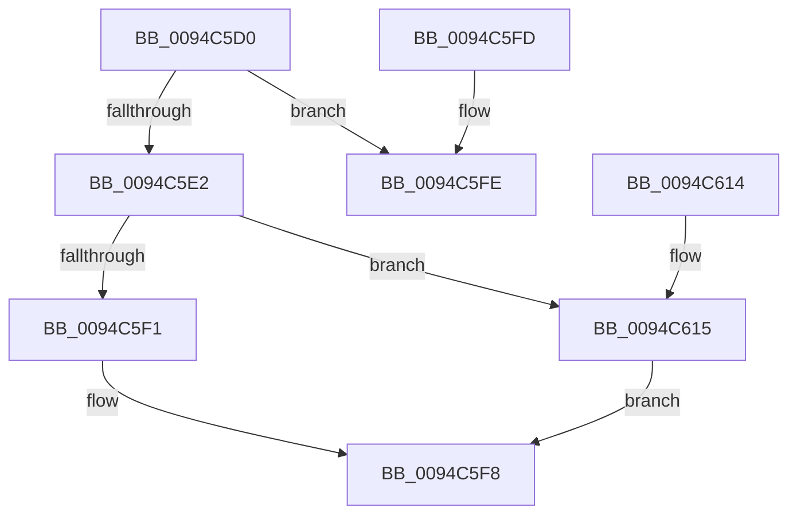

# ExpGetNextHandleTableEntry

- RVA: `0x0094C5D0`–`0x0094C626` (길이 `86` bytes)
- VA: `0x000000014094C5D0`
- 실행 섹션: `PAGE`
- PDB 이름 있음: `예`; PDB Function 태그: `아니요`
- unwind 정보 RVA: `0x00091514`
- 디코드: `26`개 명령, `86/86` bytes 표시
- 미해석 바이트: `0` (있으면 어셈블리에 `.byte`로 보존)

> 이 문서는 커널 이미지의 기계어와 PDB 기호를 분석해 생성했습니다. 4번과 5번은 함수 원형과 자료형을 바이너리 사용 방식에서 추정한 C 해석이며 원본 소스 복구 결과는 아닙니다.

## 1. Dependencies

- 직접 호출 지점: **2**; 고유 호출 대상: **1**
- 직접 호출자로 확인된 함수: **1**
- RIP 상대 이미지 참조: **0**

### Outgoing calls
- `0x0094C603` → [ExpLookupHandleTableEntry](../86/ExpLookupHandleTableEntry_function_00869DB0.md) (function, `0x00869DB0`)
- `0x0094C61C` → [ExpLookupHandleTableEntry](../86/ExpLookupHandleTableEntry_function_00869DB0.md) (function, `0x00869DB0`)

### Direct callers
- [ExQueryProcessHandleInformation](ExQueryProcessHandleInformation_function_0094C3D8.md) at `0x0094C563`

### Static image references
- 디코드된 RIP-relative 메모리 참조가 없습니다.

## 2. Other-region calls and transfers

- 다른 실행 섹션으로 향하는 call: **0**
- 별도 외부 분기/꼬리 이동을 확인하지 못했습니다.

## 3. Assembly (complete function range)

```asm
0094C5D0  48 83 EC 28                     sub rsp, 0x28
0094C5D4  49 8B 00                        mov rax, qword ptr [r8]
0094C5D7  4D 8B D0                        mov r10, r8
0094C5DA  4C 8B C8                        mov r9, rax
0094C5DD  48 85 D2                        test rdx, rdx
0094C5E0  74 1C                           je 0x14094c5fe
0094C5E2  49 83 C1 04                     add r9, 4
0094C5E6  49 33 C1                        xor rax, r9
0094C5E9  48 3D 00 04 00 00               cmp rax, 0x400
0094C5EF  73 24                           jae 0x14094c615
0094C5F1  48 8D 42 10                     lea rax, [rdx + 0x10]
0094C5F5  4D 89 08                        mov qword ptr [r8], r9
0094C5F8  48 83 C4 28                     add rsp, 0x28
0094C5FC  C3                              ret
0094C5FD  CC                              int3
0094C5FE  BA 04 00 00 00                  mov edx, 4
0094C603  E8 A8 D7 F1 FF                  call 0x140869db0
0094C608  49 C7 02 04 00 00 00            mov qword ptr [r10], 4
0094C60F  48 83 C4 28                     add rsp, 0x28
0094C613  C3                              ret
0094C614  CC                              int3
0094C615  49 83 C1 04                     add r9, 4
0094C619  49 8B D1                        mov rdx, r9
0094C61C  E8 8F D7 F1 FF                  call 0x140869db0
0094C621  4D 89 0A                        mov qword ptr [r10], r9
0094C624  EB D2                           jmp 0x14094c5f8
```

## 4. C-style interpretation (structured pseudocode)

```c
__int64 __fastcall ExpGetNextHandleTableEntry(__int64 a1, __int64 a2, __int64 a3)
{
    __int64 result;
    __int64 v_rsp;

    v_rsp = (v_rsp) - (40);
    if (a2 == 0) goto loc_0094C5FE;
    a4 = (*(unsigned __int64 *)(a3)) + (4);
    result = (*(unsigned __int64 *)(a3)) ^ (a4);
    if (result >= 0x400ULL) goto loc_0094C615;
    *(unsigned __int64 *)(a3) = a4;
loc_0094C5F8:
    v_rsp = (v_rsp) + (40);
    return a2 + 16;
loc_0094C5FE:
    result = ExpLookupHandleTableEntry(a1, 4, a3, a4);
    *(unsigned __int64 *)(a3) = 4;
    v_rsp = (v_rsp) + (40);
    return result;
loc_0094C615:
    a4 = (a4) + (4);
    result = ExpLookupHandleTableEntry(a1, a4, a3, a4);
    *(unsigned __int64 *)(a3) = a4;
    goto loc_0094C5F8;
}
```

## 5. (Beta) C Style

```c
int64_t ExpGetNextHandleTableEntry(int64_t Arg1, int64_t Arg2, void *Arg3)
{
    uint8_t *arg3 = (uint8_t *)Arg3;

    int64_t result;
    int64_t local_rsp;

    local_rsp = (local_rsp) - (40);
    if (Arg2 == 0) goto loc_0094C5FE;
    a4 = (*(uint64_t *)(arg3)) + (4);
    result = (*(uint64_t *)(arg3)) ^ (a4);
    if (result >= 0x400ULL) goto loc_0094C615;
    *(uint64_t *)(arg3) = a4;
loc_0094C5F8:
    local_rsp = (local_rsp) + (40);
    return Arg2 + 16;
loc_0094C5FE:
    result = ExpLookupHandleTableEntry(Arg1, 4, Arg3, a4);
    *(uint64_t *)(arg3) = 4;
    local_rsp = (local_rsp) + (40);
    return result;
loc_0094C615:
    a4 = (a4) + (4);
    result = ExpLookupHandleTableEntry(Arg1, a4, Arg3, a4);
    *(uint64_t *)(arg3) = a4;
    goto loc_0094C5F8;
}
```

### 관측된 메모리 오프셋

구조체 형식이 확인되지 않은 접근은 인자 기준의 오프셋으로만 기록했습니다.

| 기준 인자 | 오프셋 표현 | 폭 (bit) | 접근 |
|---|---:|---:|---|
| `Arg3` | `+ 0x0` | `64` | `R` |
| `Arg3` | `+ 0x0` | `64` | `W` |

## 6. Execution-region graph

[열기: 2D/3D 그래프와 함수 탐색 컨트롤 패널](../../../control-panel.html?section=page&rva=0x0094C5D0&view=graph)

- 2D 그래프는 위에서 아래로 흐르고, 3D 그래프는 빈 공간을 드래그해 회전합니다. Shift+드래그는 이동, 휠은 확대·축소, 함수 노드 선택은 대상 보고서 이동입니다.

### Static fallback


