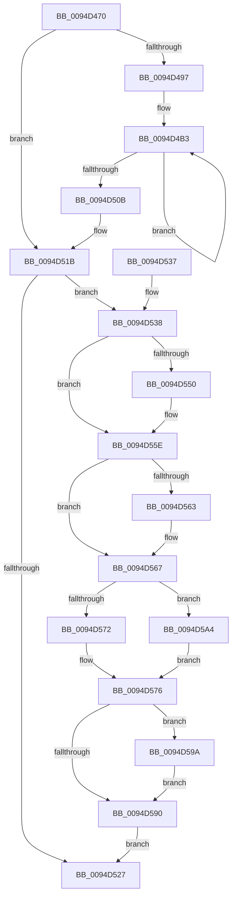

# ExpInsertLowLevelTableIntoFreeList

- RVA: `0x0094D470`–`0x0094D5AE` (길이 `318` bytes)
- VA: `0x000000014094D470`
- 실행 섹션: `PAGE`
- PDB 이름 있음: `예`; PDB Function 태그: `아니요`
- unwind 정보 RVA: `0x000916DC`
- 디코드: `80`개 명령, `318/318` bytes 표시
- 미해석 바이트: `0` (있으면 어셈블리에 `.byte`로 보존)

> 이 문서는 커널 이미지의 기계어와 PDB 기호를 분석해 생성했습니다. 4번과 5번은 함수 원형과 자료형을 바이너리 사용 방식에서 추정한 C 해석이며 원본 소스 복구 결과는 아닙니다.

## 1. Dependencies

- 직접 호출 지점: **4**; 고유 호출 대상: **4**
- 직접 호출자로 확인된 함수: **2**
- RIP 상대 이미지 참조: **1**

### Outgoing calls
- `0x0094D540` → [KeAbPreAcquire](../../text/21/KeAbPreAcquire_function_00210230.md) (function, `0x00210230`)
- `0x0094D559` → [ExfAcquirePushLockExclusiveEx](../../text/20/ExfAcquirePushLockExclusiveEx_function_0020FC90.md) (function, `0x0020FC90`)
- `0x0094D593` → [KeAbPostRelease](../../text/2E/KeAbPostRelease_function_002E1600.md) (function, `0x002E1600`)
- `0x0094D59D` → [ExfTryToWakePushLock](../../text/26/ExfTryToWakePushLock_function_00265DD0.md) (function, `0x00265DD0`)

### Direct callers
- [ExpAllocateHandleTable](ExpAllocateHandleTable_function_0094C8F0.md) at `0x0094C9A4`
- [ExpAllocateHandleTableEntrySlow](ExpAllocateHandleTableEntrySlow_function_0094D2FC.md) at `0x0094D374`

### Static image references
- `0x0094D4B3` → RVA `0x00012290` (`.rdata`; read)

## 2. Other-region calls and transfers

- 다른 실행 섹션으로 향하는 call: **4**
  - `0x0094D540` → [KeAbPreAcquire](../../text/21/KeAbPreAcquire_function_00210230.md) (`PAGE` → `.text`)
  - `0x0094D559` → [ExfAcquirePushLockExclusiveEx](../../text/20/ExfAcquirePushLockExclusiveEx_function_0020FC90.md) (`PAGE` → `.text`)
  - `0x0094D593` → [KeAbPostRelease](../../text/2E/KeAbPostRelease_function_002E1600.md) (`PAGE` → `.text`)
  - `0x0094D59D` → [ExfTryToWakePushLock](../../text/26/ExfTryToWakePushLock_function_00265DD0.md) (`PAGE` → `.text`)
- 별도 외부 분기/꼬리 이동을 확인하지 못했습니다.

## 3. Assembly (complete function range)

```asm
0094D470  48 89 5C 24 08                  mov qword ptr [rsp + 8], rbx
0094D475  48 89 74 24 10                  mov qword ptr [rsp + 0x10], rsi
0094D47A  57                              push rdi
0094D47B  48 83 EC 30                     sub rsp, 0x30
0094D47F  66 48 0F 6E D2                  movq xmm2, rdx
0094D484  49 8B D8                        mov rbx, r8
0094D487  66 0F 6C D2                     punpcklqdq xmm2, xmm2
0094D48B  48 8B FA                        mov rdi, rdx
0094D48E  45 84 C9                        test r9b, r9b
0094D491  0F 84 84 00 00 00               je 0x14094d51b
0094D497  0F 57 C0                        xorps xmm0, xmm0
0094D49A  41 B8 01 00 00 00               mov r8d, 1
0094D4A0  66 49 0F 7E C2                  movq r10, xmm0
0094D4A5  48 83 C2 18                     add rdx, 0x18
0094D4A9  66 0F 73 D8 08                  psrldq xmm0, 8
0094D4AE  66 49 0F 7E C3                  movq r11, xmm0
0094D4B3  F3 0F 7E 05 D5 4D 6C FF         movq xmm0, qword ptr [rip - 0x93b22b]
0094D4BB  41 8D 40 01                     lea eax, [r8 + 1]
0094D4BF  66 0F D6 44 24 20               movq qword ptr [rsp + 0x20], xmm0
0094D4C5  41 83 C0 02                     add r8d, 2
0094D4C9  66 0F 6E C8                     movd xmm1, eax
0094D4CD  0F 57 C0                        xorps xmm0, xmm0
0094D4D0  66 0F 70 C9 00                  pshufd xmm1, xmm1, 0
0094D4D5  66 0F FE 4C 24 20               paddd xmm1, xmmword ptr [rsp + 0x20]
0094D4DB  66 0F 62 C8                     punpckldq xmm1, xmm0
0094D4DF  66 0F 73 F1 04                  psllq xmm1, 4
0094D4E4  4C 89 52 F8                     mov qword ptr [rdx - 8], r10
0094D4E8  66 0F D4 CA                     paddq xmm1, xmm2
0094D4EC  66 0F D6 0A                     movq qword ptr [rdx], xmm1
0094D4F0  66 0F 73 D9 08                  psrldq xmm1, 8
0094D4F5  66 0F D6 4A 10                  movq qword ptr [rdx + 0x10], xmm1
0094D4FA  4C 89 5A 08                     mov qword ptr [rdx + 8], r11
0094D4FE  48 8D 52 20                     lea rdx, [rdx + 0x20]
0094D502  41 81 F8 FF 00 00 00            cmp r8d, 0xff
0094D509  72 A8                           jb 0x14094d4b3
0094D50B  48 83 A7 F0 0F 00 00 00         and qword ptr [rdi + 0xff0], 0
0094D513  48 83 A7 F8 0F 00 00 00         and qword ptr [rdi + 0xff8], 0
0094D51B  F0 81 01 00 04 00 00            lock add dword ptr [rcx], 0x400
0094D522  45 84 C9                        test r9b, r9b
0094D525  75 11                           jne 0x14094d538
0094D527  48 8B 5C 24 40                  mov rbx, qword ptr [rsp + 0x40]
0094D52C  48 8B 74 24 48                  mov rsi, qword ptr [rsp + 0x48]
0094D531  48 83 C4 30                     add rsp, 0x30
0094D535  5F                              pop rdi
0094D536  C3                              ret
0094D537  CC                              int3
0094D538  45 33 C0                        xor r8d, r8d
0094D53B  33 D2                           xor edx, edx
0094D53D  48 8B CB                        mov rcx, rbx
0094D540  E8 EB 2C 8C FF                  call 0x140210230
0094D545  F0 48 0F BA 2B 00               lock bts qword ptr [rbx], 0
0094D54B  48 8B F0                        mov rsi, rax
0094D54E  73 0E                           jae 0x14094d55e
0094D550  4C 8B C3                        mov r8, rbx
0094D553  48 8B D0                        mov rdx, rax
0094D556  48 8B CB                        mov rcx, rbx
0094D559  E8 32 27 8C FF                  call 0x14020fc90
0094D55E  48 85 F6                        test rsi, rsi
0094D561  74 04                           je 0x14094d567
0094D563  C6 46 0A 01                     mov byte ptr [rsi + 0xa], 1
0094D567  48 83 7B 08 00                  cmp qword ptr [rbx + 8], 0
0094D56C  48 8D 4F 10                     lea rcx, [rdi + 0x10]
0094D570  75 32                           jne 0x14094d5a4
0094D572  48 89 4B 08                     mov qword ptr [rbx + 8], rcx
0094D576  48 8D 87 F0 0F 00 00            lea rax, [rdi + 0xff0]
0094D57D  48 89 43 10                     mov qword ptr [rbx + 0x10], rax
0094D581  48 83 C8 FF                     or rax, 0xffffffffffffffff
0094D585  F0 48 0F C1 03                  lock xadd qword ptr [rbx], rax
0094D58A  24 06                           and al, 6
0094D58C  3C 02                           cmp al, 2
0094D58E  74 0A                           je 0x14094d59a
0094D590  48 8B CB                        mov rcx, rbx
0094D593  E8 68 40 99 FF                  call 0x1402e1600
0094D598  EB 8D                           jmp 0x14094d527
0094D59A  48 8B CB                        mov rcx, rbx
0094D59D  E8 2E 88 91 FF                  call 0x140265dd0
0094D5A2  EB EC                           jmp 0x14094d590
0094D5A4  48 8B 43 10                     mov rax, qword ptr [rbx + 0x10]
0094D5A8  48 89 48 08                     mov qword ptr [rax + 8], rcx
0094D5AC  EB C8                           jmp 0x14094d576
```

## 4. C-style interpretation (structured pseudocode)

```c
__int64 __fastcall ExpInsertLowLevelTableIntoFreeList(__int64 a1, __int64 a2, __int64 a3, unsigned __int8 a4)
{
    __int64 result;
    __int64 v_rsp;
    unsigned __int64 v_stack_m18;
    unsigned __int64 v_stack_p10;
    unsigned __int64 v_stack_p8;

    v_stack_p8 = v_rbx;
    v_stack_p10 = v_rsi;
    v_rsp = (v_rsp) - (48);
    if (a4 == 0) goto loc_0094D51B;
    a2 = (a2) + (24);
loc_0094D4B3:
    v_stack_m18 = v_xmm0;
    a3 = (unsigned int)((1) + (2));
    *(unsigned __int64 *)(a2 - 8) = v_r10;
    *(unsigned __int64 *)(a2) = v_xmm1;
    *(unsigned __int64 *)(a2 + 16) = v_xmm1;
    *(unsigned __int64 *)(a2 + 8) = v_r11;
    if (((unsigned int)(a3)) < 255) goto loc_0094D4B3;
loc_0094D51B:
    if (a4 != 0) goto loc_0094D538;
loc_0094D527:
    v_rsp = (v_rsp) + (48);
    return 1 + 1;
loc_0094D538:
    a3 = 0;
    a2 = 0;
    result = KeAbPreAcquire(v_stack_p8, a2, a3, a4);
    if (!(condition_is_above_or_equal)) {
        a3 = v_stack_p8;
        a2 = result;
        a1 = v_stack_p8;
        result = ExfAcquirePushLockExclusiveEx(a1, a2, a3, a4);
    }
    if (result != 0) {
        *(unsigned __int8 *)(result + 10) = 1;
    }
    if ((*(unsigned __int64 *)(v_stack_p8 + 8)) != 0) goto loc_0094D5A4;
    *(unsigned __int64 *)(v_stack_p8 + 8) = a2 + 16;
loc_0094D576:
    *(unsigned __int64 *)(v_stack_p8 + 16) = a2 + 4080;
    result = (a2 + 4080) | (-1);
    result = (unsigned __int8)((result) & (6));
    if (((unsigned __int8)(result)) == 2) goto loc_0094D59A;
loc_0094D590:
    result = KeAbPostRelease(v_stack_p8, a2, a3, a4);
    goto loc_0094D527;
loc_0094D59A:
    result = ExfTryToWakePushLock(v_stack_p8, a2, a3, a4);
    goto loc_0094D590;
loc_0094D5A4:
    *(unsigned __int64 *)(*(unsigned __int64 *)(v_stack_p8 + 16) + 8) = v_stack_p8;
    goto loc_0094D576;
}
```

## 5. (Beta) C Style

```c
int64_t ExpInsertLowLevelTableIntoFreeList(void *Arg1, void *Arg2, void *Arg3, uint8_t Arg4)
{
    uint8_t *arg1 = (uint8_t *)Arg1;
    uint8_t *arg2 = (uint8_t *)Arg2;
    uint8_t *arg3 = (uint8_t *)Arg3;

    int64_t result;
    int64_t local_rsp;
    uint64_t v_stack_m18;
    uint64_t v_stack_p10;
    uint64_t v_stack_p8;

    v_stack_p8 = local_rbx;
    v_stack_p10 = local_rsi;
    local_rsp = (local_rsp) - (48);
    if (Arg4 == 0) goto loc_0094D51B;
    Arg2 = (Arg2) + (24);
loc_0094D4B3:
    v_stack_m18 = v_xmm0;
    Arg3 = (uint32_t)((1) + (2));
    *(uint64_t *)(arg2 - 0x8) = local_r10;
    *(uint64_t *)(arg2) = v_xmm1;
    *(uint64_t *)(arg2 + 0x10) = v_xmm1;
    *(uint64_t *)(arg2 + 0x8) = local_r11;
    if (((uint32_t)(Arg3)) < 255) goto loc_0094D4B3;
loc_0094D51B:
    if (Arg4 != 0) goto loc_0094D538;
loc_0094D527:
    local_rsp = (local_rsp) + (48);
    return 1 + 1;
loc_0094D538:
    Arg3 = 0;
    Arg2 = 0;
    result = KeAbPreAcquire(v_stack_p8, Arg2, Arg3, Arg4);
    if (!(condition_is_above_or_equal)) {
        Arg3 = v_stack_p8;
        Arg2 = result;
        Arg1 = v_stack_p8;
        result = ExfAcquirePushLockExclusiveEx(Arg1, Arg2, Arg3, Arg4);
    }
    if (result != 0) {
        *(uint8_t *)(result + 0xA) = 1;
    }
    if ((*(uint64_t *)(v_stack_p8 + 0x8)) != 0) goto loc_0094D5A4;
    *(void **)(v_stack_p8 + 0x8) = Arg2 + 16;
loc_0094D576:
    *(void **)(v_stack_p8 + 0x10) = Arg2 + 4080;
    result = (Arg2 + 4080) | (-1);
    result = (uint8_t)((result) & (6));
    if (((uint8_t)(result)) == 2) goto loc_0094D59A;
loc_0094D590:
    result = KeAbPostRelease(v_stack_p8, Arg2, Arg3, Arg4);
    goto loc_0094D527;
loc_0094D59A:
    result = ExfTryToWakePushLock(v_stack_p8, Arg2, Arg3, Arg4);
    goto loc_0094D590;
loc_0094D5A4:
    *(uint64_t *)(*(uint64_t *)(v_stack_p8 + 0x10) + 0x8) = v_stack_p8;
    goto loc_0094D576;
}
```

### 관측된 메모리 오프셋

구조체 형식이 확인되지 않은 접근은 인자 기준의 오프셋으로만 기록했습니다.

| 기준 인자 | 오프셋 표현 | 폭 (bit) | 접근 |
|---|---:|---:|---|
| `Arg1` | `+ 0x0` | `32` | `R/W` |
| `Arg2` | `- 0x8` | `64` | `W` |
| `Arg2` | `+ 0x0` | `64` | `R` |
| `Arg2` | `+ 0x8` | `64` | `W` |
| `Arg2` | `+ 0x10` | `64` | `R` |
| `Arg2` | `+ 0x20` | `64` | `R` |
| `Arg2` | `+ 0xFF0` | `64` | `R` |
| `Arg2` | `+ 0xFF0` | `64` | `R/W` |
| `Arg2` | `+ 0xFF8` | `64` | `R/W` |
| `Arg3` | `+ 0x0` | `64` | `R/W` |
| `Arg3` | `+ 0x8` | `64` | `R` |
| `Arg3` | `+ 0x8` | `64` | `W` |
| `Arg3` | `+ 0x10` | `64` | `R` |
| `Arg3` | `+ 0x10` | `64` | `W` |

## 6. Execution-region graph

[열기: 2D/3D 그래프와 함수 탐색 컨트롤 패널](../../../control-panel.html?section=page&rva=0x0094D470&view=graph)

- 2D 그래프는 위에서 아래로 흐르고, 3D 그래프는 빈 공간을 드래그해 회전합니다. Shift+드래그는 이동, 휠은 확대·축소, 함수 노드 선택은 대상 보고서 이동입니다.

### Static fallback


