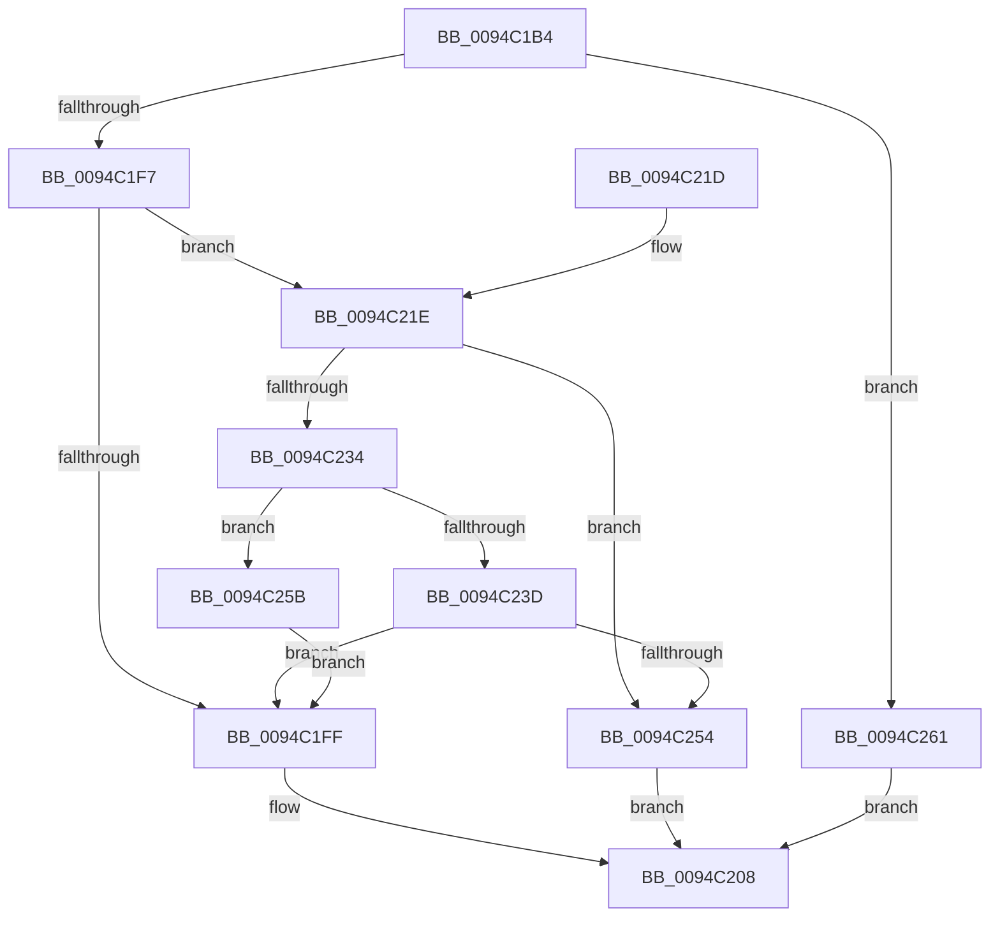

# ExpSetHandleExtraInfo

- RVA: `0x0094C1B4`–`0x0094C268` (길이 `180` bytes)
- VA: `0x000000014094C1B4`
- 실행 섹션: `PAGE`
- PDB 이름 있음: `예`; PDB Function 태그: `아니요`
- unwind 정보 RVA: `0x0009149C`
- 디코드: `52`개 명령, `180/180` bytes 표시
- 미해석 바이트: `0` (있으면 어셈블리에 `.byte`로 보존)

> 이 문서는 커널 이미지의 기계어와 PDB 기호를 분석해 생성했습니다. 4번과 5번은 함수 원형과 자료형을 바이너리 사용 방식에서 추정한 C 해석이며 원본 소스 복구 결과는 아닙니다.

## 1. Dependencies

- 직접 호출 지점: **3**; 고유 호출 대상: **3**
- 직접 호출자로 확인된 함수: **1**
- RIP 상대 이미지 참조: **0**

### Outgoing calls
- `0x0094C1EA` → [ExpLookupHandleTableEntry](../86/ExpLookupHandleTableEntry_function_00869DB0.md) (function, `0x00869DB0`)
- `0x0094C227` → [ExpAllocateTablePagedPool](ExpAllocateTablePagedPool_function_0094D634.md) (function, `0x0094D634`)
- `0x0094C247` → [ExpFreeTablePagedPool](../86/ExpFreeTablePagedPool_function_0086B410.md) (function, `0x0086B410`)

### Direct callers
- [ExpDuplicateSingleHandle](ExpDuplicateSingleHandle_function_0094D0E4.md) at `0x0094D1A4`

### Static image references
- 디코드된 RIP-relative 메모리 참조가 없습니다.

## 2. Other-region calls and transfers

- 다른 실행 섹션으로 향하는 call: **0**
- 별도 외부 분기/꼬리 이동을 확인하지 못했습니다.

## 3. Assembly (complete function range)

```asm
0094C1B4  48 89 5C 24 08                  mov qword ptr [rsp + 8], rbx
0094C1B9  48 89 6C 24 18                  mov qword ptr [rsp + 0x18], rbp
0094C1BE  48 89 74 24 20                  mov qword ptr [rsp + 0x20], rsi
0094C1C3  57                              push rdi
0094C1C4  48 83 EC 20                     sub rsp, 0x20
0094C1C8  48 89 54 24 38                  mov qword ptr [rsp + 0x38], rdx
0094C1CD  8B C2                           mov eax, edx
0094C1CF  81 E2 03 FC FF FF               and edx, 0xfffffc03
0094C1D5  C1 E8 02                        shr eax, 2
0094C1D8  89 54 24 38                     mov dword ptr [rsp + 0x38], edx
0094C1DC  49 8B F0                        mov rsi, r8
0094C1DF  48 8B 54 24 38                  mov rdx, qword ptr [rsp + 0x38]
0094C1E4  48 8B D9                        mov rbx, rcx
0094C1E7  0F B6 E8                        movzx ebp, al
0094C1EA  E8 C1 DB F1 FF                  call 0x140869db0
0094C1EF  48 8B F8                        mov rdi, rax
0094C1F2  48 85 C0                        test rax, rax
0094C1F5  74 6A                           je 0x14094c261
0094C1F7  48 8B 10                        mov rdx, qword ptr [rax]
0094C1FA  48 85 D2                        test rdx, rdx
0094C1FD  74 1F                           je 0x14094c21e
0094C1FF  48 8B 06                        mov rax, qword ptr [rsi]
0094C202  48 89 04 EA                     mov qword ptr [rdx + rbp*8], rax
0094C206  33 C0                           xor eax, eax
0094C208  48 8B 5C 24 30                  mov rbx, qword ptr [rsp + 0x30]
0094C20D  48 8B 6C 24 40                  mov rbp, qword ptr [rsp + 0x40]
0094C212  48 8B 74 24 48                  mov rsi, qword ptr [rsp + 0x48]
0094C217  48 83 C4 20                     add rsp, 0x20
0094C21B  5F                              pop rdi
0094C21C  C3                              ret
0094C21D  CC                              int3
0094C21E  48 8B 4B 10                     mov rcx, qword ptr [rbx + 0x10]
0094C222  BA 00 08 00 00                  mov edx, 0x800
0094C227  E8 08 14 00 00                  call 0x14094d634
0094C22C  48 8B D0                        mov rdx, rax
0094C22F  48 85 C0                        test rax, rax
0094C232  74 20                           je 0x14094c254
0094C234  33 C0                           xor eax, eax
0094C236  F0 48 0F B1 17                  lock cmpxchg qword ptr [rdi], rdx
0094C23B  74 1E                           je 0x14094c25b
0094C23D  48 8B 4B 10                     mov rcx, qword ptr [rbx + 0x10]
0094C241  41 B8 00 08 00 00               mov r8d, 0x800
0094C247  E8 C4 F1 F1 FF                  call 0x14086b410
0094C24C  48 8B 17                        mov rdx, qword ptr [rdi]
0094C24F  48 85 D2                        test rdx, rdx
0094C252  75 AB                           jne 0x14094c1ff
0094C254  B8 9A 00 00 C0                  mov eax, 0xc000009a
0094C259  EB AD                           jmp 0x14094c208
0094C25B  F0 FF 43 04                     lock inc dword ptr [rbx + 4]
0094C25F  EB 9E                           jmp 0x14094c1ff
0094C261  B8 01 00 00 C0                  mov eax, 0xc0000001
0094C266  EB A0                           jmp 0x14094c208
```

## 4. C-style interpretation (structured pseudocode)

```c
__int64 __fastcall ExpSetHandleExtraInfo(__int64 a1, __int64 a2, __int64 a3)
{
    __int64 result;
    __int64 v_rsp;
    unsigned __int64 v_stack_p10;
    unsigned __int64 v_stack_p18;
    unsigned __int64 v_stack_p20;
    unsigned __int64 v_stack_p8;

    v_stack_p8 = v_rbx;
    v_stack_p18 = v_rbp;
    v_stack_p20 = v_rsi;
    v_rsp = (v_rsp) - (32);
    v_stack_p10 = a2;
    a2 = (unsigned int)((a2) & (0xFFFFFC03ULL));
    result = (unsigned int)(((unsigned int)((unsigned int)(a2))) >> (2));
    v_stack_p10 = (unsigned int)(a2);
    result = ExpLookupHandleTableEntry(a1, v_stack_p10, a3, a4);
    if (result == 0) goto loc_0094C261;
    if (*(unsigned __int64 *)(result) == 0) goto loc_0094C21E;
loc_0094C1FF:
    *(unsigned __int64 *)(*(unsigned __int64 *)(result) + (unsigned __int8)(result) * 8) = *(unsigned __int64 *)(a3);
    result = 0;
loc_0094C208:
    v_rsp = (v_rsp) + (32);
    return result;
loc_0094C21E:
    result = ExpAllocateTablePagedPool(*(unsigned __int64 *)(v_stack_p8 + 16), (unsigned int)(0x800ULL), a3, a4);
    if (result == 0) goto loc_0094C254;
    result = 0;
    if (condition_is_equal) goto loc_0094C25B;
    result = ExpFreeTablePagedPool(*(unsigned __int64 *)(v_stack_p8 + 16), result, (unsigned int)(0x800ULL), a4);
    if (*(unsigned __int64 *)(result) != 0) goto loc_0094C1FF;
loc_0094C254:
    goto loc_0094C208;
loc_0094C25B:
    goto loc_0094C1FF;
loc_0094C261:
    goto loc_0094C208;
}
```

## 5. (Beta) C Style

```c
int64_t ExpSetHandleExtraInfo(void *Arg1, int64_t Arg2, void *Arg3)
{
    uint8_t *arg1 = (uint8_t *)Arg1;
    uint8_t *arg3 = (uint8_t *)Arg3;

    int64_t result;
    int64_t local_rsp;
    uint64_t v_stack_p10;
    uint64_t v_stack_p18;
    uint64_t v_stack_p20;
    uint64_t v_stack_p8;

    v_stack_p8 = local_rbx;
    v_stack_p18 = local_rbp;
    v_stack_p20 = local_rsi;
    local_rsp = (local_rsp) - (32);
    v_stack_p10 = Arg2;
    Arg2 = (uint32_t)((Arg2) & (0xFFFFFC03ULL));
    result = (uint32_t)(((uint32_t)((uint32_t)(Arg2))) >> (2));
    v_stack_p10 = (uint32_t)(Arg2);
    result = ExpLookupHandleTableEntry(Arg1, v_stack_p10, Arg3, a4);
    if (result == 0) goto loc_0094C261;
    if (*(uint64_t *)(result) == 0) goto loc_0094C21E;
loc_0094C1FF:
    *(uint64_t *)(*(uint64_t *)(result) + (uint8_t)(result) * 8) = *(uint64_t *)(arg3);
    result = 0;
loc_0094C208:
    local_rsp = (local_rsp) + (32);
    return result;
loc_0094C21E:
    result = ExpAllocateTablePagedPool(*(uint64_t *)(v_stack_p8 + 0x10), (uint32_t)(0x800ULL), Arg3, a4);
    if (result == 0) goto loc_0094C254;
    result = 0;
    if (condition_is_equal) goto loc_0094C25B;
    result = ExpFreeTablePagedPool(*(uint64_t *)(v_stack_p8 + 0x10), result, (uint32_t)(0x800ULL), a4);
    if (*(uint64_t *)(result) != 0) goto loc_0094C1FF;
loc_0094C254:
    goto loc_0094C208;
loc_0094C25B:
    goto loc_0094C1FF;
loc_0094C261:
    goto loc_0094C208;
}
```

### 관측된 메모리 오프셋

구조체 형식이 확인되지 않은 접근은 인자 기준의 오프셋으로만 기록했습니다.

| 기준 인자 | 오프셋 표현 | 폭 (bit) | 접근 |
|---|---:|---:|---|
| `Arg1` | `+ 0x4` | `32` | `R/W` |
| `Arg1` | `+ 0x10` | `64` | `R` |
| `Arg3` | `+ 0x0` | `64` | `R` |

## 6. Execution-region graph

[열기: 2D/3D 그래프와 함수 탐색 컨트롤 패널](../../../control-panel.html?section=page&rva=0x0094C1B4&view=graph)

- 2D 그래프는 위에서 아래로 흐르고, 3D 그래프는 빈 공간을 드래그해 회전합니다. Shift+드래그는 이동, 휠은 확대·축소, 함수 노드 선택은 대상 보고서 이동입니다.

### Static fallback


