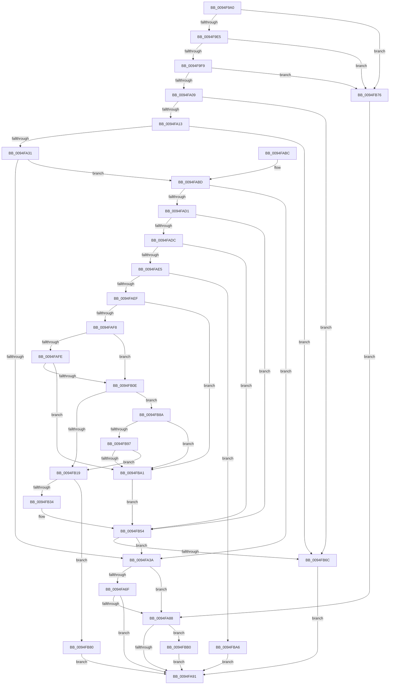

# IoRegisterDeviceInterface

- RVA: `0x0094F9A0`–`0x0094FBBF` (길이 `543` bytes)
- VA: `0x000000014094F9A0`
- 실행 섹션: `PAGE`
- PDB 이름 있음: `예`; PDB Function 태그: `아니요`
- unwind 정보 RVA: `0x00091BBC`
- 디코드: `145`개 명령, `543/543` bytes 표시
- 미해석 바이트: `0` (있으면 어셈블리에 `.byte`로 보존)

> 이 문서는 커널 이미지의 기계어와 PDB 기호를 분석해 생성했습니다. 4번과 5번은 함수 원형과 자료형을 바이너리 사용 방식에서 추정한 C 해석이며 원본 소스 복구 결과는 아닙니다.

## 1. Dependencies

- 직접 호출 지점: **8**; 고유 호출 대상: **8**
- 직접 호출자로 확인된 함수: **2**
- RIP 상대 이미지 참조: **1**

### Outgoing calls
- `0x0094FA21` → [ObQueryNameStringMode](../8A/ObQueryNameStringMode_function_008A7ED0.md) (function, `0x008A7ED0`)
- `0x0094FA5F` → [IopRegisterDeviceInterface](../95/IopRegisterDeviceInterface_function_009501B0.md) (function, `0x009501B0`)
- `0x0094FA7D` → [RtlInitUnicodeStringEx](../../text/46/RtlInitUnicodeStringEx_function_00463960.md) (function, `0x00463960`)
- `0x0094FA97` → [PnpUnicodeStringToWstrFree](../8F/PnpUnicodeStringToWstrFree_function_008F59F0.md) (function, `0x008F59F0`)
- `0x0094FB27` → [ExAllocatePool2](../../poolcode/B8/ExAllocatePool2_function_00B820F0.md) (function, `0x00B820F0`)
- `0x0094FB3F` → [memcpy](../../text/6C/memcpy_function_006C6840.md) (function, `0x006C6840`)
- `0x0094FB5E` → [wcspbrk](../../text/50/wcspbrk_function_005025F0.md) (function, `0x005025F0`)
- `0x0094FBB5` → [ExFreePoolWithTag](../../poolcode/B8/ExFreePoolWithTag_function_00B82870.md) (function, `0x00B82870`)

### Direct callers
- [DifIoRegisterDeviceInterfaceWrapper](../../text/62/DifIoRegisterDeviceInterfaceWrapper_function_0062C210.md) at `0x0062C303`
- [sub_00B1C3F8](../B1/Unknown_function_00B1C3F8.md) at `0x00B1C468`

### Static image references
- `0x0094FB54` → RVA `0x00AFD7E0` (` ?? ::NNGAKEGL::`string'`; read)

## 2. Other-region calls and transfers

- 다른 실행 섹션으로 향하는 call: **5**
  - `0x0094FA7D` → [RtlInitUnicodeStringEx](../../text/46/RtlInitUnicodeStringEx_function_00463960.md) (`PAGE` → `.text`)
  - `0x0094FB27` → [ExAllocatePool2](../../poolcode/B8/ExAllocatePool2_function_00B820F0.md) (`PAGE` → `POOLCODE`)
  - `0x0094FB3F` → [memcpy](../../text/6C/memcpy_function_006C6840.md) (`PAGE` → `.text`)
  - `0x0094FB5E` → [wcspbrk](../../text/50/wcspbrk_function_005025F0.md) (`PAGE` → `.text`)
  - `0x0094FBB5` → [ExFreePoolWithTag](../../poolcode/B8/ExFreePoolWithTag_function_00B82870.md) (`PAGE` → `POOLCODE`)
- 별도 외부 분기/꼬리 이동을 확인하지 못했습니다.

## 3. Assembly (complete function range)

```asm
0094F9A0  48 8B C4                        mov rax, rsp
0094F9A3  48 89 58 10                     mov qword ptr [rax + 0x10], rbx
0094F9A7  48 89 68 18                     mov qword ptr [rax + 0x18], rbp
0094F9AB  48 89 70 20                     mov qword ptr [rax + 0x20], rsi
0094F9AF  57                              push rdi
0094F9B0  41 54                           push r12
0094F9B2  41 55                           push r13
0094F9B4  41 56                           push r14
0094F9B6  41 57                           push r15
0094F9B8  48 83 EC 40                     sub rsp, 0x40
0094F9BC  33 DB                           xor ebx, ebx
0094F9BE  0F 57 C0                        xorps xmm0, xmm0
0094F9C1  89 58 08                        mov dword ptr [rax + 8], ebx
0094F9C4  4D 8B E1                        mov r12, r9
0094F9C7  48 89 58 D0                     mov qword ptr [rax - 0x30], rbx
0094F9CB  4D 8B F0                        mov r14, r8
0094F9CE  4C 8B EA                        mov r13, rdx
0094F9D1  4C 8B F9                        mov r15, rcx
0094F9D4  8B FB                           mov edi, ebx
0094F9D6  8B F3                           mov esi, ebx
0094F9D8  41 0F 11 01                     movups xmmword ptr [r9], xmm0
0094F9DC  48 85 C9                        test rcx, rcx
0094F9DF  0F 84 91 01 00 00               je 0x14094fb76
0094F9E5  48 8B 81 38 01 00 00            mov rax, qword ptr [rcx + 0x138]
0094F9EC  48 8B 68 28                     mov rbp, qword ptr [rax + 0x28]
0094F9F0  48 85 ED                        test rbp, rbp
0094F9F3  0F 84 7D 01 00 00               je 0x14094fb76
0094F9F9  F7 85 8C 01 00 00 00 00 02 00   test dword ptr [rbp + 0x18c], 0x20000
0094FA03  0F 85 6D 01 00 00               jne 0x14094fb76
0094FA09  48 39 5D 30                     cmp qword ptr [rbp + 0x30], rbx
0094FA0D  0F 84 59 01 00 00               je 0x14094fb6c
0094FA13  4C 8D 4C 24 70                  lea r9, [rsp + 0x70]
0094FA18  88 5C 24 20                     mov byte ptr [rsp + 0x20], bl
0094FA1C  45 33 C0                        xor r8d, r8d
0094FA1F  33 D2                           xor edx, edx
0094FA21  E8 AA 84 F5 FF                  call 0x1408a7ed0
0094FA26  83 7C 24 70 10                  cmp dword ptr [rsp + 0x70], 0x10
0094FA2B  0F 86 3B 01 00 00               jbe 0x14094fb6c
0094FA31  4D 85 F6                        test r14, r14
0094FA34  0F 85 83 00 00 00               jne 0x14094fabd
0094FA3A  48 8B 4D 30                     mov rcx, qword ptr [rbp + 0x30]
0094FA3E  48 8D 44 24 30                  lea rax, [rsp + 0x30]
0094FA43  48 89 44 24 28                  mov qword ptr [rsp + 0x28], rax
0094FA48  45 33 C9                        xor r9d, r9d
0094FA4B  48 8D 44 24 38                  lea rax, [rsp + 0x38]
0094FA50  89 5C 24 30                     mov dword ptr [rsp + 0x30], ebx
0094FA54  4C 8B C6                        mov r8, rsi
0094FA57  48 89 44 24 20                  mov qword ptr [rsp + 0x20], rax
0094FA5C  49 8B D5                        mov rdx, r13
0094FA5F  E8 4C 07 00 00                  call 0x1409501b0
0094FA64  48 8B 7C 24 38                  mov rdi, qword ptr [rsp + 0x38]
0094FA69  8B D8                           mov ebx, eax
0094FA6B  85 C0                           test eax, eax
0094FA6D  78 19                           js 0x14094fa88
0094FA6F  8B 44 24 30                     mov eax, dword ptr [rsp + 0x30]
0094FA73  48 8B D7                        mov rdx, rdi
0094FA76  41 09 47 30                     or dword ptr [r15 + 0x30], eax
0094FA7A  49 8B CC                        mov rcx, r12
0094FA7D  E8 DE 3E B1 FF                  call 0x140463960
0094FA82  8B D8                           mov ebx, eax
0094FA84  85 C0                           test eax, eax
0094FA86  79 09                           jns 0x14094fa91
0094FA88  48 85 FF                        test rdi, rdi
0094FA8B  0F 85 1F 01 00 00               jne 0x14094fbb0
0094FA91  49 8B D6                        mov rdx, r14
0094FA94  48 8B CE                        mov rcx, rsi
0094FA97  E8 54 5F FA FF                  call 0x1408f59f0
0094FA9C  4C 8D 5C 24 40                  lea r11, [rsp + 0x40]
0094FAA1  8B C3                           mov eax, ebx
0094FAA3  49 8B 5B 38                     mov rbx, qword ptr [r11 + 0x38]
0094FAA7  49 8B 6B 40                     mov rbp, qword ptr [r11 + 0x40]
0094FAAB  49 8B 73 48                     mov rsi, qword ptr [r11 + 0x48]
0094FAAF  49 8B E3                        mov rsp, r11
0094FAB2  41 5F                           pop r15
0094FAB4  41 5E                           pop r14
0094FAB6  41 5D                           pop r13
0094FAB8  41 5C                           pop r12
0094FABA  5F                              pop rdi
0094FABB  C3                              ret
0094FABC  CC                              int3
0094FABD  41 0F B7 16                     movzx edx, word ptr [r14]
0094FAC1  41 B9 02 00 00 00               mov r9d, 2
0094FAC7  66 41 3B D1                     cmp dx, r9w
0094FACB  0F 82 69 FF FF FF               jb 0x14094fa3a
0094FAD1  45 0F B7 46 02                  movzx r8d, word ptr [r14 + 2]
0094FAD6  66 45 3B C1                     cmp r8w, r9w
0094FADA  72 78                           jb 0x14094fb54
0094FADC  49 8B 4E 08                     mov rcx, qword ptr [r14 + 8]
0094FAE0  48 85 C9                        test rcx, rcx
0094FAE3  74 6F                           je 0x14094fb54
0094FAE5  66 41 3B D0                     cmp dx, r8w
0094FAE9  0F 87 B7 00 00 00               ja 0x14094fba6
0094FAEF  66 39 19                        cmp word ptr [rcx], bx
0094FAF2  0F 84 A9 00 00 00               je 0x14094fba1
0094FAF8  66 41 3B D0                     cmp dx, r8w
0094FAFC  75 10                           jne 0x14094fb0e
0094FAFE  8B C2                           mov eax, edx
0094FB00  48 D1 E8                        shr rax, 1
0094FB03  66 39 5C 41 FE                  cmp word ptr [rcx + rax*2 - 2], bx
0094FB08  0F 84 93 00 00 00               je 0x14094fba1
0094FB0E  49 8B C0                        mov rax, r8
0094FB11  49 2B C1                        sub rax, r9
0094FB14  48 3B D0                        cmp rdx, rax
0094FB17  76 71                           jbe 0x14094fb8a
0094FB19  49 03 D1                        add rdx, r9
0094FB1C  B9 00 01 00 00                  mov ecx, 0x100
0094FB21  41 B8 50 70 73 75               mov r8d, 0x75737050
0094FB27  E8 C4 25 23 00                  call 0x140b820f0
0094FB2C  48 8B D8                        mov rbx, rax
0094FB2F  48 85 C0                        test rax, rax
0094FB32  74 4C                           je 0x14094fb80
0094FB34  45 0F B7 06                     movzx r8d, word ptr [r14]
0094FB38  48 8B C8                        mov rcx, rax
0094FB3B  49 8B 56 08                     mov rdx, qword ptr [r14 + 8]
0094FB3F  E8 FC 6C D7 FF                  call 0x1406c6840
0094FB44  41 0F B7 06                     movzx eax, word ptr [r14]
0094FB48  48 8B F3                        mov rsi, rbx
0094FB4B  48 D1 E8                        shr rax, 1
0094FB4E  66 89 3C 43                     mov word ptr [rbx + rax*2], di
0094FB52  33 DB                           xor ebx, ebx
0094FB54  48 8D 15 85 DC 1A 00            lea rdx, [rip + 0x1adc85]
0094FB5B  48 8B CE                        mov rcx, rsi
0094FB5E  E8 8D 2A BB FF                  call 0x1405025f0
0094FB63  48 85 C0                        test rax, rax
0094FB66  0F 84 CE FE FF FF               je 0x14094fa3a
0094FB6C  BB 10 00 00 C0                  mov ebx, 0xc0000010
0094FB71  E9 1B FF FF FF                  jmp 0x14094fa91
0094FB76  BB 10 00 00 C0                  mov ebx, 0xc0000010
0094FB7B  E9 08 FF FF FF                  jmp 0x14094fa88
0094FB80  BB 9A 00 00 C0                  mov ebx, 0xc000009a
0094FB85  E9 07 FF FF FF                  jmp 0x14094fa91
0094FB8A  48 8B C2                        mov rax, rdx
0094FB8D  48 D1 E8                        shr rax, 1
0094FB90  66 39 5C 41 FE                  cmp word ptr [rcx + rax*2 - 2], bx
0094FB95  74 0A                           je 0x14094fba1
0094FB97  66 39 1C 41                     cmp word ptr [rcx + rax*2], bx
0094FB9B  0F 85 78 FF FF FF               jne 0x14094fb19
0094FBA1  48 8B F1                        mov rsi, rcx
0094FBA4  EB AE                           jmp 0x14094fb54
0094FBA6  BB 0D 00 00 C0                  mov ebx, 0xc000000d
0094FBAB  E9 E1 FE FF FF                  jmp 0x14094fa91
0094FBB0  33 D2                           xor edx, edx
0094FBB2  48 8B CF                        mov rcx, rdi
0094FBB5  E8 B6 2C 23 00                  call 0x140b82870
0094FBBA  E9 D2 FE FF FF                  jmp 0x14094fa91
```

## 4. C-style interpretation (structured pseudocode)

```c
__int64 __fastcall IoRegisterDeviceInterface(__int64 a1, __int64 a2, __int64 a3, __int64 a4)
{
    __int64 result;
    __int64 v_rbx;
    __int64 v_rsp;
    unsigned __int64 v_stack_m28;
    unsigned __int64 v_stack_m30;
    unsigned __int64 v_stack_m38;
    unsigned __int64 v_stack_m40;
    unsigned __int8 v_stack_m48;
    unsigned __int64 v_stack_p8;

    *(unsigned __int64 *)(v_rsp + 16) = v_rbx;
    *(unsigned __int64 *)(v_rsp + 24) = v_rbp;
    *(unsigned __int64 *)(v_rsp + 32) = v_rsi;
    v_rsp = (v_rsp) - (64);
    v_rbx = 0;
    *(unsigned int *)(v_rsp + 8) = 0;
    *(unsigned __int64 *)(v_rsp - 48) = 0;
    *(unsigned __int64 *)(a4) = v_xmm0;
    if (a1 == 0) goto loc_0094FB76;
    if (*(unsigned __int64 *)(*(unsigned __int64 *)(a1 + 312) + 40) == 0) goto loc_0094FB76;
    if (((*(unsigned int *)(*(unsigned __int64 *)(*(unsigned __int64 *)(a1 + 312) + 40) + 396)) & (0x20000ULL)) != 0) goto loc_0094FB76;
    if ((*(unsigned __int64 *)(*(unsigned __int64 *)(*(unsigned __int64 *)(a1 + 312) + 40) + 48)) == 0) goto loc_0094FB6C;
    v_stack_m48 = 0;
    a3 = 0;
    a2 = 0;
    result = ObQueryNameStringMode(a1, a2, a3, v_stack_p8);
    if (v_stack_p8 <= 16) goto loc_0094FB6C;
    if (0 != 0) goto loc_0094FABD;
loc_0094FA3A:
    v_stack_m40 = v_stack_m38;
    a4 = 0;
    v_stack_m38 = 0;
    v_stack_m48 = v_stack_m30;
    result = IopRegisterDeviceInterface(*(unsigned __int64 *)(*(unsigned __int64 *)(*(unsigned __int64 *)(a1 + 312) + 40) + 48), 0, 0, a4);
    if (sign_flag) goto loc_0094FA88;
    result = RtlInitUnicodeStringEx(0, v_stack_m30, 0, a4);
    if (!sign_flag) goto loc_0094FA91;
loc_0094FA88:
    if (v_stack_m30 != 0) goto loc_0094FBB0;
loc_0094FA91:
    result = PnpUnicodeStringToWstrFree(0, 0, 0, a4);
    return (unsigned int)((unsigned int)((unsigned int)((unsigned int)(result))));
loc_0094FABD:
    if (((unsigned __int16)(*(unsigned __int16 *)(a3))) < 2) goto loc_0094FA3A;
    if (((unsigned __int16)(*(unsigned __int16 *)(a3 + 2))) < 2) goto loc_0094FB54;
    if (*(unsigned __int64 *)(a3 + 8) == 0) goto loc_0094FB54;
    if (((unsigned __int16)(*(unsigned __int16 *)(a3))) > ((unsigned __int16)(*(unsigned __int16 *)(a3 + 2)))) goto loc_0094FBA6;
    if ((*(unsigned __int16 *)(*(unsigned __int64 *)(a3 + 8))) == ((unsigned __int16)(*(unsigned __int64 *)(v_stack_m28 + 56)))) goto loc_0094FBA1;
    if (((unsigned __int16)(*(unsigned __int16 *)(a3))) != ((unsigned __int16)(*(unsigned __int16 *)(a3 + 2)))) goto loc_0094FB0E;
    result = ((unsigned int)((unsigned int)(*(unsigned __int16 *)(a3)))) >> (1);
    if ((*(unsigned __int16 *)(*(unsigned __int64 *)(a3 + 8) + result * 2 - 2)) == ((unsigned __int16)(*(unsigned __int64 *)(v_stack_m28 + 56)))) goto loc_0094FBA1;
loc_0094FB0E:
    result = (*(unsigned __int16 *)(a3 + 2)) - (2);
    if ((*(unsigned __int16 *)(a3)) <= result) goto loc_0094FB8A;
loc_0094FB19:
    a2 = (*(unsigned __int16 *)(a3)) + (2);
    result = ExAllocatePool2(256, a2, (unsigned int)(0x75737050ULL), 2);
    if (result == 0) goto loc_0094FB80;
    result = memcpy(result, *(unsigned __int64 *)(a3 + 8), *(unsigned __int16 *)(a3), 2);
    result = (*(unsigned __int16 *)(a3)) >> (1);
    *(unsigned __int16 *)(result + result * 2) = (unsigned __int16)(v_stack_m30);
    v_rbx = 0;
loc_0094FB54:
    result = wcspbrk(result, v_rip + 1760389, *(unsigned __int16 *)(a3), 2);
    if (result == 0) goto loc_0094FA3A;
loc_0094FB6C:
    goto loc_0094FA91;
loc_0094FB76:
    goto loc_0094FA88;
loc_0094FB80:
    goto loc_0094FA91;
loc_0094FB8A:
    result = (v_rip + 1760389) >> (1);
    if ((*(unsigned __int16 *)(result + result * 2 - 2)) == ((unsigned __int16)((unsigned int)(0xC000009AULL)))) goto loc_0094FBA1;
    if ((*(unsigned __int16 *)(result + result * 2)) != ((unsigned __int16)((unsigned int)(0xC000009AULL)))) goto loc_0094FB19;
loc_0094FBA1:
    goto loc_0094FB54;
loc_0094FBA6:
    goto loc_0094FA91;
loc_0094FBB0:
    a2 = 0;
    result = ExFreePoolWithTag(v_stack_m30, a2, *(unsigned __int16 *)(a3), 2);
    goto loc_0094FA91;
}
```

## 5. (Beta) C Style

```c
int64_t IoRegisterDeviceInterface(void *Arg1, int64_t Arg2, int64_t Arg3, void *Arg4)
{
    uint8_t *arg1 = (uint8_t *)Arg1;
    uint8_t *arg4 = (uint8_t *)Arg4;

    int64_t result;
    int64_t local_rbx;
    int64_t local_rsp;
    uint64_t v_stack_m28;
    uint64_t v_stack_m30;
    uint64_t v_stack_m38;
    uint64_t v_stack_m40;
    uint8_t v_stack_m48;
    uint64_t v_stack_p8;

    *(uint64_t *)(local_rsp + 0x10) = local_rbx;
    *(uint64_t *)(local_rsp + 0x18) = local_rbp;
    *(uint64_t *)(local_rsp + 0x20) = local_rsi;
    local_rsp = (local_rsp) - (64);
    local_rbx = 0;
    *(uint32_t *)(local_rsp + 0x8) = 0;
    *(uint64_t *)(local_rsp - 0x30) = 0;
    *(uint64_t *)(arg4) = v_xmm0;
    if (Arg1 == NULL) goto loc_0094FB76;
    if (*(uint64_t *)(*(uint64_t *)(arg1 + 0x138) + 0x28) == 0) goto loc_0094FB76;
    if (((*(uint32_t *)(*(uint64_t *)(*(uint64_t *)(arg1 + 0x138) + 0x28) + 0x18C)) & (0x20000ULL)) != 0) goto loc_0094FB76;
    if ((*(uint64_t *)(*(uint64_t *)(*(uint64_t *)(arg1 + 0x138) + 0x28) + 0x30)) == 0) goto loc_0094FB6C;
    v_stack_m48 = 0;
    Arg3 = 0;
    Arg2 = 0;
    result = ObQueryNameStringMode(Arg1, Arg2, Arg3, v_stack_p8);
    if (v_stack_p8 <= 16) goto loc_0094FB6C;
    if (0 != 0) goto loc_0094FABD;
loc_0094FA3A:
    v_stack_m40 = v_stack_m38;
    Arg4 = 0;
    v_stack_m38 = 0;
    v_stack_m48 = v_stack_m30;
    result = IopRegisterDeviceInterface(*(uint64_t *)(*(uint64_t *)(*(uint64_t *)(arg1 + 0x138) + 0x28) + 0x30), 0, 0, Arg4);
    if (sign_flag) goto loc_0094FA88;
    result = RtlInitUnicodeStringEx(0, v_stack_m30, 0, Arg4);
    if (!sign_flag) goto loc_0094FA91;
loc_0094FA88:
    if (v_stack_m30 != 0) goto loc_0094FBB0;
loc_0094FA91:
    result = PnpUnicodeStringToWstrFree(0, 0, 0, Arg4);
    return (uint32_t)((uint32_t)((uint32_t)((uint32_t)(result))));
loc_0094FABD:
    if (((uint16_t)(*(uint16_t *)(Arg3))) < 2) goto loc_0094FA3A;
    if (((uint16_t)(*(uint16_t *)(Arg3 + 0x2))) < 2) goto loc_0094FB54;
    if (*(uint64_t *)(Arg3 + 0x8) == 0) goto loc_0094FB54;
    if (((uint16_t)(*(uint16_t *)(Arg3))) > ((uint16_t)(*(uint16_t *)(Arg3 + 0x2)))) goto loc_0094FBA6;
    if ((*(uint16_t *)(*(uint64_t *)(Arg3 + 0x8))) == ((uint16_t)(*(uint64_t *)(v_stack_m28 + 0x38)))) goto loc_0094FBA1;
    if (((uint16_t)(*(uint16_t *)(Arg3))) != ((uint16_t)(*(uint16_t *)(Arg3 + 0x2)))) goto loc_0094FB0E;
    result = ((uint32_t)((uint32_t)(*(uint16_t *)(Arg3)))) >> (1);
    if ((*(uint16_t *)(*(uint64_t *)(Arg3 + 0x8) + result * 2 - 0x2)) == ((uint16_t)(*(uint64_t *)(v_stack_m28 + 0x38)))) goto loc_0094FBA1;
loc_0094FB0E:
    result = (*(uint16_t *)(Arg3 + 0x2)) - (2);
    if ((*(uint16_t *)(Arg3)) <= result) goto loc_0094FB8A;
loc_0094FB19:
    Arg2 = (*(uint16_t *)(Arg3)) + (2);
    result = ExAllocatePool2(256, Arg2, (uint32_t)(0x75737050ULL), 2);
    if (result == 0) goto loc_0094FB80;
    result = memcpy(result, *(uint64_t *)(Arg3 + 0x8), *(uint16_t *)(Arg3), 2);
    result = (*(uint16_t *)(Arg3)) >> (1);
    *(uint16_t *)(result + result * 2) = (uint16_t)(v_stack_m30);
    local_rbx = 0;
loc_0094FB54:
    result = wcspbrk(result, v_rip + 1760389, *(uint16_t *)(Arg3), 2);
    if (result == 0) goto loc_0094FA3A;
loc_0094FB6C:
    goto loc_0094FA91;
loc_0094FB76:
    goto loc_0094FA88;
loc_0094FB80:
    goto loc_0094FA91;
loc_0094FB8A:
    result = (v_rip + 1760389) >> (1);
    if ((*(uint16_t *)(result + result * 2 - 0x2)) == ((uint16_t)((uint32_t)(0xC000009AULL)))) goto loc_0094FBA1;
    if ((*(uint16_t *)(result + result * 2)) != ((uint16_t)((uint32_t)(0xC000009AULL)))) goto loc_0094FB19;
loc_0094FBA1:
    goto loc_0094FB54;
loc_0094FBA6:
    goto loc_0094FA91;
loc_0094FBB0:
    Arg2 = 0;
    result = ExFreePoolWithTag(v_stack_m30, Arg2, *(uint16_t *)(Arg3), 2);
    goto loc_0094FA91;
}
```

### 관측된 메모리 오프셋

구조체 형식이 확인되지 않은 접근은 인자 기준의 오프셋으로만 기록했습니다.

| 기준 인자 | 오프셋 표현 | 폭 (bit) | 접근 |
|---|---:|---:|---|
| `Arg1` | `+ 0x30` | `32` | `R/W` |
| `Arg4` | `+ 0x0` | `128` | `R` |

## 6. Execution-region graph

[열기: 2D/3D 그래프와 함수 탐색 컨트롤 패널](../../../control-panel.html?section=page&rva=0x0094F9A0&view=graph)

- 2D 그래프는 위에서 아래로 흐르고, 3D 그래프는 빈 공간을 드래그해 회전합니다. Shift+드래그는 이동, 휠은 확대·축소, 함수 노드 선택은 대상 보고서 이동입니다.

### Static fallback


