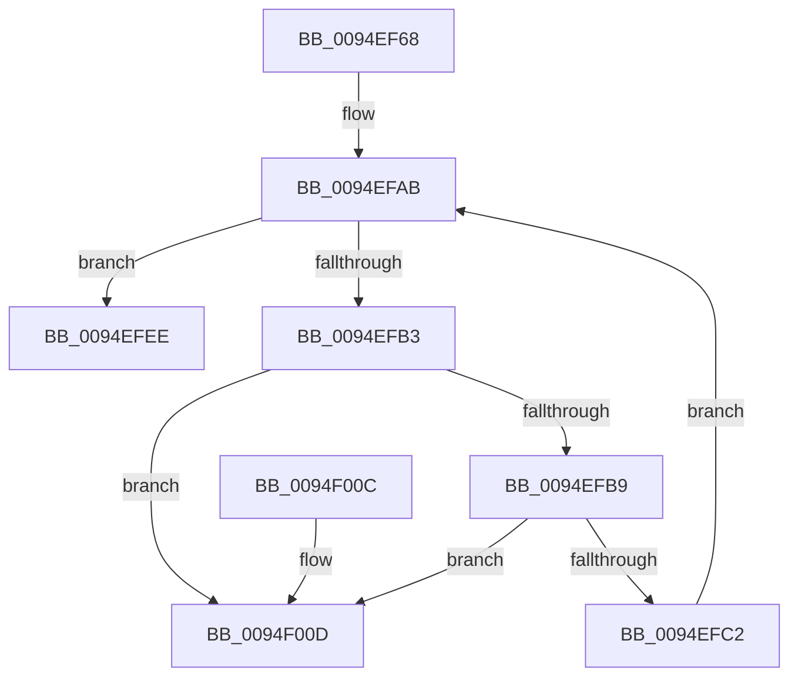

# IopDoDeferredSetInterfaceState

- RVA: `0x0094EF68`–`0x0094F014` (길이 `172` bytes)
- VA: `0x000000014094EF68`
- 실행 섹션: `PAGE`
- PDB 이름 있음: `예`; PDB Function 태그: `아니요`
- unwind 정보 RVA: `0x0006CF28`
- 디코드: `47`개 명령, `172/172` bytes 표시
- 미해석 바이트: `0` (있으면 어셈블리에 `.byte`로 보존)

> 이 문서는 커널 이미지의 기계어와 PDB 기호를 분석해 생성했습니다. 4번과 5번은 함수 원형과 자료형을 바이너리 사용 방식에서 추정한 C 해석이며 원본 소스 복구 결과는 아닙니다.

## 1. Dependencies

- 직접 호출 지점: **7**; 고유 호출 대상: **6**
- 직접 호출자로 확인된 함수: **2**
- RIP 상대 이미지 참조: **1**

### Outgoing calls
- `0x0094EF8F` → [ExAcquireResourceExclusiveLite](../../text/21/ExAcquireResourceExclusiveLite_function_00214E20.md) (function, `0x00214E20`)
- `0x0094EF9F` → [PpMarkDeviceStackExtensionFlag](../../text/4A/PpMarkDeviceStackExtensionFlag_function_004AD8D0.md) (function, `0x004AD8D0`)
- `0x0094EFD2` → [IopProcessSetInterfaceState](../95/IopProcessSetInterfaceState_function_00950964.md) (function, `0x00950964`)
- `0x0094EFDD` → [ExFreePoolWithTag](../../poolcode/B8/ExFreePoolWithTag_function_00B82870.md) (function, `0x00B82870`)
- `0x0094EFE7` → [ExFreePoolWithTag](../../poolcode/B8/ExFreePoolWithTag_function_00B82870.md) (function, `0x00B82870`)
- `0x0094EFF5` → [ExReleaseResourceLite](../../text/25/ExReleaseResourceLite_function_0025FA10.md) (function, `0x0025FA10`)
- `0x0094EFFA` → [KeLeaveCriticalRegion](../../text/25/KeLeaveCriticalRegion_function_0025D8B0.md) (function, `0x0025D8B0`)

### Direct callers
- [IoReportDetectedDevice](../72/IoReportDetectedDevice_function_00725CD0.md) at `0x00726737`
- [PipProcessStartPhase2](PipProcessStartPhase2_function_0094EE60.md) at `0x0094EE91`

### Static image references
- `0x0094EF80` → RVA `0x00F8C600` (`.data`; read)

## 2. Other-region calls and transfers

- 다른 실행 섹션으로 향하는 call: **6**
  - `0x0094EF8F` → [ExAcquireResourceExclusiveLite](../../text/21/ExAcquireResourceExclusiveLite_function_00214E20.md) (`PAGE` → `.text`)
  - `0x0094EF9F` → [PpMarkDeviceStackExtensionFlag](../../text/4A/PpMarkDeviceStackExtensionFlag_function_004AD8D0.md) (`PAGE` → `.text`)
  - `0x0094EFDD` → [ExFreePoolWithTag](../../poolcode/B8/ExFreePoolWithTag_function_00B82870.md) (`PAGE` → `POOLCODE`)
  - `0x0094EFE7` → [ExFreePoolWithTag](../../poolcode/B8/ExFreePoolWithTag_function_00B82870.md) (`PAGE` → `POOLCODE`)
  - `0x0094EFF5` → [ExReleaseResourceLite](../../text/25/ExReleaseResourceLite_function_0025FA10.md) (`PAGE` → `.text`)
  - `0x0094EFFA` → [KeLeaveCriticalRegion](../../text/25/KeLeaveCriticalRegion_function_0025D8B0.md) (`PAGE` → `.text`)
- 별도 외부 분기/꼬리 이동을 확인하지 못했습니다.

## 3. Assembly (complete function range)

```asm
0094EF68  48 89 5C 24 08                  mov qword ptr [rsp + 8], rbx
0094EF6D  57                              push rdi
0094EF6E  48 83 EC 20                     sub rsp, 0x20
0094EF72  65 48 8B 04 25 88 01 00 00      mov rax, qword ptr gs:[0x188]
0094EF7B  48 8B D9                        mov rbx, rcx
0094EF7E  B2 01                           mov dl, 1
0094EF80  48 8D 0D 79 D6 63 00            lea rcx, [rip + 0x63d679]
0094EF87  66 FF 88 E4 01 00 00            dec word ptr [rax + 0x1e4]
0094EF8E  90                              nop
0094EF8F  E8 8C 5E 8C FF                  call 0x140214e20
0094EF94  48 8B 4B 20                     mov rcx, qword ptr [rbx + 0x20]
0094EF98  45 33 C0                        xor r8d, r8d
0094EF9B  41 8D 50 10                     lea edx, [r8 + 0x10]
0094EF9F  E8 2C E9 B5 FF                  call 0x1404ad8d0
0094EFA4  48 8D BB 60 02 00 00            lea rdi, [rbx + 0x260]
0094EFAB  48 8B 1F                        mov rbx, qword ptr [rdi]
0094EFAE  48 3B DF                        cmp rbx, rdi
0094EFB1  74 3B                           je 0x14094efee
0094EFB3  48 39 7B 08                     cmp qword ptr [rbx + 8], rdi
0094EFB7  75 54                           jne 0x14094f00d
0094EFB9  48 8B 03                        mov rax, qword ptr [rbx]
0094EFBC  48 39 58 08                     cmp qword ptr [rax + 8], rbx
0094EFC0  75 4B                           jne 0x14094f00d
0094EFC2  48 89 07                        mov qword ptr [rdi], rax
0094EFC5  48 8D 4B 10                     lea rcx, [rbx + 0x10]
0094EFC9  45 33 C0                        xor r8d, r8d
0094EFCC  48 89 78 08                     mov qword ptr [rax + 8], rdi
0094EFD0  B2 01                           mov dl, 1
0094EFD2  E8 8D 19 00 00                  call 0x140950964
0094EFD7  48 8B 4B 18                     mov rcx, qword ptr [rbx + 0x18]
0094EFDB  33 D2                           xor edx, edx
0094EFDD  E8 8E 38 23 00                  call 0x140b82870
0094EFE2  33 D2                           xor edx, edx
0094EFE4  48 8B CB                        mov rcx, rbx
0094EFE7  E8 84 38 23 00                  call 0x140b82870
0094EFEC  EB BD                           jmp 0x14094efab
0094EFEE  48 8D 0D 0B D6 63 00            lea rcx, [rip + 0x63d60b]
0094EFF5  E8 16 0A 91 FF                  call 0x14025fa10
0094EFFA  E8 B1 E8 90 FF                  call 0x14025d8b0
0094EFFF  48 8B 5C 24 30                  mov rbx, qword ptr [rsp + 0x30]
0094F004  33 C0                           xor eax, eax
0094F006  48 83 C4 20                     add rsp, 0x20
0094F00A  5F                              pop rdi
0094F00B  C3                              ret
0094F00C  CC                              int3
0094F00D  B9 03 00 00 00                  mov ecx, 3
0094F012  CD 29                           int 0x29
```

## 4. C-style interpretation (structured pseudocode)

```c
__int64 __fastcall IopDoDeferredSetInterfaceState(__int64 a1, __int64 a2, int a3)
{
    __int64 result;
    __int64 v_rsp;
    unsigned __int64 v_stack_p8;

    v_stack_p8 = v_rbx;
    v_rsp = (v_rsp) - (32);
    result = ExAcquireResourceExclusiveLite(v_rip + 6542969, 1, a3, a4);
    a3 = 0;
    result = PpMarkDeviceStackExtensionFlag(*(unsigned __int64 *)(a1 + 32), a3 + 16, a3, a4);
loc_0094EFAB:
    if ((*(unsigned __int64 *)(a1 + 608)) == (a1 + 608)) goto loc_0094EFEE;
    if ((*(unsigned __int64 *)(*(unsigned __int64 *)(a1 + 608) + 8)) != (a1 + 608)) goto loc_0094F00D;
    if ((*(unsigned __int64 *)(*(unsigned __int64 *)(*(unsigned __int64 *)(a1 + 608)) + 8)) != (*(unsigned __int64 *)(a1 + 608))) goto loc_0094F00D;
    *(unsigned __int64 *)(a1 + 608) = *(unsigned __int64 *)(*(unsigned __int64 *)(a1 + 608));
    a3 = 0;
    *(unsigned __int64 *)(*(unsigned __int64 *)(*(unsigned __int64 *)(a1 + 608)) + 8) = a1 + 608;
    result = IopProcessSetInterfaceState(*(unsigned __int64 *)(a1 + 608) + 16, 1, a3, a4);
    a2 = 0;
    result = ExFreePoolWithTag(*(unsigned __int64 *)(*(unsigned __int64 *)(a1 + 608) + 24), a2, a3, a4);
    a2 = 0;
    result = ExFreePoolWithTag(*(unsigned __int64 *)(a1 + 608), a2, a3, a4);
    goto loc_0094EFAB;
loc_0094EFEE:
    result = ExReleaseResourceLite(v_rip + 6542859, a2, a3, a4);
    result = KeLeaveCriticalRegion(v_rip + 6542859, a2, a3, a4);
    result = 0;
    v_rsp = (v_rsp) + (32);
    return result;
loc_0094F00D:
    return result;
}
```

## 5. (Beta) C Style

```c
int64_t IopDoDeferredSetInterfaceState(void *Arg1, int64_t Arg2, int32_t Arg3)
{
    uint8_t *arg1 = (uint8_t *)Arg1;

    int64_t result;
    int64_t local_rsp;
    uint64_t v_stack_p8;

    v_stack_p8 = local_rbx;
    local_rsp = (local_rsp) - (32);
    result = ExAcquireResourceExclusiveLite(v_rip + 6542969, 1, Arg3, a4);
    Arg3 = 0;
    result = PpMarkDeviceStackExtensionFlag(*(uint64_t *)(arg1 + 0x20), Arg3 + 16, Arg3, a4);
loc_0094EFAB:
    if ((*(uint64_t *)(arg1 + 0x260)) == (Arg1 + 608)) goto loc_0094EFEE;
    if ((*(uint64_t *)(*(uint64_t *)(arg1 + 0x260) + 0x8)) != (Arg1 + 608)) goto loc_0094F00D;
    if ((*(uint64_t *)(*(uint64_t *)(*(uint64_t *)(arg1 + 0x260)) + 0x8)) != (*(uint64_t *)(arg1 + 0x260))) goto loc_0094F00D;
    *(uint64_t *)(arg1 + 0x260) = *(uint64_t *)(*(uint64_t *)(arg1 + 0x260));
    Arg3 = 0;
    *(void **)(*(uint64_t *)(*(uint64_t *)(arg1 + 0x260)) + 0x8) = Arg1 + 608;
    result = IopProcessSetInterfaceState(*(uint64_t *)(arg1 + 0x260) + 16, 1, Arg3, a4);
    Arg2 = 0;
    result = ExFreePoolWithTag(*(uint64_t *)(*(uint64_t *)(arg1 + 0x260) + 0x18), Arg2, Arg3, a4);
    Arg2 = 0;
    result = ExFreePoolWithTag(*(uint64_t *)(arg1 + 0x260), Arg2, Arg3, a4);
    goto loc_0094EFAB;
loc_0094EFEE:
    result = ExReleaseResourceLite(v_rip + 6542859, Arg2, Arg3, a4);
    result = KeLeaveCriticalRegion(v_rip + 6542859, Arg2, Arg3, a4);
    result = 0;
    local_rsp = (local_rsp) + (32);
    return result;
loc_0094F00D:
    return result;
}
```

### 관측된 메모리 오프셋

구조체 형식이 확인되지 않은 접근은 인자 기준의 오프셋으로만 기록했습니다.

| 기준 인자 | 오프셋 표현 | 폭 (bit) | 접근 |
|---|---:|---:|---|
| `Arg1` | `+ 0x0` | `64` | `R` |
| `Arg1` | `+ 0x0` | `64` | `W` |
| `Arg1` | `+ 0x20` | `64` | `R` |
| `Arg1` | `+ 0x260` | `64` | `R` |

## 6. Execution-region graph

[열기: 2D/3D 그래프와 함수 탐색 컨트롤 패널](../../../control-panel.html?section=page&rva=0x0094EF68&view=graph)

- 2D 그래프는 위에서 아래로 흐르고, 3D 그래프는 빈 공간을 드래그해 회전합니다. Shift+드래그는 이동, 휠은 확대·축소, 함수 노드 선택은 대상 보고서 이동입니다.

### Static fallback


