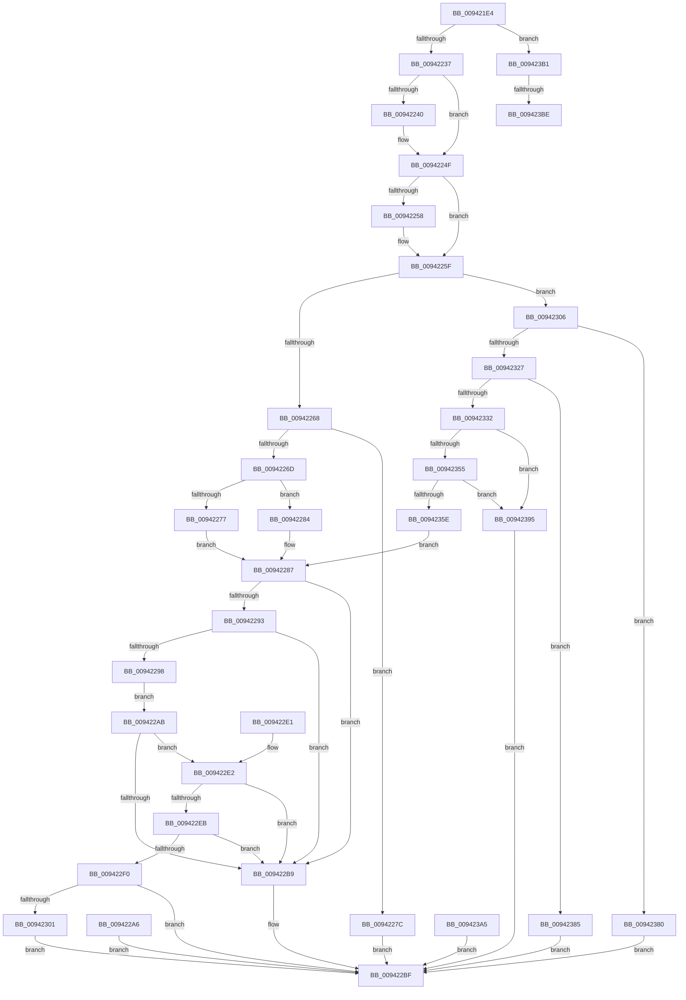

# LdrCaptureDynamicRelocationTableHeader

- RVA: `0x009421E4`–`0x009423D2` (길이 `494` bytes)
- VA: `0x00000001409421E4`
- 실행 섹션: `PAGE`
- PDB 이름 있음: `예`; PDB Function 태그: `예`
- unwind 정보 RVA: `0x00090348`
- 디코드: `127`개 명령, `494/494` bytes 표시
- 미해석 바이트: `0` (있으면 어셈블리에 `.byte`로 보존)

> 이 문서는 커널 이미지의 기계어와 PDB 기호를 분석해 생성했습니다. 4번과 5번은 함수 원형과 자료형을 바이너리 사용 방식에서 추정한 C 해석이며 원본 소스 복구 결과는 아닙니다.

## 1. Dependencies

- 직접 호출 지점: **1**; 고유 호출 대상: **1**
- 직접 호출자로 확인된 함수: **3**
- RIP 상대 이미지 참조: **0**

### Outgoing calls
- `0x00942317` → [RtlImageNtHeaderEx](../../text/41/RtlImageNtHeaderEx_function_0041EAA0.md) (function, `0x0041EAA0`)

### Direct callers
- [MiCaptureBootDriverRetpolineInfo](../80/MiCaptureBootDriverRetpolineInfo_function_0080137C.md) at `0x00801442`
- [MiParseImageLoadConfig](MiParseImageLoadConfig_function_00940D18.md) at `0x0094116D`
- [MiApplyDynamicRelocations](../../init/C6/MiApplyDynamicRelocations_function_00C696C0.md) at `0x00C69747`

### Static image references
- 디코드된 RIP-relative 메모리 참조가 없습니다.

## 2. Other-region calls and transfers

- 다른 실행 섹션으로 향하는 call: **1**
  - `0x00942317` → [RtlImageNtHeaderEx](../../text/41/RtlImageNtHeaderEx_function_0041EAA0.md) (`PAGE` → `.text`)
- call이 아닌 외부 분기/꼬리 이동: **2**
  - `0x009423B8` → [sub_00B25504](../B2/Unknown_function_00B25504.md) (`tail-transfer`)
  - `0x009423CD` → [sub_00B25504](../B2/Unknown_function_00B25504.md) (`tail-transfer`)

## 3. Assembly (complete function range)

```asm
009421E4  48 8B C4                        mov rax, rsp
009421E7  48 89 58 08                     mov qword ptr [rax + 8], rbx
009421EB  48 89 70 10                     mov qword ptr [rax + 0x10], rsi
009421EF  48 89 78 18                     mov qword ptr [rax + 0x18], rdi
009421F3  4C 89 60 20                     mov qword ptr [rax + 0x20], r12
009421F7  41 55                           push r13
009421F9  41 56                           push r14
009421FB  41 57                           push r15
009421FD  48 83 EC 30                     sub rsp, 0x30
00942201  44 8B FA                        mov r15d, edx
00942204  4C 8B F1                        mov r14, rcx
00942207  45 33 ED                        xor r13d, r13d
0094220A  4C 89 68 E0                     mov qword ptr [rax - 0x20], r13
0094220E  45 8B D5                        mov r10d, r13d
00942211  41 0F B7 DD                     movzx ebx, r13w
00942215  41 8B F5                        mov esi, r13d
00942218  45 8B DD                        mov r11d, r13d
0094221B  4C 8B A4 24 80 00 00 00         mov r12, qword ptr [rsp + 0x80]
00942223  45 89 2C 24                     mov dword ptr [r12], r13d
00942227  B8 0B 02 00 00                  mov eax, 0x20b
0094222C  66 39 44 24 78                  cmp word ptr [rsp + 0x78], ax
00942231  0F 85 7A 01 00 00               jne 0x1409423b1
00942237  41 81 F9 E6 00 00 00            cmp r9d, 0xe6
0094223E  72 0F                           jb 0x14094224f
00942240  41 0F B7 98 E4 00 00 00         movzx ebx, word ptr [r8 + 0xe4]
00942248  41 8B B0 E0 00 00 00            mov esi, dword ptr [r8 + 0xe0]
0094224F  41 81 F9 C8 00 00 00            cmp r9d, 0xc8
00942256  72 07                           jb 0x14094225f
00942258  4D 8B 98 C0 00 00 00            mov r11, qword ptr [r8 + 0xc0]
0094225F  66 85 DB                        test bx, bx
00942262  0F 85 9E 00 00 00               jne 0x140942306
00942268  4D 85 DB                        test r11, r11
0094226B  74 0F                           je 0x14094227c
0094226D  48 8B 44 24 70                  mov rax, qword ptr [rsp + 0x70]
00942272  48 85 C0                        test rax, rax
00942275  75 0D                           jne 0x140942284
00942277  45 2B DE                        sub r11d, r14d
0094227A  EB 0B                           jmp 0x140942287
0094227C  41 BA BB 00 00 C0               mov r10d, 0xc00000bb
00942282  EB 3B                           jmp 0x1409422bf
00942284  44 2B D8                        sub r11d, eax
00942287  41 8B CB                        mov ecx, r11d
0094228A  49 8D 53 08                     lea rdx, [r11 + 8]
0094228E  48 3B D1                        cmp rdx, rcx
00942291  72 26                           jb 0x1409422b9
00942293  49 3B D7                        cmp rdx, r15
00942296  77 21                           ja 0x1409422b9
00942298  4B 8B 04 33                     mov rax, qword ptr [r11 + r14]
0094229C  48 89 84 24 80 00 00 00         mov qword ptr [rsp + 0x80], rax
009422A4  EB 05                           jmp 0x1409422ab
009422A6  44 8B D0                        mov r10d, eax
009422A9  EB 14                           jmp 0x1409422bf
009422AB  48 8B C8                        mov rcx, rax
009422AE  48 C1 E9 20                     shr rcx, 0x20
009422B2  8D 51 08                        lea edx, [rcx + 8]
009422B5  3B D1                           cmp edx, ecx
009422B7  73 29                           jae 0x1409422e2
009422B9  41 BA 7B 00 00 C0               mov r10d, 0xc000007b
009422BF  41 8B C2                        mov eax, r10d
009422C2  48 8B 5C 24 50                  mov rbx, qword ptr [rsp + 0x50]
009422C7  48 8B 74 24 58                  mov rsi, qword ptr [rsp + 0x58]
009422CC  48 8B 7C 24 60                  mov rdi, qword ptr [rsp + 0x60]
009422D1  4C 8B 64 24 68                  mov r12, qword ptr [rsp + 0x68]
009422D6  48 83 C4 30                     add rsp, 0x30
009422DA  41 5F                           pop r15
009422DC  41 5E                           pop r14
009422DE  41 5D                           pop r13
009422E0  C3                              ret
009422E1  CC                              int3
009422E2  42 8D 0C 1A                     lea ecx, [rdx + r11]
009422E6  41 3B CB                        cmp ecx, r11d
009422E9  72 CE                           jb 0x1409422b9
009422EB  41 3B CF                        cmp ecx, r15d
009422EE  77 C9                           ja 0x1409422b9
009422F0  45 89 1C 24                     mov dword ptr [r12], r11d
009422F4  48 8B 8C 24 88 00 00 00         mov rcx, qword ptr [rsp + 0x88]
009422FC  48 85 C9                        test rcx, rcx
009422FF  74 BE                           je 0x1409422bf
00942301  48 89 01                        mov qword ptr [rcx], rax
00942304  EB B9                           jmp 0x1409422bf
00942306  4D 8B C7                        mov r8, r15
00942309  49 8D 3C 0F                     lea rdi, [r15 + rcx]
0094230D  4C 8D 4C 24 28                  lea r9, [rsp + 0x28]
00942312  49 8B D6                        mov rdx, r14
00942315  33 C9                           xor ecx, ecx
00942317  E8 84 C7 AD FF                  call 0x14041eaa0
0094231C  44 8B D0                        mov r10d, eax
0094231F  89 44 24 20                     mov dword ptr [rsp + 0x20], eax
00942323  85 C0                           test eax, eax
00942325  78 59                           js 0x140942380
00942327  48 8B 4C 24 28                  mov rcx, qword ptr [rsp + 0x28]
0094232C  66 3B 59 06                     cmp bx, word ptr [rcx + 6]
00942330  77 53                           ja 0x140942385
00942332  0F B7 C3                        movzx eax, bx
00942335  48 8D 14 80                     lea rdx, [rax + rax*4]
00942339  0F B7 41 14                     movzx eax, word ptr [rcx + 0x14]
0094233D  48 83 C0 F0                     add rax, -0x10
00942341  48 03 C1                        add rax, rcx
00942344  48 8D 04 D0                     lea rax, [rax + rdx*8]
00942348  48 89 84 24 80 00 00 00         mov qword ptr [rsp + 0x80], rax
00942350  48 3B F8                        cmp rdi, rax
00942353  76 40                           jbe 0x140942395
00942355  48 83 C0 28                     add rax, 0x28
00942359  48 3B F8                        cmp rdi, rax
0094235C  72 37                           jb 0x140942395
0094235E  0F AE E8                        lfence
00942361  48 8B 84 24 80 00 00 00         mov rax, qword ptr [rsp + 0x80]
00942369  44 8B 58 0C                     mov r11d, dword ptr [rax + 0xc]
0094236D  46 8D 1C 1E                     lea r11d, [rsi + r11]
00942371  44 89 5C 24 24                  mov dword ptr [rsp + 0x24], r11d
00942376  44 8B 54 24 20                  mov r10d, dword ptr [rsp + 0x20]
0094237B  E9 07 FF FF FF                  jmp 0x140942287
00942380  E9 3A FF FF FF                  jmp 0x1409422bf
00942385  41 BA 7B 00 00 C0               mov r10d, 0xc000007b
0094238B  44 89 54 24 20                  mov dword ptr [rsp + 0x20], r10d
00942390  E9 2A FF FF FF                  jmp 0x1409422bf
00942395  41 BA 7B 00 00 C0               mov r10d, 0xc000007b
0094239B  44 89 54 24 20                  mov dword ptr [rsp + 0x20], r10d
009423A0  E9 1A FF FF FF                  jmp 0x1409422bf
009423A5  44 8B D0                        mov r10d, eax
009423A8  89 44 24 20                     mov dword ptr [rsp + 0x20], eax
009423AC  E9 0E FF FF FF                  jmp 0x1409422bf
009423B1  41 81 F9 8E 00 00 00            cmp r9d, 0x8e
009423B8  0F 82 46 31 1E 00               jb 0x140b25504
009423BE  41 0F B7 98 8C 00 00 00         movzx ebx, word ptr [r8 + 0x8c]
009423C6  41 8B B0 88 00 00 00            mov esi, dword ptr [r8 + 0x88]
009423CD  E9 32 31 1E 00                  jmp 0x140b25504
```

## 4. C-style interpretation (structured pseudocode)

```c
__int64 __fastcall LdrCaptureDynamicRelocationTableHeader(__int64 a1, int a2, __int64 a3, int a4, __int64 a5, unsigned __int16 a6, __int64 a7, __int64 a8)
{
    __int64 result;
    __int64 v_r11;
    __int64 v_r13;
    __int64 v_rbx;
    __int64 v_rsi;
    __int64 v_rsp;
    unsigned __int64 v_stack_p10;
    unsigned __int64 v_stack_p18;
    unsigned __int64 v_stack_p20;
    unsigned int v_stack_p24;
    unsigned __int64 v_stack_p28;
    unsigned __int64 v_stack_p38;
    unsigned __int64 v_stack_p8;
    unsigned __int64 v_stack_p80;

    *(unsigned __int64 *)(v_rsp + 8) = v_rbx;
    *(unsigned __int64 *)(v_rsp + 16) = v_rsi;
    *(unsigned __int64 *)(v_rsp + 24) = v_rdi;
    *(unsigned __int64 *)(v_rsp + 32) = v_r12;
    v_rsp = (v_rsp) - (48);
    v_r13 = 0;
    *(unsigned __int64 *)(v_rsp - 32) = 0;
    *(unsigned int *)(a7) = 0;
    if (a6 != 523) goto loc_009423B1;
    v_rbx = 0;
    v_rsi = 0;
    if (a4 >= 230) {
        v_rbx = *(unsigned __int16 *)(a3 + 228);
        v_rsi = *(unsigned int *)(a3 + 224);
    }
    v_r11 = 0;
    if (a4 >= 200) {
        v_r11 = *(unsigned __int64 *)(a3 + 192);
    }
    if ((unsigned __int16)(v_rbx) != 0) goto loc_00942306;
    if (v_r11 == 0) goto loc_0094227C;
    if (a5 != 0) goto loc_00942284;
    v_r11 = (unsigned int)((v_r11) - ((unsigned int)(a1)));
    goto loc_00942287;
loc_0094227C:
    goto loc_009422BF;
loc_00942284:
    v_r11 = (unsigned int)((v_r11) - ((unsigned int)(a5)));
loc_00942287:
    if ((v_r11 + 8) < ((unsigned int)((unsigned int)(v_r11)))) goto loc_009422B9;
    if ((v_r11 + 8) > ((unsigned int)(a2))) goto loc_009422B9;
    v_stack_p38 = *(unsigned __int64 *)(v_r11 + a1 * 1);
    goto loc_009422AB;
loc_009422AB:
    a1 = (*(unsigned __int64 *)(v_r11 + a1 * 1)) >> (32);
    if (((unsigned int)(a1 + 8)) >= ((unsigned int)(a1))) goto loc_009422E2;
loc_009422B9:
loc_009422BF:
    v_rsp = (v_rsp) + (48);
    return (unsigned int)((unsigned int)((unsigned int)(0xC000007BULL)));
loc_009422E2:
    if (((unsigned int)(a1 + 8 + v_r11 * 1)) < ((unsigned int)(v_r11))) goto loc_009422B9;
    if (((unsigned int)(a1 + 8 + v_r11 * 1)) > ((unsigned int)((unsigned int)(a2)))) goto loc_009422B9;
    *(unsigned int *)(v_stack_p20) = (unsigned int)(v_r11);
    if (a8 == 0) goto loc_009422BF;
    *(unsigned __int64 *)(a8) = (unsigned int)((unsigned int)((unsigned int)(0xC000007BULL)));
    goto loc_009422BF;
loc_00942306:
    a1 = 0;
    result = RtlImageNtHeaderEx(a1, a1, (unsigned int)(a2), v_stack_p28);
    v_stack_p20 = (unsigned int)(result);
    if (sign_flag) goto loc_00942380;
    if (((unsigned __int16)(v_stack_p8)) > (*(unsigned __int16 *)(v_stack_p28 + 6))) goto loc_00942385;
    result = (*(unsigned __int16 *)(v_stack_p28 + 20)) + (-16);
    result = (result) + (v_stack_p28);
    v_stack_p80 = result + (unsigned __int16)(v_stack_p8) + (unsigned __int16)(v_stack_p8) * 4 * 8;
    if (((unsigned int)(a2) + a8 * 1) <= (result + (unsigned __int16)(v_stack_p8) + (unsigned __int16)(v_stack_p8) * 4 * 8)) goto loc_00942395;
    result = (result + (unsigned __int16)(v_stack_p8) + (unsigned __int16)(v_stack_p8) * 4 * 8) + (40);
    if (((unsigned int)(a2) + a8 * 1) < result) goto loc_00942395;
    v_stack_p24 = (unsigned int)(v_stack_p10 + (unsigned int)(*(unsigned int *)(a7 + 12)) * 1);
    goto loc_00942287;
loc_00942380:
    goto loc_009422BF;
loc_00942385:
    v_stack_p20 = (unsigned int)((unsigned int)(0xC000007BULL));
    goto loc_009422BF;
loc_00942395:
    v_stack_p20 = (unsigned int)((unsigned int)(0xC000007BULL));
    goto loc_009422BF;
loc_009423B1:
}
```

## 5. (Beta) C Style

```c
int64_t LdrCaptureDynamicRelocationTableHeader(int64_t Arg1, void *Arg2, void *Arg3, int32_t Arg4, int64_t Arg5, uint16_t Arg6, void *Arg7, int64_t Arg8)
{
    uint8_t *arg2 = (uint8_t *)Arg2;
    uint8_t *arg3 = (uint8_t *)Arg3;
    uint8_t *arg7 = (uint8_t *)Arg7;

    int64_t result;
    int64_t local_r11;
    int64_t local_r13;
    int64_t local_rbx;
    int64_t local_rsi;
    int64_t local_rsp;
    uint64_t v_stack_p10;
    uint64_t v_stack_p18;
    uint64_t v_stack_p20;
    uint32_t v_stack_p24;
    uint64_t v_stack_p28;
    uint64_t v_stack_p38;
    uint64_t v_stack_p8;
    uint64_t v_stack_p80;

    *(uint64_t *)(local_rsp + 0x8) = local_rbx;
    *(uint64_t *)(local_rsp + 0x10) = local_rsi;
    *(uint64_t *)(local_rsp + 0x18) = local_rdi;
    *(uint64_t *)(local_rsp + 0x20) = local_r12;
    local_rsp = (local_rsp) - (48);
    local_r13 = 0;
    *(uint64_t *)(local_rsp - 0x20) = 0;
    *(uint32_t *)(arg7) = 0;
    if (Arg6 != 523) goto loc_009423B1;
    local_rbx = 0;
    local_rsi = 0;
    if (Arg4 >= 230) {
        local_rbx = *(uint16_t *)(arg3 + 0xE4);
        local_rsi = *(uint32_t *)(arg3 + 0xE0);
    }
    local_r11 = 0;
    if (Arg4 >= 200) {
        local_r11 = *(uint64_t *)(arg3 + 0xC0);
    }
    if ((uint16_t)(local_rbx) != 0) goto loc_00942306;
    if (local_r11 == 0) goto loc_0094227C;
    if (Arg5 != 0) goto loc_00942284;
    local_r11 = (uint32_t)((local_r11) - ((uint32_t)(Arg1)));
    goto loc_00942287;
loc_0094227C:
    goto loc_009422BF;
loc_00942284:
    local_r11 = (uint32_t)((local_r11) - ((uint32_t)(Arg5)));
loc_00942287:
    if ((local_r11 + 8) < ((uint32_t)((uint32_t)(local_r11)))) goto loc_009422B9;
    if ((local_r11 + 8) > ((uint32_t)(Arg2))) goto loc_009422B9;
    v_stack_p38 = *(uint64_t *)(local_r11 + Arg1 * 1);
    goto loc_009422AB;
loc_009422AB:
    Arg1 = (*(uint64_t *)(local_r11 + Arg1 * 1)) >> (32);
    if (((uint32_t)(Arg1 + 8)) >= ((uint32_t)(Arg1))) goto loc_009422E2;
loc_009422B9:
loc_009422BF:
    local_rsp = (local_rsp) + (48);
    return (uint32_t)((uint32_t)((uint32_t)(0xC000007BULL)));
loc_009422E2:
    if (((uint32_t)(Arg1 + 8 + local_r11 * 1)) < ((uint32_t)(local_r11))) goto loc_009422B9;
    if (((uint32_t)(Arg1 + 8 + local_r11 * 1)) > ((uint32_t)((uint32_t)(Arg2)))) goto loc_009422B9;
    *(uint32_t *)(v_stack_p20) = (uint32_t)(local_r11);
    if (Arg8 == 0) goto loc_009422BF;
    *(uint64_t *)(Arg8) = (uint32_t)((uint32_t)((uint32_t)(0xC000007BULL)));
    goto loc_009422BF;
loc_00942306:
    Arg1 = 0;
    result = RtlImageNtHeaderEx(Arg1, Arg1, (uint32_t)(Arg2), v_stack_p28);
    v_stack_p20 = (uint32_t)(result);
    if (sign_flag) goto loc_00942380;
    if (((uint16_t)(v_stack_p8)) > (*(uint16_t *)(v_stack_p28 + 0x6))) goto loc_00942385;
    result = (*(uint16_t *)(v_stack_p28 + 0x14)) + (-16);
    result = (result) + (v_stack_p28);
    v_stack_p80 = result + (uint16_t)(v_stack_p8) + (uint16_t)(v_stack_p8) * 4 * 8;
    if (((uint32_t)(Arg2) + Arg8 * 1) <= (result + (uint16_t)(v_stack_p8) + (uint16_t)(v_stack_p8) * 4 * 8)) goto loc_00942395;
    result = (result + (uint16_t)(v_stack_p8) + (uint16_t)(v_stack_p8) * 4 * 8) + (40);
    if (((uint32_t)(Arg2) + Arg8 * 1) < result) goto loc_00942395;
    v_stack_p24 = (uint32_t)(v_stack_p10 + (uint32_t)(*(uint32_t *)(arg7 + 0xC)) * 1);
    goto loc_00942287;
loc_00942380:
    goto loc_009422BF;
loc_00942385:
    v_stack_p20 = (uint32_t)((uint32_t)(0xC000007BULL));
    goto loc_009422BF;
loc_00942395:
    v_stack_p20 = (uint32_t)((uint32_t)(0xC000007BULL));
    goto loc_009422BF;
loc_009423B1:
}
```

### 관측된 메모리 오프셋

구조체 형식이 확인되지 않은 접근은 인자 기준의 오프셋으로만 기록했습니다.

| 기준 인자 | 오프셋 표현 | 폭 (bit) | 접근 |
|---|---:|---:|---|
| `Arg2` | `+ 0x0 + rcx*1` | `64` | `R` |
| `Arg3` | `+ 0x88` | `32` | `R` |
| `Arg3` | `+ 0x8C` | `16` | `R` |
| `Arg3` | `+ 0xC0` | `64` | `R` |
| `Arg3` | `+ 0xE0` | `32` | `R` |
| `Arg3` | `+ 0xE4` | `16` | `R` |
| `Arg7` | `+ 0x0` | `32` | `W` |
| `Arg7` | `+ 0xC` | `32` | `R` |

## 6. Execution-region graph

[열기: 2D/3D 그래프와 함수 탐색 컨트롤 패널](../../../control-panel.html?section=page&rva=0x009421E4&view=graph)

- 2D 그래프는 위에서 아래로 흐르고, 3D 그래프는 빈 공간을 드래그해 회전합니다. Shift+드래그는 이동, 휠은 확대·축소, 함수 노드 선택은 대상 보고서 이동입니다.

### Static fallback


