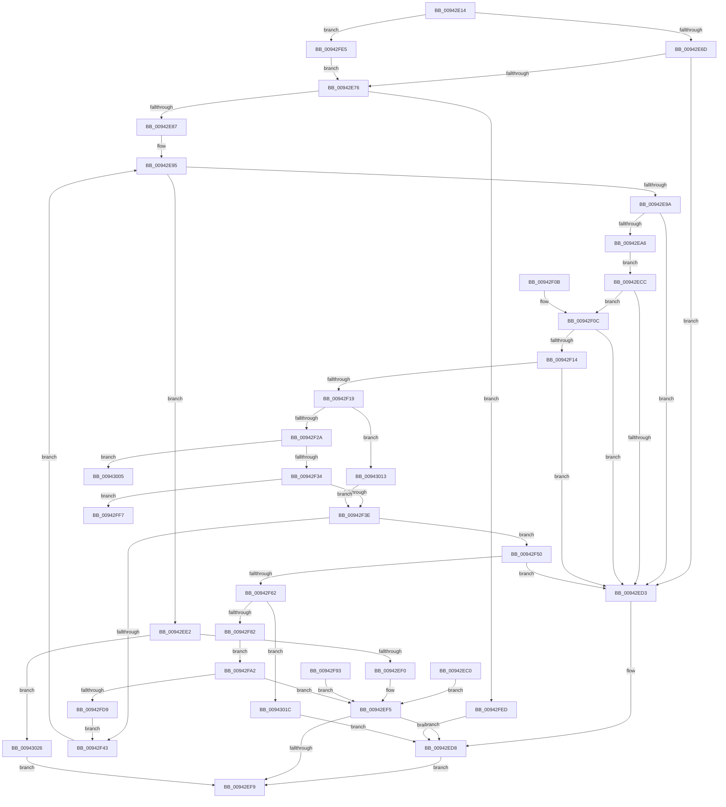

# MiCaptureRetpolineRelocationTables

- RVA: `0x00942E14`–`0x0094302D` (길이 `537` bytes)
- VA: `0x0000000140942E14`
- 실행 섹션: `PAGE`
- PDB 이름 있음: `예`; PDB Function 태그: `예`
- unwind 정보 RVA: `0x000904B4`
- 디코드: `140`개 명령, `537/537` bytes 표시
- 미해석 바이트: `0` (있으면 어셈블리에 `.byte`로 보존)

> 이 문서는 커널 이미지의 기계어와 PDB 기호를 분석해 생성했습니다. 4번과 5번은 함수 원형과 자료형을 바이너리 사용 방식에서 추정한 C 해석이며 원본 소스 복구 결과는 아닙니다.

## 1. Dependencies

- 직접 호출 지점: **7**; 고유 호출 대상: **6**
- 직접 호출자로 확인된 함수: **2**
- RIP 상대 이미지 참조: **0**

### Outgoing calls
- `0x00942E5F` → [RtlImageDirectoryEntryToData](../../text/43/RtlImageDirectoryEntryToData_function_004328D0.md) (function, `0x004328D0`)
- `0x00942EDB` → [MiFreeImageRetpolineContext](MiFreeImageRetpolineContext_function_00941488.md) (function, `0x00941488`)
- `0x00942F71` → [MiAllocatePool](../../text/35/MiAllocatePool_function_0035B540.md) (function, `0x0035B540`)
- `0x00942F8C` → [memcpy](../../text/6C/memcpy_function_006C6840.md) (function, `0x006C6840`)
- `0x00942FCA` → [RtlValidateDynamicFixupRelocation](../../text/44/RtlValidateDynamicFixupRelocation_function_00449AD8.md) (function, `0x00449AD8`)
- `0x00942FF7` → [KeIsRetpolineEnabled](../../text/44/KeIsRetpolineEnabled_function_0044EE20.md) (function, `0x0044EE20`)
- `0x00943005` → [KeIsRetpolineEnabled](../../text/44/KeIsRetpolineEnabled_function_0044EE20.md) (function, `0x0044EE20`)

### Direct callers
- [MiCaptureBootDriverRetpolineInfo](../80/MiCaptureBootDriverRetpolineInfo_function_0080137C.md) at `0x0080146D`
- [MiParseImageLoadConfig](MiParseImageLoadConfig_function_00940D18.md) at `0x009411BE`

### Static image references
- 디코드된 RIP-relative 메모리 참조가 없습니다.

## 2. Other-region calls and transfers

- 다른 실행 섹션으로 향하는 call: **6**
  - `0x00942E5F` → [RtlImageDirectoryEntryToData](../../text/43/RtlImageDirectoryEntryToData_function_004328D0.md) (`PAGE` → `.text`)
  - `0x00942F71` → [MiAllocatePool](../../text/35/MiAllocatePool_function_0035B540.md) (`PAGE` → `.text`)
  - `0x00942F8C` → [memcpy](../../text/6C/memcpy_function_006C6840.md) (`PAGE` → `.text`)
  - `0x00942FCA` → [RtlValidateDynamicFixupRelocation](../../text/44/RtlValidateDynamicFixupRelocation_function_00449AD8.md) (`PAGE` → `.text`)
  - `0x00942FF7` → [KeIsRetpolineEnabled](../../text/44/KeIsRetpolineEnabled_function_0044EE20.md) (`PAGE` → `.text`)
  - `0x00943005` → [KeIsRetpolineEnabled](../../text/44/KeIsRetpolineEnabled_function_0044EE20.md) (`PAGE` → `.text`)
- call이 아닌 외부 분기/꼬리 이동: **2**
  - `0x00943000` → [sub_00B25518](../B2/Unknown_function_00B25518.md) (`tail-transfer`)
  - `0x0094300E` → [sub_00B25518](../B2/Unknown_function_00B25518.md) (`tail-transfer`)

## 3. Assembly (complete function range)

```asm
00942E14  48 8B C4                        mov rax, rsp
00942E17  44 89 40 18                     mov dword ptr [rax + 0x18], r8d
00942E1B  89 50 10                        mov dword ptr [rax + 0x10], edx
00942E1E  48 89 48 08                     mov qword ptr [rax + 8], rcx
00942E22  53                              push rbx
00942E23  56                              push rsi
00942E24  57                              push rdi
00942E25  41 54                           push r12
00942E27  41 55                           push r13
00942E29  41 56                           push r14
00942E2B  41 57                           push r15
00942E2D  48 83 EC 40                     sub rsp, 0x40
00942E31  41 8B F1                        mov esi, r9d
00942E34  44 8B F2                        mov r14d, edx
00942E37  48 8B D9                        mov rbx, rcx
00942E3A  48 8B BC 24 B0 00 00 00         mov rdi, qword ptr [rsp + 0xb0]
00942E42  48 83 60 B0 00                  and qword ptr [rax - 0x50], 0
00942E47  83 60 A8 00                     and dword ptr [rax - 0x58], 0
00942E4B  C6 84 24 A8 00 00 00 00         mov byte ptr [rsp + 0xa8], 0
00942E53  41 B8 0C 00 00 00               mov r8d, 0xc
00942E59  4C 8D 48 AC                     lea r9, [rax - 0x54]
00942E5D  B2 01                           mov dl, 1
00942E5F  E8 6C FA AE FF                  call 0x1404328d0
00942E64  48 85 C0                        test rax, rax
00942E67  0F 84 78 01 00 00               je 0x140942fe5
00942E6D  2B C3                           sub eax, ebx
00942E6F  89 07                           mov dword ptr [rdi], eax
00942E71  41 3B C6                        cmp eax, r14d
00942E74  77 5D                           ja 0x140942ed3
00942E76  48 8B 84 24 A0 00 00 00         mov rax, qword ptr [rsp + 0xa0]
00942E7E  83 38 01                        cmp dword ptr [rax], 1
00942E81  0F 85 66 01 00 00               jne 0x140942fed
00942E87  44 8B 60 04                     mov r12d, dword ptr [rax + 4]
00942E8B  41 83 C4 08                     add r12d, 8
00942E8F  44 03 E6                        add r12d, esi
00942E92  83 C6 08                        add esi, 8
00942E95  41 3B F4                        cmp esi, r12d
00942E98  73 48                           jae 0x140942ee2
00942E9A  48 8D 4E 0C                     lea rcx, [rsi + 0xc]
00942E9E  41 8B C4                        mov eax, r12d
00942EA1  48 3B C8                        cmp rcx, rax
00942EA4  77 2D                           ja 0x140942ed3
00942EA6  4C 8D 3C 1E                     lea r15, [rsi + rbx]
00942EAA  4C 89 7C 24 28                  mov qword ptr [rsp + 0x28], r15
00942EAF  F2 41 0F 10 07                  movsd xmm0, qword ptr [r15]
00942EB4  F2 0F 11 44 24 30               movsd qword ptr [rsp + 0x30], xmm0
00942EBA  45 8B 6F 08                     mov r13d, dword ptr [r15 + 8]
00942EBE  EB 0C                           jmp 0x140942ecc
00942EC0  8B D8                           mov ebx, eax
00942EC2  48 8B BC 24 B0 00 00 00         mov rdi, qword ptr [rsp + 0xb0]
00942ECA  EB 29                           jmp 0x140942ef5
00942ECC  8D 46 0C                        lea eax, [rsi + 0xc]
00942ECF  3B C6                           cmp eax, esi
00942ED1  73 39                           jae 0x140942f0c
00942ED3  BB 7B 00 00 C0                  mov ebx, 0xc000007b
00942ED8  48 8B CF                        mov rcx, rdi
00942EDB  E8 A8 E5 FF FF                  call 0x140941488
00942EE0  EB 17                           jmp 0x140942ef9
00942EE2  80 BC 24 A8 00 00 00 00         cmp byte ptr [rsp + 0xa8], 0
00942EEA  0F 85 36 01 00 00               jne 0x140943026
00942EF0  BB BB 00 00 C0                  mov ebx, 0xc00000bb
00942EF5  85 DB                           test ebx, ebx
00942EF7  78 DF                           js 0x140942ed8
00942EF9  8B C3                           mov eax, ebx
00942EFB  48 83 C4 40                     add rsp, 0x40
00942EFF  41 5F                           pop r15
00942F01  41 5E                           pop r14
00942F03  41 5D                           pop r13
00942F05  41 5C                           pop r12
00942F07  5F                              pop rdi
00942F08  5E                              pop rsi
00942F09  5B                              pop rbx
00942F0A  C3                              ret
00942F0B  CC                              int3
00942F0C  42 8D 34 28                     lea esi, [rax + r13]
00942F10  3B F0                           cmp esi, eax
00942F12  72 BF                           jb 0x140942ed3
00942F14  41 3B F4                        cmp esi, r12d
00942F17  77 BA                           ja 0x140942ed3
00942F19  33 DB                           xor ebx, ebx
00942F1B  48 8B 44 24 30                  mov rax, qword ptr [rsp + 0x30]
00942F20  48 83 E8 03                     sub rax, 3
00942F24  0F 84 E9 00 00 00               je 0x140943013
00942F2A  48 83 E8 01                     sub rax, 1
00942F2E  0F 84 D1 00 00 00               je 0x140943005
00942F34  48 83 F8 01                     cmp rax, 1
00942F38  0F 84 B9 00 00 00               je 0x140942ff7
00942F3E  48 85 DB                        test rbx, rbx
00942F41  75 0D                           jne 0x140942f50
00942F43  48 8B 9C 24 80 00 00 00         mov rbx, qword ptr [rsp + 0x80]
00942F4B  E9 45 FF FF FF                  jmp 0x140942e95
00942F50  C6 84 24 A8 00 00 00 01         mov byte ptr [rsp + 0xa8], 1
00942F58  48 83 3B 00                     cmp qword ptr [rbx], 0
00942F5C  0F 85 71 FF FF FF               jne 0x140942ed3
00942F62  41 B8 4D 69 52 72               mov r8d, 0x7252694d
00942F68  49 8D 55 0C                     lea rdx, [r13 + 0xc]
00942F6C  B9 00 01 00 00                  mov ecx, 0x100
00942F71  E8 CA 85 A1 FF                  call 0x14035b540
00942F76  48 89 03                        mov qword ptr [rbx], rax
00942F79  48 85 C0                        test rax, rax
00942F7C  0F 84 9A 00 00 00               je 0x14094301c
00942F82  4D 8D 45 0C                     lea r8, [r13 + 0xc]
00942F86  49 8B D7                        mov rdx, r15
00942F89  48 8B C8                        mov rcx, rax
00942F8C  E8 AF 38 D8 FF                  call 0x1406c6840
00942F91  EB 0F                           jmp 0x140942fa2
00942F93  8B D8                           mov ebx, eax
00942F95  48 8B BC 24 B0 00 00 00         mov rdi, qword ptr [rsp + 0xb0]
00942F9D  E9 53 FF FF FF                  jmp 0x140942ef5
00942FA2  48 8B 03                        mov rax, qword ptr [rbx]
00942FA5  F2 0F 10 44 24 30               movsd xmm0, qword ptr [rsp + 0x30]
00942FAB  F2 0F 11 00                     movsd qword ptr [rax], xmm0
00942FAF  44 89 68 08                     mov dword ptr [rax + 8], r13d
00942FB3  4C 8D 4C 24 20                  lea r9, [rsp + 0x20]
00942FB8  44 8B 84 24 90 00 00 00         mov r8d, dword ptr [rsp + 0x90]
00942FC0  8B 94 24 88 00 00 00            mov edx, dword ptr [rsp + 0x88]
00942FC7  48 8B 0B                        mov rcx, qword ptr [rbx]
00942FCA  E8 09 6B B0 FF                  call 0x140449ad8
00942FCF  8B D8                           mov ebx, eax
00942FD1  85 C0                           test eax, eax
00942FD3  0F 88 1C FF FF FF               js 0x140942ef5
00942FD9  8B 44 24 20                     mov eax, dword ptr [rsp + 0x20]
00942FDD  01 47 04                        add dword ptr [rdi + 4], eax
00942FE0  E9 5E FF FF FF                  jmp 0x140942f43
00942FE5  83 27 00                        and dword ptr [rdi], 0
00942FE8  E9 89 FE FF FF                  jmp 0x140942e76
00942FED  BB BB 00 00 C0                  mov ebx, 0xc00000bb
00942FF2  E9 E1 FE FF FF                  jmp 0x140942ed8
00942FF7  E8 24 BE B0 FF                  call 0x14044ee20
00942FFC  48 8D 4F 18                     lea rcx, [rdi + 0x18]
00943000  E9 13 25 1E 00                  jmp 0x140b25518
00943005  E8 16 BE B0 FF                  call 0x14044ee20
0094300A  48 8D 4F 10                     lea rcx, [rdi + 0x10]
0094300E  E9 05 25 1E 00                  jmp 0x140b25518
00943013  48 8D 5F 08                     lea rbx, [rdi + 8]
00943017  E9 22 FF FF FF                  jmp 0x140942f3e
0094301C  BB 9A 00 00 C0                  mov ebx, 0xc000009a
00943021  E9 B2 FE FF FF                  jmp 0x140942ed8
00943026  33 DB                           xor ebx, ebx
00943028  E9 CC FE FF FF                  jmp 0x140942ef9
```

## 4. C-style interpretation (structured pseudocode)

```c
__int64 __fastcall MiCaptureRetpolineRelocationTables(__int64 a1, int a2, int a3, int a4, __int64 a5, unsigned __int8 a6, __int64 a7)
{
    __int64 result;
    __int64 v_r12;
    __int64 v_rbx;
    __int64 v_rsi;
    __int64 v_rsp;
    unsigned __int64 v_stack_m48;
    unsigned __int64 v_stack_m50;
    unsigned __int64 v_stack_p20;
    unsigned __int8 v_stack_p30;
    unsigned __int64 v_stack_p38;
    unsigned __int64 v_stack_p80;
    unsigned int v_stack_p88;
    unsigned int v_stack_p90;
    unsigned __int8 v_stack_pA8;
    unsigned __int64 v_stack_pB0;

    *(unsigned int *)(v_rsp + 24) = a3;
    *(unsigned int *)(v_rsp + 16) = a2;
    *(unsigned __int64 *)(v_rsp + 8) = a1;
    v_rsp = (v_rsp) - (64);
    v_stack_p30 = 0;
    result = RtlImageDirectoryEntryToData(a1, 1, 12, v_rsp - 84);
    if (result == 0) goto loc_00942FE5;
    result = (unsigned int)((result) - ((unsigned int)(a1)));
    *(unsigned int *)(a7) = (unsigned int)(result);
    if (((unsigned int)(result)) > ((unsigned int)((unsigned int)(a2)))) goto loc_00942ED3;
loc_00942E76:
    if ((*(unsigned int *)(a5)) != 1) goto loc_00942FED;
    v_r12 = (unsigned int)(((unsigned int)(*(unsigned int *)(a5 + 4))) + (8));
    v_r12 = (unsigned int)((v_r12) + ((unsigned int)((unsigned int)(a4))));
    v_rsi = (unsigned int)(((unsigned int)(a4)) + (8));
loc_00942E95:
    if (((unsigned int)(v_rsi)) >= ((unsigned int)(v_r12))) goto loc_00942EE2;
    if ((v_rsi + 12) > ((unsigned int)((unsigned int)(v_r12)))) goto loc_00942ED3;
    v_stack_m50 = v_rsi + a1 * 1;
    v_stack_m48 = v_xmm0;
    goto loc_00942ECC;
loc_00942ECC:
    if (((unsigned int)(v_rsi + 12)) >= ((unsigned int)(v_rsi))) goto loc_00942F0C;
loc_00942ED3:
loc_00942ED8:
    result = MiFreeImageRetpolineContext(a7, 1, 12, v_rsp - 84);
    goto loc_00942EF9;
loc_00942EE2:
    if (a6 != 0) goto loc_00943026;
loc_00942EF5:
    if (sign_flag) goto loc_00942ED8;
loc_00942EF9:
    v_rsp = (v_rsp) + (64);
    return (unsigned int)((unsigned int)((unsigned int)(0xC00000BBULL)));
loc_00942F0C:
    if (((unsigned int)((unsigned int)((unsigned int)((unsigned int)(0xC00000BBULL))) + (unsigned int)(*(unsigned int *)(v_rsi + a1 * 1 + 8)) * 1)) < ((unsigned int)((unsigned int)((unsigned int)((unsigned int)(0xC00000BBULL)))))) goto loc_00942ED3;
    if (((unsigned int)((unsigned int)((unsigned int)((unsigned int)(0xC00000BBULL))) + (unsigned int)(*(unsigned int *)(v_rsi + a1 * 1 + 8)) * 1)) > ((unsigned int)(v_r12))) goto loc_00942ED3;
    v_rbx = 0;
    result = (v_stack_p30) - (3);
    if (condition_is_equal) goto loc_00943013;
    result = (result) - (1);
    if (condition_is_equal) goto loc_00943005;
    if (result == 1) goto loc_00942FF7;
loc_00942F3E:
    if (0 != 0) goto loc_00942F50;
loc_00942F43:
    goto loc_00942E95;
loc_00942F50:
    v_stack_pA8 = 1;
    if ((*(unsigned __int64 *)(v_stack_p80)) != 0) goto loc_00942ED3;
    result = MiAllocatePool(256, (unsigned int)(*(unsigned int *)(v_rsi + a1 * 1 + 8)) + 12, (unsigned int)(0x7252694DULL), v_rsp - 84);
    *(unsigned __int64 *)(v_stack_p80) = result;
    if (result == 0) goto loc_0094301C;
    result = memcpy(result, v_rsi + a1 * 1, (unsigned int)(*(unsigned int *)(v_rsi + a1 * 1 + 8)) + 12, v_rsp - 84);
    goto loc_00942FA2;
loc_00942FA2:
    *(unsigned __int64 *)(*(unsigned __int64 *)(v_stack_p80)) = v_xmm0;
    *(unsigned int *)(*(unsigned __int64 *)(v_stack_p80) + 8) = (unsigned int)((unsigned int)(*(unsigned int *)(v_rsi + a1 * 1 + 8)));
    result = RtlValidateDynamicFixupRelocation(*(unsigned __int64 *)(v_stack_p80), (unsigned int)(v_stack_p88), (unsigned int)(v_stack_p90), v_stack_p20);
    if (sign_flag) goto loc_00942EF5;
    goto loc_00942F43;
loc_00942FE5:
    goto loc_00942E76;
loc_00942FED:
    goto loc_00942ED8;
loc_00942FF7:
    result = KeIsRetpolineEnabled(*(unsigned __int64 *)(v_stack_p80), (unsigned int)(v_stack_p88), (unsigned int)(v_stack_p90), v_stack_p20);
loc_00943005:
    result = KeIsRetpolineEnabled(a7 + 24, (unsigned int)(v_stack_p88), (unsigned int)(v_stack_p90), v_stack_p20);
loc_00943013:
    goto loc_00942F3E;
loc_0094301C:
    goto loc_00942ED8;
loc_00943026:
    v_rbx = 0;
    goto loc_00942EF9;
}
```

## 5. (Beta) C Style

```c
int64_t MiCaptureRetpolineRelocationTables(int64_t Arg1, int32_t Arg2, int32_t Arg3, int32_t Arg4, void *Arg5, uint8_t Arg6, void *Arg7)
{
    uint8_t *arg5 = (uint8_t *)Arg5;
    uint8_t *arg7 = (uint8_t *)Arg7;

    int64_t result;
    int64_t local_r12;
    int64_t local_rbx;
    int64_t local_rsi;
    int64_t local_rsp;
    uint64_t v_stack_m48;
    uint64_t v_stack_m50;
    uint64_t v_stack_p20;
    uint8_t v_stack_p30;
    uint64_t v_stack_p38;
    uint64_t v_stack_p80;
    uint32_t v_stack_p88;
    uint32_t v_stack_p90;
    uint8_t v_stack_pA8;
    uint64_t v_stack_pB0;

    *(uint32_t *)(local_rsp + 0x18) = Arg3;
    *(uint32_t *)(local_rsp + 0x10) = Arg2;
    *(uint64_t *)(local_rsp + 0x8) = Arg1;
    local_rsp = (local_rsp) - (64);
    v_stack_p30 = 0;
    result = RtlImageDirectoryEntryToData(Arg1, 1, 12, local_rsp - 84);
    if (result == 0) goto loc_00942FE5;
    result = (uint32_t)((result) - ((uint32_t)(Arg1)));
    *(uint32_t *)(arg7) = (uint32_t)(result);
    if (((uint32_t)(result)) > ((uint32_t)((uint32_t)(Arg2)))) goto loc_00942ED3;
loc_00942E76:
    if ((*(uint32_t *)(arg5)) != 1) goto loc_00942FED;
    local_r12 = (uint32_t)(((uint32_t)(*(uint32_t *)(arg5 + 0x4))) + (8));
    local_r12 = (uint32_t)((local_r12) + ((uint32_t)((uint32_t)(Arg4))));
    local_rsi = (uint32_t)(((uint32_t)(Arg4)) + (8));
loc_00942E95:
    if (((uint32_t)(local_rsi)) >= ((uint32_t)(local_r12))) goto loc_00942EE2;
    if ((local_rsi + 12) > ((uint32_t)((uint32_t)(local_r12)))) goto loc_00942ED3;
    v_stack_m50 = local_rsi + Arg1 * 1;
    v_stack_m48 = v_xmm0;
    goto loc_00942ECC;
loc_00942ECC:
    if (((uint32_t)(local_rsi + 12)) >= ((uint32_t)(local_rsi))) goto loc_00942F0C;
loc_00942ED3:
loc_00942ED8:
    result = MiFreeImageRetpolineContext(Arg7, 1, 12, local_rsp - 84);
    goto loc_00942EF9;
loc_00942EE2:
    if (Arg6 != 0) goto loc_00943026;
loc_00942EF5:
    if (sign_flag) goto loc_00942ED8;
loc_00942EF9:
    local_rsp = (local_rsp) + (64);
    return (uint32_t)((uint32_t)((uint32_t)(0xC00000BBULL)));
loc_00942F0C:
    if (((uint32_t)((uint32_t)((uint32_t)((uint32_t)(0xC00000BBULL))) + (uint32_t)(*(uint32_t *)(local_rsi + Arg1 * 1 + 0x8)) * 1)) < ((uint32_t)((uint32_t)((uint32_t)((uint32_t)(0xC00000BBULL)))))) goto loc_00942ED3;
    if (((uint32_t)((uint32_t)((uint32_t)((uint32_t)(0xC00000BBULL))) + (uint32_t)(*(uint32_t *)(local_rsi + Arg1 * 1 + 0x8)) * 1)) > ((uint32_t)(local_r12))) goto loc_00942ED3;
    local_rbx = 0;
    result = (v_stack_p30) - (3);
    if (condition_is_equal) goto loc_00943013;
    result = (result) - (1);
    if (condition_is_equal) goto loc_00943005;
    if (result == 1) goto loc_00942FF7;
loc_00942F3E:
    if (0 != 0) goto loc_00942F50;
loc_00942F43:
    goto loc_00942E95;
loc_00942F50:
    v_stack_pA8 = 1;
    if ((*(uint64_t *)(v_stack_p80)) != 0) goto loc_00942ED3;
    result = MiAllocatePool(256, (uint32_t)(*(uint32_t *)(local_rsi + Arg1 * 1 + 0x8)) + 12, (uint32_t)(0x7252694DULL), local_rsp - 84);
    *(uint64_t *)(v_stack_p80) = result;
    if (result == 0) goto loc_0094301C;
    result = memcpy(result, local_rsi + Arg1 * 1, (uint32_t)(*(uint32_t *)(local_rsi + Arg1 * 1 + 0x8)) + 12, local_rsp - 84);
    goto loc_00942FA2;
loc_00942FA2:
    *(uint64_t *)(*(uint64_t *)(v_stack_p80)) = v_xmm0;
    *(uint32_t *)(*(uint64_t *)(v_stack_p80) + 0x8) = (uint32_t)((uint32_t)(*(uint32_t *)(local_rsi + Arg1 * 1 + 0x8)));
    result = RtlValidateDynamicFixupRelocation(*(uint64_t *)(v_stack_p80), (uint32_t)(v_stack_p88), (uint32_t)(v_stack_p90), v_stack_p20);
    if (sign_flag) goto loc_00942EF5;
    goto loc_00942F43;
loc_00942FE5:
    goto loc_00942E76;
loc_00942FED:
    goto loc_00942ED8;
loc_00942FF7:
    result = KeIsRetpolineEnabled(*(uint64_t *)(v_stack_p80), (uint32_t)(v_stack_p88), (uint32_t)(v_stack_p90), v_stack_p20);
loc_00943005:
    result = KeIsRetpolineEnabled(Arg7 + 24, (uint32_t)(v_stack_p88), (uint32_t)(v_stack_p90), v_stack_p20);
loc_00943013:
    goto loc_00942F3E;
loc_0094301C:
    goto loc_00942ED8;
loc_00943026:
    local_rbx = 0;
    goto loc_00942EF9;
}
```

### 관측된 메모리 오프셋

구조체 형식이 확인되지 않은 접근은 인자 기준의 오프셋으로만 기록했습니다.

| 기준 인자 | 오프셋 표현 | 폭 (bit) | 접근 |
|---|---:|---:|---|
| `Arg5` | `+ 0x0` | `32` | `R` |
| `Arg5` | `+ 0x4` | `32` | `R` |
| `Arg7` | `+ 0x0` | `32` | `R/W` |
| `Arg7` | `+ 0x0` | `32` | `W` |
| `Arg7` | `+ 0x4` | `32` | `R/W` |
| `Arg7` | `+ 0x8` | `64` | `R` |
| `Arg7` | `+ 0x10` | `64` | `R` |
| `Arg7` | `+ 0x18` | `64` | `R` |

## 6. Execution-region graph

[열기: 2D/3D 그래프와 함수 탐색 컨트롤 패널](../../../control-panel.html?section=page&rva=0x00942E14&view=graph)

- 2D 그래프는 위에서 아래로 흐르고, 3D 그래프는 빈 공간을 드래그해 회전합니다. Shift+드래그는 이동, 휠은 확대·축소, 함수 노드 선택은 대상 보고서 이동입니다.

### Static fallback


