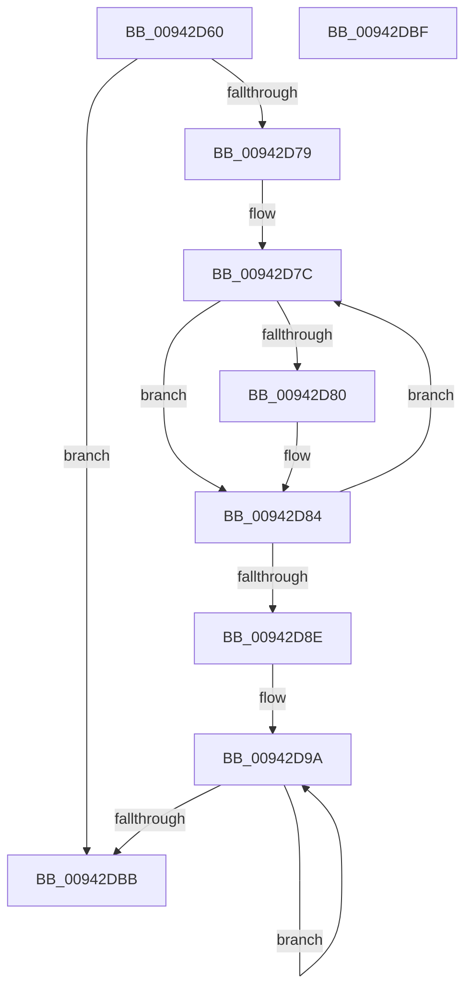

# MiImageGetRawRvaState

- RVA: `0x00942D60`–`0x00942DC0` (길이 `96` bytes)
- VA: `0x0000000140942D60`
- 실행 섹션: `PAGE`
- PDB 이름 있음: `예`; PDB Function 태그: `아니요`
- unwind 정보 RVA: `0x000DB714`
- 디코드: `29`개 명령, `96/96` bytes 표시
- 미해석 바이트: `0` (있으면 어셈블리에 `.byte`로 보존)

> 이 문서는 커널 이미지의 기계어와 PDB 기호를 분석해 생성했습니다. 4번과 5번은 함수 원형과 자료형을 바이너리 사용 방식에서 추정한 C 해석이며 원본 소스 복구 결과는 아닙니다.

## 1. Dependencies

- 직접 호출 지점: **0**; 고유 호출 대상: **0**
- 직접 호출자로 확인된 함수: **2**
- RIP 상대 이미지 참조: **0**

### Outgoing calls
- 직접 디코드된 call 명령이 없습니다.

### Direct callers
- [MiImageRvaRawEnumFirst](MiImageRvaRawEnumFirst_function_009423E0.md) at `0x00942477`
- [RtlpCompressRvaList](RtlpCompressRvaList_function_00942650.md) at `0x00942879`

### Static image references
- 디코드된 RIP-relative 메모리 참조가 없습니다.

## 2. Other-region calls and transfers

- 다른 실행 섹션으로 향하는 call: **0**
- 별도 외부 분기/꼬리 이동을 확인하지 못했습니다.

## 3. Assembly (complete function range)

```asm
00942D60  44 8B 99 90 00 00 00            mov r11d, dword ptr [rcx + 0x90]
00942D67  48 8D 81 98 00 00 00            lea rax, [rcx + 0x98]
00942D6E  45 33 C9                        xor r9d, r9d
00942D71  45 8B C1                        mov r8d, r9d
00942D74  45 85 DB                        test r11d, r11d
00942D77  74 42                           je 0x140942dbb
00942D79  45 8B D3                        mov r10d, r11d
00942D7C  39 10                           cmp dword ptr [rax], edx
00942D7E  75 04                           jne 0x140942d84
00942D80  44 0B 40 04                     or r8d, dword ptr [rax + 4]
00942D84  48 83 C0 28                     add rax, 0x28
00942D88  49 83 EA 01                     sub r10, 1
00942D8C  75 EE                           jne 0x140942d7c
00942D8E  BA 01 00 00 00                  mov edx, 1
00942D93  4C 8D 91 80 00 00 00            lea r10, [rcx + 0x80]
00942D9A  8B CA                           mov ecx, edx
00942D9C  4D 8D 52 04                     lea r10, [r10 + 4]
00942DA0  41 0B C9                        or ecx, r9d
00942DA3  41 8B C0                        mov eax, r8d
00942DA6  41 23 42 FC                     and eax, dword ptr [r10 - 4]
00942DAA  85 C0                           test eax, eax
00942DAC  41 0F 44 C9                     cmove ecx, r9d
00942DB0  D1 C2                           rol edx, 1
00942DB2  44 8B C9                        mov r9d, ecx
00942DB5  49 83 EB 01                     sub r11, 1
00942DB9  75 DF                           jne 0x140942d9a
00942DBB  41 8B C1                        mov eax, r9d
00942DBE  C3                              ret
00942DBF  CC                              int3
```

## 4. C-style interpretation (structured pseudocode)

```c
__int64 __fastcall MiImageGetRawRvaState(__int64 a1, int a2, __int64 a3, int a4)
{
    __int64 result;
    __int64 v_r10;
    __int64 v_r11;

    a4 = 0;
    if ((unsigned int)((unsigned int)(*(unsigned int *)(a1 + 144))) == 0) goto loc_00942DBB;
loc_00942D7C:
    if ((*(unsigned int *)(a1 + 152)) == a2) {
        a3 = (unsigned int)((0) | (*(unsigned int *)(a1 + 152 + 4)));
    }
    result = (a1 + 152) + (40);
    v_r10 = ((unsigned int)((unsigned int)((unsigned int)(*(unsigned int *)(a1 + 144))))) - (1);
    if (condition_is_not_equal) goto loc_00942D7C;
loc_00942D9A:
    a1 = (unsigned int)((1) | (0));
    result = (unsigned int)(((unsigned int)((unsigned int)(a3))) & (*(unsigned int *)(a1 + 128 + 4 - 4)));
    if ((unsigned int)(result) == 0) { a1 = 0; }
    v_r11 = ((unsigned int)(*(unsigned int *)(a1 + 144))) - (1);
    if (condition_is_not_equal) goto loc_00942D9A;
loc_00942DBB:
    return (unsigned int)((unsigned int)((unsigned int)((unsigned int)(a1))));
}
```

## 5. (Beta) C Style

```c
int64_t MiImageGetRawRvaState(void *Arg1, int32_t Arg2, int64_t Arg3, int32_t Arg4)
{
    uint8_t *arg1 = (uint8_t *)Arg1;

    int64_t result;
    int64_t local_r10;
    int64_t local_r11;

    Arg4 = 0;
    if ((uint32_t)((uint32_t)(*(uint32_t *)(arg1 + 0x90))) == 0) goto loc_00942DBB;
loc_00942D7C:
    if ((*(uint32_t *)(arg1 + 0x98)) == Arg2) {
        Arg3 = (uint32_t)((0) | (*(uint32_t *)(arg1 + 0x98 + 0x4)));
    }
    result = (Arg1 + 152) + (40);
    local_r10 = ((uint32_t)((uint32_t)((uint32_t)(*(uint32_t *)(arg1 + 0x90))))) - (1);
    if (condition_is_not_equal) goto loc_00942D7C;
loc_00942D9A:
    Arg1 = (uint32_t)((1) | (0));
    result = (uint32_t)(((uint32_t)((uint32_t)(Arg3))) & (*(uint32_t *)(arg1 + 0x80 + 0x4 - 0x4)));
    if ((uint32_t)(result) == 0) { Arg1 = 0; }
    local_r11 = ((uint32_t)(*(uint32_t *)(arg1 + 0x90))) - (1);
    if (condition_is_not_equal) goto loc_00942D9A;
loc_00942DBB:
    return (uint32_t)((uint32_t)((uint32_t)((uint32_t)(Arg1))));
}
```

### 관측된 메모리 오프셋

구조체 형식이 확인되지 않은 접근은 인자 기준의 오프셋으로만 기록했습니다.

| 기준 인자 | 오프셋 표현 | 폭 (bit) | 접근 |
|---|---:|---:|---|
| `Arg1` | `- 0x4` | `32` | `R` |
| `Arg1` | `+ 0x0` | `32` | `R` |
| `Arg1` | `+ 0x4` | `32` | `R` |
| `Arg1` | `+ 0x4` | `64` | `R` |
| `Arg1` | `+ 0x80` | `64` | `R` |
| `Arg1` | `+ 0x90` | `32` | `R` |
| `Arg1` | `+ 0x98` | `64` | `R` |

## 6. Execution-region graph

[열기: 2D/3D 그래프와 함수 탐색 컨트롤 패널](../../../control-panel.html?section=page&rva=0x00942D60&view=graph)

- 2D 그래프는 위에서 아래로 흐르고, 3D 그래프는 빈 공간을 드래그해 회전합니다. Shift+드래그는 이동, 휠은 확대·축소, 함수 노드 선택은 대상 보고서 이동입니다.

### Static fallback


