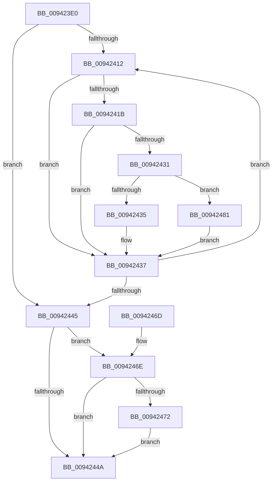

# MiImageRvaRawEnumFirst

- RVA: `0x009423E0`–`0x00942488` (길이 `168` bytes)
- VA: `0x00000001409423E0`
- 실행 섹션: `PAGE`
- PDB 이름 있음: `예`; PDB Function 태그: `아니요`
- unwind 정보 RVA: `0x000903A0`
- 디코드: `53`개 명령, `168/168` bytes 표시
- 미해석 바이트: `0` (있으면 어셈블리에 `.byte`로 보존)

> 이 문서는 커널 이미지의 기계어와 PDB 기호를 분석해 생성했습니다. 4번과 5번은 함수 원형과 자료형을 바이너리 사용 방식에서 추정한 C 해석이며 원본 소스 복구 결과는 아닙니다.

## 1. Dependencies

- 직접 호출 지점: **2**; 고유 호출 대상: **2**
- 직접 호출자로 확인된 함수: **0**
- RIP 상대 이미지 참조: **0**

### Outgoing calls
- `0x00942426` → [guard_dispatch_icall](../../text/6B/guard_dispatch_icall_function_006BAAD0.md) (function, `0x006BAAD0`)
- `0x00942477` → [MiImageGetRawRvaState](MiImageGetRawRvaState_function_00942D60.md) (function, `0x00942D60`)

### Direct callers
- 이 함수 시작 RVA로 연결되는 직접 call은 확인되지 않았습니다. 간접 호출은 완전히 역산할 수 없습니다.

### Static image references
- 디코드된 RIP-relative 메모리 참조가 없습니다.

## 2. Other-region calls and transfers

- 다른 실행 섹션으로 향하는 call: **1**
  - `0x00942426` → [guard_dispatch_icall](../../text/6B/guard_dispatch_icall_function_006BAAD0.md) (`PAGE` → `.text`)
- 별도 외부 분기/꼬리 이동을 확인하지 못했습니다.

## 3. Assembly (complete function range)

```asm
009423E0  48 8B C4                        mov rax, rsp
009423E3  48 89 58 08                     mov qword ptr [rax + 8], rbx
009423E7  48 89 68 10                     mov qword ptr [rax + 0x10], rbp
009423EB  48 89 70 18                     mov qword ptr [rax + 0x18], rsi
009423EF  48 89 78 20                     mov qword ptr [rax + 0x20], rdi
009423F3  41 56                           push r14
009423F5  48 83 EC 20                     sub rsp, 0x20
009423F9  33 DB                           xor ebx, ebx
009423FB  48 8D B1 98 00 00 00            lea rsi, [rcx + 0x98]
00942402  33 ED                           xor ebp, ebp
00942404  4C 8B F2                        mov r14, rdx
00942407  48 8B F9                        mov rdi, rcx
0094240A  39 99 90 00 00 00               cmp dword ptr [rcx + 0x90], ebx
00942410  76 33                           jbe 0x140942445
00942412  48 8B 46 08                     mov rax, qword ptr [rsi + 8]
00942416  48 85 C0                        test rax, rax
00942419  74 1C                           je 0x140942437
0094241B  4C 8D 46 04                     lea r8, [rsi + 4]
0094241F  48 8B CF                        mov rcx, rdi
00942422  48 8D 56 18                     lea rdx, [rsi + 0x18]
00942426  E8 A5 86 D7 FF                  call 0x1406baad0
0094242B  89 06                           mov dword ptr [rsi], eax
0094242D  85 C0                           test eax, eax
0094242F  74 06                           je 0x140942437
00942431  85 DB                           test ebx, ebx
00942433  75 4C                           jne 0x140942481
00942435  8B D8                           mov ebx, eax
00942437  FF C5                           inc ebp
00942439  48 83 C6 28                     add rsi, 0x28
0094243D  3B AF 90 00 00 00               cmp ebp, dword ptr [rdi + 0x90]
00942443  72 CD                           jb 0x140942412
00942445  4D 85 F6                        test r14, r14
00942448  75 24                           jne 0x14094246e
0094244A  48 8B 6C 24 38                  mov rbp, qword ptr [rsp + 0x38]
0094244F  8B C3                           mov eax, ebx
00942451  48 8B 74 24 40                  mov rsi, qword ptr [rsp + 0x40]
00942456  89 9F 38 01 00 00               mov dword ptr [rdi + 0x138], ebx
0094245C  48 8B 5C 24 30                  mov rbx, qword ptr [rsp + 0x30]
00942461  48 8B 7C 24 48                  mov rdi, qword ptr [rsp + 0x48]
00942466  48 83 C4 20                     add rsp, 0x20
0094246A  41 5E                           pop r14
0094246C  C3                              ret
0094246D  CC                              int3
0094246E  85 DB                           test ebx, ebx
00942470  74 D8                           je 0x14094244a
00942472  8B D3                           mov edx, ebx
00942474  48 8B CF                        mov rcx, rdi
00942477  E8 E4 08 00 00                  call 0x140942d60
0094247C  41 89 06                        mov dword ptr [r14], eax
0094247F  EB C9                           jmp 0x14094244a
00942481  3B D8                           cmp ebx, eax
00942483  0F 43 D8                        cmovae ebx, eax
00942486  EB AF                           jmp 0x140942437
```

## 4. C-style interpretation (structured pseudocode)

```c
__int64 __fastcall MiImageRvaRawEnumFirst(__int64 a1, __int64 a2)
{
    __int64 result;
    __int64 v_rbp;
    __int64 v_rbx;
    __int64 v_rsi;
    __int64 v_rsp;
    unsigned __int64 v_stack_p10;
    unsigned __int64 v_stack_p18;
    unsigned __int64 v_stack_p20;
    unsigned __int64 v_stack_p8;

    *(unsigned __int64 *)(v_rsp + 8) = v_rbx;
    *(unsigned __int64 *)(v_rsp + 16) = v_rbp;
    *(unsigned __int64 *)(v_rsp + 24) = v_rsi;
    *(unsigned __int64 *)(v_rsp + 32) = v_rdi;
    v_rsp = (v_rsp) - (32);
    v_rbx = 0;
    v_rbp = 0;
    if ((*(unsigned int *)(a1 + 144)) <= 0) goto loc_00942445;
loc_00942412:
    if (*(unsigned __int64 *)(a1 + 152 + 8) == 0) goto loc_00942437;
    result = guard_dispatch_icall(a1, a1 + 152 + 24, a1 + 152 + 4, a4);
    *(unsigned int *)(a1 + 152) = (unsigned int)(result);
    if ((unsigned int)(result) == 0) goto loc_00942437;
    if (0 != 0) goto loc_00942481;
loc_00942437:
    v_rbp = (unsigned int)((v_rbp) + 1);
    v_rsi = (a1 + 152) + (40);
    if (((unsigned int)(v_rbp)) < (*(unsigned int *)(a1 + 144))) goto loc_00942412;
loc_00942445:
    if (a2 != 0) goto loc_0094246E;
loc_0094244A:
    *(unsigned int *)(a1 + 312) = (unsigned int)((unsigned int)((unsigned int)(result)));
    v_rsp = (v_rsp) + (32);
    return (unsigned int)((unsigned int)((unsigned int)((unsigned int)(result))));
loc_0094246E:
    if ((unsigned int)(v_stack_p8) == 0) goto loc_0094244A;
    result = MiImageGetRawRvaState(v_stack_p20, (unsigned int)((unsigned int)(v_stack_p8)), a1 + 152 + 4, a4);
    *(unsigned int *)(a2) = (unsigned int)(result);
    goto loc_0094244A;
loc_00942481:
    v_rbx = v_stack_p8;
    if (((unsigned int)(v_stack_p8)) >= ((unsigned int)(result))) { v_rbx = (unsigned int)(result); }
    goto loc_00942437;
}
```

## 5. (Beta) C Style

```c
int64_t MiImageRvaRawEnumFirst(void *Arg1, int64_t Arg2)
{
    uint8_t *arg1 = (uint8_t *)Arg1;

    int64_t result;
    int64_t local_rbp;
    int64_t local_rbx;
    int64_t local_rsi;
    int64_t local_rsp;
    uint64_t v_stack_p10;
    uint64_t v_stack_p18;
    uint64_t v_stack_p20;
    uint64_t v_stack_p8;

    *(uint64_t *)(local_rsp + 0x8) = local_rbx;
    *(uint64_t *)(local_rsp + 0x10) = local_rbp;
    *(uint64_t *)(local_rsp + 0x18) = local_rsi;
    *(uint64_t *)(local_rsp + 0x20) = local_rdi;
    local_rsp = (local_rsp) - (32);
    local_rbx = 0;
    local_rbp = 0;
    if ((*(uint32_t *)(arg1 + 0x90)) <= 0) goto loc_00942445;
loc_00942412:
    if (*(uint64_t *)(arg1 + 0x98 + 0x8) == 0) goto loc_00942437;
    result = guard_dispatch_icall(Arg1, Arg1 + 152 + 24, Arg1 + 152 + 4, a4);
    *(uint32_t *)(arg1 + 0x98) = (uint32_t)(result);
    if ((uint32_t)(result) == 0) goto loc_00942437;
    if (0 != 0) goto loc_00942481;
loc_00942437:
    local_rbp = (uint32_t)((local_rbp) + 1);
    local_rsi = (Arg1 + 152) + (40);
    if (((uint32_t)(local_rbp)) < (*(uint32_t *)(arg1 + 0x90))) goto loc_00942412;
loc_00942445:
    if (Arg2 != 0) goto loc_0094246E;
loc_0094244A:
    *(uint32_t *)(arg1 + 0x138) = (uint32_t)((uint32_t)((uint32_t)(result)));
    local_rsp = (local_rsp) + (32);
    return (uint32_t)((uint32_t)((uint32_t)((uint32_t)(result))));
loc_0094246E:
    if ((uint32_t)(v_stack_p8) == 0) goto loc_0094244A;
    result = MiImageGetRawRvaState(v_stack_p20, (uint32_t)((uint32_t)(v_stack_p8)), Arg1 + 152 + 4, a4);
    *(uint32_t *)(Arg2) = (uint32_t)(result);
    goto loc_0094244A;
loc_00942481:
    local_rbx = v_stack_p8;
    if (((uint32_t)(v_stack_p8)) >= ((uint32_t)(result))) { local_rbx = (uint32_t)(result); }
    goto loc_00942437;
}
```

### 관측된 메모리 오프셋

구조체 형식이 확인되지 않은 접근은 인자 기준의 오프셋으로만 기록했습니다.

| 기준 인자 | 오프셋 표현 | 폭 (bit) | 접근 |
|---|---:|---:|---|
| `Arg1` | `+ 0x0` | `32` | `W` |
| `Arg1` | `+ 0x4` | `64` | `R` |
| `Arg1` | `+ 0x8` | `64` | `R` |
| `Arg1` | `+ 0x18` | `64` | `R` |
| `Arg1` | `+ 0x90` | `32` | `R` |
| `Arg1` | `+ 0x98` | `64` | `R` |
| `Arg1` | `+ 0x138` | `32` | `W` |

## 6. Execution-region graph

[열기: 2D/3D 그래프와 함수 탐색 컨트롤 패널](../../../control-panel.html?section=page&rva=0x009423E0&view=graph)

- 2D 그래프는 위에서 아래로 흐르고, 3D 그래프는 빈 공간을 드래그해 회전합니다. Shift+드래그는 이동, 휠은 확대·축소, 함수 노드 선택은 대상 보고서 이동입니다.

### Static fallback


