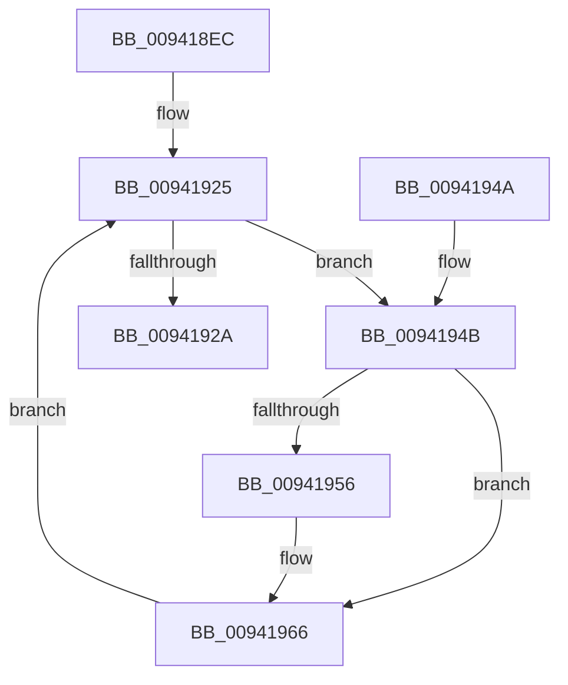

# MiLogRelocationFaults

- RVA: `0x009418EC`–`0x0094196B` (길이 `127` bytes)
- VA: `0x00000001409418EC`
- 실행 섹션: `PAGE`
- PDB 이름 있음: `예`; PDB Function 태그: `아니요`
- unwind 정보 RVA: `0x0007836C`
- 디코드: `37`개 명령, `127/127` bytes 표시
- 미해석 바이트: `0` (있으면 어셈블리에 `.byte`로 보존)

> 이 문서는 커널 이미지의 기계어와 PDB 기호를 분석해 생성했습니다. 4번과 5번은 함수 원형과 자료형을 바이너리 사용 방식에서 추정한 C 해석이며 원본 소스 복구 결과는 아닙니다.

## 1. Dependencies

- 직접 호출 지점: **4**; 고유 호출 대상: **3**
- 직접 호출자로 확인된 함수: **1**
- RIP 상대 이미지 참조: **0**

### Outgoing calls
- `0x00941909` → [MiReferenceControlAreaFile](../../text/43/MiReferenceControlAreaFile_function_00431554.md) (function, `0x00431554`)
- `0x0094191C` → [MiLogRelocationRva](MiLogRelocationRva_function_009420DC.md) (function, `0x009420DC`)
- `0x00941930` → [MiDereferenceControlAreaFile](../../text/43/MiDereferenceControlAreaFile_function_004345E0.md) (function, `0x004345E0`)
- `0x00941961` → [MiLogRelocationRva](MiLogRelocationRva_function_009420DC.md) (function, `0x009420DC`)

### Direct callers
- [MiRelocateImage](../98/MiRelocateImage_function_00988E14.md) at `0x0098936F`

### Static image references
- 디코드된 RIP-relative 메모리 참조가 없습니다.

## 2. Other-region calls and transfers

- 다른 실행 섹션으로 향하는 call: **2**
  - `0x00941909` → [MiReferenceControlAreaFile](../../text/43/MiReferenceControlAreaFile_function_00431554.md) (`PAGE` → `.text`)
  - `0x00941930` → [MiDereferenceControlAreaFile](../../text/43/MiDereferenceControlAreaFile_function_004345E0.md) (`PAGE` → `.text`)
- 별도 외부 분기/꼬리 이동을 확인하지 못했습니다.

## 3. Assembly (complete function range)

```asm
009418EC  48 89 5C 24 08                  mov qword ptr [rsp + 8], rbx
009418F1  48 89 6C 24 10                  mov qword ptr [rsp + 0x10], rbp
009418F6  48 89 74 24 18                  mov qword ptr [rsp + 0x18], rsi
009418FB  57                              push rdi
009418FC  48 83 EC 20                     sub rsp, 0x20
00941900  49 8B F8                        mov rdi, r8
00941903  48 8B DA                        mov rbx, rdx
00941906  48 8B F1                        mov rsi, rcx
00941909  E8 46 FC AE FF                  call 0x140431554
0094190E  8B 53 04                        mov edx, dword ptr [rbx + 4]
00941911  4C 8B CE                        mov r9, rsi
00941914  8B 0B                           mov ecx, dword ptr [rbx]
00941916  4C 8B C0                        mov r8, rax
00941919  48 8B E8                        mov rbp, rax
0094191C  E8 BB 07 00 00                  call 0x1409420dc
00941921  48 8B 5F 10                     mov rbx, qword ptr [rdi + 0x10]
00941925  48 85 DB                        test rbx, rbx
00941928  75 21                           jne 0x14094194b
0094192A  48 8B D5                        mov rdx, rbp
0094192D  48 8B CE                        mov rcx, rsi
00941930  E8 AB 2C AF FF                  call 0x1404345e0
00941935  48 8B 5C 24 30                  mov rbx, qword ptr [rsp + 0x30]
0094193A  48 8B 6C 24 38                  mov rbp, qword ptr [rsp + 0x38]
0094193F  48 8B 74 24 40                  mov rsi, qword ptr [rsp + 0x40]
00941944  48 83 C4 20                     add rsp, 0x20
00941948  5F                              pop rdi
00941949  C3                              ret
0094194A  CC                              int3
0094194B  8B 4B 08                        mov ecx, dword ptr [rbx + 8]
0094194E  F7 C1 FF 0F 00 00               test ecx, 0xfff
00941954  74 10                           je 0x140941966
00941956  4C 8B CE                        mov r9, rsi
00941959  4C 8B C5                        mov r8, rbp
0094195C  BA 00 20 00 00                  mov edx, 0x2000
00941961  E8 76 07 00 00                  call 0x1409420dc
00941966  48 8B 1B                        mov rbx, qword ptr [rbx]
00941969  EB BA                           jmp 0x140941925
```

## 4. C-style interpretation (structured pseudocode)

```c
__int64 __fastcall MiLogRelocationFaults(__int64 a1, __int64 a2, __int64 a3)
{
    __int64 result;
    __int64 v_rsp;
    unsigned __int64 v_stack_p10;
    unsigned __int64 v_stack_p18;
    unsigned __int64 v_stack_p8;

    v_stack_p8 = v_rbx;
    v_stack_p10 = v_rbp;
    v_stack_p18 = v_rsi;
    v_rsp = (v_rsp) - (32);
    result = MiReferenceControlAreaFile(a1, a2, a3, a4);
    result = MiLogRelocationRva((unsigned int)(*(unsigned int *)(a2)), (unsigned int)(*(unsigned int *)(a2 + 4)), result, a1);
loc_00941925:
    if (*(unsigned __int64 *)(a3 + 16) != 0) goto loc_0094194B;
    result = MiDereferenceControlAreaFile(a1, result, result, a1);
    v_rsp = (v_rsp) + (32);
    return result;
loc_0094194B:
    if ((((unsigned int)((unsigned int)(*(unsigned int *)(v_stack_p8 + 8)))) & (0xFFFULL)) != 0) {
        a4 = v_stack_p18;
        a3 = v_stack_p10;
        a2 = 0x2000ULL;
        result = MiLogRelocationRva((unsigned int)(*(unsigned int *)(v_stack_p8 + 8)), a2, a3, a4);
    }
    goto loc_00941925;
}
```

## 5. (Beta) C Style

```c
int64_t MiLogRelocationFaults(int64_t Arg1, void *Arg2, void *Arg3)
{
    uint8_t *arg2 = (uint8_t *)Arg2;
    uint8_t *arg3 = (uint8_t *)Arg3;

    int64_t result;
    int64_t local_rsp;
    uint64_t v_stack_p10;
    uint64_t v_stack_p18;
    uint64_t v_stack_p8;

    v_stack_p8 = local_rbx;
    v_stack_p10 = local_rbp;
    v_stack_p18 = local_rsi;
    local_rsp = (local_rsp) - (32);
    result = MiReferenceControlAreaFile(Arg1, Arg2, Arg3, a4);
    result = MiLogRelocationRva((uint32_t)(*(uint32_t *)(arg2)), (uint32_t)(*(uint32_t *)(arg2 + 0x4)), result, Arg1);
loc_00941925:
    if (*(uint64_t *)(arg3 + 0x10) != 0) goto loc_0094194B;
    result = MiDereferenceControlAreaFile(Arg1, result, result, Arg1);
    local_rsp = (local_rsp) + (32);
    return result;
loc_0094194B:
    if ((((uint32_t)((uint32_t)(*(uint32_t *)(v_stack_p8 + 0x8)))) & (0xFFFULL)) != 0) {
        a4 = v_stack_p18;
        Arg3 = v_stack_p10;
        Arg2 = 0x2000ULL;
        result = MiLogRelocationRva((uint32_t)(*(uint32_t *)(v_stack_p8 + 0x8)), Arg2, Arg3, a4);
    }
    goto loc_00941925;
}
```

### 관측된 메모리 오프셋

구조체 형식이 확인되지 않은 접근은 인자 기준의 오프셋으로만 기록했습니다.

| 기준 인자 | 오프셋 표현 | 폭 (bit) | 접근 |
|---|---:|---:|---|
| `Arg2` | `+ 0x0` | `32` | `R` |
| `Arg2` | `+ 0x4` | `32` | `R` |
| `Arg3` | `+ 0x10` | `64` | `R` |

## 6. Execution-region graph

[열기: 2D/3D 그래프와 함수 탐색 컨트롤 패널](../../../control-panel.html?section=page&rva=0x009418EC&view=graph)

- 2D 그래프는 위에서 아래로 흐르고, 3D 그래프는 빈 공간을 드래그해 회전합니다. Shift+드래그는 이동, 휠은 확대·축소, 함수 노드 선택은 대상 보고서 이동입니다.

### Static fallback


