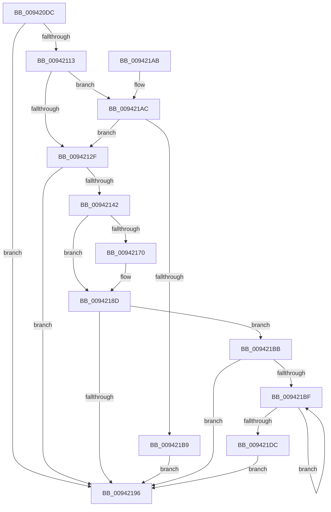

# MiLogRelocationRva

- RVA: `0x009420DC`–`0x009421DE` (길이 `258` bytes)
- VA: `0x00000001409420DC`
- 실행 섹션: `PAGE`
- PDB 이름 있음: `예`; PDB Function 태그: `아니요`
- unwind 정보 RVA: `0x00090330`
- 디코드: `66`개 명령, `258/258` bytes 표시
- 미해석 바이트: `0` (있으면 어셈블리에 `.byte`로 보존)

> 이 문서는 커널 이미지의 기계어와 PDB 기호를 분석해 생성했습니다. 4번과 5번은 함수 원형과 자료형을 바이너리 사용 방식에서 추정한 C 해석이며 원본 소스 복구 결과는 아닙니다.

## 1. Dependencies

- 직접 호출 지점: **4**; 고유 호출 대상: **4**
- 직접 호출자로 확인된 함수: **4**
- RIP 상대 이미지 참조: **2**

### Outgoing calls
- `0x00942105` → [MiOffsetToProtos](../../text/24/MiOffsetToProtos_function_0024D880.md) (function, `0x0024D880`)
- `0x00942138` → [PsGetIoPriorityThread](../../text/34/PsGetIoPriorityThread_function_00343930.md) (function, `0x00343930`)
- `0x00942188` → [PfLogFileDataAccess](../../text/34/PfLogFileDataAccess_function_00342090.md) (function, `0x00342090`)
- `0x009421CB` → [PfSnLogPageFault](../../text/34/PfSnLogPageFault_function_00344950.md) (function, `0x00344950`)

### Direct callers
- [MiParseImageLoadConfig](MiParseImageLoadConfig_function_00940D18.md) at `0x00940F62`
- [MiCaptureImageCfgContext](MiCaptureImageCfgContext_function_009414E0.md) at `0x009416EE`
- [MiLogRelocationFaults](MiLogRelocationFaults_function_009418EC.md) at `0x0094191C`
- [MiLogRelocationFaults](MiLogRelocationFaults_function_009418EC.md) at `0x00941961`
- [MiParseComAndCetHeaders](MiParseComAndCetHeaders_function_00941974.md) at `0x00941A9C`
- [MiParseComAndCetHeaders](MiParseComAndCetHeaders_function_00941974.md) at `0x00941B4F`
- [MiParseComAndCetHeaders](MiParseComAndCetHeaders_function_00941974.md) at `0x00941D00`

### Static image references
- `0x00942126` → RVA `0x00E67248` (`.data`; read)
- `0x00942167` → RVA `0x00F0F230` (`.data`; read)

## 2. Other-region calls and transfers

- 다른 실행 섹션으로 향하는 call: **4**
  - `0x00942105` → [MiOffsetToProtos](../../text/24/MiOffsetToProtos_function_0024D880.md) (`PAGE` → `.text`)
  - `0x00942138` → [PsGetIoPriorityThread](../../text/34/PsGetIoPriorityThread_function_00343930.md) (`PAGE` → `.text`)
  - `0x00942188` → [PfLogFileDataAccess](../../text/34/PfLogFileDataAccess_function_00342090.md) (`PAGE` → `.text`)
  - `0x009421CB` → [PfSnLogPageFault](../../text/34/PfSnLogPageFault_function_00344950.md) (`PAGE` → `.text`)
- 별도 외부 분기/꼬리 이동을 확인하지 못했습니다.

## 3. Assembly (complete function range)

```asm
009420DC  48 8B C4                        mov rax, rsp
009420DF  48 89 58 08                     mov qword ptr [rax + 8], rbx
009420E3  48 89 68 10                     mov qword ptr [rax + 0x10], rbp
009420E7  48 89 70 18                     mov qword ptr [rax + 0x18], rsi
009420EB  57                              push rdi
009420EC  48 83 EC 40                     sub rsp, 0x40
009420F0  48 83 60 E8 00                  and qword ptr [rax - 0x18], 0
009420F5  49 8B F0                        mov rsi, r8
009420F8  8B EA                           mov ebp, edx
009420FA  4C 8D 40 E8                     lea r8, [rax - 0x18]
009420FE  8B D1                           mov edx, ecx
00942100  8B F9                           mov edi, ecx
00942102  49 8B C9                        mov rcx, r9
00942105  E8 76 B7 90 FF                  call 0x14024d880
0094210A  48 85 C0                        test rax, rax
0094210D  0F 84 83 00 00 00               je 0x140942196
00942113  8B 58 24                        mov ebx, dword ptr [rax + 0x24]
00942116  48 8B 44 24 30                  mov rax, qword ptr [rsp + 0x30]
0094211B  48 C1 E0 0C                     shl rax, 0xc
0094211F  48 C1 E3 09                     shl rbx, 9
00942123  48 03 D8                        add rbx, rax
00942126  83 3D 1B 51 52 00 00            cmp dword ptr [rip + 0x52511b], 0
0094212D  74 7D                           je 0x1409421ac
0094212F  65 48 8B 0C 25 88 01 00 00      mov rcx, qword ptr gs:[0x188]
00942138  E8 F3 17 A0 FF                  call 0x140343930
0094213D  83 F8 02                        cmp eax, 2
00942140  7C 54                           jl 0x140942196
00942142  BA FF 0F 00 00                  mov edx, 0xfff
00942147  48 8D 8D FF 0F 00 00            lea rcx, [rbp + 0xfff]
0094214E  48 23 FA                        and rdi, rdx
00942151  48 03 CF                        add rcx, rdi
00942154  48 C1 E9 0C                     shr rcx, 0xc
00942158  85 DA                           test edx, ebx
0094215A  8D 79 01                        lea edi, [rcx + 1]
0094215D  0F 44 F9                        cmove edi, ecx
00942160  48 81 E3 00 F0 FF FF            and rbx, 0xfffffffffffff000
00942167  83 3D C2 D0 5C 00 00            cmp dword ptr [rip + 0x5cd0c2], 0
0094216E  74 1D                           je 0x14094218d
00942170  65 48 8B 14 25 88 01 00 00      mov rdx, qword ptr gs:[0x188]
00942179  4C 8B C3                        mov r8, rbx
0094217C  48 8B 4E 18                     mov rcx, qword ptr [rsi + 0x18]
00942180  83 64 24 20 00                  and dword ptr [rsp + 0x20], 0
00942185  44 8B CF                        mov r9d, edi
00942188  E8 03 FF 9F FF                  call 0x140342090
0094218D  83 3D B4 50 52 00 00            cmp dword ptr [rip + 0x5250b4], 0
00942194  75 25                           jne 0x1409421bb
00942196  48 8B 5C 24 50                  mov rbx, qword ptr [rsp + 0x50]
0094219B  48 8B 6C 24 58                  mov rbp, qword ptr [rsp + 0x58]
009421A0  48 8B 74 24 60                  mov rsi, qword ptr [rsp + 0x60]
009421A5  48 83 C4 40                     add rsp, 0x40
009421A9  5F                              pop rdi
009421AA  C3                              ret
009421AB  CC                              int3
009421AC  83 3D 7D D0 5C 00 00            cmp dword ptr [rip + 0x5cd07d], 0
009421B3  0F 85 76 FF FF FF               jne 0x14094212f
009421B9  EB DB                           jmp 0x140942196
009421BB  85 FF                           test edi, edi
009421BD  74 D7                           je 0x140942196
009421BF  41 B8 02 00 00 00               mov r8d, 2
009421C5  48 8B D3                        mov rdx, rbx
009421C8  48 8B CE                        mov rcx, rsi
009421CB  E8 80 27 A0 FF                  call 0x140344950
009421D0  48 81 C3 00 10 00 00            add rbx, 0x1000
009421D7  83 C7 FF                        add edi, -1
009421DA  75 E3                           jne 0x1409421bf
009421DC  EB B8                           jmp 0x140942196
```

## 4. C-style interpretation (structured pseudocode)

```c
__int64 __fastcall MiLogRelocationRva(int a1, int a2, __int64 a3, __int64 a4)
{
    __int64 result;
    __int64 v_rbx;
    __int64 v_rdi;
    __int64 v_rsp;
    unsigned __int64 v_stack_m18;
    unsigned int v_stack_m28;
    unsigned __int64 v_stack_p10;
    unsigned __int64 v_stack_p18;
    unsigned __int64 v_stack_p8;

    *(unsigned __int64 *)(v_rsp + 8) = v_rbx;
    *(unsigned __int64 *)(v_rsp + 16) = v_rbp;
    *(unsigned __int64 *)(v_rsp + 24) = v_rsi;
    v_rsp = (v_rsp) - (64);
    result = MiOffsetToProtos(a4, (unsigned int)(a1), v_rsp - 24, a4);
    if (result == 0) goto loc_00942196;
    result = (v_stack_m18) << (12);
    v_rbx = ((unsigned int)(*(unsigned int *)(result + 36))) << (9);
    v_rbx = (v_rbx) + (result);
    if ((*(unsigned int *)(v_rip + 5394715)) == 0) goto loc_009421AC;
loc_0094212F:
    result = PsGetIoPriorityThread(*(unsigned __int64 *)(gs_base + (0 + 392)), (unsigned int)(a1), v_rsp - 24, a4);
    if (((unsigned int)(result)) < 2) goto loc_00942196;
    v_rdi = ((unsigned int)(a1)) & ((unsigned int)(0xFFFULL));
    a1 = ((unsigned int)(a2) + 4095) + (v_rdi);
    a1 = (a1) >> (12);
    v_rdi = a1 + 1;
    if ((((unsigned int)((unsigned int)(0xFFFULL))) & ((unsigned int)(v_rbx))) == 0) { v_rdi = a1; }
    v_rbx = (v_rbx) & (0xFFFFFFFFFFFFF000ULL);
    if ((*(unsigned int *)(v_rip + 6082754)) != 0) {
        a2 = *(unsigned __int64 *)(gs_base + (0 + 392));
        a3 = v_rbx;
        a1 = *(unsigned __int64 *)(a3 + 24);
        a4 = (unsigned int)(v_rdi);
        result = PfLogFileDataAccess(a1, a2, a3, a4);
    }
    if ((*(unsigned int *)(v_rip + 5394612)) != 0) goto loc_009421BB;
loc_00942196:
    v_rsp = (v_rsp) + (64);
    return result;
loc_009421AC:
    if ((*(unsigned int *)(v_rip + 6082685)) != 0) goto loc_0094212F;
    goto loc_00942196;
loc_009421BB:
    if ((unsigned int)(v_rdi) == 0) goto loc_00942196;
loc_009421BF:
    result = PfSnLogPageFault(v_stack_p18, v_stack_p8, 2, a4);
    v_rbx = (v_stack_p8) + (0x1000ULL);
    v_rdi = (unsigned int)((v_rdi) + (-1));
    if (condition_is_not_equal) goto loc_009421BF;
    goto loc_00942196;
}
```

## 5. (Beta) C Style

```c
int64_t MiLogRelocationRva(int32_t Arg1, void *Arg2, void *Arg3, int64_t Arg4)
{
    uint8_t *arg2 = (uint8_t *)Arg2;
    uint8_t *arg3 = (uint8_t *)Arg3;

    int64_t result;
    int64_t local_rbx;
    int64_t local_rdi;
    int64_t local_rsp;
    uint64_t v_stack_m18;
    uint32_t v_stack_m28;
    uint64_t v_stack_p10;
    uint64_t v_stack_p18;
    uint64_t v_stack_p8;

    *(uint64_t *)(local_rsp + 0x8) = local_rbx;
    *(uint64_t *)(local_rsp + 0x10) = local_rbp;
    *(uint64_t *)(local_rsp + 0x18) = local_rsi;
    local_rsp = (local_rsp) - (64);
    result = MiOffsetToProtos(Arg4, (uint32_t)(Arg1), local_rsp - 24, Arg4);
    if (result == 0) goto loc_00942196;
    result = (v_stack_m18) << (12);
    local_rbx = ((uint32_t)(*(uint32_t *)(result + 0x24))) << (9);
    local_rbx = (local_rbx) + (result);
    if ((*(uint32_t *)(v_rip + 0x52511B)) == 0) goto loc_009421AC;
loc_0094212F:
    result = PsGetIoPriorityThread(*(uint64_t *)(gs_base + (0 + 0x188)), (uint32_t)(Arg1), local_rsp - 24, Arg4);
    if (((uint32_t)(result)) < 2) goto loc_00942196;
    local_rdi = ((uint32_t)(Arg1)) & ((uint32_t)(0xFFFULL));
    Arg1 = ((uint32_t)(Arg2) + 4095) + (local_rdi);
    Arg1 = (Arg1) >> (12);
    local_rdi = Arg1 + 1;
    if ((((uint32_t)((uint32_t)(0xFFFULL))) & ((uint32_t)(local_rbx))) == 0) { local_rdi = Arg1; }
    local_rbx = (local_rbx) & (0xFFFFFFFFFFFFF000ULL);
    if ((*(uint32_t *)(v_rip + 0x5CD0C2)) != 0) {
        Arg2 = *(uint64_t *)(gs_base + (0 + 0x188));
        Arg3 = local_rbx;
        Arg1 = *(uint64_t *)(arg3 + 0x18);
        Arg4 = (uint32_t)(local_rdi);
        result = PfLogFileDataAccess(Arg1, Arg2, Arg3, Arg4);
    }
    if ((*(uint32_t *)(v_rip + 0x5250B4)) != 0) goto loc_009421BB;
loc_00942196:
    local_rsp = (local_rsp) + (64);
    return result;
loc_009421AC:
    if ((*(uint32_t *)(v_rip + 0x5CD07D)) != 0) goto loc_0094212F;
    goto loc_00942196;
loc_009421BB:
    if ((uint32_t)(local_rdi) == 0) goto loc_00942196;
loc_009421BF:
    result = PfSnLogPageFault(v_stack_p18, v_stack_p8, 2, Arg4);
    local_rbx = (v_stack_p8) + (0x1000ULL);
    local_rdi = (uint32_t)((local_rdi) + (-1));
    if (condition_is_not_equal) goto loc_009421BF;
    goto loc_00942196;
}
```

### 관측된 메모리 오프셋

구조체 형식이 확인되지 않은 접근은 인자 기준의 오프셋으로만 기록했습니다.

| 기준 인자 | 오프셋 표현 | 폭 (bit) | 접근 |
|---|---:|---:|---|
| `Arg2` | `+ 0xFFF` | `64` | `R` |
| `Arg3` | `+ 0x18` | `64` | `R` |

## 6. Execution-region graph

[열기: 2D/3D 그래프와 함수 탐색 컨트롤 패널](../../../control-panel.html?section=page&rva=0x009420DC&view=graph)

- 2D 그래프는 위에서 아래로 흐르고, 3D 그래프는 빈 공간을 드래그해 회전합니다. Shift+드래그는 이동, 휠은 확대·축소, 함수 노드 선택은 대상 보고서 이동입니다.

### Static fallback


