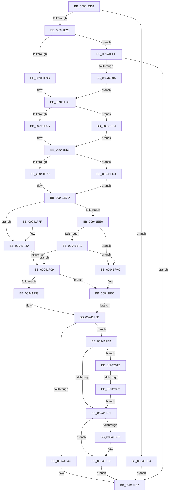

# MiMapImageInSystemSpace

- RVA: `0x00941DD8`–`0x00942063` (길이 `651` bytes)
- VA: `0x0000000140941DD8`
- 실행 섹션: `PAGE`
- PDB 이름 있음: `예`; PDB Function 태그: `예`
- unwind 정보 RVA: `0x00090304`
- 디코드: `173`개 명령, `651/651` bytes 표시
- 미해석 바이트: `0` (있으면 어셈블리에 `.byte`로 보존)

> 이 문서는 커널 이미지의 기계어와 PDB 기호를 분석해 생성했습니다. 4번과 5번은 함수 원형과 자료형을 바이너리 사용 방식에서 추정한 C 해석이며 원본 소스 복구 결과는 아닙니다.

## 1. Dependencies

- 직접 호출 지점: **16**; 고유 호출 대상: **16**
- 직접 호출자로 확인된 함수: **6**
- RIP 상대 이미지 참조: **0**

### Outgoing calls
- `0x00941E0A` → [memset](../../text/6C/memset_function_006C6C40.md) (function, `0x006C6C40`)
- `0x00941E2D` → [MiControlAreaRequiresCharge](../../text/3B/MiControlAreaRequiresCharge_function_003B36CC.md) (function, `0x003B36CC`)
- `0x00941E61` → [MiReferenceControlAreaFile](../../text/43/MiReferenceControlAreaFile_function_00431554.md) (function, `0x00431554`)
- `0x00941E99` → [PsGetProcessSessionIdEx](../../text/22/PsGetProcessSessionIdEx_function_0022F8F0.md) (function, `0x0022F8F0`)
- `0x00941EC7` → [MiSectionControlArea](../../text/29/MiSectionControlArea_function_00294CB0.md) (function, `0x00294CB0`)
- `0x00941ED2` → [MiCheckPurgeAndUpMapCount](../../text/41/MiCheckPurgeAndUpMapCount_function_004186B0.md) (function, `0x004186B0`)
- `0x00941F28` → [MiInsertInSystemSpace](../../text/3B/MiInsertInSystemSpace_function_003B2F5C.md) (function, `0x003B2F5C`)
- `0x00941F43` → [MiDereferenceControlAreaFile](../../text/43/MiDereferenceControlAreaFile_function_004345E0.md) (function, `0x004345E0`)
- `0x00941F51` → [MiGetAnyMultiplexedVm](../../text/44/MiGetAnyMultiplexedVm_function_00448BD0.md) (function, `0x00448BD0`)
- `0x00941FB4` → [MiDereferenceControlArea](../../text/47/MiDereferenceControlArea_function_00479A20.md) (function, `0x00479A20`)
- `0x00941FCB` → [MiReturnCrossPartitionControlAreaCharges](../../text/4D/MiReturnCrossPartitionControlAreaCharges_function_004D6184.md) (function, `0x004D6184`)
- `0x00941FFD` → [MiReferenceActiveSubsection](../../text/32/MiReferenceActiveSubsection_function_00325060.md) (function, `0x00325060`)
- `0x0094201A` → [MiGetControlAreaPartition](../../text/43/MiGetControlAreaPartition_function_0043E560.md) (function, `0x0043E560`)
- `0x00942031` → [KeStackAttachProcess](../../text/21/KeStackAttachProcess_function_00216800.md) (function, `0x00216800`)
- `0x00942044` → [MiMapImageInSystemProcess](../7F/MiMapImageInSystemProcess_function_007FE4F8.md) (function, `0x007FE4F8`)
- `0x00942059` → [KiUnstackDetachProcess](../../text/21/KiUnstackDetachProcess_function_00217D30.md) (function, `0x00217D30`)

### Direct callers
- [MiSetPagesModified](../../text/49/MiSetPagesModified_function_0049DC2C.md) at `0x0049DD6B`
- [MiValidateSectionCreate](MiValidateSectionCreate_function_00940190.md) at `0x00940330`
- [MiParseComAndCetHeaders](MiParseComAndCetHeaders_function_00941974.md) at `0x009419FF`
- [MiRelocateImage](../98/MiRelocateImage_function_00988E14.md) at `0x00989010`
- [MiGetSystemAddressForImage](../A7/MiGetSystemAddressForImage_function_00A74EEC.md) at `0x00A7508B`
- [MiOpenHotPatchFile](../AB/MiOpenHotPatchFile_function_00AB5684.md) at `0x00AB5942`

### Static image references
- 디코드된 RIP-relative 메모리 참조가 없습니다.

## 2. Other-region calls and transfers

- 다른 실행 섹션으로 향하는 call: **15**
  - `0x00941E0A` → [memset](../../text/6C/memset_function_006C6C40.md) (`PAGE` → `.text`)
  - `0x00941E2D` → [MiControlAreaRequiresCharge](../../text/3B/MiControlAreaRequiresCharge_function_003B36CC.md) (`PAGE` → `.text`)
  - `0x00941E61` → [MiReferenceControlAreaFile](../../text/43/MiReferenceControlAreaFile_function_00431554.md) (`PAGE` → `.text`)
  - `0x00941E99` → [PsGetProcessSessionIdEx](../../text/22/PsGetProcessSessionIdEx_function_0022F8F0.md) (`PAGE` → `.text`)
  - `0x00941EC7` → [MiSectionControlArea](../../text/29/MiSectionControlArea_function_00294CB0.md) (`PAGE` → `.text`)
  - `0x00941ED2` → [MiCheckPurgeAndUpMapCount](../../text/41/MiCheckPurgeAndUpMapCount_function_004186B0.md) (`PAGE` → `.text`)
  - `0x00941F28` → [MiInsertInSystemSpace](../../text/3B/MiInsertInSystemSpace_function_003B2F5C.md) (`PAGE` → `.text`)
  - `0x00941F43` → [MiDereferenceControlAreaFile](../../text/43/MiDereferenceControlAreaFile_function_004345E0.md) (`PAGE` → `.text`)
  - `0x00941F51` → [MiGetAnyMultiplexedVm](../../text/44/MiGetAnyMultiplexedVm_function_00448BD0.md) (`PAGE` → `.text`)
  - `0x00941FB4` → [MiDereferenceControlArea](../../text/47/MiDereferenceControlArea_function_00479A20.md) (`PAGE` → `.text`)
  - `0x00941FCB` → [MiReturnCrossPartitionControlAreaCharges](../../text/4D/MiReturnCrossPartitionControlAreaCharges_function_004D6184.md) (`PAGE` → `.text`)
  - `0x00941FFD` → [MiReferenceActiveSubsection](../../text/32/MiReferenceActiveSubsection_function_00325060.md) (`PAGE` → `.text`)
  - `0x0094201A` → [MiGetControlAreaPartition](../../text/43/MiGetControlAreaPartition_function_0043E560.md) (`PAGE` → `.text`)
  - `0x00942031` → [KeStackAttachProcess](../../text/21/KeStackAttachProcess_function_00216800.md) (`PAGE` → `.text`)
  - `0x00942059` → [KiUnstackDetachProcess](../../text/21/KiUnstackDetachProcess_function_00217D30.md) (`PAGE` → `.text`)
- call이 아닌 외부 분기/꼬리 이동: **1**
  - `0x0094204D` → [sub_00B254F8](../B2/Unknown_function_00B254F8.md) (`tail-transfer`)

## 3. Assembly (complete function range)

```asm
00941DD8  48 89 5C 24 10                  mov qword ptr [rsp + 0x10], rbx
00941DDD  55                              push rbp
00941DDE  56                              push rsi
00941DDF  57                              push rdi
00941DE0  41 54                           push r12
00941DE2  41 55                           push r13
00941DE4  41 56                           push r14
00941DE6  41 57                           push r15
00941DE8  48 8B EC                        mov rbp, rsp
00941DEB  48 83 EC 70                     sub rsp, 0x70
00941DEF  45 33 E4                        xor r12d, r12d
00941DF2  49 8B F0                        mov rsi, r8
00941DF5  44 8B FA                        mov r15d, edx
00941DF8  4C 89 65 50                     mov qword ptr [rbp + 0x50], r12
00941DFC  48 8B F9                        mov rdi, rcx
00941DFF  33 D2                           xor edx, edx
00941E01  48 8D 4D C0                     lea rcx, [rbp - 0x40]
00941E05  45 8D 44 24 40                  lea r8d, [r12 + 0x40]
00941E0A  E8 31 4E D8 FF                  call 0x1406c6c40
00941E0F  4C 89 26                        mov qword ptr [rsi], r12
00941E12  48 8B 07                        mov rax, qword ptr [rdi]
00941E15  4C 8B 48 38                     mov r9, qword ptr [rax + 0x38]
00941E19  41 8B 59 40                     mov ebx, dword ptr [r9 + 0x40]
00941E1D  85 DB                           test ebx, ebx
00941E1F  0F 84 BF 01 00 00               je 0x140941fe4
00941E25  41 8D 54 24 03                  lea edx, [r12 + 3]
00941E2A  48 8B CF                        mov rcx, rdi
00941E2D  E8 9A 18 A7 FF                  call 0x1403b36cc
00941E32  83 F8 01                        cmp eax, 1
00941E35  0F 85 B3 01 00 00               jne 0x140941fee
00941E3B  41 8B C4                        mov eax, r12d
00941E3E  48 89 46 08                     mov qword ptr [rsi + 8], rax
00941E42  41 F6 C7 01                     test r15b, 1
00941E46  0F 84 48 01 00 00               je 0x140941f94
00941E4C  48 8B 07                        mov rax, qword ptr [rdi]
00941E4F  44 8B 70 08                     mov r14d, dword ptr [rax + 8]
00941E53  41 8B C6                        mov eax, r14d
00941E56  48 8B CF                        mov rcx, rdi
00941E59  48 C1 E0 0C                     shl rax, 0xc
00941E5D  48 89 45 F0                     mov qword ptr [rbp - 0x10], rax
00941E61  E8 EE F6 AE FF                  call 0x140431554
00941E66  4C 8B E8                        mov r13, rax
00941E69  48 8B 48 08                     mov rcx, qword ptr [rax + 8]
00941E6D  8B 51 34                        mov edx, dword ptr [rcx + 0x34]
00941E70  F6 C2 10                        test dl, 0x10
00941E73  0F 85 5B 01 00 00               jne 0x140941fd4
00941E79  48 89 7D E8                     mov qword ptr [rbp - 0x18], rdi
00941E7D  65 48 8B 0C 25 88 01 00 00      mov rcx, qword ptr gs:[0x188]
00941E86  8B 5D FC                        mov ebx, dword ptr [rbp - 4]
00941E89  81 E3 02 F0 FF FF               and ebx, 0xfffff002
00941E8F  83 CB 02                        or ebx, 2
00941E92  48 8B 89 B8 00 00 00            mov rcx, qword ptr [rcx + 0xb8]
00941E99  E8 52 DA 8E FF                  call 0x14022f8f0
00941E9E  83 4D F8 20                     or dword ptr [rbp - 8], 0x20
00941EA2  48 8D 4D C0                     lea rcx, [rbp - 0x40]
00941EA6  C1 E0 0C                        shl eax, 0xc
00941EA9  41 83 CF 08                     or r15d, 8
00941EAD  33 C3                           xor eax, ebx
00941EAF  4C 89 65 40                     mov qword ptr [rbp + 0x40], r12
00941EB3  25 00 F0 FF 7F                  and eax, 0x7ffff000
00941EB8  4C 89 65 58                     mov qword ptr [rbp + 0x58], r12
00941EBC  33 C3                           xor eax, ebx
00941EBE  41 8B DE                        mov ebx, r14d
00941EC1  C1 E3 0C                        shl ebx, 0xc
00941EC4  89 45 FC                        mov dword ptr [rbp - 4], eax
00941EC7  E8 E4 2D 95 FF                  call 0x140294cb0
00941ECC  48 8B C8                        mov rcx, rax
00941ECF  4C 8B E0                        mov r12, rax
00941ED2  E8 D9 67 AD FF                  call 0x1404186b0
00941ED7  48 85 DB                        test rbx, rbx
00941EDA  0F 84 A0 00 00 00               je 0x140941f80
00941EE0  0F B7 45 40                     movzx eax, word ptr [rbp + 0x40]
00941EE4  48 8D 0C 18                     lea rcx, [rax + rbx]
00941EE8  48 3B C8                        cmp rcx, rax
00941EEB  0F 82 BB 00 00 00               jb 0x140941fac
00941EF1  81 65 40 00 00 FF FF            and dword ptr [rbp + 0x40], 0xffff0000
00941EF8  48 8B 45 F0                     mov rax, qword ptr [rbp - 0x10]
00941EFC  48 2B 45 40                     sub rax, qword ptr [rbp + 0x40]
00941F00  48 3B C8                        cmp rcx, rax
00941F03  0F 87 A3 00 00 00               ja 0x140941fac
00941F09  48 8D 55 58                     lea rdx, [rbp + 0x58]
00941F0D  41 8B C7                        mov eax, r15d
00941F10  48 89 54 24 28                  mov qword ptr [rsp + 0x28], rdx
00941F15  4C 8D 45 40                     lea r8, [rbp + 0x40]
00941F19  48 8D 55 C0                     lea rdx, [rbp - 0x40]
00941F1D  48 89 44 24 20                  mov qword ptr [rsp + 0x20], rax
00941F22  41 B9 01 00 00 00               mov r9d, 1
00941F28  E8 2F 10 A7 FF                  call 0x1403b2f5c
00941F2D  8B D8                           mov ebx, eax
00941F2F  85 C0                           test eax, eax
00941F31  78 7E                           js 0x140941fb1
00941F33  48 8B 45 58                     mov rax, qword ptr [rbp + 0x58]
00941F37  33 DB                           xor ebx, ebx
00941F39  48 89 45 50                     mov qword ptr [rbp + 0x50], rax
00941F3D  49 8B D5                        mov rdx, r13
00941F40  48 8B CF                        mov rcx, rdi
00941F43  E8 98 26 AF FF                  call 0x1404345e0
00941F48  85 DB                           test ebx, ebx
00941F4A  78 6F                           js 0x140941fbb
00941F4C  B9 02 00 00 00                  mov ecx, 2
00941F51  E8 7A 6C B0 FF                  call 0x140448bd0
00941F56  48 89 46 18                     mov qword ptr [rsi + 0x18], rax
00941F5A  48 8B 45 50                     mov rax, qword ptr [rbp + 0x50]
00941F5E  48 89 06                        mov qword ptr [rsi], rax
00941F61  33 C0                           xor eax, eax
00941F63  44 89 76 10                     mov dword ptr [rsi + 0x10], r14d
00941F67  48 8B 9C 24 B8 00 00 00         mov rbx, qword ptr [rsp + 0xb8]
00941F6F  48 83 C4 70                     add rsp, 0x70
00941F73  41 5F                           pop r15
00941F75  41 5E                           pop r14
00941F77  41 5D                           pop r13
00941F79  41 5C                           pop r12
00941F7B  5F                              pop rdi
00941F7C  5E                              pop rsi
00941F7D  5D                              pop rbp
00941F7E  C3                              ret
00941F7F  CC                              int3
00941F80  81 65 40 00 00 FF FF            and dword ptr [rbp + 0x40], 0xffff0000
00941F87  48 8B 4D F0                     mov rcx, qword ptr [rbp - 0x10]
00941F8B  48 2B 4D 40                     sub rcx, qword ptr [rbp + 0x40]
00941F8F  E9 75 FF FF FF                  jmp 0x140941f09
00941F94  F7 C3 FF 0F 00 00               test ebx, 0xfff
00941F9A  45 8B F4                        mov r14d, r12d
00941F9D  41 0F 95 C6                     setne r14b
00941FA1  C1 EB 0C                        shr ebx, 0xc
00941FA4  44 03 F3                        add r14d, ebx
00941FA7  E9 A7 FE FF FF                  jmp 0x140941e53
00941FAC  BB 1F 00 00 C0                  mov ebx, 0xc000001f
00941FB1  49 8B CC                        mov rcx, r12
00941FB4  E8 67 7A B3 FF                  call 0x140479a20
00941FB9  EB 82                           jmp 0x140941f3d
00941FBB  41 F6 C7 02                     test r15b, 2
00941FBF  75 51                           jne 0x140942012
00941FC1  48 83 7E 08 00                  cmp qword ptr [rsi + 8], 0
00941FC6  74 08                           je 0x140941fd0
00941FC8  48 8B CF                        mov rcx, rdi
00941FCB  E8 B4 41 B9 FF                  call 0x1404d6184
00941FD0  8B C3                           mov eax, ebx
00941FD2  EB 93                           jmp 0x140941f67
00941FD4  49 8B CD                        mov rcx, r13
00941FD7  48 83 C9 01                     or rcx, 1
00941FDB  48 89 4D E8                     mov qword ptr [rbp - 0x18], rcx
00941FDF  E9 99 FE FF FF                  jmp 0x140941e7d
00941FE4  B8 7B 00 00 C0                  mov eax, 0xc000007b
00941FE9  E9 79 FF FF FF                  jmp 0x140941f67
00941FEE  48 8D 8F 80 00 00 00            lea rcx, [rdi + 0x80]
00941FF5  41 B0 11                        mov r8b, 0x11
00941FF8  BA 88 01 00 00                  mov edx, 0x188
00941FFD  E8 5E 30 9E FF                  call 0x140325060
00942002  85 C0                           test eax, eax
00942004  0F 88 5D FF FF FF               js 0x140941f67
0094200A  48 8B C7                        mov rax, rdi
0094200D  E9 2C FE FF FF                  jmp 0x140941e3e
00942012  48 83 65 58 00                  and qword ptr [rbp + 0x58], 0
00942017  48 8B CF                        mov rcx, rdi
0094201A  E8 41 C5 AF FF                  call 0x14043e560
0094201F  48 8D 56 20                     lea rdx, [rsi + 0x20]
00942023  48 8B 88 B8 00 00 00            mov rcx, qword ptr [rax + 0xb8]
0094202A  4C 8B 69 78                     mov r13, qword ptr [rcx + 0x78]
0094202E  49 8B CD                        mov rcx, r13
00942031  E8 CA 47 8D FF                  call 0x140216800
00942036  4C 8D 4D 58                     lea r9, [rbp + 0x58]
0094203A  41 8B D7                        mov edx, r15d
0094203D  4C 8D 45 50                     lea r8, [rbp + 0x50]
00942041  48 8B CF                        mov rcx, rdi
00942044  E8 AF C4 EB FF                  call 0x1407fe4f8
00942049  8B D8                           mov ebx, eax
0094204B  85 C0                           test eax, eax
0094204D  0F 89 A5 34 1E 00               jns 0x140b254f8
00942053  33 D2                           xor edx, edx
00942055  48 8D 4E 20                     lea rcx, [rsi + 0x20]
00942059  E8 D2 5C 8D FF                  call 0x140217d30
0094205E  E9 5E FF FF FF                  jmp 0x140941fc1
```

## 4. C-style interpretation (structured pseudocode)

```c
__int64 __fastcall MiMapImageInSystemSpace(__int64 a1, int a2, __int64 a3)
{
    __int64 result;
    __int64 v_r12;
    __int64 v_r14;
    __int64 v_r15;
    __int64 v_rbx;
    __int64 v_rsp;
    unsigned int v_stack_m3C;
    unsigned int v_stack_m40;
    unsigned __int64 v_stack_m48;
    unsigned __int64 v_stack_m50;
    unsigned __int64 v_stack_m78;
    unsigned __int64 v_stack_m80;
    unsigned __int64 v_stack_m88;
    unsigned __int64 v_stack_p10;
    unsigned __int64 v_stack_p18;
    unsigned __int64 v_stack_p20;
    unsigned __int64 v_stack_p8;

    v_stack_p10 = v_rbx;
    v_rsp = (v_rsp) - (112);
    v_r12 = 0;
    v_stack_p18 = 0;
    a2 = 0;
    result = memset(v_stack_m78, a2, v_r12 + 64, a4);
    *(unsigned __int64 *)(a3) = 0;
    if ((unsigned int)((unsigned int)(*(unsigned int *)(*(unsigned __int64 *)(*(unsigned __int64 *)(a1) + 56) + 64))) == 0) goto loc_00941FE4;
    result = MiControlAreaRequiresCharge(a1, v_r12 + 3, v_r12 + 64, *(unsigned __int64 *)(*(unsigned __int64 *)(a1) + 56));
    if (((unsigned int)(result)) != 1) goto loc_00941FEE;
loc_00941E3E:
    *(unsigned __int64 *)(a3 + 8) = 0;
    if ((((unsigned __int8)((unsigned int)(a2))) & (1)) == 0) goto loc_00941F94;
loc_00941E53:
    result = ((unsigned int)((unsigned int)((unsigned int)(*(unsigned int *)(*(unsigned __int64 *)(a1) + 8))))) << (12);
    v_stack_m48 = result;
    result = MiReferenceControlAreaFile(a1, v_r12 + 3, v_r12 + 64, *(unsigned __int64 *)(*(unsigned __int64 *)(a1) + 56));
    if ((((unsigned __int8)((unsigned int)(*(unsigned int *)(*(unsigned __int64 *)(result + 8) + 52)))) & (16)) != 0) goto loc_00941FD4;
    v_stack_m50 = a1;
loc_00941E7D:
    v_rbx = (unsigned int)(((unsigned int)(v_stack_m3C)) & (0xFFFFF002ULL));
    v_rbx = (unsigned int)((v_rbx) | (2));
    result = PsGetProcessSessionIdEx(*(unsigned __int64 *)(*(unsigned __int64 *)(gs_base + (0 + 392)) + 184), (unsigned int)(*(unsigned int *)(*(unsigned __int64 *)(result + 8) + 52)), v_r12 + 64, *(unsigned __int64 *)(*(unsigned __int64 *)(a1) + 56));
    result = (unsigned int)((result) << (12));
    v_r15 = (unsigned int)(((unsigned int)(a2)) | (8));
    result = (unsigned int)((result) ^ ((unsigned int)(v_rbx)));
    v_stack_p8 = 0;
    result = (unsigned int)((result) & (0x7FFFF000ULL));
    v_stack_p20 = 0;
    result = (unsigned int)((result) ^ ((unsigned int)(v_rbx)));
    v_rbx = (unsigned int)(((unsigned int)((unsigned int)((unsigned int)(*(unsigned int *)(*(unsigned __int64 *)(a1) + 8))))) << (12));
    v_stack_m3C = (unsigned int)(result);
    result = MiSectionControlArea(v_stack_m78, (unsigned int)(*(unsigned int *)(*(unsigned __int64 *)(result + 8) + 52)), v_r12 + 64, *(unsigned __int64 *)(*(unsigned __int64 *)(a1) + 56));
    result = MiCheckPurgeAndUpMapCount(result, (unsigned int)(*(unsigned int *)(*(unsigned __int64 *)(result + 8) + 52)), v_r12 + 64, *(unsigned __int64 *)(*(unsigned __int64 *)(a1) + 56));
    if (v_rbx == 0) goto loc_00941F80;
    if ((v_stack_p8 + v_rbx * 1) < v_stack_p8) goto loc_00941FAC;
    result = (v_stack_m48) - (v_stack_p8);
    if ((v_stack_p8 + v_rbx * 1) > result) goto loc_00941FAC;
loc_00941F09:
    v_stack_m80 = v_stack_p20;
    v_stack_m88 = (unsigned int)((unsigned int)(v_r15));
    result = MiInsertInSystemSpace(v_stack_p8 + v_rbx * 1, v_stack_m78, v_stack_p8, 1);
    if (sign_flag) goto loc_00941FB1;
    v_rbx = 0;
    v_stack_p18 = v_stack_p20;
loc_00941F3D:
    result = MiDereferenceControlAreaFile(a1, result, v_stack_p8, 1);
    if (sign_flag) goto loc_00941FBB;
    result = MiGetAnyMultiplexedVm(2, result, v_stack_p8, 1);
    *(unsigned __int64 *)(a3 + 24) = result;
    *(unsigned __int64 *)(a3) = v_stack_p18;
    result = 0;
    *(unsigned int *)(a3 + 16) = (unsigned int)((unsigned int)(*(unsigned int *)(*(unsigned __int64 *)(a1) + 8)));
loc_00941F67:
    v_rsp = (v_rsp) + (112);
    return result;
loc_00941F80:
    a1 = (v_stack_m48) - (v_stack_p8);
    goto loc_00941F09;
loc_00941F94:
    v_r14 = ((((unsigned int)(v_stack_p10)) & (0xFFFULL)) != 0) ? 1 : 0;
    v_rbx = (unsigned int)((v_stack_p10) >> (12));
    v_r14 = (unsigned int)((v_r14) + ((unsigned int)(v_rbx)));
    goto loc_00941E53;
loc_00941FAC:
loc_00941FB1:
    result = MiDereferenceControlArea(0, result, v_stack_p8, 1);
    goto loc_00941F3D;
loc_00941FBB:
    if ((((unsigned __int8)(v_r15)) & (2)) != 0) goto loc_00942012;
loc_00941FC1:
    if ((*(unsigned __int64 *)(a3 + 8)) != 0) {
        a1 = a1;
        result = MiReturnCrossPartitionControlAreaCharges(a1, result, v_stack_p8, 1);
    }
    goto loc_00941F67;
loc_00941FD4:
    a1 = (result) | (1);
    v_stack_m50 = a1;
    goto loc_00941E7D;
loc_00941FE4:
    goto loc_00941F67;
loc_00941FEE:
    result = MiReferenceActiveSubsection(a1 + 128, 392, 17, 1);
    if (sign_flag) goto loc_00941F67;
    goto loc_00941E3E;
loc_00942012:
    result = MiGetControlAreaPartition(a1, 392, 17, 1);
    result = KeStackAttachProcess(*(unsigned __int64 *)(*(unsigned __int64 *)(result + 184) + 120), a3 + 32, 17, 1);
    result = MiMapImageInSystemProcess(a1, (unsigned int)((unsigned int)(v_r15)), v_stack_p18, v_stack_p20);
    a2 = 0;
    result = KiUnstackDetachProcess(a3 + 32, a2, v_stack_p18, v_stack_p20);
    goto loc_00941FC1;
}
```

## 5. (Beta) C Style

```c
int64_t MiMapImageInSystemSpace(void *Arg1, int32_t Arg2, void *Arg3)
{
    uint8_t *arg1 = (uint8_t *)Arg1;
    uint8_t *arg3 = (uint8_t *)Arg3;

    int64_t result;
    int64_t local_r12;
    int64_t local_r14;
    int64_t local_r15;
    int64_t local_rbx;
    int64_t local_rsp;
    uint32_t v_stack_m3C;
    uint32_t v_stack_m40;
    uint64_t v_stack_m48;
    uint64_t v_stack_m50;
    uint64_t v_stack_m78;
    uint64_t v_stack_m80;
    uint64_t v_stack_m88;
    uint64_t v_stack_p10;
    uint64_t v_stack_p18;
    uint64_t v_stack_p20;
    uint64_t v_stack_p8;

    v_stack_p10 = local_rbx;
    local_rsp = (local_rsp) - (112);
    local_r12 = 0;
    v_stack_p18 = 0;
    Arg2 = 0;
    result = memset(v_stack_m78, Arg2, local_r12 + 64, a4);
    *(uint64_t *)(arg3) = 0;
    if ((uint32_t)((uint32_t)(*(uint32_t *)(*(uint64_t *)(*(uint64_t *)(arg1) + 0x38) + 0x40))) == 0) goto loc_00941FE4;
    result = MiControlAreaRequiresCharge(Arg1, local_r12 + 3, local_r12 + 64, *(uint64_t *)(*(uint64_t *)(arg1) + 0x38));
    if (((uint32_t)(result)) != 1) goto loc_00941FEE;
loc_00941E3E:
    *(uint64_t *)(arg3 + 0x8) = 0;
    if ((((uint8_t)((uint32_t)(Arg2))) & (1)) == 0) goto loc_00941F94;
loc_00941E53:
    result = ((uint32_t)((uint32_t)((uint32_t)(*(uint32_t *)(*(uint64_t *)(arg1) + 0x8))))) << (12);
    v_stack_m48 = result;
    result = MiReferenceControlAreaFile(Arg1, local_r12 + 3, local_r12 + 64, *(uint64_t *)(*(uint64_t *)(arg1) + 0x38));
    if ((((uint8_t)((uint32_t)(*(uint32_t *)(*(uint64_t *)(result + 0x8) + 0x34)))) & (16)) != 0) goto loc_00941FD4;
    v_stack_m50 = Arg1;
loc_00941E7D:
    local_rbx = (uint32_t)(((uint32_t)(v_stack_m3C)) & (0xFFFFF002ULL));
    local_rbx = (uint32_t)((local_rbx) | (2));
    result = PsGetProcessSessionIdEx(*(uint64_t *)(*(uint64_t *)(gs_base + (0 + 0x188)) + 0xB8), (uint32_t)(*(uint32_t *)(*(uint64_t *)(result + 0x8) + 0x34)), local_r12 + 64, *(uint64_t *)(*(uint64_t *)(arg1) + 0x38));
    result = (uint32_t)((result) << (12));
    local_r15 = (uint32_t)(((uint32_t)(Arg2)) | (8));
    result = (uint32_t)((result) ^ ((uint32_t)(local_rbx)));
    v_stack_p8 = 0;
    result = (uint32_t)((result) & (0x7FFFF000ULL));
    v_stack_p20 = 0;
    result = (uint32_t)((result) ^ ((uint32_t)(local_rbx)));
    local_rbx = (uint32_t)(((uint32_t)((uint32_t)((uint32_t)(*(uint32_t *)(*(uint64_t *)(arg1) + 0x8))))) << (12));
    v_stack_m3C = (uint32_t)(result);
    result = MiSectionControlArea(v_stack_m78, (uint32_t)(*(uint32_t *)(*(uint64_t *)(result + 0x8) + 0x34)), local_r12 + 64, *(uint64_t *)(*(uint64_t *)(arg1) + 0x38));
    result = MiCheckPurgeAndUpMapCount(result, (uint32_t)(*(uint32_t *)(*(uint64_t *)(result + 0x8) + 0x34)), local_r12 + 64, *(uint64_t *)(*(uint64_t *)(arg1) + 0x38));
    if (local_rbx == 0) goto loc_00941F80;
    if ((v_stack_p8 + local_rbx * 1) < v_stack_p8) goto loc_00941FAC;
    result = (v_stack_m48) - (v_stack_p8);
    if ((v_stack_p8 + local_rbx * 1) > result) goto loc_00941FAC;
loc_00941F09:
    v_stack_m80 = v_stack_p20;
    v_stack_m88 = (uint32_t)((uint32_t)(local_r15));
    result = MiInsertInSystemSpace(v_stack_p8 + local_rbx * 1, v_stack_m78, v_stack_p8, 1);
    if (sign_flag) goto loc_00941FB1;
    local_rbx = 0;
    v_stack_p18 = v_stack_p20;
loc_00941F3D:
    result = MiDereferenceControlAreaFile(Arg1, result, v_stack_p8, 1);
    if (sign_flag) goto loc_00941FBB;
    result = MiGetAnyMultiplexedVm(2, result, v_stack_p8, 1);
    *(uint64_t *)(arg3 + 0x18) = result;
    *(uint64_t *)(arg3) = v_stack_p18;
    result = 0;
    *(uint32_t *)(arg3 + 0x10) = (uint32_t)((uint32_t)(*(uint32_t *)(*(uint64_t *)(arg1) + 0x8)));
loc_00941F67:
    local_rsp = (local_rsp) + (112);
    return result;
loc_00941F80:
    Arg1 = (v_stack_m48) - (v_stack_p8);
    goto loc_00941F09;
loc_00941F94:
    local_r14 = ((((uint32_t)(v_stack_p10)) & (0xFFFULL)) != 0) ? 1 : 0;
    local_rbx = (uint32_t)((v_stack_p10) >> (12));
    local_r14 = (uint32_t)((local_r14) + ((uint32_t)(local_rbx)));
    goto loc_00941E53;
loc_00941FAC:
loc_00941FB1:
    result = MiDereferenceControlArea(0, result, v_stack_p8, 1);
    goto loc_00941F3D;
loc_00941FBB:
    if ((((uint8_t)(local_r15)) & (2)) != 0) goto loc_00942012;
loc_00941FC1:
    if ((*(uint64_t *)(arg3 + 0x8)) != 0) {
        Arg1 = Arg1;
        result = MiReturnCrossPartitionControlAreaCharges(Arg1, result, v_stack_p8, 1);
    }
    goto loc_00941F67;
loc_00941FD4:
    Arg1 = (result) | (1);
    v_stack_m50 = Arg1;
    goto loc_00941E7D;
loc_00941FE4:
    goto loc_00941F67;
loc_00941FEE:
    result = MiReferenceActiveSubsection(Arg1 + 128, 392, 17, 1);
    if (sign_flag) goto loc_00941F67;
    goto loc_00941E3E;
loc_00942012:
    result = MiGetControlAreaPartition(Arg1, 392, 17, 1);
    result = KeStackAttachProcess(*(uint64_t *)(*(uint64_t *)(result + 0xB8) + 0x78), Arg3 + 32, 17, 1);
    result = MiMapImageInSystemProcess(Arg1, (uint32_t)((uint32_t)(local_r15)), v_stack_p18, v_stack_p20);
    Arg2 = 0;
    result = KiUnstackDetachProcess(Arg3 + 32, Arg2, v_stack_p18, v_stack_p20);
    goto loc_00941FC1;
}
```

### 관측된 메모리 오프셋

구조체 형식이 확인되지 않은 접근은 인자 기준의 오프셋으로만 기록했습니다.

| 기준 인자 | 오프셋 표현 | 폭 (bit) | 접근 |
|---|---:|---:|---|
| `Arg1` | `+ 0x0` | `64` | `R` |
| `Arg1` | `+ 0x80` | `64` | `R` |
| `Arg3` | `+ 0x0` | `64` | `W` |
| `Arg3` | `+ 0x8` | `64` | `R` |
| `Arg3` | `+ 0x8` | `64` | `W` |
| `Arg3` | `+ 0x10` | `32` | `W` |
| `Arg3` | `+ 0x18` | `64` | `W` |
| `Arg3` | `+ 0x20` | `64` | `R` |

## 6. Execution-region graph

[열기: 2D/3D 그래프와 함수 탐색 컨트롤 패널](../../../control-panel.html?section=page&rva=0x00941DD8&view=graph)

- 2D 그래프는 위에서 아래로 흐르고, 3D 그래프는 빈 공간을 드래그해 회전합니다. Shift+드래그는 이동, 휠은 확대·축소, 함수 노드 선택은 대상 보고서 이동입니다.

### Static fallback


