# MiParseImageLoadConfig

- RVA: `0x00940D18`–`0x0094147F` (길이 `1,895` bytes)
- VA: `0x0000000140940D18`
- 실행 섹션: `PAGE`
- PDB 이름 있음: `예`; PDB Function 태그: `아니요`
- unwind 정보 RVA: `0x00090234`
- 디코드: `382`개 명령, `1,895/1,895` bytes 표시
- 미해석 바이트: `0` (있으면 어셈블리에 `.byte`로 보존)

> 이 문서는 커널 이미지의 기계어와 PDB 기호를 분석해 생성했습니다. 4번과 5번은 함수 원형과 자료형을 바이너리 사용 방식에서 추정한 C 해석이며 원본 소스 복구 결과는 아닙니다.

## 1. Dependencies

- 직접 호출 지점: **19**; 고유 호출 대상: **18**
- 직접 호출자로 확인된 함수: **1**
- RIP 상대 이미지 참조: **4**

### Outgoing calls
- `0x00940DB0` → [memset](../../text/6C/memset_function_006C6C40.md) (function, `0x006C6C40`)
- `0x00940DFC` → [memset](../../text/6C/memset_function_006C6C40.md) (function, `0x006C6C40`)
- `0x00940EC3` → [memcpy](../../text/6C/memcpy_function_006C6840.md) (function, `0x006C6840`)
- `0x00940F44` → [MiReferenceControlAreaFile](../../text/43/MiReferenceControlAreaFile_function_00431554.md) (function, `0x00431554`)
- `0x00940F62` → [MiLogRelocationRva](MiLogRelocationRva_function_009420DC.md) (function, `0x009420DC`)
- `0x00941023` → [MiCaptureImageCfgContext](MiCaptureImageCfgContext_function_009414E0.md) (function, `0x009414E0`)
- `0x009410EC` → [RtlCreateRvaList](RtlCreateRvaList_function_00942490.md) (function, `0x00942490`)
- `0x00941100` → [KeIsRetpolineEnabled](../../text/44/KeIsRetpolineEnabled_function_0044EE20.md) (function, `0x0044EE20`)
- `0x0094116D` → [LdrCaptureDynamicRelocationTableHeader](LdrCaptureDynamicRelocationTableHeader_function_009421E4.md) (function, `0x009421E4`)
- `0x009411BE` → [MiCaptureRetpolineRelocationTables](MiCaptureRetpolineRelocationTables_function_00942E14.md) (function, `0x00942E14`)
- `0x009411EA` → [MiCreateRetpolineRelocationInformation](../93/MiCreateRetpolineRelocationInformation_function_0093FE10.md) (function, `0x0093FE10`)
- `0x0094126E` → [RtlInitializeImageSystemOverride](RtlInitializeImageSystemOverride_function_00940098.md) (function, `0x00940098`)
- `0x009412E8` → [RtlCreateFunctionOverrideFixupInfo](RtlCreateFunctionOverrideFixupInfo_function_00943034.md) (function, `0x00943034`)
- `0x00941311` → [MiDereferenceControlAreaFile](../../text/43/MiDereferenceControlAreaFile_function_004345E0.md) (function, `0x004345E0`)
- `0x0094131E` → [MiFreeImageCfgContext](../../text/49/MiFreeImageCfgContext_function_0049BEA4.md) (function, `0x0049BEA4`)
- `0x0094132B` → [MiFreeImageRetpolineContext](MiFreeImageRetpolineContext_function_00941488.md) (function, `0x00941488`)
- `0x0094133D` → [_security_check_cookie](../../text/6A/_security_check_cookie_function_006AC640.md) (function, `0x006AC640`)
- `0x00941356` → [KeIsImportOptimizationEnabled](../../text/4A/KeIsImportOptimizationEnabled_function_004A8FB8.md) (function, `0x004A8FB8`)
- `0x00941449` → [MiFreeImageLoadConfig](../93/MiFreeImageLoadConfig_function_0093F144.md) (function, `0x0093F144`)

### Direct callers
- [MiRelocateImage](../98/MiRelocateImage_function_00988E14.md) at `0x00989063`

### Static image references
- `0x00940D2B` → RVA `0x00E0A740` (`.data`; read)
- `0x0094107C` → RVA `0x0099FB40` (`MiImageCfgRvaIteratorFirst`; read)
- `0x0094108B` → RVA `0x0099FB70` (`MiImageCfgRvaIteratorNext`; read)
- `0x009412C4` → RVA `0x00E2DAC0` (`.data`; read)

## 2. Other-region calls and transfers

- 다른 실행 섹션으로 향하는 call: **9**
  - `0x00940DB0` → [memset](../../text/6C/memset_function_006C6C40.md) (`PAGE` → `.text`)
  - `0x00940DFC` → [memset](../../text/6C/memset_function_006C6C40.md) (`PAGE` → `.text`)
  - `0x00940EC3` → [memcpy](../../text/6C/memcpy_function_006C6840.md) (`PAGE` → `.text`)
  - `0x00940F44` → [MiReferenceControlAreaFile](../../text/43/MiReferenceControlAreaFile_function_00431554.md) (`PAGE` → `.text`)
  - `0x00941100` → [KeIsRetpolineEnabled](../../text/44/KeIsRetpolineEnabled_function_0044EE20.md) (`PAGE` → `.text`)
  - `0x00941311` → [MiDereferenceControlAreaFile](../../text/43/MiDereferenceControlAreaFile_function_004345E0.md) (`PAGE` → `.text`)
  - `0x0094131E` → [MiFreeImageCfgContext](../../text/49/MiFreeImageCfgContext_function_0049BEA4.md) (`PAGE` → `.text`)
  - `0x0094133D` → [_security_check_cookie](../../text/6A/_security_check_cookie_function_006AC640.md) (`PAGE` → `.text`)
  - `0x00941356` → [KeIsImportOptimizationEnabled](../../text/4A/KeIsImportOptimizationEnabled_function_004A8FB8.md) (`PAGE` → `.text`)
- 별도 외부 분기/꼬리 이동을 확인하지 못했습니다.

## 3. Assembly (complete function range)

```asm
00940D18  40 53                           push rbx
00940D1A  56                              push rsi
00940D1B  57                              push rdi
00940D1C  41 54                           push r12
00940D1E  41 55                           push r13
00940D20  41 56                           push r14
00940D22  41 57                           push r15
00940D24  48 81 EC 40 04 00 00            sub rsp, 0x440
00940D2B  48 8B 05 0E 9A 4C 00            mov rax, qword ptr [rip + 0x4c9a0e]
00940D32  48 33 C4                        xor rax, rsp
00940D35  48 89 84 24 30 04 00 00         mov qword ptr [rsp + 0x430], rax
00940D3D  45 8B E9                        mov r13d, r9d
00940D40  4D 8B F0                        mov r14, r8
00940D43  48 89 54 24 68                  mov qword ptr [rsp + 0x68], rdx
00940D48  48 8B D9                        mov rbx, rcx
00940D4B  48 89 4C 24 60                  mov qword ptr [rsp + 0x60], rcx
00940D50  48 89 8C 24 D8 00 00 00         mov qword ptr [rsp + 0xd8], rcx
00940D58  48 89 8C 24 08 01 00 00         mov qword ptr [rsp + 0x108], rcx
00940D60  48 89 94 24 E0 00 00 00         mov qword ptr [rsp + 0xe0], rdx
00940D68  48 89 94 24 10 01 00 00         mov qword ptr [rsp + 0x110], rdx
00940D70  4C 89 84 24 E8 00 00 00         mov qword ptr [rsp + 0xe8], r8
00940D78  4C 89 84 24 18 01 00 00         mov qword ptr [rsp + 0x118], r8
00940D80  44 89 8C 24 80 00 00 00         mov dword ptr [rsp + 0x80], r9d
00940D88  44 89 8C 24 A8 00 00 00         mov dword ptr [rsp + 0xa8], r9d
00940D90  4C 8B BC 24 A0 04 00 00         mov r15, qword ptr [rsp + 0x4a0]
00940D98  4C 89 BC 24 F0 00 00 00         mov qword ptr [rsp + 0xf0], r15
00940DA0  33 D2                           xor edx, edx
00940DA2  41 B8 48 01 00 00               mov r8d, 0x148
00940DA8  48 8D 8C 24 E0 02 00 00         lea rcx, [rsp + 0x2e0]
00940DB0  E8 8B 5E D8 FF                  call 0x1406c6c40
00940DB5  33 FF                           xor edi, edi
00940DB7  48 89 BC 24 B8 00 00 00         mov qword ptr [rsp + 0xb8], rdi
00940DBF  41 89 3F                        mov dword ptr [r15], edi
00940DC2  44 8A E7                        mov r12b, dil
00940DC5  89 7C 24 5C                     mov dword ptr [rsp + 0x5c], edi
00940DC9  48 89 BC 24 A0 00 00 00         mov qword ptr [rsp + 0xa0], rdi
00940DD1  89 BC 24 90 00 00 00            mov dword ptr [rsp + 0x90], edi
00940DD8  8B F7                           mov esi, edi
00940DDA  48 8B 1B                        mov rbx, qword ptr [rbx]
00940DDD  48 8B 43 38                     mov rax, qword ptr [rbx + 0x38]
00940DE1  8B 40 40                        mov eax, dword ptr [rax + 0x40]
00940DE4  89 44 24 54                     mov dword ptr [rsp + 0x54], eax
00940DE8  89 44 24 74                     mov dword ptr [rsp + 0x74], eax
00940DEC  33 D2                           xor edx, edx
00940DEE  41 B8 40 01 00 00               mov r8d, 0x140
00940DF4  48 8D 8C 24 A0 01 00 00         lea rcx, [rsp + 0x1a0]
00940DFC  E8 3F 5E D8 FF                  call 0x1406c6c40
00940E01  4C 8B 4B 38                     mov r9, qword ptr [rbx + 0x38]
00940E05  4C 89 8C 24 B0 00 00 00         mov qword ptr [rsp + 0xb0], r9
00940E0D  4C 89 8C 24 C0 00 00 00         mov qword ptr [rsp + 0xc0], r9
00940E15  4D 8B 1E                        mov r11, qword ptr [r14]
00940E18  4C 89 9C 24 98 00 00 00         mov qword ptr [rsp + 0x98], r11
00940E20  4C 89 9C 24 C8 00 00 00         mov qword ptr [rsp + 0xc8], r11
00940E28  4D 8D 56 60                     lea r10, [r14 + 0x60]
00940E2C  4C 89 94 24 00 01 00 00         mov qword ptr [rsp + 0x100], r10
00940E34  41 8B 12                        mov edx, dword ptr [r10]
00940E37  85 D2                           test edx, edx
00940E39  0F 84 B5 04 00 00               je 0x1409412f4
00940E3F  41 8B 5E 64                     mov ebx, dword ptr [r14 + 0x64]
00940E43  89 5C 24 58                     mov dword ptr [rsp + 0x58], ebx
00940E47  41 0F B7 46 30                  movzx eax, word ptr [r14 + 0x30]
00940E4C  41 B8 0B 02 00 00               mov r8d, 0x20b
00940E52  66 41 3B C0                     cmp ax, r8w
00940E56  0F 85 0B 06 00 00               jne 0x140941467
00940E5C  B8 94 00 00 00                  mov eax, 0x94
00940E61  89 44 24 70                     mov dword ptr [rsp + 0x70], eax
00940E65  8D 0C 02                        lea ecx, [rdx + rax]
00940E68  3B CA                           cmp ecx, edx
00940E6A  0F 86 84 04 00 00               jbe 0x1409412f4
00940E70  41 3B 4E 10                     cmp ecx, dword ptr [r14 + 0x10]
00940E74  0F 87 7A 04 00 00               ja 0x1409412f4
00940E7A  48 03 54 24 68                  add rdx, qword ptr [rsp + 0x68]
00940E7F  48 89 94 24 F8 00 00 00         mov qword ptr [rsp + 0xf8], rdx
00940E87  3B D8                           cmp ebx, eax
00940E89  0F 82 DE 04 00 00               jb 0x14094136d
00940E8F  41 B8 48 01 00 00               mov r8d, 0x148
00940E95  41 3B D8                        cmp ebx, r8d
00940E98  41 0F 43 D8                     cmovae ebx, r8d
00940E9C  89 5C 24 58                     mov dword ptr [rsp + 0x58], ebx
00940EA0  41 8B 02                        mov eax, dword ptr [r10]
00940EA3  8D 0C 18                        lea ecx, [rax + rbx]
00940EA6  3B C8                           cmp ecx, eax
00940EA8  0F 86 46 04 00 00               jbe 0x1409412f4
00940EAE  41 3B 4E 10                     cmp ecx, dword ptr [r14 + 0x10]
00940EB2  0F 87 3C 04 00 00               ja 0x1409412f4
00940EB8  44 8B C3                        mov r8d, ebx
00940EBB  48 8D 8C 24 E0 02 00 00         lea rcx, [rsp + 0x2e0]
00940EC3  E8 78 59 D8 FF                  call 0x1406c6840
00940EC8  48 8B 4C 24 60                  mov rcx, qword ptr [rsp + 0x60]
00940ECD  EB 6D                           jmp 0x140940f3c
00940ECF  8B F0                           mov esi, eax
00940ED1  33 FF                           xor edi, edi
00940ED3  48 8B 84 24 C0 00 00 00         mov rax, qword ptr [rsp + 0xc0]
00940EDB  48 89 84 24 B0 00 00 00         mov qword ptr [rsp + 0xb0], rax
00940EE3  8B 5C 24 58                     mov ebx, dword ptr [rsp + 0x58]
00940EE7  48 8B 84 24 C8 00 00 00         mov rax, qword ptr [rsp + 0xc8]
00940EEF  48 89 84 24 98 00 00 00         mov qword ptr [rsp + 0x98], rax
00940EF7  48 89 BC 24 A0 00 00 00         mov qword ptr [rsp + 0xa0], rdi
00940EFF  44 8A E7                        mov r12b, dil
00940F02  8B 44 24 74                     mov eax, dword ptr [rsp + 0x74]
00940F06  89 44 24 54                     mov dword ptr [rsp + 0x54], eax
00940F0A  48 8B 8C 24 D8 00 00 00         mov rcx, qword ptr [rsp + 0xd8]
00940F12  48 89 4C 24 60                  mov qword ptr [rsp + 0x60], rcx
00940F17  48 8B 84 24 E0 00 00 00         mov rax, qword ptr [rsp + 0xe0]
00940F1F  48 89 44 24 68                  mov qword ptr [rsp + 0x68], rax
00940F24  4C 8B B4 24 E8 00 00 00         mov r14, qword ptr [rsp + 0xe8]
00940F2C  44 8B AC 24 80 00 00 00         mov r13d, dword ptr [rsp + 0x80]
00940F34  4C 8B BC 24 F0 00 00 00         mov r15, qword ptr [rsp + 0xf0]
00940F3C  85 F6                           test esi, esi
00940F3E  0F 88 02 05 00 00               js 0x140941446
00940F44  E8 0B 06 AF FF                  call 0x140431554
00940F49  48 8B F0                        mov rsi, rax
00940F4C  48 89 84 24 A0 00 00 00         mov qword ptr [rsp + 0xa0], rax
00940F54  4C 8B 4C 24 60                  mov r9, qword ptr [rsp + 0x60]
00940F59  4C 8B C0                        mov r8, rax
00940F5C  8B D3                           mov edx, ebx
00940F5E  41 8B 4E 60                     mov ecx, dword ptr [r14 + 0x60]
00940F62  E8 75 11 00 00                  call 0x1409420dc
00940F67  48 8B 8C 24 08 01 00 00         mov rcx, qword ptr [rsp + 0x108]
00940F6F  48 89 8C 24 A0 01 00 00         mov qword ptr [rsp + 0x1a0], rcx
00940F77  48 89 B4 24 A8 01 00 00         mov qword ptr [rsp + 0x1a8], rsi
00940F7F  48 8B 8C 24 10 01 00 00         mov rcx, qword ptr [rsp + 0x110]
00940F87  48 89 8C 24 B0 01 00 00         mov qword ptr [rsp + 0x1b0], rcx
00940F8F  48 8B 94 24 98 00 00 00         mov rdx, qword ptr [rsp + 0x98]
00940F97  48 89 94 24 B8 01 00 00         mov qword ptr [rsp + 0x1b8], rdx
00940F9F  8B 8C 24 A8 00 00 00            mov ecx, dword ptr [rsp + 0xa8]
00940FA6  89 8C 24 C0 01 00 00            mov dword ptr [rsp + 0x1c0], ecx
00940FAD  89 BC 24 C4 01 00 00            mov dword ptr [rsp + 0x1c4], edi
00940FB4  48 8B 84 24 18 01 00 00         mov rax, qword ptr [rsp + 0x118]
00940FBC  48 89 84 24 C8 01 00 00         mov qword ptr [rsp + 0x1c8], rax
00940FC4  48 8D 84 24 E0 02 00 00         lea rax, [rsp + 0x2e0]
00940FCC  48 89 84 24 D0 01 00 00         mov qword ptr [rsp + 0x1d0], rax
00940FD4  89 9C 24 D8 01 00 00            mov dword ptr [rsp + 0x1d8], ebx
00940FDB  41 8B C5                        mov eax, r13d
00940FDE  48 8D 8C 24 E0 01 00 00         lea rcx, [rsp + 0x1e0]
00940FE6  48 89 4C 24 48                  mov qword ptr [rsp + 0x48], rcx
00940FEB  48 8D 8C 24 90 00 00 00         lea rcx, [rsp + 0x90]
00940FF3  48 89 4C 24 40                  mov qword ptr [rsp + 0x40], rcx
00940FF8  89 5C 24 38                     mov dword ptr [rsp + 0x38], ebx
00940FFC  48 8D 8C 24 E0 02 00 00         lea rcx, [rsp + 0x2e0]
00941004  48 89 4C 24 30                  mov qword ptr [rsp + 0x30], rcx
00941009  4C 89 74 24 28                  mov qword ptr [rsp + 0x28], r14
0094100E  48 89 44 24 20                  mov qword ptr [rsp + 0x20], rax
00941013  4C 8B CA                        mov r9, rdx
00941016  4C 8B 44 24 68                  mov r8, qword ptr [rsp + 0x68]
0094101B  48 8B D6                        mov rdx, rsi
0094101E  48 8B 4C 24 60                  mov rcx, qword ptr [rsp + 0x60]
00941023  E8 B8 04 00 00                  call 0x1409414e0
00941028  8B F0                           mov esi, eax
0094102A  85 C0                           test eax, eax
0094102C  0F 88 C2 02 00 00               js 0x1409412f4
00941032  8B 94 24 90 00 00 00            mov edx, dword ptr [rsp + 0x90]
00941039  41 0B 17                        or edx, dword ptr [r15]
0094103C  41 89 17                        mov dword ptr [r15], edx
0094103F  41 B8 C4 01 00 00               mov r8d, 0x1c4
00941045  8B CF                           mov ecx, edi
00941047  48 8B 84 24 B0 00 00 00         mov rax, qword ptr [rsp + 0xb0]
0094104F  66 44 39 40 30                  cmp word ptr [rax + 0x30], r8w
00941054  0F 94 C1                        sete cl
00941057  66 41 89 4F 04                  mov word ptr [r15 + 4], cx
0094105C  0F B7 40 30                     movzx eax, word ptr [rax + 0x30]
00941060  66 41 89 47 06                  mov word ptr [r15 + 6], ax
00941065  44 8B CF                        mov r9d, edi
00941068  B9 01 00 00 00                  mov ecx, 1
0094106D  84 D1                           test cl, dl
0094106F  0F 84 DE 03 00 00               je 0x140941453
00941075  89 8C 24 20 02 00 00            mov dword ptr [rsp + 0x220], ecx
0094107C  48 8D 05 BD EA 05 00            lea rax, [rip + 0x5eabd]
00941083  48 89 84 24 40 02 00 00         mov qword ptr [rsp + 0x240], rax
0094108B  48 8D 05 DE EA 05 00            lea rax, [rip + 0x5eade]
00941092  48 89 84 24 48 02 00 00         mov qword ptr [rsp + 0x248], rax
0094109A  44 8B C9                        mov r9d, ecx
0094109D  F6 C2 08                        test dl, 8
009410A0  74 1F                           je 0x1409410c1
009410A2  C7 84 24 24 02 00 00 04 00 00 00  mov dword ptr [rsp + 0x224], 4
009410AD  48 89 BC 24 68 02 00 00         mov qword ptr [rsp + 0x268], rdi
009410B5  48 89 BC 24 70 02 00 00         mov qword ptr [rsp + 0x270], rdi
009410BD  44 8D 49 01                     lea r9d, [rcx + 1]
009410C1  44 89 8C 24 30 02 00 00         mov dword ptr [rsp + 0x230], r9d
009410C9  45 85 C9                        test r9d, r9d
009410CC  74 32                           je 0x140941100
009410CE  49 8D 47 08                     lea rax, [r15 + 8]
009410D2  48 89 44 24 30                  mov qword ptr [rsp + 0x30], rax
009410D7  48 8D 84 24 20 02 00 00         lea rax, [rsp + 0x220]
009410DF  48 89 44 24 20                  mov qword ptr [rsp + 0x20], rax
009410E4  48 8D 8C 24 A0 01 00 00         lea rcx, [rsp + 0x1a0]
009410EC  E8 9F 13 00 00                  call 0x140942490
009410F1  8B F0                           mov esi, eax
009410F3  85 C0                           test eax, eax
009410F5  0F 88 F9 01 00 00               js 0x1409412f4
009410FB  B9 01 00 00 00                  mov ecx, 1
00941100  E8 1B DD B0 FF                  call 0x14044ee20
00941105  84 C0                           test al, al
00941107  0F 84 49 02 00 00               je 0x140941356
0094110D  45 0F B6 E4                     movzx r12d, r12b
00941111  B8 0B 02 00 00                  mov eax, 0x20b
00941116  66 41 39 46 30                  cmp word ptr [r14 + 0x30], ax
0094111B  44 0F 44 E1                     cmove r12d, ecx
0094111F  45 0F B7 76 30                  movzx r14d, word ptr [r14 + 0x30]
00941124  45 84 E4                        test r12b, r12b
00941127  0F 84 05 03 00 00               je 0x140941432
0094112D  48 8D 84 24 B8 00 00 00         lea rax, [rsp + 0xb8]
00941135  48 89 44 24 38                  mov qword ptr [rsp + 0x38], rax
0094113A  48 8D 44 24 5C                  lea rax, [rsp + 0x5c]
0094113F  48 89 44 24 30                  mov qword ptr [rsp + 0x30], rax
00941144  66 44 89 74 24 28               mov word ptr [rsp + 0x28], r14w
0094114A  48 8B 84 24 98 00 00 00         mov rax, qword ptr [rsp + 0x98]
00941152  48 89 44 24 20                  mov qword ptr [rsp + 0x20], rax
00941157  44 8B CB                        mov r9d, ebx
0094115A  4C 8D 84 24 E0 02 00 00         lea r8, [rsp + 0x2e0]
00941162  41 8B D5                        mov edx, r13d
00941165  48 8B 5C 24 68                  mov rbx, qword ptr [rsp + 0x68]
0094116A  48 8B CB                        mov rcx, rbx
0094116D  E8 72 10 00 00                  call 0x1409421e4
00941172  8B F0                           mov esi, eax
00941174  3D BB 00 00 C0                  cmp eax, 0xc00000bb
00941179  0F 84 AC 02 00 00               je 0x14094142b
0094117F  85 C0                           test eax, eax
00941181  0F 88 6D 01 00 00               js 0x1409412f4
00941187  45 84 E4                        test r12b, r12b
0094118A  44 8B 64 24 54                  mov r12d, dword ptr [rsp + 0x54]
0094118F  74 6C                           je 0x1409411fd
00941191  44 8B 4C 24 5C                  mov r9d, dword ptr [rsp + 0x5c]
00941196  45 85 C9                        test r9d, r9d
00941199  74 62                           je 0x1409411fd
0094119B  48 8D 84 24 00 02 00 00         lea rax, [rsp + 0x200]
009411A3  48 89 44 24 30                  mov qword ptr [rsp + 0x30], rax
009411A8  48 8D 84 24 B8 00 00 00         lea rax, [rsp + 0xb8]
009411B0  48 89 44 24 20                  mov qword ptr [rsp + 0x20], rax
009411B5  45 8B C4                        mov r8d, r12d
009411B8  41 8B D5                        mov edx, r13d
009411BB  48 8B CB                        mov rcx, rbx
009411BE  E8 51 1C 00 00                  call 0x140942e14
009411C3  8B F0                           mov esi, eax
009411C5  3D BB 00 00 C0                  cmp eax, 0xc00000bb
009411CA  74 2F                           je 0x1409411fb
009411CC  85 C0                           test eax, eax
009411CE  0F 88 20 01 00 00               js 0x1409412f4
009411D4  4D 8D 4F 10                     lea r9, [r15 + 0x10]
009411D8  45 8B C5                        mov r8d, r13d
009411DB  8B 94 24 F8 01 00 00            mov edx, dword ptr [rsp + 0x1f8]
009411E2  48 8D 8C 24 00 02 00 00         lea rcx, [rsp + 0x200]
009411EA  E8 21 EC FF FF                  call 0x14093fe10
009411EF  8B F0                           mov esi, eax
009411F1  85 C0                           test eax, eax
009411F3  0F 88 FB 00 00 00               js 0x1409412f4
009411F9  EB 02                           jmp 0x1409411fd
009411FB  8B F7                           mov esi, edi
009411FD  B8 0B 02 00 00                  mov eax, 0x20b
00941202  66 44 3B F0                     cmp r14w, ax
00941206  0F 85 E3 00 00 00               jne 0x1409412ef
0094120C  39 7C 24 5C                     cmp dword ptr [rsp + 0x5c], edi
00941210  0F 84 D9 00 00 00               je 0x1409412ef
00941216  0F 57 C0                        xorps xmm0, xmm0
00941219  33 C0                           xor eax, eax
0094121B  0F 11 84 24 60 01 00 00         movups xmmword ptr [rsp + 0x160], xmm0
00941223  0F 11 84 24 70 01 00 00         movups xmmword ptr [rsp + 0x170], xmm0
0094122B  0F 11 84 24 80 01 00 00         movups xmmword ptr [rsp + 0x180], xmm0
00941233  48 89 84 24 90 01 00 00         mov qword ptr [rsp + 0x190], rax
0094123B  89 84 24 98 01 00 00            mov dword ptr [rsp + 0x198], eax
00941242  48 8B D7                        mov rdx, rdi
00941245  48 8B 44 24 60                  mov rax, qword ptr [rsp + 0x60]
0094124A  48 8B 00                        mov rax, qword ptr [rax]
0094124D  48 8B 48 38                     mov rcx, qword ptr [rax + 0x38]
00941251  8B 41 4C                        mov eax, dword ptr [rcx + 0x4c]
00941254  A8 40                           test al, 0x40
00941256  74 5E                           je 0x1409412b6
00941258  45 8B 07                        mov r8d, dword ptr [r15]
0094125B  41 C1 E8 03                     shr r8d, 3
0094125F  41 83 E0 01                     and r8d, 1
00941263  41 8B D5                        mov edx, r13d
00941266  48 8D 8C 24 20 01 00 00         lea rcx, [rsp + 0x120]
0094126E  E8 25 EE FF FF                  call 0x140940098
00941273  0F 10 08                        movups xmm1, xmmword ptr [rax]
00941276  0F 11 8C 24 60 01 00 00         movups xmmword ptr [rsp + 0x160], xmm1
0094127E  0F 10 40 10                     movups xmm0, xmmword ptr [rax + 0x10]
00941282  0F 11 84 24 70 01 00 00         movups xmmword ptr [rsp + 0x170], xmm0
0094128A  0F 10 48 20                     movups xmm1, xmmword ptr [rax + 0x20]
0094128E  0F 11 8C 24 80 01 00 00         movups xmmword ptr [rsp + 0x180], xmm1
00941296  F2 0F 10 40 30                  movsd xmm0, qword ptr [rax + 0x30]
0094129B  F2 0F 11 84 24 90 01 00 00      movsd qword ptr [rsp + 0x190], xmm0
009412A4  8B 40 38                        mov eax, dword ptr [rax + 0x38]
009412A7  89 84 24 98 01 00 00            mov dword ptr [rsp + 0x198], eax
009412AE  48 8D 94 24 60 01 00 00         lea rdx, [rsp + 0x160]
009412B6  49 8D 47 18                     lea rax, [r15 + 0x18]
009412BA  48 89 54 24 38                  mov qword ptr [rsp + 0x38], rdx
009412BF  48 89 44 24 30                  mov qword ptr [rsp + 0x30], rax
009412C4  48 8D 05 F5 C7 4E 00            lea rax, [rip + 0x4ec7f5]
009412CB  48 89 44 24 28                  mov qword ptr [rsp + 0x28], rax
009412D0  44 89 64 24 20                  mov dword ptr [rsp + 0x20], r12d
009412D5  4C 8D 8C 24 B8 00 00 00         lea r9, [rsp + 0xb8]
009412DD  44 8B 44 24 5C                  mov r8d, dword ptr [rsp + 0x5c]
009412E2  41 8B D5                        mov edx, r13d
009412E5  48 8B CB                        mov rcx, rbx
009412E8  E8 47 1D 00 00                  call 0x140943034
009412ED  8B F0                           mov esi, eax
009412EF  85 F6                           test esi, esi
009412F1  0F 49 F7                        cmovns esi, edi
009412F4  85 F6                           test esi, esi
009412F6  0F 88 4A 01 00 00               js 0x140941446
009412FC  48 8B 84 24 A0 00 00 00         mov rax, qword ptr [rsp + 0xa0]
00941304  48 85 C0                        test rax, rax
00941307  74 0D                           je 0x140941316
00941309  48 8B D0                        mov rdx, rax
0094130C  48 8B 4C 24 60                  mov rcx, qword ptr [rsp + 0x60]
00941311  E8 CA 32 AF FF                  call 0x1404345e0
00941316  48 8D 8C 24 E0 01 00 00         lea rcx, [rsp + 0x1e0]
0094131E  E8 81 AB B5 FF                  call 0x14049bea4
00941323  48 8D 8C 24 00 02 00 00         lea rcx, [rsp + 0x200]
0094132B  E8 58 01 00 00                  call 0x140941488
00941330  8B C6                           mov eax, esi
00941332  48 8B 8C 24 30 04 00 00         mov rcx, qword ptr [rsp + 0x430]
0094133A  48 33 CC                        xor rcx, rsp
0094133D  E8 FE B2 D6 FF                  call 0x1406ac640
00941342  48 81 C4 40 04 00 00            add rsp, 0x440
00941349  41 5F                           pop r15
0094134B  41 5E                           pop r14
0094134D  41 5D                           pop r13
0094134F  41 5C                           pop r12
00941351  5F                              pop rdi
00941352  5E                              pop rsi
00941353  5B                              pop rbx
00941354  C3                              ret
00941355  CC                              int3
00941356  E8 5D 7C B6 FF                  call 0x1404a8fb8
0094135B  84 C0                           test al, al
0094135D  0F 85 AA FD FF FF               jne 0x14094110d
00941363  B8 0B 02 00 00                  mov eax, 0x20b
00941368  E9 B2 FD FF FF                  jmp 0x14094111f
0094136D  B9 4C 01 00 00                  mov ecx, 0x14c
00941372  66 41 39 49 30                  cmp word ptr [r9 + 0x30], cx
00941377  0F 85 77 FF FF FF               jne 0x1409412f4
0094137D  83 FB 04                        cmp ebx, 4
00941380  76 06                           jbe 0x140941388
00941382  8B 1A                           mov ebx, dword ptr [rdx]
00941384  89 5C 24 58                     mov dword ptr [rsp + 0x58], ebx
00941388  41 B8 48 01 00 00               mov r8d, 0x148
0094138E  E9 87 00 00 00                  jmp 0x14094141a
00941393  8B F0                           mov esi, eax
00941395  33 FF                           xor edi, edi
00941397  41 B8 48 01 00 00               mov r8d, 0x148
0094139D  48 8B 84 24 C0 00 00 00         mov rax, qword ptr [rsp + 0xc0]
009413A5  48 89 84 24 B0 00 00 00         mov qword ptr [rsp + 0xb0], rax
009413AD  48 8B 94 24 F8 00 00 00         mov rdx, qword ptr [rsp + 0xf8]
009413B5  8B 5C 24 58                     mov ebx, dword ptr [rsp + 0x58]
009413B9  8B 44 24 70                     mov eax, dword ptr [rsp + 0x70]
009413BD  48 8B 8C 24 C8 00 00 00         mov rcx, qword ptr [rsp + 0xc8]
009413C5  48 89 8C 24 98 00 00 00         mov qword ptr [rsp + 0x98], rcx
009413CD  48 89 BC 24 A0 00 00 00         mov qword ptr [rsp + 0xa0], rdi
009413D5  44 8A E7                        mov r12b, dil
009413D8  8B 4C 24 74                     mov ecx, dword ptr [rsp + 0x74]
009413DC  89 4C 24 54                     mov dword ptr [rsp + 0x54], ecx
009413E0  48 8B 8C 24 D8 00 00 00         mov rcx, qword ptr [rsp + 0xd8]
009413E8  48 89 4C 24 60                  mov qword ptr [rsp + 0x60], rcx
009413ED  48 8B 8C 24 E0 00 00 00         mov rcx, qword ptr [rsp + 0xe0]
009413F5  48 89 4C 24 68                  mov qword ptr [rsp + 0x68], rcx
009413FA  4C 8B B4 24 E8 00 00 00         mov r14, qword ptr [rsp + 0xe8]
00941402  44 8B AC 24 80 00 00 00         mov r13d, dword ptr [rsp + 0x80]
0094140A  4C 8B BC 24 F0 00 00 00         mov r15, qword ptr [rsp + 0xf0]
00941412  4C 8B 94 24 00 01 00 00         mov r10, qword ptr [rsp + 0x100]
0094141A  85 F6                           test esi, esi
0094141C  78 28                           js 0x140941446
0094141E  3B D8                           cmp ebx, eax
00941420  0F 83 6F FA FF FF               jae 0x140940e95
00941426  E9 C9 FE FF FF                  jmp 0x1409412f4
0094142B  8B F7                           mov esi, edi
0094142D  E9 55 FD FF FF                  jmp 0x140941187
00941432  66 44 3B F0                     cmp r14w, ax
00941436  0F 84 F1 FC FF FF               je 0x14094112d
0094143C  48 8B 5C 24 68                  mov rbx, qword ptr [rsp + 0x68]
00941441  E9 41 FD FF FF                  jmp 0x140941187
00941446  49 8B CF                        mov rcx, r15
00941449  E8 F6 DC FF FF                  call 0x14093f144
0094144E  E9 A9 FE FF FF                  jmp 0x1409412fc
00941453  48 89 BC 24 40 02 00 00         mov qword ptr [rsp + 0x240], rdi
0094145B  89 BC 24 20 02 00 00            mov dword ptr [rsp + 0x220], edi
00941462  E9 5A FC FF FF                  jmp 0x1409410c1
00941467  B9 0B 01 00 00                  mov ecx, 0x10b
0094146C  66 3B C1                        cmp ax, cx
0094146F  0F 85 7F FE FF FF               jne 0x1409412f4
00941475  B8 5C 00 00 00                  mov eax, 0x5c
0094147A  E9 E2 F9 FF FF                  jmp 0x140940e61
```

## 4. C-style interpretation (structured pseudocode)

```c
__int64 __fastcall MiParseImageLoadConfig(__int64 a1, __int64 a2, __int64 a3, int a4, __int64 a5)
{
    __int64 result;
    __int64 v_r12;
    __int64 v_rbx;
    __int64 v_rdi;
    __int64 v_rsi;
    __int64 v_rsp;
    unsigned __int64 v_stack_m198;
    unsigned __int64 v_stack_m208;
    unsigned __int64 v_stack_m210;
    unsigned __int64 v_stack_m230;
    unsigned __int64 v_stack_m238;
    unsigned int v_stack_m248;
    unsigned int v_stack_m254;
    unsigned int v_stack_m258;
    unsigned __int64 v_stack_m278;
    unsigned int v_stack_m280;
    unsigned __int64 v_stack_m298;
    unsigned int v_stack_m2A0;
    unsigned __int64 v_stack_m2A8;
    unsigned __int64 v_stack_m2B0;
    unsigned int v_stack_m2B4;
    unsigned int v_stack_m2B8;
    unsigned __int64 v_stack_m2C0;
    unsigned __int64 v_stack_m2C8;
    unsigned __int64 v_stack_m2D0;
    unsigned __int64 v_stack_m2D8;
    unsigned int v_stack_m2E0;
    unsigned __int64 v_stack_m2E8;
    unsigned __int64 v_stack_m2F8;
    unsigned __int64 v_stack_m308;
    unsigned __int64 v_stack_m318;
    unsigned __int64 v_stack_m358;
    unsigned __int64 v_stack_m360;
    unsigned __int64 v_stack_m368;
    unsigned __int64 v_stack_m370;
    unsigned __int64 v_stack_m378;
    unsigned __int64 v_stack_m380;
    unsigned __int64 v_stack_m388;
    unsigned __int64 v_stack_m390;
    unsigned __int64 v_stack_m398;
    unsigned __int64 v_stack_m3A0;
    unsigned __int64 v_stack_m3B0;
    unsigned __int64 v_stack_m3B8;
    unsigned __int64 v_stack_m3C0;
    unsigned __int64 v_stack_m3C8;
    unsigned int v_stack_m3D0;
    unsigned __int64 v_stack_m3D8;
    unsigned __int64 v_stack_m3E0;
    unsigned int v_stack_m3E8;
    unsigned int v_stack_m3F8;
    unsigned int v_stack_m404;
    unsigned int v_stack_m408;
    unsigned __int64 v_stack_m410;
    unsigned __int64 v_stack_m418;
    unsigned int v_stack_m41C;
    unsigned int v_stack_m420;
    unsigned int v_stack_m424;
    unsigned __int64 v_stack_m430;
    unsigned __int64 v_stack_m438;
    unsigned int v_stack_m440;
    unsigned __int64 v_stack_m448;
    unsigned __int64 v_stack_m450;
    unsigned __int64 v_stack_m458;
    unsigned __int64 v_stack_m48;
    unsigned __int64 v_stack_p100;
    unsigned int v_stack_p220;
    unsigned __int64 v_stack_p240;
    unsigned int v_stack_p54;
    unsigned int v_stack_p58;
    unsigned __int64 v_stack_p60;
    unsigned __int64 v_stack_p68;
    unsigned int v_stack_p70;
    unsigned int v_stack_p74;
    unsigned int v_stack_p80;
    unsigned __int64 v_stack_p98;
    unsigned __int64 v_stack_pA0;
    unsigned __int64 v_stack_pB0;
    unsigned __int64 v_stack_pC0;
    unsigned __int64 v_stack_pC8;
    unsigned __int64 v_stack_pD8;
    unsigned __int64 v_stack_pE0;
    unsigned __int64 v_stack_pE8;
    unsigned __int64 v_stack_pF0;
    unsigned __int64 v_stack_pF8;

    v_rsp = (v_rsp) - (0x440ULL);
    result = (*(unsigned __int64 *)(v_rip + 5020174)) ^ (v_rsp);
    v_stack_m48 = result;
    v_stack_m410 = a2;
    v_stack_m418 = a1;
    v_stack_m3A0 = a1;
    v_stack_m370 = a1;
    v_stack_m398 = a2;
    v_stack_m368 = a2;
    v_stack_m390 = a3;
    v_stack_m360 = a3;
    v_stack_m3F8 = a4;
    v_stack_m3D0 = a4;
    v_stack_m388 = a5;
    a2 = 0;
    result = memset(v_stack_m198, a2, 328, a4);
    v_rdi = 0;
    v_stack_m3C0 = 0;
    *(unsigned int *)(a5) = 0;
    v_stack_m41C = 0;
    v_stack_m3D8 = 0;
    v_stack_m3E8 = 0;
    v_stack_m424 = (unsigned int)((unsigned int)(*(unsigned int *)(*(unsigned __int64 *)(*(unsigned __int64 *)(a1) + 56) + 64)));
    v_stack_m404 = (unsigned int)((unsigned int)(*(unsigned int *)(*(unsigned __int64 *)(*(unsigned __int64 *)(a1) + 56) + 64)));
    a2 = 0;
    result = memset(v_stack_m2D8, a2, 320, a4);
    v_stack_m3C8 = *(unsigned __int64 *)(*(unsigned __int64 *)(a1) + 56);
    v_stack_m3B8 = *(unsigned __int64 *)(*(unsigned __int64 *)(a1) + 56);
    v_stack_m3E0 = *(unsigned __int64 *)(a3);
    v_stack_m3B0 = *(unsigned __int64 *)(a3);
    v_stack_m378 = a3 + 96;
    if ((unsigned int)((unsigned int)(*(unsigned int *)(a3 + 96))) == 0) goto loc_009412F4;
    v_stack_m420 = (unsigned int)((unsigned int)(*(unsigned int *)(a3 + 100)));
    if (((unsigned __int16)(*(unsigned __int16 *)(a3 + 48))) != 523) goto loc_00941467;
loc_00940E61:
    v_stack_m408 = 148;
    if (((unsigned int)((unsigned int)(*(unsigned int *)(a3 + 96)) + 148 * 1)) <= ((unsigned int)((unsigned int)(*(unsigned int *)(a3 + 96))))) goto loc_009412F4;
    if (((unsigned int)((unsigned int)(*(unsigned int *)(a3 + 96)) + 148 * 1)) > (*(unsigned int *)(a3 + 16))) goto loc_009412F4;
    a2 = ((unsigned int)(*(unsigned int *)(a3 + 96))) + (v_stack_m410);
    v_stack_m380 = a2;
    if (((unsigned int)((unsigned int)(*(unsigned int *)(a3 + 100)))) < 148) goto loc_0094136D;
loc_00940E95:
    v_rbx = (unsigned int)(*(unsigned int *)(a3 + 100));
    if (((unsigned int)((unsigned int)(*(unsigned int *)(a3 + 100)))) >= 328) { v_rbx = 328; }
    v_stack_m420 = (unsigned int)(v_rbx);
    if (((unsigned int)((unsigned int)(*(unsigned int *)(a3 + 96)) + v_rbx * 1)) <= ((unsigned int)((unsigned int)(*(unsigned int *)(a3 + 96))))) goto loc_009412F4;
    if (((unsigned int)((unsigned int)(*(unsigned int *)(a3 + 96)) + v_rbx * 1)) > (*(unsigned int *)(a3 + 16))) goto loc_009412F4;
    result = memcpy(v_stack_m198, a2, (unsigned int)((unsigned int)(v_rbx)), *(unsigned __int64 *)(*(unsigned __int64 *)(a1) + 56));
    goto loc_00940F3C;
loc_00940F3C:
    if (sign_flag) goto loc_00941446;
    result = MiReferenceControlAreaFile(v_stack_m418, a2, (unsigned int)((unsigned int)(v_rbx)), *(unsigned __int64 *)(*(unsigned __int64 *)(a1) + 56));
    v_stack_m3D8 = result;
    result = MiLogRelocationRva((unsigned int)(*(unsigned int *)(a3 + 96)), (unsigned int)((unsigned int)(v_rbx)), result, v_stack_m418);
    v_stack_m2D8 = v_stack_m370;
    v_stack_m2D0 = result;
    v_stack_m2C8 = v_stack_m368;
    v_stack_m2C0 = v_stack_m3E0;
    v_stack_m2B8 = (unsigned int)((unsigned int)(v_stack_m3D0));
    v_stack_m2B4 = 0;
    v_stack_m2B0 = v_stack_m360;
    v_stack_m2A8 = v_stack_m198;
    v_stack_m2A0 = (unsigned int)(v_rbx);
    v_stack_m430 = v_stack_m298;
    v_stack_m438 = v_stack_m3E8;
    v_stack_m440 = (unsigned int)(v_rbx);
    v_stack_m448 = v_stack_m198;
    v_stack_m450 = a3;
    v_stack_m458 = (unsigned int)((unsigned int)((unsigned int)(a4)));
    result = MiCaptureImageCfgContext(v_stack_m418, result, v_stack_m410, v_stack_m3E0);
    if (sign_flag) goto loc_009412F4;
    a2 = (unsigned int)(((unsigned int)(v_stack_m3E8)) | (*(unsigned int *)(a5)));
    *(unsigned int *)(a5) = (unsigned int)(a2);
    a1 = ((*(unsigned __int16 *)(v_stack_m3C8 + 48)) == 452) ? 1 : 0;
    *(unsigned __int16 *)(a5 + 4) = (unsigned __int16)(a1);
    *(unsigned __int16 *)(a5 + 6) = (unsigned __int16)(*(unsigned __int16 *)(v_stack_m3C8 + 48));
    if (((1) & ((unsigned __int8)(a2))) == 0) goto loc_00941453;
    v_stack_m258 = 1;
    v_stack_m238 = v_rip + 387773;
    v_stack_m230 = v_rip + 387806;
    if ((((unsigned __int8)(a2)) & (8)) != 0) {
        v_stack_m254 = 4;
        v_stack_m210 = 0;
        v_stack_m208 = 0;
        a4 = 1 + 1;
    }
    v_stack_m248 = a4;
    if (a4 == 0) goto loc_00941100;
    v_stack_m448 = a5 + 8;
    v_stack_m458 = v_stack_m258;
    result = RtlCreateRvaList(v_stack_m2D8, a2, 452, a4);
    if (sign_flag) goto loc_009412F4;
loc_00941100:
    result = KeIsRetpolineEnabled(1, a2, 452, a4);
    if ((unsigned __int8)(result) == 0) goto loc_00941356;
loc_0094110D:
    v_r12 = 0;
    if ((*(unsigned __int16 *)(a3 + 48)) == 523) { v_r12 = 1; }
loc_0094111F:
    if ((unsigned __int8)(v_r12) == 0) goto loc_00941432;
loc_0094112D:
    v_stack_m440 = v_stack_m3C0;
    v_stack_m448 = v_stack_m41C;
    v_stack_m450 = (unsigned __int16)(*(unsigned __int16 *)(a3 + 48));
    v_stack_m458 = v_stack_m3E0;
    result = LdrCaptureDynamicRelocationTableHeader(v_stack_m410, (unsigned int)((unsigned int)((unsigned int)(a4))), v_stack_m198, (unsigned int)((unsigned int)(v_rbx)));
    if (((unsigned int)(result)) == 0xC00000BBULL) goto loc_0094142B;
    if (sign_flag) goto loc_009412F4;
loc_00941187:
    if ((unsigned __int8)(v_r12) == 0) goto loc_009411FD;
    if ((unsigned int)((unsigned int)(v_stack_m41C)) == 0) goto loc_009411FD;
    v_stack_m448 = v_stack_m278;
    v_stack_m458 = v_stack_m3C0;
    result = MiCaptureRetpolineRelocationTables(v_stack_m410, (unsigned int)((unsigned int)((unsigned int)(a4))), (unsigned int)((unsigned int)((unsigned int)(v_stack_m424))), (unsigned int)(v_stack_m41C));
    if (((unsigned int)(result)) == 0xC00000BBULL) goto loc_009411FB;
    if (sign_flag) goto loc_009412F4;
    result = MiCreateRetpolineRelocationInformation(v_stack_m278, (unsigned int)(v_stack_m280), (unsigned int)((unsigned int)((unsigned int)(a4))), a5 + 16);
    if (sign_flag) goto loc_009412F4;
    goto loc_009411FD;
loc_009411FB:
loc_009411FD:
    if (((unsigned __int16)(*(unsigned __int16 *)(a3 + 48))) != 523) goto loc_009412EF;
    if (v_stack_m41C == 0) goto loc_009412EF;
    result = 0;
    v_stack_m318 = v_xmm0;
    v_stack_m308 = v_xmm0;
    v_stack_m2F8 = v_xmm0;
    v_stack_m2E8 = 0;
    v_stack_m2E0 = 0;
    result = (unsigned int)(*(unsigned int *)(*(unsigned __int64 *)(*(unsigned __int64 *)(v_stack_m418) + 56) + 76));
    if ((((unsigned __int8)((unsigned int)(*(unsigned int *)(*(unsigned __int64 *)(*(unsigned __int64 *)(v_stack_m418) + 56) + 76)))) & (64)) != 0) {
        a3 = *(unsigned int *)(a5);
        a3 = (unsigned int)((a3) >> (3));
        a3 = (unsigned int)((a3) & (1));
        a2 = (unsigned int)((unsigned int)(a4));
        a1 = v_stack_m358;
        result = RtlInitializeImageSystemOverride(a1, a2, a3, a5 + 16);
        v_stack_m318 = v_xmm1;
        v_stack_m308 = v_xmm0;
        v_stack_m2F8 = v_xmm1;
        v_stack_m2E8 = v_xmm0;
        result = *(unsigned int *)(result + 56);
        v_stack_m2E0 = (unsigned int)(result);
        a2 = v_stack_m318;
    }
    v_stack_m440 = a2;
    v_stack_m448 = a5 + 24;
    v_stack_m450 = v_rip + 5162997;
    v_stack_m458 = (unsigned int)((unsigned int)(v_stack_m424));
    result = RtlCreateFunctionOverrideFixupInfo(v_stack_m410, (unsigned int)((unsigned int)((unsigned int)(a4))), (unsigned int)(v_stack_m41C), v_stack_m3C0);
loc_009412EF:
    v_rsi = (unsigned int)((unsigned int)(result));
    if (!sign_flag) { v_rsi = 0; }
loc_009412F4:
    if (sign_flag) goto loc_00941446;
loc_009412FC:
    result = v_stack_m3D8;
    if (v_stack_m3D8 != 0) {
        a2 = v_stack_m3D8;
        a1 = v_stack_m418;
        result = MiDereferenceControlAreaFile(a1, a2, (unsigned int)(v_stack_m41C), v_stack_m3C0);
    }
    result = MiFreeImageCfgContext(v_stack_m298, a2, (unsigned int)(v_stack_m41C), v_stack_m3C0);
    result = MiFreeImageRetpolineContext(v_stack_m278, a2, (unsigned int)(v_stack_m41C), v_stack_m3C0);
    a1 = (v_stack_m48) ^ (v_rsp);
    result = _security_check_cookie(a1, a2, (unsigned int)(v_stack_m41C), v_stack_m3C0);
    v_rsp = (v_rsp) + (0x440ULL);
    return result;
loc_00941356:
    result = KeIsImportOptimizationEnabled(a1, a2, (unsigned int)(v_stack_m41C), v_stack_m3C0);
    if ((unsigned __int8)(result) != 0) goto loc_0094110D;
    goto loc_0094111F;
loc_0094136D:
    if ((*(unsigned __int16 *)(v_stack_m3C0 + 48)) != 332) goto loc_009412F4;
    v_rbx = v_stack_m410;
    if (((unsigned int)(v_stack_m410)) >= = 4) {
        v_rbx = *(unsigned int *)(a2);
        v_stack_p58 = (unsigned int)(v_rbx);
    }
    goto loc_0094141A;
loc_0094141A:
    if (sign_flag) goto loc_00941446;
    if (((unsigned int)(v_rbx)) >= 523) goto loc_00940E95;
    goto loc_009412F4;
loc_0094142B:
    goto loc_00941187;
loc_00941432:
    if (((unsigned __int16)(*(unsigned __int16 *)(a3 + 48))) == 523) goto loc_0094112D;
    goto loc_00941187;
loc_00941446:
    result = MiFreeImageLoadConfig(a5, a2, 328, v_stack_m3C0);
    goto loc_009412FC;
loc_00941453:
    v_stack_p240 = 0;
    v_stack_p220 = 0;
    goto loc_009410C1;
loc_00941467:
    if (((unsigned __int16)(result)) != 267) goto loc_009412F4;
    goto loc_00940E61;
}
```

## 5. (Beta) C Style

```c
int64_t MiParseImageLoadConfig(void *Arg1, int64_t Arg2, void *Arg3, int32_t Arg4, void *Arg5)
{
    uint8_t *arg1 = (uint8_t *)Arg1;
    uint8_t *arg3 = (uint8_t *)Arg3;
    uint8_t *arg5 = (uint8_t *)Arg5;

    int64_t result;
    int64_t local_r12;
    int64_t local_rbx;
    int64_t local_rdi;
    int64_t local_rsi;
    int64_t local_rsp;
    uint64_t v_stack_m198;
    uint64_t v_stack_m208;
    uint64_t v_stack_m210;
    uint64_t v_stack_m230;
    uint64_t v_stack_m238;
    uint32_t v_stack_m248;
    uint32_t v_stack_m254;
    uint32_t v_stack_m258;
    uint64_t v_stack_m278;
    uint32_t v_stack_m280;
    uint64_t v_stack_m298;
    uint32_t v_stack_m2A0;
    uint64_t v_stack_m2A8;
    uint64_t v_stack_m2B0;
    uint32_t v_stack_m2B4;
    uint32_t v_stack_m2B8;
    uint64_t v_stack_m2C0;
    uint64_t v_stack_m2C8;
    uint64_t v_stack_m2D0;
    uint64_t v_stack_m2D8;
    uint32_t v_stack_m2E0;
    uint64_t v_stack_m2E8;
    uint64_t v_stack_m2F8;
    uint64_t v_stack_m308;
    uint64_t v_stack_m318;
    uint64_t v_stack_m358;
    uint64_t v_stack_m360;
    uint64_t v_stack_m368;
    uint64_t v_stack_m370;
    uint64_t v_stack_m378;
    uint64_t v_stack_m380;
    uint64_t v_stack_m388;
    uint64_t v_stack_m390;
    uint64_t v_stack_m398;
    uint64_t v_stack_m3A0;
    uint64_t v_stack_m3B0;
    uint64_t v_stack_m3B8;
    uint64_t v_stack_m3C0;
    uint64_t v_stack_m3C8;
    uint32_t v_stack_m3D0;
    uint64_t v_stack_m3D8;
    uint64_t v_stack_m3E0;
    uint32_t v_stack_m3E8;
    uint32_t v_stack_m3F8;
    uint32_t v_stack_m404;
    uint32_t v_stack_m408;
    uint64_t v_stack_m410;
    uint64_t v_stack_m418;
    uint32_t v_stack_m41C;
    uint32_t v_stack_m420;
    uint32_t v_stack_m424;
    uint64_t v_stack_m430;
    uint64_t v_stack_m438;
    uint32_t v_stack_m440;
    uint64_t v_stack_m448;
    uint64_t v_stack_m450;
    uint64_t v_stack_m458;
    uint64_t v_stack_m48;
    uint64_t v_stack_p100;
    uint32_t v_stack_p220;
    uint64_t v_stack_p240;
    uint32_t v_stack_p54;
    uint32_t v_stack_p58;
    uint64_t v_stack_p60;
    uint64_t v_stack_p68;
    uint32_t v_stack_p70;
    uint32_t v_stack_p74;
    uint32_t v_stack_p80;
    uint64_t v_stack_p98;
    uint64_t v_stack_pA0;
    uint64_t v_stack_pB0;
    uint64_t v_stack_pC0;
    uint64_t v_stack_pC8;
    uint64_t v_stack_pD8;
    uint64_t v_stack_pE0;
    uint64_t v_stack_pE8;
    uint64_t v_stack_pF0;
    uint64_t v_stack_pF8;

    local_rsp = (local_rsp) - (0x440ULL);
    result = (*(uint64_t *)(v_rip + 0x4C9A0E)) ^ (local_rsp);
    v_stack_m48 = result;
    v_stack_m410 = Arg2;
    v_stack_m418 = Arg1;
    v_stack_m3A0 = Arg1;
    v_stack_m370 = Arg1;
    v_stack_m398 = Arg2;
    v_stack_m368 = Arg2;
    v_stack_m390 = Arg3;
    v_stack_m360 = Arg3;
    v_stack_m3F8 = Arg4;
    v_stack_m3D0 = Arg4;
    v_stack_m388 = Arg5;
    Arg2 = 0;
    result = memset(v_stack_m198, Arg2, 328, Arg4);
    local_rdi = 0;
    v_stack_m3C0 = 0;
    *(uint32_t *)(arg5) = 0;
    v_stack_m41C = 0;
    v_stack_m3D8 = 0;
    v_stack_m3E8 = 0;
    v_stack_m424 = (uint32_t)((uint32_t)(*(uint32_t *)(*(uint64_t *)(*(uint64_t *)(arg1) + 0x38) + 0x40)));
    v_stack_m404 = (uint32_t)((uint32_t)(*(uint32_t *)(*(uint64_t *)(*(uint64_t *)(arg1) + 0x38) + 0x40)));
    Arg2 = 0;
    result = memset(v_stack_m2D8, Arg2, 320, Arg4);
    v_stack_m3C8 = *(uint64_t *)(*(uint64_t *)(arg1) + 0x38);
    v_stack_m3B8 = *(uint64_t *)(*(uint64_t *)(arg1) + 0x38);
    v_stack_m3E0 = *(uint64_t *)(arg3);
    v_stack_m3B0 = *(uint64_t *)(arg3);
    v_stack_m378 = Arg3 + 96;
    if ((uint32_t)((uint32_t)(*(uint32_t *)(arg3 + 0x60))) == 0) goto loc_009412F4;
    v_stack_m420 = (uint32_t)((uint32_t)(*(uint32_t *)(arg3 + 0x64)));
    if (((uint16_t)(*(uint16_t *)(arg3 + 0x30))) != 523) goto loc_00941467;
loc_00940E61:
    v_stack_m408 = 148;
    if (((uint32_t)((uint32_t)(*(uint32_t *)(arg3 + 0x60)) + 148 * 1)) <= ((uint32_t)((uint32_t)(*(uint32_t *)(arg3 + 0x60))))) goto loc_009412F4;
    if (((uint32_t)((uint32_t)(*(uint32_t *)(arg3 + 0x60)) + 148 * 1)) > (*(uint32_t *)(arg3 + 0x10))) goto loc_009412F4;
    Arg2 = ((uint32_t)(*(uint32_t *)(arg3 + 0x60))) + (v_stack_m410);
    v_stack_m380 = Arg2;
    if (((uint32_t)((uint32_t)(*(uint32_t *)(arg3 + 0x64)))) < 148) goto loc_0094136D;
loc_00940E95:
    local_rbx = (uint32_t)(*(uint32_t *)(arg3 + 0x64));
    if (((uint32_t)((uint32_t)(*(uint32_t *)(arg3 + 0x64)))) >= 328) { local_rbx = 328; }
    v_stack_m420 = (uint32_t)(local_rbx);
    if (((uint32_t)((uint32_t)(*(uint32_t *)(arg3 + 0x60)) + local_rbx * 1)) <= ((uint32_t)((uint32_t)(*(uint32_t *)(arg3 + 0x60))))) goto loc_009412F4;
    if (((uint32_t)((uint32_t)(*(uint32_t *)(arg3 + 0x60)) + local_rbx * 1)) > (*(uint32_t *)(arg3 + 0x10))) goto loc_009412F4;
    result = memcpy(v_stack_m198, Arg2, (uint32_t)((uint32_t)(local_rbx)), *(uint64_t *)(*(uint64_t *)(arg1) + 0x38));
    goto loc_00940F3C;
loc_00940F3C:
    if (sign_flag) goto loc_00941446;
    result = MiReferenceControlAreaFile(v_stack_m418, Arg2, (uint32_t)((uint32_t)(local_rbx)), *(uint64_t *)(*(uint64_t *)(arg1) + 0x38));
    v_stack_m3D8 = result;
    result = MiLogRelocationRva((uint32_t)(*(uint32_t *)(arg3 + 0x60)), (uint32_t)((uint32_t)(local_rbx)), result, v_stack_m418);
    v_stack_m2D8 = v_stack_m370;
    v_stack_m2D0 = result;
    v_stack_m2C8 = v_stack_m368;
    v_stack_m2C0 = v_stack_m3E0;
    v_stack_m2B8 = (uint32_t)((uint32_t)(v_stack_m3D0));
    v_stack_m2B4 = 0;
    v_stack_m2B0 = v_stack_m360;
    v_stack_m2A8 = v_stack_m198;
    v_stack_m2A0 = (uint32_t)(local_rbx);
    v_stack_m430 = v_stack_m298;
    v_stack_m438 = v_stack_m3E8;
    v_stack_m440 = (uint32_t)(local_rbx);
    v_stack_m448 = v_stack_m198;
    v_stack_m450 = Arg3;
    v_stack_m458 = (uint32_t)((uint32_t)((uint32_t)(Arg4)));
    result = MiCaptureImageCfgContext(v_stack_m418, result, v_stack_m410, v_stack_m3E0);
    if (sign_flag) goto loc_009412F4;
    Arg2 = (uint32_t)(((uint32_t)(v_stack_m3E8)) | (*(uint32_t *)(arg5)));
    *(uint32_t *)(arg5) = (uint32_t)(Arg2);
    Arg1 = ((*(uint16_t *)(v_stack_m3C8 + 0x30)) == 452) ? 1 : 0;
    *(uint16_t *)(arg5 + 0x4) = (uint16_t)(Arg1);
    *(uint16_t *)(arg5 + 0x6) = (uint16_t)(*(uint16_t *)(v_stack_m3C8 + 0x30));
    if (((1) & ((uint8_t)(Arg2))) == 0) goto loc_00941453;
    v_stack_m258 = 1;
    v_stack_m238 = v_rip + 387773;
    v_stack_m230 = v_rip + 387806;
    if ((((uint8_t)(Arg2)) & (8)) != 0) {
        v_stack_m254 = 4;
        v_stack_m210 = 0;
        v_stack_m208 = 0;
        Arg4 = 1 + 1;
    }
    v_stack_m248 = Arg4;
    if (Arg4 == 0) goto loc_00941100;
    v_stack_m448 = Arg5 + 8;
    v_stack_m458 = v_stack_m258;
    result = RtlCreateRvaList(v_stack_m2D8, Arg2, 452, Arg4);
    if (sign_flag) goto loc_009412F4;
loc_00941100:
    result = KeIsRetpolineEnabled(1, Arg2, 452, Arg4);
    if ((uint8_t)(result) == 0) goto loc_00941356;
loc_0094110D:
    local_r12 = 0;
    if ((*(uint16_t *)(arg3 + 0x30)) == 523) { local_r12 = 1; }
loc_0094111F:
    if ((uint8_t)(local_r12) == 0) goto loc_00941432;
loc_0094112D:
    v_stack_m440 = v_stack_m3C0;
    v_stack_m448 = v_stack_m41C;
    v_stack_m450 = (uint16_t)(*(uint16_t *)(arg3 + 0x30));
    v_stack_m458 = v_stack_m3E0;
    result = LdrCaptureDynamicRelocationTableHeader(v_stack_m410, (uint32_t)((uint32_t)((uint32_t)(Arg4))), v_stack_m198, (uint32_t)((uint32_t)(local_rbx)));
    if (((uint32_t)(result)) == 0xC00000BBULL) goto loc_0094142B;
    if (sign_flag) goto loc_009412F4;
loc_00941187:
    if ((uint8_t)(local_r12) == 0) goto loc_009411FD;
    if ((uint32_t)((uint32_t)(v_stack_m41C)) == 0) goto loc_009411FD;
    v_stack_m448 = v_stack_m278;
    v_stack_m458 = v_stack_m3C0;
    result = MiCaptureRetpolineRelocationTables(v_stack_m410, (uint32_t)((uint32_t)((uint32_t)(Arg4))), (uint32_t)((uint32_t)((uint32_t)(v_stack_m424))), (uint32_t)(v_stack_m41C));
    if (((uint32_t)(result)) == 0xC00000BBULL) goto loc_009411FB;
    if (sign_flag) goto loc_009412F4;
    result = MiCreateRetpolineRelocationInformation(v_stack_m278, (uint32_t)(v_stack_m280), (uint32_t)((uint32_t)((uint32_t)(Arg4))), Arg5 + 16);
    if (sign_flag) goto loc_009412F4;
    goto loc_009411FD;
loc_009411FB:
loc_009411FD:
    if (((uint16_t)(*(uint16_t *)(arg3 + 0x30))) != 523) goto loc_009412EF;
    if (v_stack_m41C == 0) goto loc_009412EF;
    result = 0;
    v_stack_m318 = v_xmm0;
    v_stack_m308 = v_xmm0;
    v_stack_m2F8 = v_xmm0;
    v_stack_m2E8 = 0;
    v_stack_m2E0 = 0;
    result = (uint32_t)(*(uint32_t *)(*(uint64_t *)(*(uint64_t *)(v_stack_m418) + 0x38) + 0x4C));
    if ((((uint8_t)((uint32_t)(*(uint32_t *)(*(uint64_t *)(*(uint64_t *)(v_stack_m418) + 0x38) + 0x4C)))) & (64)) != 0) {
        Arg3 = *(uint32_t *)(arg5);
        Arg3 = (uint32_t)((Arg3) >> (3));
        Arg3 = (uint32_t)((Arg3) & (1));
        Arg2 = (uint32_t)((uint32_t)(Arg4));
        Arg1 = v_stack_m358;
        result = RtlInitializeImageSystemOverride(Arg1, Arg2, Arg3, Arg5 + 16);
        v_stack_m318 = v_xmm1;
        v_stack_m308 = v_xmm0;
        v_stack_m2F8 = v_xmm1;
        v_stack_m2E8 = v_xmm0;
        result = *(uint32_t *)(result + 0x38);
        v_stack_m2E0 = (uint32_t)(result);
        Arg2 = v_stack_m318;
    }
    v_stack_m440 = Arg2;
    v_stack_m448 = Arg5 + 24;
    v_stack_m450 = v_rip + 5162997;
    v_stack_m458 = (uint32_t)((uint32_t)(v_stack_m424));
    result = RtlCreateFunctionOverrideFixupInfo(v_stack_m410, (uint32_t)((uint32_t)((uint32_t)(Arg4))), (uint32_t)(v_stack_m41C), v_stack_m3C0);
loc_009412EF:
    local_rsi = (uint32_t)((uint32_t)(result));
    if (!sign_flag) { local_rsi = 0; }
loc_009412F4:
    if (sign_flag) goto loc_00941446;
loc_009412FC:
    result = v_stack_m3D8;
    if (v_stack_m3D8 != 0) {
        Arg2 = v_stack_m3D8;
        Arg1 = v_stack_m418;
        result = MiDereferenceControlAreaFile(Arg1, Arg2, (uint32_t)(v_stack_m41C), v_stack_m3C0);
    }
    result = MiFreeImageCfgContext(v_stack_m298, Arg2, (uint32_t)(v_stack_m41C), v_stack_m3C0);
    result = MiFreeImageRetpolineContext(v_stack_m278, Arg2, (uint32_t)(v_stack_m41C), v_stack_m3C0);
    Arg1 = (v_stack_m48) ^ (local_rsp);
    result = _security_check_cookie(Arg1, Arg2, (uint32_t)(v_stack_m41C), v_stack_m3C0);
    local_rsp = (local_rsp) + (0x440ULL);
    return result;
loc_00941356:
    result = KeIsImportOptimizationEnabled(Arg1, Arg2, (uint32_t)(v_stack_m41C), v_stack_m3C0);
    if ((uint8_t)(result) != 0) goto loc_0094110D;
    goto loc_0094111F;
loc_0094136D:
    if ((*(uint16_t *)(v_stack_m3C0 + 0x30)) != 332) goto loc_009412F4;
    local_rbx = v_stack_m410;
    if (((uint32_t)(v_stack_m410)) >= = 4) {
        local_rbx = *(uint32_t *)(Arg2);
        v_stack_p58 = (uint32_t)(local_rbx);
    }
    goto loc_0094141A;
loc_0094141A:
    if (sign_flag) goto loc_00941446;
    if (((uint32_t)(local_rbx)) >= 523) goto loc_00940E95;
    goto loc_009412F4;
loc_0094142B:
    goto loc_00941187;
loc_00941432:
    if (((uint16_t)(*(uint16_t *)(arg3 + 0x30))) == 523) goto loc_0094112D;
    goto loc_00941187;
loc_00941446:
    result = MiFreeImageLoadConfig(Arg5, Arg2, 328, v_stack_m3C0);
    goto loc_009412FC;
loc_00941453:
    v_stack_p240 = 0;
    v_stack_p220 = 0;
    goto loc_009410C1;
loc_00941467:
    if (((uint16_t)(result)) != 267) goto loc_009412F4;
    goto loc_00940E61;
}
```

### 관측된 메모리 오프셋

구조체 형식이 확인되지 않은 접근은 인자 기준의 오프셋으로만 기록했습니다.

| 기준 인자 | 오프셋 표현 | 폭 (bit) | 접근 |
|---|---:|---:|---|
| `Arg1` | `+ 0x0` | `64` | `R` |
| `Arg3` | `+ 0x0` | `32` | `R` |
| `Arg3` | `+ 0x0` | `64` | `R` |
| `Arg3` | `+ 0x10` | `32` | `R` |
| `Arg3` | `+ 0x30` | `16` | `R` |
| `Arg3` | `+ 0x60` | `32` | `R` |
| `Arg3` | `+ 0x60` | `64` | `R` |
| `Arg3` | `+ 0x64` | `32` | `R` |
| `Arg5` | `+ 0x0` | `32` | `R` |
| `Arg5` | `+ 0x0` | `32` | `W` |
| `Arg5` | `+ 0x4` | `16` | `W` |
| `Arg5` | `+ 0x6` | `16` | `W` |
| `Arg5` | `+ 0x8` | `64` | `R` |
| `Arg5` | `+ 0x10` | `64` | `R` |
| `Arg5` | `+ 0x18` | `64` | `R` |

## 6. Execution-region graph

[열기: 2D/3D 그래프와 함수 탐색 컨트롤 패널](../../../control-panel.html?section=page&rva=0x00940D18&view=graph)

- 2D 그래프는 위에서 아래로 흐르고, 3D 그래프는 빈 공간을 드래그해 회전합니다. Shift+드래그는 이동, 휠은 확대·축소, 함수 노드 선택은 대상 보고서 이동입니다.

### Static fallback

```mermaid
flowchart TD
  bb_00940D18[BB_00940D18]
  bb_00940E3F[BB_00940E3F]
  bb_00940E5C[BB_00940E5C]
  bb_00940E61[BB_00940E61]
  bb_00940E70[BB_00940E70]
  bb_00940E7A[BB_00940E7A]
  bb_00940E8F[BB_00940E8F]
  bb_00940E95[BB_00940E95]
  bb_00940EAE[BB_00940EAE]
  bb_00940EB8[BB_00940EB8]
  bb_00940ECF[BB_00940ECF]
  bb_00940F3C[BB_00940F3C]
  bb_00940F44[BB_00940F44]
  bb_00941032[BB_00941032]
  bb_00941075[BB_00941075]
  bb_009410A2[BB_009410A2]
  bb_009410C1[BB_009410C1]
  bb_009410CE[BB_009410CE]
  bb_009410FB[BB_009410FB]
  bb_00941100[BB_00941100]
  bb_0094110D[BB_0094110D]
  bb_0094111F[BB_0094111F]
  bb_0094112D[BB_0094112D]
  bb_0094117F[BB_0094117F]
  bb_00941187[BB_00941187]
  bb_00941191[BB_00941191]
  bb_0094119B[BB_0094119B]
  bb_009411CC[BB_009411CC]
  bb_009411D4[BB_009411D4]
  bb_009411F9[BB_009411F9]
  bb_009411FB[BB_009411FB]
  bb_009411FD[BB_009411FD]
  bb_0094120C[BB_0094120C]
  bb_00941216[BB_00941216]
  bb_00941258[BB_00941258]
  bb_009412B6[BB_009412B6]
  bb_009412EF[BB_009412EF]
  bb_009412F4[BB_009412F4]
  bb_009412FC[BB_009412FC]
  bb_00941309[BB_00941309]
  bb_00941316[BB_00941316]
  bb_00941355[BB_00941355]
  bb_00941356[BB_00941356]
  bb_00941363[BB_00941363]
  bb_0094136D[BB_0094136D]
  bb_0094137D[BB_0094137D]
  bb_00941382[BB_00941382]
  bb_00941388[BB_00941388]
  bb_00941393[BB_00941393]
  bb_0094141A[BB_0094141A]
  bb_0094141E[BB_0094141E]
  bb_00941426[BB_00941426]
  bb_0094142B[BB_0094142B]
  bb_00941432[BB_00941432]
  bb_0094143C[BB_0094143C]
  bb_00941446[BB_00941446]
  bb_00941453[BB_00941453]
  bb_00941467[BB_00941467]
  bb_00941475[BB_00941475]
  bb_00940D18 -->|branch| bb_009412F4
  bb_00940D18 -->|fallthrough| bb_00940E3F
  bb_00940E3F -->|branch| bb_00941467
  bb_00940E3F -->|fallthrough| bb_00940E5C
  bb_00940E5C -->|flow| bb_00940E61
  bb_00940E61 -->|branch| bb_009412F4
  bb_00940E61 -->|fallthrough| bb_00940E70
  bb_00940E70 -->|branch| bb_009412F4
  bb_00940E70 -->|fallthrough| bb_00940E7A
  bb_00940E7A -->|branch| bb_0094136D
  bb_00940E7A -->|fallthrough| bb_00940E8F
  bb_00940E8F -->|flow| bb_00940E95
  bb_00940E95 -->|branch| bb_009412F4
  bb_00940E95 -->|fallthrough| bb_00940EAE
  bb_00940EAE -->|branch| bb_009412F4
  bb_00940EAE -->|fallthrough| bb_00940EB8
  bb_00940EB8 -->|branch| bb_00940F3C
  bb_00940ECF -->|flow| bb_00940F3C
  bb_00940F3C -->|branch| bb_00941446
  bb_00940F3C -->|fallthrough| bb_00940F44
  bb_00940F44 -->|branch| bb_009412F4
  bb_00940F44 -->|fallthrough| bb_00941032
  bb_00941032 -->|branch| bb_00941453
  bb_00941032 -->|fallthrough| bb_00941075
  bb_00941075 -->|branch| bb_009410C1
  bb_00941075 -->|fallthrough| bb_009410A2
  bb_009410A2 -->|flow| bb_009410C1
  bb_009410C1 -->|branch| bb_00941100
  bb_009410C1 -->|fallthrough| bb_009410CE
  bb_009410CE -->|branch| bb_009412F4
  bb_009410CE -->|fallthrough| bb_009410FB
  bb_009410FB -->|flow| bb_00941100
  bb_00941100 -->|branch| bb_00941356
  bb_00941100 -->|fallthrough| bb_0094110D
  bb_0094110D -->|flow| bb_0094111F
  bb_0094111F -->|branch| bb_00941432
  bb_0094111F -->|fallthrough| bb_0094112D
  bb_0094112D -->|branch| bb_0094142B
  bb_0094112D -->|fallthrough| bb_0094117F
  bb_0094117F -->|branch| bb_009412F4
  bb_0094117F -->|fallthrough| bb_00941187
  bb_00941187 -->|branch| bb_009411FD
  bb_00941187 -->|fallthrough| bb_00941191
  bb_00941191 -->|branch| bb_009411FD
  bb_00941191 -->|fallthrough| bb_0094119B
  bb_0094119B -->|branch| bb_009411FB
  bb_0094119B -->|fallthrough| bb_009411CC
  bb_009411CC -->|branch| bb_009412F4
  bb_009411CC -->|fallthrough| bb_009411D4
  bb_009411D4 -->|branch| bb_009412F4
  bb_009411D4 -->|fallthrough| bb_009411F9
  bb_009411F9 -->|branch| bb_009411FD
  bb_009411FB -->|flow| bb_009411FD
  bb_009411FD -->|branch| bb_009412EF
  bb_009411FD -->|fallthrough| bb_0094120C
  bb_0094120C -->|branch| bb_009412EF
  bb_0094120C -->|fallthrough| bb_00941216
  bb_00941216 -->|branch| bb_009412B6
  bb_00941216 -->|fallthrough| bb_00941258
  bb_00941258 -->|flow| bb_009412B6
  bb_009412B6 -->|flow| bb_009412EF
  bb_009412EF -->|flow| bb_009412F4
  bb_009412F4 -->|branch| bb_00941446
  bb_009412F4 -->|fallthrough| bb_009412FC
  bb_009412FC -->|branch| bb_00941316
  bb_009412FC -->|fallthrough| bb_00941309
  bb_00941309 -->|flow| bb_00941316
  bb_00941355 -->|flow| bb_00941356
  bb_00941356 -->|branch| bb_0094110D
  bb_00941356 -->|fallthrough| bb_00941363
  bb_00941363 -->|branch| bb_0094111F
  bb_0094136D -->|branch| bb_009412F4
  bb_0094136D -->|fallthrough| bb_0094137D
  bb_0094137D -->|branch| bb_00941388
  bb_0094137D -->|fallthrough| bb_00941382
  bb_00941382 -->|flow| bb_00941388
  bb_00941388 -->|branch| bb_0094141A
  bb_00941393 -->|flow| bb_0094141A
  bb_0094141A -->|branch| bb_00941446
  bb_0094141A -->|fallthrough| bb_0094141E
  bb_0094141E -->|branch| bb_00940E95
  bb_0094141E -->|fallthrough| bb_00941426
  bb_00941426 -->|branch| bb_009412F4
  bb_0094142B -->|branch| bb_00941187
  bb_00941432 -->|branch| bb_0094112D
  bb_00941432 -->|fallthrough| bb_0094143C
  bb_0094143C -->|branch| bb_00941187
  bb_00941446 -->|branch| bb_009412FC
  bb_00941453 -->|branch| bb_009410C1
  bb_00941467 -->|branch| bb_009412F4
  bb_00941467 -->|fallthrough| bb_00941475
  bb_00941475 -->|branch| bb_00940E61
```


