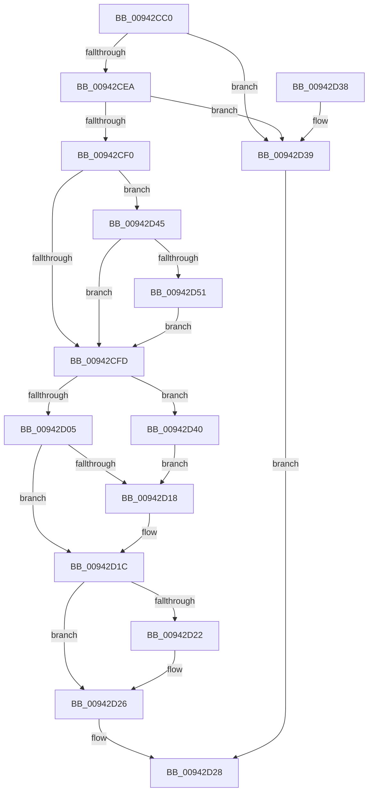

# MiQueryFlagsForRvaEntry

- RVA: `0x00942CC0`–`0x00942D56` (길이 `150` bytes)
- VA: `0x0000000140942CC0`
- 실행 섹션: `PAGE`
- PDB 이름 있음: `예`; PDB Function 태그: `아니요`
- unwind 정보 RVA: `0x000904A0`
- 디코드: `48`개 명령, `150/150` bytes 표시
- 미해석 바이트: `0` (있으면 어셈블리에 `.byte`로 보존)

> 이 문서는 커널 이미지의 기계어와 PDB 기호를 분석해 생성했습니다. 4번과 5번은 함수 원형과 자료형을 바이너리 사용 방식에서 추정한 C 해석이며 원본 소스 복구 결과는 아닙니다.

## 1. Dependencies

- 직접 호출 지점: **0**; 고유 호출 대상: **0**
- 직접 호출자로 확인된 함수: **2**
- RIP 상대 이미지 참조: **0**

### Outgoing calls
- 직접 디코드된 call 명령이 없습니다.

### Direct callers
- [RtlpCompressRvaList](RtlpCompressRvaList_function_00942650.md) at `0x009427E2`
- [sub_00942ABF](Unknown_function_00942ABF.md) at `0x00942B63`

### Static image references
- 디코드된 RIP-relative 메모리 참조가 없습니다.

## 2. Other-region calls and transfers

- 다른 실행 섹션으로 향하는 call: **0**
- 별도 외부 분기/꼬리 이동을 확인하지 못했습니다.

## 3. Assembly (complete function range)

```asm
00942CC0  48 89 5C 24 08                  mov qword ptr [rsp + 8], rbx
00942CC5  48 89 74 24 10                  mov qword ptr [rsp + 0x10], rsi
00942CCA  48 89 7C 24 18                  mov qword ptr [rsp + 0x18], rdi
00942CCF  4C 8B 54 24 40                  mov r10, qword ptr [rsp + 0x40]
00942CD4  45 32 DB                        xor r11b, r11b
00942CD7  48 8B 7C 24 48                  mov rdi, qword ptr [rsp + 0x48]
00942CDC  48 8B F1                        mov rsi, rcx
00942CDF  41 83 22 00                     and dword ptr [r10], 0
00942CE3  8B 19                           mov ebx, dword ptr [rcx]
00942CE5  41 3B D9                        cmp ebx, r9d
00942CE8  76 4F                           jbe 0x140942d39
00942CEA  3B 5C 24 28                     cmp ebx, dword ptr [rsp + 0x28]
00942CEE  73 49                           jae 0x140942d39
00942CF0  8B 4C 24 30                     mov ecx, dword ptr [rsp + 0x30]
00942CF4  B8 01 00 00 00                  mov eax, 1
00942CF9  85 C9                           test ecx, ecx
00942CFB  75 48                           jne 0x140942d45
00942CFD  41 89 18                        mov dword ptr [r8], ebx
00942D00  83 FA 04                        cmp edx, 4
00942D03  76 3B                           jbe 0x140942d40
00942D05  44 0F B6 5E 04                  movzx r11d, byte ptr [rsi + 4]
00942D0A  41 8B CB                        mov ecx, r11d
00942D0D  23 C8                           and ecx, eax
00942D0F  0F 95 C0                        setne al
00942D12  88 07                           mov byte ptr [rdi], al
00942D14  85 C9                           test ecx, ecx
00942D16  75 04                           jne 0x140942d1c
00942D18  41 83 0A 01                     or dword ptr [r10], 1
00942D1C  41 F6 C3 02                     test r11b, 2
00942D20  74 04                           je 0x140942d26
00942D22  41 83 0A 04                     or dword ptr [r10], 4
00942D26  33 C0                           xor eax, eax
00942D28  48 8B 5C 24 08                  mov rbx, qword ptr [rsp + 8]
00942D2D  48 8B 74 24 10                  mov rsi, qword ptr [rsp + 0x10]
00942D32  48 8B 7C 24 18                  mov rdi, qword ptr [rsp + 0x18]
00942D37  C3                              ret
00942D38  CC                              int3
00942D39  B8 7B 00 00 C0                  mov eax, 0xc000007b
00942D3E  EB E8                           jmp 0x140942d28
00942D40  44 88 1F                        mov byte ptr [rdi], r11b
00942D43  EB D3                           jmp 0x140942d18
00942D45  8B C1                           mov eax, ecx
00942D47  F7 D0                           not eax
00942D49  83 E0 01                        and eax, 1
00942D4C  F6 C1 02                        test cl, 2
00942D4F  74 AC                           je 0x140942cfd
00942D51  83 C8 02                        or eax, 2
00942D54  EB A7                           jmp 0x140942cfd
```

## 4. C-style interpretation (structured pseudocode)

```c
__int64 __fastcall MiQueryFlagsForRvaEntry(__int64 a1, int a2, __int64 a3, int a4, unsigned int a5, unsigned int a6, __int64 a7, __int64 a8, __int64 a9)
{
    __int64 result;
    __int64 v_r11;
    unsigned __int64 v_stack_p10;
    unsigned __int64 v_stack_p18;
    unsigned __int64 v_stack_p8;

    v_stack_p8 = v_rbx;
    v_stack_p10 = v_rsi;
    v_stack_p18 = v_rdi;
    v_r11 = 0;
    if (((unsigned int)((unsigned int)(*(unsigned int *)(a1)))) <= a4) goto loc_00942D39;
    if (((unsigned int)((unsigned int)(*(unsigned int *)(a1)))) >= a5) goto loc_00942D39;
    if ((unsigned int)((unsigned int)(a6)) != 0) goto loc_00942D45;
loc_00942CFD:
    *(unsigned int *)(a3) = (unsigned int)((unsigned int)(*(unsigned int *)(a1)));
    if (a2 <= 4) goto loc_00942D40;
    a1 = (unsigned int)(((unsigned int)((unsigned int)(*(unsigned __int8 *)(a1 + 4)))) & (1));
    result = (condition_is_not_equal) ? 1 : 0;
    *(unsigned __int8 *)(a9) = (unsigned __int8)(result);
    if ((unsigned int)(a1) == 0) {
    }
    if ((((unsigned __int8)(*(unsigned __int8 *)(a1 + 4))) & (2)) != 0) {
    }
    result = 0;
loc_00942D28:
    return result;
loc_00942D39:
    goto loc_00942D28;
loc_00942D40:
    *(unsigned __int8 *)(v_stack_p18) = (unsigned __int8)(*(unsigned __int8 *)(a1 + 4));
    goto loc_00942D18;
loc_00942D45:
    result = (unsigned int)(~((unsigned int)((unsigned int)(a1))));
    result = (unsigned int)((result) & (1));
    if ((((unsigned __int8)(a1)) & (2)) == 0) goto loc_00942CFD;
    result = (unsigned int)((result) | (2));
    goto loc_00942CFD;
}
```

## 5. (Beta) C Style

```c
int64_t MiQueryFlagsForRvaEntry(void *Arg1, int32_t Arg2, void *Arg3, int32_t Arg4, uint32_t Arg5, uint32_t Arg6, uint64_t Arg7, void *Arg8, void *Arg9)
{
    uint8_t *arg1 = (uint8_t *)Arg1;
    uint8_t *arg3 = (uint8_t *)Arg3;
    uint8_t *arg8 = (uint8_t *)Arg8;
    uint8_t *arg9 = (uint8_t *)Arg9;

    int64_t result;
    int64_t local_r11;
    uint64_t v_stack_p10;
    uint64_t v_stack_p18;
    uint64_t v_stack_p8;

    v_stack_p8 = local_rbx;
    v_stack_p10 = local_rsi;
    v_stack_p18 = local_rdi;
    local_r11 = 0;
    if (((uint32_t)((uint32_t)(*(uint32_t *)(arg1)))) <= Arg4) goto loc_00942D39;
    if (((uint32_t)((uint32_t)(*(uint32_t *)(arg1)))) >= Arg5) goto loc_00942D39;
    if ((uint32_t)((uint32_t)(Arg6)) != 0) goto loc_00942D45;
loc_00942CFD:
    *(uint32_t *)(arg3) = (uint32_t)((uint32_t)(*(uint32_t *)(arg1)));
    if (Arg2 <= 4) goto loc_00942D40;
    Arg1 = (uint32_t)(((uint32_t)((uint32_t)(*(uint8_t *)(arg1 + 0x4)))) & (1));
    result = (condition_is_not_equal) ? 1 : 0;
    *(uint8_t *)(arg9) = (uint8_t)(result);
    if ((uint32_t)(Arg1) == 0) {
    }
    if ((((uint8_t)(*(uint8_t *)(arg1 + 0x4))) & (2)) != 0) {
    }
    result = 0;
loc_00942D28:
    return result;
loc_00942D39:
    goto loc_00942D28;
loc_00942D40:
    *(uint8_t *)(v_stack_p18) = (uint8_t)(*(uint8_t *)(arg1 + 0x4));
    goto loc_00942D18;
loc_00942D45:
    result = (uint32_t)(~((uint32_t)((uint32_t)(Arg1))));
    result = (uint32_t)((result) & (1));
    if ((((uint8_t)(Arg1)) & (2)) == 0) goto loc_00942CFD;
    result = (uint32_t)((result) | (2));
    goto loc_00942CFD;
}
```

### 관측된 메모리 오프셋

구조체 형식이 확인되지 않은 접근은 인자 기준의 오프셋으로만 기록했습니다.

| 기준 인자 | 오프셋 표현 | 폭 (bit) | 접근 |
|---|---:|---:|---|
| `Arg1` | `+ 0x0` | `32` | `R` |
| `Arg1` | `+ 0x4` | `8` | `R` |
| `Arg3` | `+ 0x0` | `32` | `W` |
| `Arg8` | `+ 0x0` | `32` | `R/W` |
| `Arg9` | `+ 0x0` | `8` | `W` |

## 6. Execution-region graph

[열기: 2D/3D 그래프와 함수 탐색 컨트롤 패널](../../../control-panel.html?section=page&rva=0x00942CC0&view=graph)

- 2D 그래프는 위에서 아래로 흐르고, 3D 그래프는 빈 공간을 드래그해 회전합니다. Shift+드래그는 이동, 휠은 확대·축소, 함수 노드 선택은 대상 보고서 이동입니다.

### Static fallback


