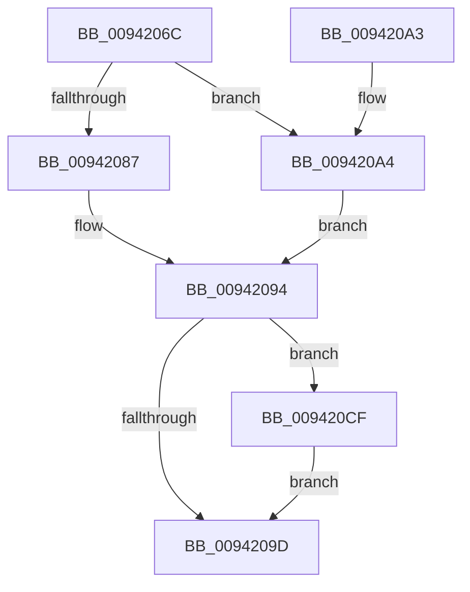

# MiUnmapImageInSystemSpace

- RVA: `0x0094206C`–`0x009420D6` (길이 `106` bytes)
- VA: `0x000000014094206C`
- 실행 섹션: `PAGE`
- PDB 이름 있음: `예`; PDB Function 태그: `아니요`
- unwind 정보 RVA: `0x0006CB78`
- 디코드: `29`개 명령, `106/106` bytes 표시
- 미해석 바이트: `0` (있으면 어셈블리에 `.byte`로 보존)

> 이 문서는 커널 이미지의 기계어와 PDB 기호를 분석해 생성했습니다. 4번과 5번은 함수 원형과 자료형을 바이너리 사용 방식에서 추정한 C 해석이며 원본 소스 복구 결과는 아닙니다.

## 1. Dependencies

- 직접 호출 지점: **4**; 고유 호출 대상: **4**
- 직접 호출자로 확인된 함수: **7**
- RIP 상대 이미지 참조: **0**

### Outgoing calls
- `0x0094208F` → [MiRemoveFromSystemSpace](../../text/29/MiRemoveFromSystemSpace_function_002962FC.md) (function, `0x002962FC`)
- `0x009420BD` → [MiUnmapViewOfSection](../88/MiUnmapViewOfSection_function_0088A4C4.md) (function, `0x0088A4C4`)
- `0x009420C8` → [KiUnstackDetachProcess](../../text/21/KiUnstackDetachProcess_function_00217D30.md) (function, `0x00217D30`)
- `0x009420CF` → [MiReturnCrossPartitionControlAreaCharges](../../text/4D/MiReturnCrossPartitionControlAreaCharges_function_004D6184.md) (function, `0x004D6184`)

### Direct callers
- [MiSetPagesModified](../../text/49/MiSetPagesModified_function_0049DC2C.md) at `0x0049E08A`
- [MiApplyImageHotPatchRequest](../80/MiApplyImageHotPatchRequest_function_008025AC.md) at `0x0080297D`
- [MiApplyImageHotPatchRequest](../80/MiApplyImageHotPatchRequest_function_008025AC.md) at `0x00802AC0`
- [MiValidateSectionCreate](MiValidateSectionCreate_function_00940190.md) at `0x0094045A`
- [MiParseComAndCetHeaders](MiParseComAndCetHeaders_function_00941974.md) at `0x00941BCE`
- [MiRelocateImage](../98/MiRelocateImage_function_00988E14.md) at `0x0098930E`
- [MiRelocateImage](../98/MiRelocateImage_function_00988E14.md) at `0x00989639`
- [MiOpenHotPatchFile](../AB/MiOpenHotPatchFile_function_00AB5684.md) at `0x00AB5B36`
- [sub_00B40C48](../B4/Unknown_function_00B40C48.md) at `0x00B40FCD`

### Static image references
- 디코드된 RIP-relative 메모리 참조가 없습니다.

## 2. Other-region calls and transfers

- 다른 실행 섹션으로 향하는 call: **3**
  - `0x0094208F` → [MiRemoveFromSystemSpace](../../text/29/MiRemoveFromSystemSpace_function_002962FC.md) (`PAGE` → `.text`)
  - `0x009420C8` → [KiUnstackDetachProcess](../../text/21/KiUnstackDetachProcess_function_00217D30.md) (`PAGE` → `.text`)
  - `0x009420CF` → [MiReturnCrossPartitionControlAreaCharges](../../text/4D/MiReturnCrossPartitionControlAreaCharges_function_004D6184.md) (`PAGE` → `.text`)
- 별도 외부 분기/꼬리 이동을 확인하지 못했습니다.

## 3. Assembly (complete function range)

```asm
0094206C  40 53                           push rbx
0094206E  48 83 EC 20                     sub rsp, 0x20
00942072  48 8B 01                        mov rax, qword ptr [rcx]
00942075  48 8B D9                        mov rbx, rcx
00942078  48 B9 FF FF FE FF FF 7F 00 00   movabs rcx, 0x7ffffffeffff
00942082  48 3B C1                        cmp rax, rcx
00942085  76 1D                           jbe 0x1409420a4
00942087  BA 01 00 00 00                  mov edx, 1
0094208C  48 8B C8                        mov rcx, rax
0094208F  E8 68 42 95 FF                  call 0x1402962fc
00942094  48 8B 4B 08                     mov rcx, qword ptr [rbx + 8]
00942098  48 85 C9                        test rcx, rcx
0094209B  75 32                           jne 0x1409420cf
0094209D  48 83 C4 20                     add rsp, 0x20
009420A1  5B                              pop rbx
009420A2  C3                              ret
009420A3  CC                              int3
009420A4  65 48 8B 0C 25 88 01 00 00      mov rcx, qword ptr gs:[0x188]
009420AD  45 33 C9                        xor r9d, r9d
009420B0  45 33 C0                        xor r8d, r8d
009420B3  48 8B D0                        mov rdx, rax
009420B6  48 8B 89 B8 00 00 00            mov rcx, qword ptr [rcx + 0xb8]
009420BD  E8 02 84 F4 FF                  call 0x14088a4c4
009420C2  48 8D 4B 20                     lea rcx, [rbx + 0x20]
009420C6  33 D2                           xor edx, edx
009420C8  E8 63 5C 8D FF                  call 0x140217d30
009420CD  EB C5                           jmp 0x140942094
009420CF  E8 B0 40 B9 FF                  call 0x1404d6184
009420D4  EB C7                           jmp 0x14094209d
```

## 4. C-style interpretation (structured pseudocode)

```c
__int64 __fastcall MiUnmapImageInSystemSpace(__int64 a1, __int64 a2, int a3, int a4)
{
    __int64 result;
    __int64 v_rsp;

    v_rsp = (v_rsp) - (32);
    if ((*(unsigned __int64 *)(a1)) <= a1) goto loc_009420A4;
    result = MiRemoveFromSystemSpace(*(unsigned __int64 *)(a1), 1, a3, a4);
loc_00942094:
    if (*(unsigned __int64 *)(a1 + 8) != 0) goto loc_009420CF;
loc_0094209D:
    v_rsp = (v_rsp) + (32);
    return result;
loc_009420A4:
    a4 = 0;
    a3 = 0;
    result = MiUnmapViewOfSection(*(unsigned __int64 *)(*(unsigned __int64 *)(gs_base + (0 + 392)) + 184), result, a3, a4);
    a2 = 0;
    result = KiUnstackDetachProcess(a1 + 32, a2, a3, a4);
    goto loc_00942094;
loc_009420CF:
    result = MiReturnCrossPartitionControlAreaCharges(a1 + 32, a2, a3, a4);
    goto loc_0094209D;
}
```

## 5. (Beta) C Style

```c
int64_t MiUnmapImageInSystemSpace(void *Arg1, int64_t Arg2, int32_t Arg3, int32_t Arg4)
{
    uint8_t *arg1 = (uint8_t *)Arg1;

    int64_t result;
    int64_t local_rsp;

    local_rsp = (local_rsp) - (32);
    if ((*(uint64_t *)(arg1)) <= Arg1) goto loc_009420A4;
    result = MiRemoveFromSystemSpace(*(uint64_t *)(arg1), 1, Arg3, Arg4);
loc_00942094:
    if (*(uint64_t *)(arg1 + 0x8) != 0) goto loc_009420CF;
loc_0094209D:
    local_rsp = (local_rsp) + (32);
    return result;
loc_009420A4:
    Arg4 = 0;
    Arg3 = 0;
    result = MiUnmapViewOfSection(*(uint64_t *)(*(uint64_t *)(gs_base + (0 + 0x188)) + 0xB8), result, Arg3, Arg4);
    Arg2 = 0;
    result = KiUnstackDetachProcess(Arg1 + 32, Arg2, Arg3, Arg4);
    goto loc_00942094;
loc_009420CF:
    result = MiReturnCrossPartitionControlAreaCharges(Arg1 + 32, Arg2, Arg3, Arg4);
    goto loc_0094209D;
}
```

### 관측된 메모리 오프셋

구조체 형식이 확인되지 않은 접근은 인자 기준의 오프셋으로만 기록했습니다.

| 기준 인자 | 오프셋 표현 | 폭 (bit) | 접근 |
|---|---:|---:|---|
| `Arg1` | `+ 0x0` | `64` | `R` |
| `Arg1` | `+ 0x8` | `64` | `R` |
| `Arg1` | `+ 0x20` | `64` | `R` |

## 6. Execution-region graph

[열기: 2D/3D 그래프와 함수 탐색 컨트롤 패널](../../../control-panel.html?section=page&rva=0x0094206C&view=graph)

- 2D 그래프는 위에서 아래로 흐르고, 3D 그래프는 빈 공간을 드래그해 회전합니다. Shift+드래그는 이동, 휠은 확대·축소, 함수 노드 선택은 대상 보고서 이동입니다.

### Static fallback


