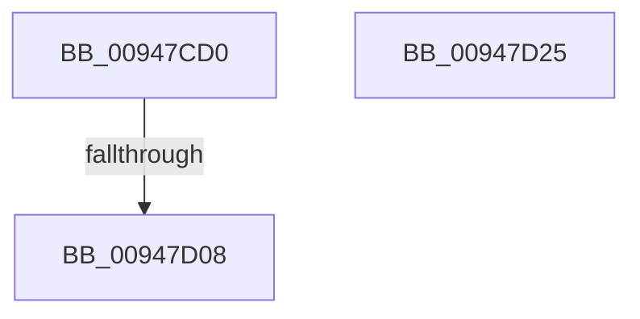

# ObCheckRefTraceProcess

- RVA: `0x00947CD0`–`0x00947D26` (길이 `86` bytes)
- VA: `0x0000000140947CD0`
- 실행 섹션: `PAGE`
- PDB 이름 있음: `예`; PDB Function 태그: `예`
- unwind 정보 RVA: `0x00060130`
- 디코드: `24`개 명령, `86/86` bytes 표시
- 미해석 바이트: `0` (있으면 어셈블리에 `.byte`로 보존)

> 이 문서는 커널 이미지의 기계어와 PDB 기호를 분석해 생성했습니다. 4번과 5번은 함수 원형과 자료형을 바이너리 사용 방식에서 추정한 C 해석이며 원본 소스 복구 결과는 아닙니다.

## 1. Dependencies

- 직접 호출 지점: **0**; 고유 호출 대상: **0**
- 직접 호출자로 확인된 함수: **1**
- RIP 상대 이미지 참조: **1**

### Outgoing calls
- 직접 디코드된 call 명령이 없습니다.

### Direct callers
- [PspInsertProcess](PspInsertProcess_function_009472CC.md) at `0x009474DC`

### Static image references
- `0x00947CFA` → RVA `0x00FC5010` (`ALMOSTRO`; read)

## 2. Other-region calls and transfers

- 다른 실행 섹션으로 향하는 call: **0**
- call이 아닌 외부 분기/꼬리 이동: **1**
  - `0x00947D02` → [sub_00B257D0](../B2/Unknown_function_00B257D0.md) (`tail-transfer`)

## 3. Assembly (complete function range)

```asm
00947CD0  48 8B C4                        mov rax, rsp
00947CD3  48 89 58 08                     mov qword ptr [rax + 8], rbx
00947CD7  48 89 68 10                     mov qword ptr [rax + 0x10], rbp
00947CDB  48 89 70 18                     mov qword ptr [rax + 0x18], rsi
00947CDF  48 89 78 20                     mov qword ptr [rax + 0x20], rdi
00947CE3  41 56                           push r14
00947CE5  48 83 EC 40                     sub rsp, 0x40
00947CE9  0F 57 C0                        xorps xmm0, xmm0
00947CEC  0F 57 C9                        xorps xmm1, xmm1
00947CEF  0F 11 40 D8                     movups xmmword ptr [rax - 0x28], xmm0
00947CF3  48 8B F9                        mov rdi, rcx
00947CF6  0F 11 48 E8                     movups xmmword ptr [rax - 0x18], xmm1
00947CFA  8B 05 10 D3 67 00               mov eax, dword ptr [rip + 0x67d310]
00947D00  A8 20                           test al, 0x20
00947D02  0F 85 C8 DA 1D 00               jne 0x140b257d0
00947D08  33 C0                           xor eax, eax
00947D0A  48 8B 5C 24 50                  mov rbx, qword ptr [rsp + 0x50]
00947D0F  48 8B 6C 24 58                  mov rbp, qword ptr [rsp + 0x58]
00947D14  48 8B 74 24 60                  mov rsi, qword ptr [rsp + 0x60]
00947D19  48 8B 7C 24 68                  mov rdi, qword ptr [rsp + 0x68]
00947D1E  48 83 C4 40                     add rsp, 0x40
00947D22  41 5E                           pop r14
00947D24  C3                              ret
00947D25  CC                              int3
```

## 4. C-style interpretation (structured pseudocode)

```c
__int64 __fastcall ObCheckRefTraceProcess(__int64 a1)
{
    __int64 result;
    __int64 v_rsp;
    unsigned __int64 v_stack_p10;
    unsigned __int64 v_stack_p18;
    unsigned __int64 v_stack_p20;
    unsigned __int64 v_stack_p8;

    *(unsigned __int64 *)(v_rsp + 8) = v_rbx;
    *(unsigned __int64 *)(v_rsp + 16) = v_rbp;
    *(unsigned __int64 *)(v_rsp + 24) = v_rsi;
    *(unsigned __int64 *)(v_rsp + 32) = v_rdi;
    v_rsp = (v_rsp) - (64);
    *(unsigned __int64 *)(v_rsp - 40) = v_xmm0;
    *(unsigned __int64 *)(v_rsp - 24) = v_xmm1;
    result = 0;
    v_rsp = (v_rsp) + (64);
    return result;
}
```

## 5. (Beta) C Style

```c
int64_t ObCheckRefTraceProcess(int64_t Arg1)
{
    int64_t result;
    int64_t local_rsp;
    uint64_t v_stack_p10;
    uint64_t v_stack_p18;
    uint64_t v_stack_p20;
    uint64_t v_stack_p8;

    *(uint64_t *)(local_rsp + 0x8) = local_rbx;
    *(uint64_t *)(local_rsp + 0x10) = local_rbp;
    *(uint64_t *)(local_rsp + 0x18) = local_rsi;
    *(uint64_t *)(local_rsp + 0x20) = local_rdi;
    local_rsp = (local_rsp) - (64);
    *(uint64_t *)(local_rsp - 0x28) = v_xmm0;
    *(uint64_t *)(local_rsp - 0x18) = v_xmm1;
    result = 0;
    local_rsp = (local_rsp) + (64);
    return result;
}
```

## 6. Execution-region graph

[열기: 2D/3D 그래프와 함수 탐색 컨트롤 패널](../../../control-panel.html?section=page&rva=0x00947CD0&view=graph)

- 2D 그래프는 위에서 아래로 흐르고, 3D 그래프는 빈 공간을 드래그해 회전합니다. Shift+드래그는 이동, 휠은 확대·축소, 함수 노드 선택은 대상 보고서 이동입니다.

### Static fallback


