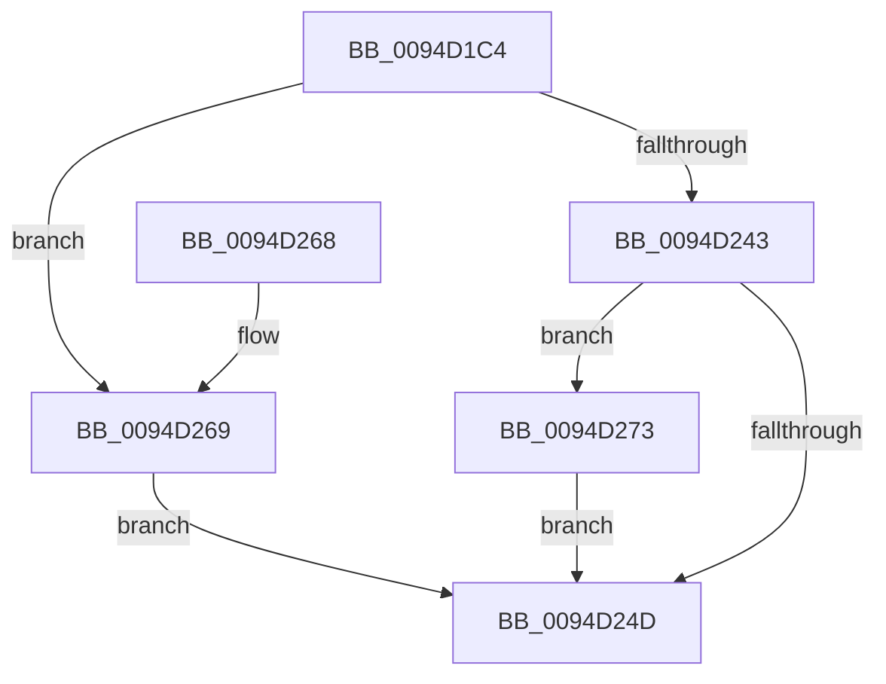

# ObInheritObjectHandle

- RVA: `0x0094D1C4`–`0x0094D2C0` (길이 `252` bytes)
- VA: `0x000000014094D1C4`
- 실행 섹션: `PAGE`
- PDB 이름 있음: `예`; PDB Function 태그: `아니요`
- unwind 정보 RVA: `0x00091694`
- 디코드: `69`개 명령, `252/252` bytes 표시
- 미해석 바이트: `0` (있으면 어셈블리에 `.byte`로 보존)

> 이 문서는 커널 이미지의 기계어와 PDB 기호를 분석해 생성했습니다. 4번과 5번은 함수 원형과 자료형을 바이너리 사용 방식에서 추정한 C 해석이며 원본 소스 복구 결과는 아닙니다.

## 1. Dependencies

- 직접 호출 지점: **6**; 고유 호출 대상: **6**
- 직접 호출자로 확인된 함수: **1**
- RIP 상대 이미지 참조: **3**

### Outgoing calls
- `0x0094D1EB` → [ExGetHandlePointer](../../text/43/ExGetHandlePointer_function_00430C90.md) (function, `0x00430C90`)
- `0x0094D1FA` → [ObpIncrPointerCount](../../text/43/ObpIncrPointerCount_function_00430BB0.md) (function, `0x00430BB0`)
- `0x0094D215` → [ExUnlockHandleTableEntry](ExUnlockHandleTableEntry_function_0094D2D0.md) (function, `0x0094D2D0`)
- `0x0094D238` → [ObpIncrementHandleCountEx](../86/ObpIncrementHandleCountEx_function_0086DA10.md) (function, `0x0086DA10`)
- `0x0094D26C` → [ObfDereferenceObject](../../text/2F/ObfDereferenceObject_function_002F9350.md) (function, `0x002F9350`)
- `0x0094D2B9` → [EtwTraceDuplicateHandle](../A5/EtwTraceDuplicateHandle_function_00A56C5C.md) (function, `0x00A56C5C`)

### Direct callers
- [ExpDuplicateSingleHandle](ExpDuplicateSingleHandle_function_0094D0E4.md) at `0x0094D151`

### Static image references
- `0x0094D243` → RVA `0x00FC6B10` (`ALMOSTRO`; read)
- `0x0094D291` → RVA `0x00FC6E4C` (`ALMOSTRO`; read)
- `0x0094D29B` → RVA `0x00FC7800` (`ALMOSTRO`; read)

## 2. Other-region calls and transfers

- 다른 실행 섹션으로 향하는 call: **3**
  - `0x0094D1EB` → [ExGetHandlePointer](../../text/43/ExGetHandlePointer_function_00430C90.md) (`PAGE` → `.text`)
  - `0x0094D1FA` → [ObpIncrPointerCount](../../text/43/ObpIncrPointerCount_function_00430BB0.md) (`PAGE` → `.text`)
  - `0x0094D26C` → [ObfDereferenceObject](../../text/2F/ObfDereferenceObject_function_002F9350.md) (`PAGE` → `.text`)
- 별도 외부 분기/꼬리 이동을 확인하지 못했습니다.

## 3. Assembly (complete function range)

```asm
0094D1C4  48 89 5C 24 08                  mov qword ptr [rsp + 8], rbx
0094D1C9  48 89 6C 24 10                  mov qword ptr [rsp + 0x10], rbp
0094D1CE  48 89 74 24 18                  mov qword ptr [rsp + 0x18], rsi
0094D1D3  57                              push rdi
0094D1D4  41 56                           push r14
0094D1D6  41 57                           push r15
0094D1D8  48 83 EC 40                     sub rsp, 0x40
0094D1DC  4C 8B F1                        mov r14, rcx
0094D1DF  49 8B D9                        mov rbx, r9
0094D1E2  49 8B C9                        mov rcx, r9
0094D1E5  49 8B F8                        mov rdi, r8
0094D1E8  4C 8B FA                        mov r15, rdx
0094D1EB  E8 A0 3A AE FF                  call 0x140430c90
0094D1F0  48 8B C8                        mov rcx, rax
0094D1F3  48 8B E8                        mov rbp, rax
0094D1F6  48 8D 70 30                     lea rsi, [rax + 0x30]
0094D1FA  E8 B1 39 AE FF                  call 0x140430bb0
0094D1FF  44 8B 53 08                     mov r10d, dword ptr [rbx + 8]
0094D203  48 8B D3                        mov rdx, rbx
0094D206  41 81 E2 FF FF FF 01            and r10d, 0x1ffffff
0094D20D  48 8B CF                        mov rcx, rdi
0094D210  44 89 54 24 78                  mov dword ptr [rsp + 0x78], r10d
0094D215  E8 B6 00 00 00                  call 0x14094d2d0
0094D21A  33 FF                           xor edi, edi
0094D21C  48 8D 54 24 78                  lea rdx, [rsp + 0x78]
0094D221  48 89 7C 24 30                  mov qword ptr [rsp + 0x30], rdi
0094D226  4C 8B CE                        mov r9, rsi
0094D229  89 7C 24 28                     mov dword ptr [rsp + 0x28], edi
0094D22D  4D 8B C6                        mov r8, r14
0094D230  40 88 7C 24 20                  mov byte ptr [rsp + 0x20], dil
0094D235  8D 4F 03                        lea ecx, [rdi + 3]
0094D238  E8 D3 07 F2 FF                  call 0x14086da10
0094D23D  8B D8                           mov ebx, eax
0094D23F  85 C0                           test eax, eax
0094D241  78 26                           js 0x14094d269
0094D243  8B 05 C7 98 67 00               mov eax, dword ptr [rip + 0x6798c7]
0094D249  A8 40                           test al, 0x40
0094D24B  75 26                           jne 0x14094d273
0094D24D  48 8B 6C 24 68                  mov rbp, qword ptr [rsp + 0x68]
0094D252  8B C3                           mov eax, ebx
0094D254  48 8B 5C 24 60                  mov rbx, qword ptr [rsp + 0x60]
0094D259  48 8B 74 24 70                  mov rsi, qword ptr [rsp + 0x70]
0094D25E  48 83 C4 40                     add rsp, 0x40
0094D262  41 5F                           pop r15
0094D264  41 5E                           pop r14
0094D266  5F                              pop rdi
0094D267  C3                              ret
0094D268  CC                              int3
0094D269  48 8B CE                        mov rcx, rsi
0094D26C  E8 DF C0 9A FF                  call 0x1402f9350
0094D271  EB DA                           jmp 0x14094d24d
0094D273  45 8B 8E D0 02 00 00            mov r9d, dword ptr [r14 + 0x2d0]
0094D27A  48 8B C5                        mov rax, rbp
0094D27D  48 C1 E8 08                     shr rax, 8
0094D281  4C 8B C6                        mov r8, rsi
0094D284  0F B6 C8                        movzx ecx, al
0094D287  49 8B D7                        mov rdx, r15
0094D28A  0F B6 45 18                     movzx eax, byte ptr [rbp + 0x18]
0094D28E  48 33 C8                        xor rcx, rax
0094D291  0F B6 05 B4 9B 67 00            movzx eax, byte ptr [rip + 0x679bb4]
0094D298  48 33 C8                        xor rcx, rax
0094D29B  48 8D 05 5E A5 67 00            lea rax, [rip + 0x67a55e]
0094D2A2  48 8B 04 C8                     mov rax, qword ptr [rax + rcx*8]
0094D2A6  49 8B CF                        mov rcx, r15
0094D2A9  48 89 44 24 28                  mov qword ptr [rsp + 0x28], rax
0094D2AE  41 8B 86 D0 01 00 00            mov eax, dword ptr [r14 + 0x1d0]
0094D2B5  89 44 24 20                     mov dword ptr [rsp + 0x20], eax
0094D2B9  E8 9E 99 10 00                  call 0x140a56c5c
0094D2BE  EB 8D                           jmp 0x14094d24d
```

## 4. C-style interpretation (structured pseudocode)

```c
__int64 __fastcall ObInheritObjectHandle(__int64 a1, __int64 a2, __int64 a3, __int64 a4)
{
    __int64 result;
    __int64 v_r10;
    __int64 v_rdi;
    __int64 v_rsp;
    unsigned __int64 v_stack_m28;
    unsigned int v_stack_m30;
    unsigned __int8 v_stack_m38;
    unsigned __int64 v_stack_p10;
    unsigned __int64 v_stack_p18;
    unsigned int v_stack_p20;
    unsigned __int64 v_stack_p28;
    unsigned __int64 v_stack_p8;

    v_stack_p8 = v_rbx;
    v_stack_p10 = v_rbp;
    v_stack_p18 = v_rsi;
    v_rsp = (v_rsp) - (64);
    result = ExGetHandlePointer(a4, a2, a3, a4);
    result = ObpIncrPointerCount(result, a2, a3, a4);
    v_r10 = (unsigned int)(((unsigned int)(*(unsigned int *)(a4 + 8))) & (0x1FFFFFFULL));
    v_stack_p20 = (unsigned int)(v_r10);
    result = ExUnlockHandleTableEntry(a3, a4, a3, a4);
    v_rdi = 0;
    v_stack_m28 = 0;
    v_stack_m30 = 0;
    v_stack_m38 = 0;
    result = ObpIncrementHandleCountEx(v_rdi + 3, v_stack_p20, a1, result + 48);
    if (sign_flag) goto loc_0094D269;
    if ((((unsigned __int8)((unsigned int)(*(unsigned int *)(v_rip + 6789319)))) & (64)) != 0) goto loc_0094D273;
loc_0094D24D:
    v_rsp = (v_rsp) + (64);
    return (unsigned int)((unsigned int)((unsigned int)((unsigned int)(result))));
loc_0094D269:
    result = ObfDereferenceObject(v_stack_p18, v_stack_p20, a1, result + 48);
    goto loc_0094D24D;
loc_0094D273:
    result = (v_stack_p10) >> (8);
    a1 = ((unsigned __int8)(result)) ^ (*(unsigned __int8 *)(v_stack_p10 + 24));
    a1 = (a1) ^ (*(unsigned __int8 *)(v_rip + 6790068));
    v_stack_p28 = *(unsigned __int64 *)(v_rip + 6792542 + a1 * 8);
    v_stack_p20 = (unsigned int)((unsigned int)(*(unsigned int *)(a1 + 464)));
    result = EtwTraceDuplicateHandle(a2, a2, v_stack_p18, (unsigned int)(*(unsigned int *)(a1 + 720)));
    goto loc_0094D24D;
}
```

## 5. (Beta) C Style

```c
int64_t ObInheritObjectHandle(void *Arg1, int64_t Arg2, int64_t Arg3, void *Arg4)
{
    uint8_t *arg1 = (uint8_t *)Arg1;
    uint8_t *arg4 = (uint8_t *)Arg4;

    int64_t result;
    int64_t local_r10;
    int64_t local_rdi;
    int64_t local_rsp;
    uint64_t v_stack_m28;
    uint32_t v_stack_m30;
    uint8_t v_stack_m38;
    uint64_t v_stack_p10;
    uint64_t v_stack_p18;
    uint32_t v_stack_p20;
    uint64_t v_stack_p28;
    uint64_t v_stack_p8;

    v_stack_p8 = local_rbx;
    v_stack_p10 = local_rbp;
    v_stack_p18 = local_rsi;
    local_rsp = (local_rsp) - (64);
    result = ExGetHandlePointer(Arg4, Arg2, Arg3, Arg4);
    result = ObpIncrPointerCount(result, Arg2, Arg3, Arg4);
    local_r10 = (uint32_t)(((uint32_t)(*(uint32_t *)(arg4 + 0x8))) & (0x1FFFFFFULL));
    v_stack_p20 = (uint32_t)(local_r10);
    result = ExUnlockHandleTableEntry(Arg3, Arg4, Arg3, Arg4);
    local_rdi = 0;
    v_stack_m28 = 0;
    v_stack_m30 = 0;
    v_stack_m38 = 0;
    result = ObpIncrementHandleCountEx(local_rdi + 3, v_stack_p20, Arg1, result + 48);
    if (sign_flag) goto loc_0094D269;
    if ((((uint8_t)((uint32_t)(*(uint32_t *)(v_rip + 0x6798C7)))) & (64)) != 0) goto loc_0094D273;
loc_0094D24D:
    local_rsp = (local_rsp) + (64);
    return (uint32_t)((uint32_t)((uint32_t)((uint32_t)(result))));
loc_0094D269:
    result = ObfDereferenceObject(v_stack_p18, v_stack_p20, Arg1, result + 48);
    goto loc_0094D24D;
loc_0094D273:
    result = (v_stack_p10) >> (8);
    Arg1 = ((uint8_t)(result)) ^ (*(uint8_t *)(v_stack_p10 + 0x18));
    Arg1 = (Arg1) ^ (*(uint8_t *)(v_rip + 0x679BB4));
    v_stack_p28 = *(uint64_t *)(v_rip + 0x67A55E + arg1 * 8);
    v_stack_p20 = (uint32_t)((uint32_t)(*(uint32_t *)(arg1 + 0x1D0)));
    result = EtwTraceDuplicateHandle(Arg2, Arg2, v_stack_p18, (uint32_t)(*(uint32_t *)(arg1 + 0x2D0)));
    goto loc_0094D24D;
}
```

### 관측된 메모리 오프셋

구조체 형식이 확인되지 않은 접근은 인자 기준의 오프셋으로만 기록했습니다.

| 기준 인자 | 오프셋 표현 | 폭 (bit) | 접근 |
|---|---:|---:|---|
| `Arg1` | `+ 0x1D0` | `32` | `R` |
| `Arg1` | `+ 0x2D0` | `32` | `R` |
| `Arg4` | `+ 0x8` | `32` | `R` |

## 6. Execution-region graph

[열기: 2D/3D 그래프와 함수 탐색 컨트롤 패널](../../../control-panel.html?section=page&rva=0x0094D1C4&view=graph)

- 2D 그래프는 위에서 아래로 흐르고, 3D 그래프는 빈 공간을 드래그해 회전합니다. Shift+드래그는 이동, 휠은 확대·축소, 함수 노드 선택은 대상 보고서 이동입니다.

### Static fallback


