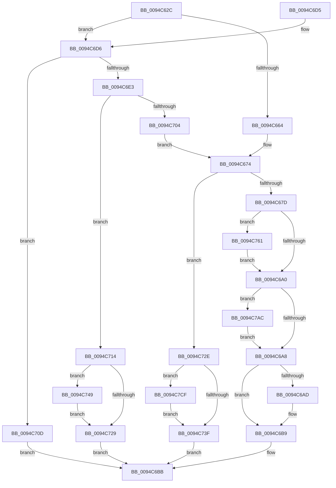

# ObInitProcess

- RVA: `0x0094C62C`–`0x0094C7E0` (길이 `436` bytes)
- VA: `0x000000014094C62C`
- 실행 섹션: `PAGE`
- PDB 이름 있음: `예`; PDB Function 태그: `아니요`
- unwind 정보 RVA: `0x00091524`
- 디코드: `115`개 명령, `436/436` bytes 표시
- 미해석 바이트: `0` (있으면 어셈블리에 `.byte`로 보존)

> 이 문서는 커널 이미지의 기계어와 PDB 기호를 분석해 생성했습니다. 4번과 5번은 함수 원형과 자료형을 바이너리 사용 방식에서 추정한 C 해석이며 원본 소스 복구 결과는 아닙니다.

## 1. Dependencies

- 직접 호출 지점: **13**; 고유 호출 대상: **11**
- 직접 호출자로 확인된 함수: **1**
- RIP 상대 이미지 참조: **2**

### Outgoing calls
- `0x0094C66C` → [ExCreateHandleTable](ExCreateHandleTable_function_0094C7E8.md) (function, `0x0094C7E8`)
- `0x0094C68B` → [SepAuditingForSubCategory](../../text/47/SepAuditingForSubCategory_function_00477E84.md) (function, `0x00477E84`)
- `0x0094C6B4` → [ExReleaseRundownProtection](../../text/34/ExReleaseRundownProtection_function_00349E80.md) (function, `0x00349E80`)
- `0x0094C6D6` → [ObReferenceProcessHandleTable](../89/ObReferenceProcessHandleTable_function_00893B70.md) (function, `0x00893B70`)
- `0x0094C6F8` → [ExDupHandleTable](ExDupHandleTable_function_0094CAC0.md) (function, `0x0094CAC0`)
- `0x0094C71B` → [ExReleaseRundownProtection](../../text/34/ExReleaseRundownProtection_function_00349E80.md) (function, `0x00349E80`)
- `0x0094C752` → [ExSweepHandleTable](../90/ExSweepHandleTable_function_00904D3C.md) (function, `0x00904D3C`)
- `0x0094C75A` → [ExDestroyHandleTable](../90/ExDestroyHandleTable_function_00904D18.md) (function, `0x00904D18`)
- `0x0094C770` → [SeCaptureSubjectContext](../86/SeCaptureSubjectContext_function_0086B820.md) (function, `0x0086B820`)
- `0x0094C796` → [SepAdtIncorporatePerUserPolicy](../79/SepAdtIncorporatePerUserPolicy_function_0079FC18.md) (function, `0x0079FC18`)
- `0x0094C79F` → [SeReleaseSubjectContext](../86/SeReleaseSubjectContext_function_0086B710.md) (function, `0x0086B710`)
- `0x0094C7C5` → [ExEnumHandleTable](../91/ExEnumHandleTable_function_0091DB20.md) (function, `0x0091DB20`)
- `0x0094C7D6` → [ExReleaseRundownProtection](../../text/34/ExReleaseRundownProtection_function_00349E80.md) (function, `0x00349E80`)

### Direct callers
- [PspAllocateProcess](../A1/PspAllocateProcess_function_00A13B3C.md) at `0x00A154D3`

### Static image references
- `0x0094C690` → RVA `0x00F04C40` (`.data`; read)
- `0x0094C7BB` → RVA `0x0074D6E0` (`ObAuditInheritedHandleProcedure`; read)

## 2. Other-region calls and transfers

- 다른 실행 섹션으로 향하는 call: **4**
  - `0x0094C68B` → [SepAuditingForSubCategory](../../text/47/SepAuditingForSubCategory_function_00477E84.md) (`PAGE` → `.text`)
  - `0x0094C6B4` → [ExReleaseRundownProtection](../../text/34/ExReleaseRundownProtection_function_00349E80.md) (`PAGE` → `.text`)
  - `0x0094C71B` → [ExReleaseRundownProtection](../../text/34/ExReleaseRundownProtection_function_00349E80.md) (`PAGE` → `.text`)
  - `0x0094C7D6` → [ExReleaseRundownProtection](../../text/34/ExReleaseRundownProtection_function_00349E80.md) (`PAGE` → `.text`)
- 별도 외부 분기/꼬리 이동을 확인하지 못했습니다.

## 3. Assembly (complete function range)

```asm
0094C62C  48 89 5C 24 10                  mov qword ptr [rsp + 0x10], rbx
0094C631  48 89 74 24 18                  mov qword ptr [rsp + 0x18], rsi
0094C636  48 89 7C 24 20                  mov qword ptr [rsp + 0x20], rdi
0094C63B  55                              push rbp
0094C63C  41 56                           push r14
0094C63E  41 57                           push r15
0094C640  48 8B EC                        mov rbp, rsp
0094C643  48 83 EC 60                     sub rsp, 0x60
0094C647  48 83 65 20 00                  and qword ptr [rbp + 0x20], 0
0094C64C  0F 57 C0                        xorps xmm0, xmm0
0094C64F  4D 8B F1                        mov r14, r9
0094C652  45 8B F8                        mov r15d, r8d
0094C655  48 8B FA                        mov rdi, rdx
0094C658  48 8B D9                        mov rbx, rcx
0094C65B  0F 11 45 D0                     movups xmmword ptr [rbp - 0x30], xmm0
0094C65F  48 85 C9                        test rcx, rcx
0094C662  75 72                           jne 0x14094c6d6
0094C664  8D 51 01                        lea edx, [rcx + 1]
0094C667  33 F6                           xor esi, esi
0094C669  48 8B CF                        mov rcx, rdi
0094C66C  E8 77 01 00 00                  call 0x14094c7e8
0094C671  4C 8B F0                        mov r14, rax
0094C674  4D 85 F6                        test r14, r14
0094C677  0F 84 B1 00 00 00               je 0x14094c72e
0094C67D  B2 01                           mov dl, 1
0094C67F  4C 89 B7 00 03 00 00            mov qword ptr [rdi + 0x300], r14
0094C686  B9 7C 00 00 00                  mov ecx, 0x7c
0094C68B  E8 F4 B7 B2 FF                  call 0x140477e84
0094C690  83 3D A9 85 5B 00 00            cmp dword ptr [rip + 0x5b85a9], 0
0094C697  88 45 20                        mov byte ptr [rbp + 0x20], al
0094C69A  0F 85 C1 00 00 00               jne 0x14094c761
0094C6A0  84 C0                           test al, al
0094C6A2  0F 85 04 01 00 00               jne 0x14094c7ac
0094C6A8  48 85 F6                        test rsi, rsi
0094C6AB  74 0C                           je 0x14094c6b9
0094C6AD  48 8D 8B E8 01 00 00            lea rcx, [rbx + 0x1e8]
0094C6B4  E8 C7 D7 9F FF                  call 0x140349e80
0094C6B9  33 C0                           xor eax, eax
0094C6BB  4C 8D 5C 24 60                  lea r11, [rsp + 0x60]
0094C6C0  49 8B 5B 28                     mov rbx, qword ptr [r11 + 0x28]
0094C6C4  49 8B 73 30                     mov rsi, qword ptr [r11 + 0x30]
0094C6C8  49 8B 7B 38                     mov rdi, qword ptr [r11 + 0x38]
0094C6CC  49 8B E3                        mov rsp, r11
0094C6CF  41 5F                           pop r15
0094C6D1  41 5E                           pop r14
0094C6D3  5D                              pop rbp
0094C6D4  C3                              ret
0094C6D5  CC                              int3
0094C6D6  E8 95 74 F4 FF                  call 0x140893b70
0094C6DB  48 8B F0                        mov rsi, rax
0094C6DE  48 85 C0                        test rax, rax
0094C6E1  74 2A                           je 0x14094c70d
0094C6E3  48 8D 45 20                     lea rax, [rbp + 0x20]
0094C6E7  4D 8B CE                        mov r9, r14
0094C6EA  45 8B C7                        mov r8d, r15d
0094C6ED  48 89 44 24 20                  mov qword ptr [rsp + 0x20], rax
0094C6F2  48 8B D6                        mov rdx, rsi
0094C6F5  48 8B CF                        mov rcx, rdi
0094C6F8  E8 C3 03 00 00                  call 0x14094cac0
0094C6FD  44 8B F0                        mov r14d, eax
0094C700  85 C0                           test eax, eax
0094C702  78 10                           js 0x14094c714
0094C704  4C 8B 75 20                     mov r14, qword ptr [rbp + 0x20]
0094C708  E9 67 FF FF FF                  jmp 0x14094c674
0094C70D  B8 0A 01 00 C0                  mov eax, 0xc000010a
0094C712  EB A7                           jmp 0x14094c6bb
0094C714  48 8D 8B E8 01 00 00            lea rcx, [rbx + 0x1e8]
0094C71B  E8 60 D7 9F FF                  call 0x140349e80
0094C720  48 8B 5D 20                     mov rbx, qword ptr [rbp + 0x20]
0094C724  48 85 DB                        test rbx, rbx
0094C727  75 20                           jne 0x14094c749
0094C729  41 8B C6                        mov eax, r14d
0094C72C  EB 8D                           jmp 0x14094c6bb
0094C72E  48 83 A7 00 03 00 00 00         and qword ptr [rdi + 0x300], 0
0094C736  48 85 F6                        test rsi, rsi
0094C739  0F 85 90 00 00 00               jne 0x14094c7cf
0094C73F  B8 9A 00 00 C0                  mov eax, 0xc000009a
0094C744  E9 72 FF FF FF                  jmp 0x14094c6bb
0094C749  45 33 C0                        xor r8d, r8d
0094C74C  48 8B D3                        mov rdx, rbx
0094C74F  48 8B CF                        mov rcx, rdi
0094C752  E8 E5 85 FB FF                  call 0x140904d3c
0094C757  48 8B CB                        mov rcx, rbx
0094C75A  E8 B9 85 FB FF                  call 0x140904d18
0094C75F  EB C8                           jmp 0x14094c729
0094C761  0F 57 C0                        xorps xmm0, xmm0
0094C764  48 8D 4D E0                     lea rcx, [rbp - 0x20]
0094C768  0F 11 45 E0                     movups xmmword ptr [rbp - 0x20], xmm0
0094C76C  0F 11 45 F0                     movups xmmword ptr [rbp - 0x10], xmm0
0094C770  E8 AB F0 F1 FF                  call 0x14086b820
0094C775  48 8B 45 E0                     mov rax, qword ptr [rbp - 0x20]
0094C779  B2 01                           mov dl, 1
0094C77B  4C 8B 4D F0                     mov r9, qword ptr [rbp - 0x10]
0094C77F  48 85 C0                        test rax, rax
0094C782  4C 0F 45 C8                     cmovne r9, rax
0094C786  45 33 C0                        xor r8d, r8d
0094C789  48 8D 45 20                     lea rax, [rbp + 0x20]
0094C78D  48 89 44 24 20                  mov qword ptr [rsp + 0x20], rax
0094C792  41 8D 48 18                     lea ecx, [r8 + 0x18]
0094C796  E8 7D 34 E5 FF                  call 0x14079fc18
0094C79B  48 8D 4D E0                     lea rcx, [rbp - 0x20]
0094C79F  E8 6C EF F1 FF                  call 0x14086b710
0094C7A4  8A 45 20                        mov al, byte ptr [rbp + 0x20]
0094C7A7  E9 F4 FE FF FF                  jmp 0x14094c6a0
0094C7AC  45 33 C9                        xor r9d, r9d
0094C7AF  48 89 7D D0                     mov qword ptr [rbp - 0x30], rdi
0094C7B3  4C 8D 45 D0                     lea r8, [rbp - 0x30]
0094C7B7  48 89 5D D8                     mov qword ptr [rbp - 0x28], rbx
0094C7BB  48 8D 15 1E 0F E0 FF            lea rdx, [rip - 0x1ff0e2]
0094C7C2  49 8B CE                        mov rcx, r14
0094C7C5  E8 56 13 FD FF                  call 0x14091db20
0094C7CA  E9 D9 FE FF FF                  jmp 0x14094c6a8
0094C7CF  48 8D 8B E8 01 00 00            lea rcx, [rbx + 0x1e8]
0094C7D6  E8 A5 D6 9F FF                  call 0x140349e80
0094C7DB  E9 5F FF FF FF                  jmp 0x14094c73f
```

## 4. C-style interpretation (structured pseudocode)

```c
__int64 __fastcall ObInitProcess(__int64 a1, __int64 a2, int a3, __int64 a4)
{
    __int64 result;
    __int64 v_rsi;
    __int64 v_rsp;
    unsigned __int64 v_stack_m18;
    unsigned __int64 v_stack_m28;
    unsigned __int64 v_stack_m38;
    unsigned __int64 v_stack_m40;
    unsigned __int64 v_stack_m48;
    unsigned __int64 v_stack_p10;
    unsigned __int64 v_stack_p18;
    unsigned __int64 v_stack_p20;
    unsigned __int64 v_stack_p8;

    v_stack_p10 = v_rbx;
    v_stack_p18 = v_rsi;
    v_stack_p20 = v_rdi;
    v_rsp = (v_rsp) - (96);
    v_stack_m48 = v_xmm0;
    if (a1 != 0) goto loc_0094C6D6;
    v_rsi = 0;
    result = ExCreateHandleTable(a2, a1 + 1, a3, a4);
loc_0094C674:
    if (result == 0) goto loc_0094C72E;
    *(unsigned __int64 *)(a2 + 768) = result;
    result = SepAuditingForSubCategory(124, 1, a3, a4);
    v_stack_p8 = (unsigned __int8)(result);
    if ((*(unsigned int *)(v_rip + 5997993)) != 0) goto loc_0094C761;
loc_0094C6A0:
    if ((unsigned __int8)(result) != 0) goto loc_0094C7AC;
loc_0094C6A8:
    if (0 != 0) {
        a1 = a1 + 488;
        result = ExReleaseRundownProtection(a1, 1, a3, a4);
    }
    result = 0;
loc_0094C6BB:
    return result;
loc_0094C6D6:
    result = ObReferenceProcessHandleTable(a1, 1, a3, a4);
    if (result == 0) goto loc_0094C70D;
    v_stack_m40 = v_stack_p8;
    result = ExDupHandleTable(*(unsigned __int64 *)(v_stack_m18 + 56), result, (unsigned int)((unsigned int)((unsigned int)(a3))), result);
    if (sign_flag) goto loc_0094C714;
    goto loc_0094C674;
loc_0094C70D:
    goto loc_0094C6BB;
loc_0094C714:
    result = ExReleaseRundownProtection(*(unsigned __int64 *)(v_stack_m18 + 40) + 488, result, (unsigned int)((unsigned int)((unsigned int)(a3))), result);
    if (v_stack_p8 != 0) goto loc_0094C749;
loc_0094C729:
    goto loc_0094C6BB;
loc_0094C72E:
    if (result != 0) goto loc_0094C7CF;
loc_0094C73F:
    goto loc_0094C6BB;
loc_0094C749:
    a3 = 0;
    result = ExSweepHandleTable(*(unsigned __int64 *)(v_stack_m18 + 56), v_stack_p8, a3, result);
    result = ExDestroyHandleTable(v_stack_p8, v_stack_p8, a3, result);
    goto loc_0094C729;
loc_0094C761:
    v_stack_m38 = v_xmm0;
    v_stack_m28 = v_xmm0;
    result = SeCaptureSubjectContext(v_stack_m38, v_stack_p8, a3, result);
    a4 = v_stack_m28;
    if (v_stack_m38 != 0) { a4 = v_stack_m38; }
    a3 = 0;
    v_stack_m40 = v_stack_p8;
    result = SepAdtIncorporatePerUserPolicy(a3 + 24, 1, a3, a4);
    result = SeReleaseSubjectContext(v_stack_m38, 1, a3, a4);
    goto loc_0094C6A0;
loc_0094C7AC:
    a4 = 0;
    v_stack_m48 = *(unsigned __int64 *)(v_stack_m18 + 56);
    v_stack_m40 = v_stack_p8;
    result = ExEnumHandleTable(v_stack_p8, v_rip - 2093282, v_stack_m48, a4);
    goto loc_0094C6A8;
loc_0094C7CF:
    result = ExReleaseRundownProtection(v_stack_p8 + 488, v_rip - 2093282, v_stack_m48, a4);
    goto loc_0094C73F;
}
```

## 5. (Beta) C Style

```c
int64_t ObInitProcess(void *Arg1, void *Arg2, int32_t Arg3, int64_t Arg4)
{
    uint8_t *arg1 = (uint8_t *)Arg1;
    uint8_t *arg2 = (uint8_t *)Arg2;

    int64_t result;
    int64_t local_rsi;
    int64_t local_rsp;
    uint64_t v_stack_m18;
    uint64_t v_stack_m28;
    uint64_t v_stack_m38;
    uint64_t v_stack_m40;
    uint64_t v_stack_m48;
    uint64_t v_stack_p10;
    uint64_t v_stack_p18;
    uint64_t v_stack_p20;
    uint64_t v_stack_p8;

    v_stack_p10 = local_rbx;
    v_stack_p18 = local_rsi;
    v_stack_p20 = local_rdi;
    local_rsp = (local_rsp) - (96);
    v_stack_m48 = v_xmm0;
    if (Arg1 != NULL) goto loc_0094C6D6;
    local_rsi = 0;
    result = ExCreateHandleTable(Arg2, Arg1 + 1, Arg3, Arg4);
loc_0094C674:
    if (result == 0) goto loc_0094C72E;
    *(uint64_t *)(arg2 + 0x300) = result;
    result = SepAuditingForSubCategory(124, 1, Arg3, Arg4);
    v_stack_p8 = (uint8_t)(result);
    if ((*(uint32_t *)(v_rip + 0x5B85A9)) != 0) goto loc_0094C761;
loc_0094C6A0:
    if ((uint8_t)(result) != 0) goto loc_0094C7AC;
loc_0094C6A8:
    if (0 != 0) {
        Arg1 = Arg1 + 488;
        result = ExReleaseRundownProtection(Arg1, 1, Arg3, Arg4);
    }
    result = 0;
loc_0094C6BB:
    return result;
loc_0094C6D6:
    result = ObReferenceProcessHandleTable(Arg1, 1, Arg3, Arg4);
    if (result == 0) goto loc_0094C70D;
    v_stack_m40 = v_stack_p8;
    result = ExDupHandleTable(*(uint64_t *)(v_stack_m18 + 0x38), result, (uint32_t)((uint32_t)((uint32_t)(Arg3))), result);
    if (sign_flag) goto loc_0094C714;
    goto loc_0094C674;
loc_0094C70D:
    goto loc_0094C6BB;
loc_0094C714:
    result = ExReleaseRundownProtection(*(uint64_t *)(v_stack_m18 + 0x28) + 488, result, (uint32_t)((uint32_t)((uint32_t)(Arg3))), result);
    if (v_stack_p8 != 0) goto loc_0094C749;
loc_0094C729:
    goto loc_0094C6BB;
loc_0094C72E:
    if (result != 0) goto loc_0094C7CF;
loc_0094C73F:
    goto loc_0094C6BB;
loc_0094C749:
    Arg3 = 0;
    result = ExSweepHandleTable(*(uint64_t *)(v_stack_m18 + 0x38), v_stack_p8, Arg3, result);
    result = ExDestroyHandleTable(v_stack_p8, v_stack_p8, Arg3, result);
    goto loc_0094C729;
loc_0094C761:
    v_stack_m38 = v_xmm0;
    v_stack_m28 = v_xmm0;
    result = SeCaptureSubjectContext(v_stack_m38, v_stack_p8, Arg3, result);
    Arg4 = v_stack_m28;
    if (v_stack_m38 != 0) { Arg4 = v_stack_m38; }
    Arg3 = 0;
    v_stack_m40 = v_stack_p8;
    result = SepAdtIncorporatePerUserPolicy(Arg3 + 24, 1, Arg3, Arg4);
    result = SeReleaseSubjectContext(v_stack_m38, 1, Arg3, Arg4);
    goto loc_0094C6A0;
loc_0094C7AC:
    Arg4 = 0;
    v_stack_m48 = *(uint64_t *)(v_stack_m18 + 0x38);
    v_stack_m40 = v_stack_p8;
    result = ExEnumHandleTable(v_stack_p8, v_rip - 2093282, v_stack_m48, Arg4);
    goto loc_0094C6A8;
loc_0094C7CF:
    result = ExReleaseRundownProtection(v_stack_p8 + 488, v_rip - 2093282, v_stack_m48, Arg4);
    goto loc_0094C73F;
}
```

### 관측된 메모리 오프셋

구조체 형식이 확인되지 않은 접근은 인자 기준의 오프셋으로만 기록했습니다.

| 기준 인자 | 오프셋 표현 | 폭 (bit) | 접근 |
|---|---:|---:|---|
| `Arg1` | `+ 0x1E8` | `64` | `R` |
| `Arg2` | `+ 0x300` | `64` | `R/W` |
| `Arg2` | `+ 0x300` | `64` | `W` |

## 6. Execution-region graph

[열기: 2D/3D 그래프와 함수 탐색 컨트롤 패널](../../../control-panel.html?section=page&rva=0x0094C62C&view=graph)

- 2D 그래프는 위에서 아래로 흐르고, 3D 그래프는 빈 공간을 드래그해 회전합니다. Shift+드래그는 이동, 휠은 확대·축소, 함수 노드 선택은 대상 보고서 이동입니다.

### Static fallback


