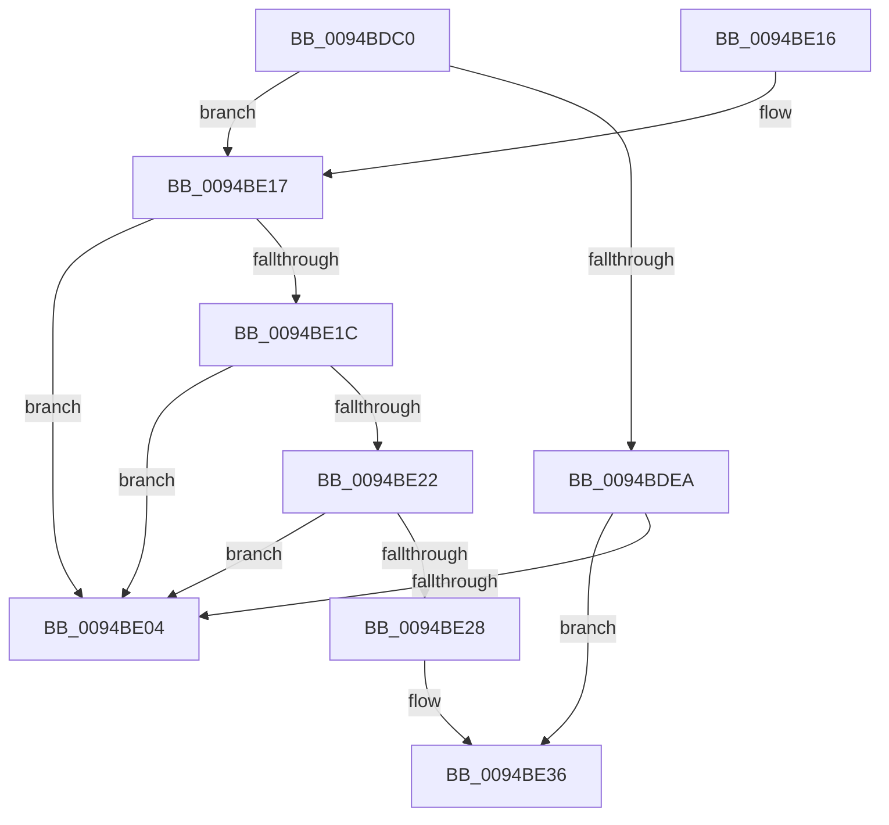

# ObReferenceFileObjectForWrite

- RVA: `0x0094BDC0`–`0x0094BE3F` (길이 `127` bytes)
- VA: `0x000000014094BDC0`
- 실행 섹션: `PAGE`
- PDB 이름 있음: `예`; PDB Function 태그: `아니요`
- unwind 정보 RVA: `0x0009143C`
- 디코드: `37`개 명령, `127/127` bytes 표시
- 미해석 바이트: `0` (있으면 어셈블리에 `.byte`로 보존)

> 이 문서는 커널 이미지의 기계어와 PDB 기호를 분석해 생성했습니다. 4번과 5번은 함수 원형과 자료형을 바이너리 사용 방식에서 추정한 C 해석이며 원본 소스 복구 결과는 아닙니다.

## 1. Dependencies

- 직접 호출 지점: **0**; 고유 호출 대상: **0**
- 직접 호출자로 확인된 함수: **2**
- RIP 상대 이미지 참조: **1**

### Outgoing calls
- 직접 디코드된 call 명령이 없습니다.

### Direct callers
- [NtCopyFileChunk](NtCopyFileChunk_function_0094B600.md) at `0x0094B85B`
- [NtCopyFileChunk](NtCopyFileChunk_function_0094B600.md) at `0x0094B9F5`
- [IopIoRingReferenceFileObject](../AD/IopIoRingReferenceFileObject_function_00AD3A8C.md) at `0x00AD3AD1`

### Static image references
- `0x0094BE28` → RVA `0x00F0F5B8` (`.data`; read)

## 2. Other-region calls and transfers

- 다른 실행 섹션으로 향하는 call: **0**
- 별도 외부 분기/꼬리 이동을 확인하지 못했습니다.

## 3. Assembly (complete function range)

```asm
0094BDC0  4C 89 4C 24 20                  mov qword ptr [rsp + 0x20], r9
0094BDC5  4C 89 44 24 18                  mov qword ptr [rsp + 0x18], r8
0094BDCA  53                              push rbx
0094BDCB  55                              push rbp
0094BDCC  41 54                           push r12
0094BDCE  41 55                           push r13
0094BDD0  41 57                           push r15
0094BDD2  48 83 EC 50                     sub rsp, 0x50
0094BDD6  65 4C 8B 3C 25 88 01 00 00      mov r15, qword ptr gs:[0x188]
0094BDDF  44 0F B6 E2                     movzx r12d, dl
0094BDE3  48 8B E9                        mov rbp, rcx
0094BDE6  85 C9                           test ecx, ecx
0094BDE8  78 2D                           js 0x14094be17
0094BDEA  49 8B 87 B8 00 00 00            mov rax, qword ptr [r15 + 0xb8]
0094BDF1  4C 8B A8 00 03 00 00            mov r13, qword ptr [rax + 0x300]
0094BDF8  8B 80 F4 01 00 00               mov eax, dword ptr [rax + 0x1f4]
0094BDFE  0F BA E0 1A                     bt eax, 0x1a
0094BE02  72 32                           jb 0x14094be36
0094BE04  B8 08 00 00 C0                  mov eax, 0xc0000008
0094BE09  48 83 C4 50                     add rsp, 0x50
0094BE0D  41 5F                           pop r15
0094BE0F  41 5D                           pop r13
0094BE11  41 5C                           pop r12
0094BE13  5D                              pop rbp
0094BE14  5B                              pop rbx
0094BE15  C3                              ret
0094BE16  CC                              int3
0094BE17  45 84 E4                        test r12b, r12b
0094BE1A  75 E8                           jne 0x14094be04
0094BE1C  48 83 FD FF                     cmp rbp, -1
0094BE20  74 E2                           je 0x14094be04
0094BE22  48 83 FD FE                     cmp rbp, -2
0094BE26  74 DC                           je 0x14094be04
0094BE28  4C 8B 2D 89 37 5C 00            mov r13, qword ptr [rip + 0x5c3789]
0094BE2F  48 81 F5 00 00 00 80            xor rbp, 0xffffffff80000000
0094BE36  66 41 FF 8F E4 01 00 00         dec word ptr [r15 + 0x1e4]
0094BE3E  90                              nop
```

## 4. C-style interpretation (structured pseudocode)

```c
__int64 __fastcall ObReferenceFileObjectForWrite(__int64 a1, unsigned __int8 a2, __int64 a3, __int64 a4)
{
    __int64 v_rbp;
    __int64 v_rsp;
    unsigned __int64 v_stack_p18;
    unsigned __int64 v_stack_p20;

    v_stack_p20 = a4;
    v_stack_p18 = a3;
    v_rsp = (v_rsp) - (80);
    if (sign_flag) goto loc_0094BE17;
    if (condition_is_below) goto loc_0094BE36;
loc_0094BE04:
    v_rsp = (v_rsp) + (80);
    return (unsigned int)(0xC0000008ULL);
loc_0094BE17:
    if (a2 != 0) goto loc_0094BE04;
    if (a1 == -1) goto loc_0094BE04;
    if (a1 == -2) goto loc_0094BE04;
    v_rbp = (a1) ^ (0xFFFFFFFF80000000ULL);
loc_0094BE36:
    return (unsigned int)(0xC0000008ULL);
}
```

## 5. (Beta) C Style

```c
int64_t ObReferenceFileObjectForWrite(int64_t Arg1, uint8_t Arg2, int64_t Arg3, int64_t Arg4)
{
    int64_t local_rbp;
    int64_t local_rsp;
    uint64_t v_stack_p18;
    uint64_t v_stack_p20;

    v_stack_p20 = Arg4;
    v_stack_p18 = Arg3;
    local_rsp = (local_rsp) - (80);
    if (sign_flag) goto loc_0094BE17;
    if (condition_is_below) goto loc_0094BE36;
loc_0094BE04:
    local_rsp = (local_rsp) + (80);
    return (uint32_t)(0xC0000008ULL);
loc_0094BE17:
    if (Arg2 != 0) goto loc_0094BE04;
    if (Arg1 == -1) goto loc_0094BE04;
    if (Arg1 == -2) goto loc_0094BE04;
    local_rbp = (Arg1) ^ (0xFFFFFFFF80000000ULL);
loc_0094BE36:
    return (uint32_t)(0xC0000008ULL);
}
```

## 6. Execution-region graph

[열기: 2D/3D 그래프와 함수 탐색 컨트롤 패널](../../../control-panel.html?section=page&rva=0x0094BDC0&view=graph)

- 2D 그래프는 위에서 아래로 흐르고, 3D 그래프는 빈 공간을 드래그해 회전합니다. Shift+드래그는 이동, 휠은 확대·축소, 함수 노드 선택은 대상 보고서 이동입니다.

### Static fallback


