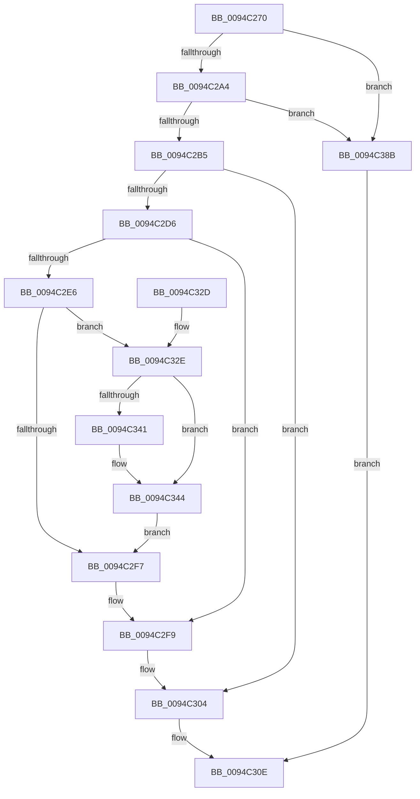

# ObpAuditObjectAccess

- RVA: `0x0094C270`–`0x0094C392` (길이 `290` bytes)
- VA: `0x000000014094C270`
- 실행 섹션: `PAGE`
- PDB 이름 있음: `예`; PDB Function 태그: `아니요`
- unwind 정보 RVA: `0x000914B4`
- 디코드: `81`개 명령, `290/290` bytes 표시
- 미해석 바이트: `0` (있으면 어셈블리에 `.byte`로 보존)

> 이 문서는 커널 이미지의 기계어와 PDB 기호를 분석해 생성했습니다. 4번과 5번은 함수 원형과 자료형을 바이너리 사용 방식에서 추정한 C 해석이며 원본 소스 복구 결과는 아닙니다.

## 1. Dependencies

- 직접 호출 지점: **7**; 고유 호출 대상: **7**
- 직접 호출자로 확인된 함수: **3**
- RIP 상대 이미지 참조: **2**

### Outgoing calls
- `0x0094C2A4` → [ExpGetHandleExtraInfo](../86/ExpGetHandleExtraInfo_function_0086B454.md) (function, `0x0086B454`)
- `0x0094C2CD` → [ExLockHandleTableEntry](../../text/40/ExLockHandleTableEntry_function_0040DAA0.md) (function, `0x0040DAA0`)
- `0x0094C2DC` → [ExGetHandlePointer](../../text/43/ExGetHandlePointer_function_00430C90.md) (function, `0x00430C90`)
- `0x0094C2FF` → [ExUnlockHandleTableEntry](ExUnlockHandleTableEntry_function_0094D2D0.md) (function, `0x0094D2D0`)
- `0x0094C307` → [KeLeaveCriticalRegionThread](../../text/25/KeLeaveCriticalRegionThread_function_0025EFF0.md) (function, `0x0025EFF0`)
- `0x0094C337` → [OBJECT_HEADER_TO_AUDIT_INFO](../../text/41/OBJECT_HEADER_TO_AUDIT_INFO_function_0041BF70.md) (function, `0x0041BF70`)
- `0x0094C381` → [SeOperationAuditAlarm](../91/SeOperationAuditAlarm_function_0091EA78.md) (function, `0x0091EA78`)

### Direct callers
- [ObpReferenceObjectByHandleWithTag](../86/ObpReferenceObjectByHandleWithTag_function_00869650.md) at `0x00869D31`
- [NtWriteFile](../8E/NtWriteFile_function_008E92D0.md) at `0x008E9765`
- [sub_0094C011](Unknown_function_0094C011.md) at `0x0094C197`

### Static image references
- `0x0094C365` → RVA `0x00FC6E4C` (`ALMOSTRO`; read)
- `0x0094C372` → RVA `0x00FC7800` (`ALMOSTRO`; read)

## 2. Other-region calls and transfers

- 다른 실행 섹션으로 향하는 call: **4**
  - `0x0094C2CD` → [ExLockHandleTableEntry](../../text/40/ExLockHandleTableEntry_function_0040DAA0.md) (`PAGE` → `.text`)
  - `0x0094C2DC` → [ExGetHandlePointer](../../text/43/ExGetHandlePointer_function_00430C90.md) (`PAGE` → `.text`)
  - `0x0094C307` → [KeLeaveCriticalRegionThread](../../text/25/KeLeaveCriticalRegionThread_function_0025EFF0.md) (`PAGE` → `.text`)
  - `0x0094C337` → [OBJECT_HEADER_TO_AUDIT_INFO](../../text/41/OBJECT_HEADER_TO_AUDIT_INFO_function_0041BF70.md) (`PAGE` → `.text`)
- 별도 외부 분기/꼬리 이동을 확인하지 못했습니다.

## 3. Assembly (complete function range)

```asm
0094C270  48 8B C4                        mov rax, rsp
0094C273  48 89 58 08                     mov qword ptr [rax + 8], rbx
0094C277  48 89 68 10                     mov qword ptr [rax + 0x10], rbp
0094C27B  48 89 70 18                     mov qword ptr [rax + 0x18], rsi
0094C27F  48 89 78 20                     mov qword ptr [rax + 0x20], rdi
0094C283  41 54                           push r12
0094C285  41 56                           push r14
0094C287  41 57                           push r15
0094C289  48 83 EC 40                     sub rsp, 0x40
0094C28D  33 DB                           xor ebx, ebx
0094C28F  4D 8B F9                        mov r15, r9
0094C292  49 8B E8                        mov rbp, r8
0094C295  4C 8B E2                        mov r12, rdx
0094C298  48 8B F9                        mov rdi, rcx
0094C29B  39 59 04                        cmp dword ptr [rcx + 4], ebx
0094C29E  0F 84 E7 00 00 00               je 0x14094c38b
0094C2A4  E8 AB F1 F1 FF                  call 0x14086b454
0094C2A9  48 8B F0                        mov rsi, rax
0094C2AC  48 85 C0                        test rax, rax
0094C2AF  0F 84 D6 00 00 00               je 0x14094c38b
0094C2B5  65 4C 8B 34 25 88 01 00 00      mov r14, qword ptr gs:[0x188]
0094C2BE  48 8B D5                        mov rdx, rbp
0094C2C1  48 8B CF                        mov rcx, rdi
0094C2C4  66 41 FF 8E E4 01 00 00         dec word ptr [r14 + 0x1e4]
0094C2CC  90                              nop
0094C2CD  E8 CE 17 AC FF                  call 0x14040daa0
0094C2D2  84 C0                           test al, al
0094C2D4  74 2E                           je 0x14094c304
0094C2D6  0F 0D 0E                        prefetchw byte ptr [rsi]
0094C2D9  48 8B CD                        mov rcx, rbp
0094C2DC  E8 AF 49 AE FF                  call 0x140430c90
0094C2E1  4C 3B F8                        cmp r15, rax
0094C2E4  75 13                           jne 0x14094c2f9
0094C2E6  8B 0E                           mov ecx, dword ptr [rsi]
0094C2E8  44 8B C1                        mov r8d, ecx
0094C2EB  8B 84 24 80 00 00 00            mov eax, dword ptr [rsp + 0x80]
0094C2F2  44 23 C0                        and r8d, eax
0094C2F5  75 37                           jne 0x14094c32e
0094C2F7  B3 01                           mov bl, 1
0094C2F9  48 8B D5                        mov rdx, rbp
0094C2FC  48 8B CF                        mov rcx, rdi
0094C2FF  E8 CC 0F 00 00                  call 0x14094d2d0
0094C304  49 8B CE                        mov rcx, r14
0094C307  E8 E4 2C 91 FF                  call 0x14025eff0
0094C30C  8A C3                           mov al, bl
0094C30E  48 8B 5C 24 60                  mov rbx, qword ptr [rsp + 0x60]
0094C313  48 8B 6C 24 68                  mov rbp, qword ptr [rsp + 0x68]
0094C318  48 8B 74 24 70                  mov rsi, qword ptr [rsp + 0x70]
0094C31D  48 8B 7C 24 78                  mov rdi, qword ptr [rsp + 0x78]
0094C322  48 83 C4 40                     add rsp, 0x40
0094C326  41 5F                           pop r15
0094C328  41 5E                           pop r14
0094C32A  41 5C                           pop r12
0094C32C  C3                              ret
0094C32D  CC                              int3
0094C32E  F7 D0                           not eax
0094C330  23 C1                           and eax, ecx
0094C332  49 8B CF                        mov rcx, r15
0094C335  89 06                           mov dword ptr [rsi], eax
0094C337  E8 34 FC AC FF                  call 0x14041bf70
0094C33C  48 85 C0                        test rax, rax
0094C33F  74 03                           je 0x14094c344
0094C341  48 8B 18                        mov rbx, qword ptr [rax]
0094C344  49 8B C7                        mov rax, r15
0094C347  48 89 5C 24 30                  mov qword ptr [rsp + 0x30], rbx
0094C34C  48 C1 E8 08                     shr rax, 8
0094C350  49 8D 57 30                     lea rdx, [r15 + 0x30]
0094C354  44 0F B6 C8                     movzx r9d, al
0094C358  41 0F B6 47 18                  movzx eax, byte ptr [r15 + 0x18]
0094C35D  4C 33 C8                        xor r9, rax
0094C360  44 89 44 24 20                  mov dword ptr [rsp + 0x20], r8d
0094C365  0F B6 05 E0 AA 67 00            movzx eax, byte ptr [rip + 0x67aae0]
0094C36C  4D 8B C4                        mov r8, r12
0094C36F  4C 33 C8                        xor r9, rax
0094C372  48 8D 05 87 B4 67 00            lea rax, [rip + 0x67b487]
0094C379  4E 8B 0C C8                     mov r9, qword ptr [rax + r9*8]
0094C37D  49 83 C1 10                     add r9, 0x10
0094C381  E8 F2 26 FD FF                  call 0x14091ea78
0094C386  E9 6C FF FF FF                  jmp 0x14094c2f7
0094C38B  B0 01                           mov al, 1
0094C38D  E9 7C FF FF FF                  jmp 0x14094c30e
```

## 4. C-style interpretation (structured pseudocode)

```c
__int64 __fastcall ObpAuditObjectAccess(__int64 a1, __int64 a2, __int64 a3, __int64 a4, unsigned int a5)
{
    __int64 result;
    __int64 v_rbx;
    __int64 v_rsp;
    unsigned __int64 v_stack_p10;
    unsigned __int64 v_stack_p18;
    unsigned __int64 v_stack_p20;
    unsigned __int64 v_stack_p30;
    unsigned __int64 v_stack_p8;

    *(unsigned __int64 *)(v_rsp + 8) = v_rbx;
    *(unsigned __int64 *)(v_rsp + 16) = v_rbp;
    *(unsigned __int64 *)(v_rsp + 24) = v_rsi;
    *(unsigned __int64 *)(v_rsp + 32) = v_rdi;
    v_rsp = (v_rsp) - (64);
    v_rbx = 0;
    if ((*(unsigned int *)(a1 + 4)) == 0) goto loc_0094C38B;
    result = ExpGetHandleExtraInfo(a1, a2, a3, a4);
    if (result == 0) goto loc_0094C38B;
    result = ExLockHandleTableEntry(a1, a3, a3, a4);
    if ((unsigned __int8)(result) == 0) goto loc_0094C304;
    result = ExGetHandlePointer(a3, a3, a3, a4);
    if (a4 != result) goto loc_0094C2F9;
    a3 = (unsigned int)(((unsigned int)((unsigned int)((unsigned int)(*(unsigned int *)(result))))) & ((unsigned int)((unsigned int)(a5))));
    if (condition_is_not_equal) goto loc_0094C32E;
loc_0094C2F7:
loc_0094C2F9:
    result = ExUnlockHandleTableEntry(a1, a3, a3, a4);
loc_0094C304:
    result = KeLeaveCriticalRegionThread(*(unsigned __int64 *)(gs_base + (0 + 392)), a3, a3, a4);
loc_0094C30E:
    v_rsp = (v_rsp) + (64);
    return 1;
loc_0094C32E:
    result = (unsigned int)(~(1));
    result = (unsigned int)((result) & ((unsigned int)(*(unsigned __int64 *)(gs_base + (0 + 392)))));
    *(unsigned int *)(v_stack_p18) = (unsigned int)(result);
    result = OBJECT_HEADER_TO_AUDIT_INFO(a4, a3, a3, a4);
    v_rbx = v_stack_p8;
    if (result != 0) {
        v_rbx = *(unsigned __int64 *)(result);
    }
    v_stack_p30 = v_rbx;
    result = (a4) >> (8);
    a4 = ((unsigned __int8)(result)) ^ (*(unsigned __int8 *)(a4 + 24));
    v_stack_p20 = (unsigned int)(a3);
    a4 = (a4) ^ (*(unsigned __int8 *)(v_rip + 6793952));
    a4 = (*(unsigned __int64 *)(v_rip + 6796423 + a4 * 8)) + (16);
    result = SeOperationAuditAlarm(a4, a4 + 48, a2, a4);
    goto loc_0094C2F7;
loc_0094C38B:
    goto loc_0094C30E;
}
```

## 5. (Beta) C Style

```c
int64_t ObpAuditObjectAccess(void *Arg1, int64_t Arg2, int64_t Arg3, int64_t Arg4, uint32_t Arg5)
{
    uint8_t *arg1 = (uint8_t *)Arg1;

    int64_t result;
    int64_t local_rbx;
    int64_t local_rsp;
    uint64_t v_stack_p10;
    uint64_t v_stack_p18;
    uint64_t v_stack_p20;
    uint64_t v_stack_p30;
    uint64_t v_stack_p8;

    *(uint64_t *)(local_rsp + 0x8) = local_rbx;
    *(uint64_t *)(local_rsp + 0x10) = local_rbp;
    *(uint64_t *)(local_rsp + 0x18) = local_rsi;
    *(uint64_t *)(local_rsp + 0x20) = local_rdi;
    local_rsp = (local_rsp) - (64);
    local_rbx = 0;
    if ((*(uint32_t *)(arg1 + 0x4)) == 0) goto loc_0094C38B;
    result = ExpGetHandleExtraInfo(Arg1, Arg2, Arg3, Arg4);
    if (result == 0) goto loc_0094C38B;
    result = ExLockHandleTableEntry(Arg1, Arg3, Arg3, Arg4);
    if ((uint8_t)(result) == 0) goto loc_0094C304;
    result = ExGetHandlePointer(Arg3, Arg3, Arg3, Arg4);
    if (Arg4 != result) goto loc_0094C2F9;
    Arg3 = (uint32_t)(((uint32_t)((uint32_t)((uint32_t)(*(uint32_t *)(result))))) & ((uint32_t)((uint32_t)(Arg5))));
    if (condition_is_not_equal) goto loc_0094C32E;
loc_0094C2F7:
loc_0094C2F9:
    result = ExUnlockHandleTableEntry(Arg1, Arg3, Arg3, Arg4);
loc_0094C304:
    result = KeLeaveCriticalRegionThread(*(uint64_t *)(gs_base + (0 + 0x188)), Arg3, Arg3, Arg4);
loc_0094C30E:
    local_rsp = (local_rsp) + (64);
    return 1;
loc_0094C32E:
    result = (uint32_t)(~(1));
    result = (uint32_t)((result) & ((uint32_t)(*(uint64_t *)(gs_base + (0 + 0x188)))));
    *(uint32_t *)(v_stack_p18) = (uint32_t)(result);
    result = OBJECT_HEADER_TO_AUDIT_INFO(Arg4, Arg3, Arg3, Arg4);
    local_rbx = v_stack_p8;
    if (result != 0) {
        local_rbx = *(uint64_t *)(result);
    }
    v_stack_p30 = local_rbx;
    result = (Arg4) >> (8);
    Arg4 = ((uint8_t)(result)) ^ (*(uint8_t *)(Arg4 + 0x18));
    v_stack_p20 = (uint32_t)(Arg3);
    Arg4 = (Arg4) ^ (*(uint8_t *)(v_rip + 0x67AAE0));
    Arg4 = (*(uint64_t *)(v_rip + 0x67B487 + Arg4 * 8)) + (16);
    result = SeOperationAuditAlarm(Arg4, Arg4 + 48, Arg2, Arg4);
    goto loc_0094C2F7;
loc_0094C38B:
    goto loc_0094C30E;
}
```

### 관측된 메모리 오프셋

구조체 형식이 확인되지 않은 접근은 인자 기준의 오프셋으로만 기록했습니다.

| 기준 인자 | 오프셋 표현 | 폭 (bit) | 접근 |
|---|---:|---:|---|
| `Arg1` | `+ 0x4` | `32` | `R` |

## 6. Execution-region graph

[열기: 2D/3D 그래프와 함수 탐색 컨트롤 패널](../../../control-panel.html?section=page&rva=0x0094C270&view=graph)

- 2D 그래프는 위에서 아래로 흐르고, 3D 그래프는 빈 공간을 드래그해 회전합니다. Shift+드래그는 이동, 휠은 확대·축소, 함수 노드 선택은 대상 보고서 이동입니다.

### Static fallback


