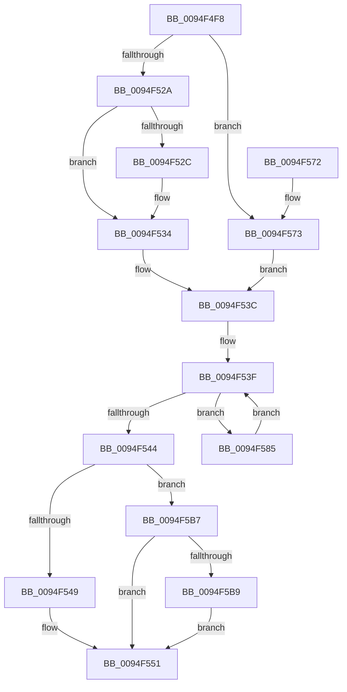

# PiDmListAddList

- RVA: `0x0094F4F8`–`0x0094F5C6` (길이 `206` bytes)
- VA: `0x000000014094F4F8`
- 실행 섹션: `PAGE`
- PDB 이름 있음: `예`; PDB Function 태그: `아니요`
- unwind 정보 RVA: `0x00091B5C`
- 디코드: `61`개 명령, `206/206` bytes 표시
- 미해석 바이트: `0` (있으면 어셈블리에 `.byte`로 보존)

> 이 문서는 커널 이미지의 기계어와 PDB 기호를 분석해 생성했습니다. 4번과 5번은 함수 원형과 자료형을 바이너리 사용 방식에서 추정한 C 해석이며 원본 소스 복구 결과는 아닙니다.

## 1. Dependencies

- 직접 호출 지점: **11**; 고유 호출 대상: **5**
- 직접 호출자로 확인된 함수: **1**
- RIP 상대 이미지 참조: **0**

### Outgoing calls
- `0x0094F519` → [PiDmGetObjectManagerForObjectType](../95/PiDmGetObjectManagerForObjectType_function_00951140.md) (function, `0x00951140`)
- `0x0094F52F` → [PiDmObjectAcquireSharedLock](../8E/PiDmObjectAcquireSharedLock_function_008E38B8.md) (function, `0x008E38B8`)
- `0x0094F537` → [CmpLockSiloKeyLockTrackerExclusive](../8F/CmpLockSiloKeyLockTrackerExclusive_function_008F9EF8.md) (function, `0x008F9EF8`)
- `0x0094F54C` → [PiDmObjectReleaseLock](../8E/PiDmObjectReleaseLock_function_008E5584.md) (function, `0x008E5584`)
- `0x0094F554` → [PiDmObjectReleaseLock](../8E/PiDmObjectReleaseLock_function_008E5584.md) (function, `0x008E5584`)
- `0x0094F576` → [CmpLockSiloKeyLockTrackerExclusive](../8F/CmpLockSiloKeyLockTrackerExclusive_function_008F9EF8.md) (function, `0x008F9EF8`)
- `0x0094F57E` → [PiDmObjectAcquireSharedLock](../8E/PiDmObjectAcquireSharedLock_function_008E38B8.md) (function, `0x008E38B8`)
- `0x0094F58C` → [PiDmObjectAcquireSharedLock](../8E/PiDmObjectAcquireSharedLock_function_008E38B8.md) (function, `0x008E38B8`)
- `0x0094F5A5` → [PiDmListAddObjectWorker](../95/PiDmListAddObjectWorker_function_009507B4.md) (function, `0x009507B4`)
- `0x0094F5AD` → [PiDmObjectReleaseLock](../8E/PiDmObjectReleaseLock_function_008E5584.md) (function, `0x008E5584`)
- `0x0094F5BC` → [PiDmObjectReleaseLock](../8E/PiDmObjectReleaseLock_function_008E5584.md) (function, `0x008E5584`)

### Direct callers
- [PiPnpRtlCmActionCallback](../8E/PiPnpRtlCmActionCallback_function_008EF110.md) at `0x008EF774`

### Static image references
- 디코드된 RIP-relative 메모리 참조가 없습니다.

## 2. Other-region calls and transfers

- 다른 실행 섹션으로 향하는 call: **0**
- 별도 외부 분기/꼬리 이동을 확인하지 못했습니다.

## 3. Assembly (complete function range)

```asm
0094F4F8  48 89 5C 24 08                  mov qword ptr [rsp + 8], rbx
0094F4FD  48 89 6C 24 10                  mov qword ptr [rsp + 0x10], rbp
0094F502  48 89 74 24 18                  mov qword ptr [rsp + 0x18], rsi
0094F507  57                              push rdi
0094F508  41 56                           push r14
0094F50A  41 57                           push r15
0094F50C  48 83 EC 30                     sub rsp, 0x30
0094F510  8B 4A 1C                        mov ecx, dword ptr [rdx + 0x1c]
0094F513  49 8B F1                        mov rsi, r9
0094F516  48 8B FA                        mov rdi, rdx
0094F519  E8 22 1C 00 00                  call 0x140951140
0094F51E  4D 8D 79 58                     lea r15, [r9 + 0x58]
0094F522  48 8B E8                        mov rbp, rax
0094F525  49 3B D1                        cmp rdx, r9
0094F528  72 49                           jb 0x14094f573
0094F52A  76 08                           jbe 0x14094f534
0094F52C  49 8B C9                        mov rcx, r9
0094F52F  E8 84 43 F9 FF                  call 0x1408e38b8
0094F534  48 8B CF                        mov rcx, rdi
0094F537  E8 BC A9 FA FF                  call 0x1408f9ef8
0094F53C  4D 8B 37                        mov r14, qword ptr [r15]
0094F53F  4D 3B F7                        cmp r14, r15
0094F542  75 41                           jne 0x14094f585
0094F544  48 3B FE                        cmp rdi, rsi
0094F547  73 6E                           jae 0x14094f5b7
0094F549  48 8B CE                        mov rcx, rsi
0094F54C  E8 33 60 F9 FF                  call 0x1408e5584
0094F551  48 8B CF                        mov rcx, rdi
0094F554  E8 2B 60 F9 FF                  call 0x1408e5584
0094F559  48 8B 5C 24 50                  mov rbx, qword ptr [rsp + 0x50]
0094F55E  48 8B 6C 24 58                  mov rbp, qword ptr [rsp + 0x58]
0094F563  48 8B 74 24 60                  mov rsi, qword ptr [rsp + 0x60]
0094F568  48 83 C4 30                     add rsp, 0x30
0094F56C  41 5F                           pop r15
0094F56E  41 5E                           pop r14
0094F570  5F                              pop rdi
0094F571  C3                              ret
0094F572  CC                              int3
0094F573  48 8B CF                        mov rcx, rdi
0094F576  E8 7D A9 FA FF                  call 0x1408f9ef8
0094F57B  48 8B CE                        mov rcx, rsi
0094F57E  E8 35 43 F9 FF                  call 0x1408e38b8
0094F583  EB B7                           jmp 0x14094f53c
0094F585  49 8D 5E C0                     lea rbx, [r14 - 0x40]
0094F589  48 8B CB                        mov rcx, rbx
0094F58C  E8 27 43 F9 FF                  call 0x1408e38b8
0094F591  48 83 64 24 20 00               and qword ptr [rsp + 0x20], 0
0094F597  4C 8B CB                        mov r9, rbx
0094F59A  4C 8B C7                        mov r8, rdi
0094F59D  48 8B D5                        mov rdx, rbp
0094F5A0  B9 02 00 00 00                  mov ecx, 2
0094F5A5  E8 0A 12 00 00                  call 0x1409507b4
0094F5AA  48 8B CB                        mov rcx, rbx
0094F5AD  E8 D2 5F F9 FF                  call 0x1408e5584
0094F5B2  4D 8B 36                        mov r14, qword ptr [r14]
0094F5B5  EB 88                           jmp 0x14094f53f
0094F5B7  76 98                           jbe 0x14094f551
0094F5B9  48 8B CF                        mov rcx, rdi
0094F5BC  E8 C3 5F F9 FF                  call 0x1408e5584
0094F5C1  48 8B FE                        mov rdi, rsi
0094F5C4  EB 8B                           jmp 0x14094f551
```

## 4. C-style interpretation (structured pseudocode)

```c
__int64 __fastcall PiDmListAddList(__int64 a1, __int64 a2, __int64 a3, __int64 a4)
{
    __int64 result;
    __int64 v_rsp;
    unsigned __int64 v_stack_p10;
    unsigned __int64 v_stack_p18;
    unsigned __int64 v_stack_p20;
    unsigned __int64 v_stack_p8;

    v_stack_p8 = v_rbx;
    v_stack_p10 = v_rbp;
    v_stack_p18 = v_rsi;
    v_rsp = (v_rsp) - (48);
    result = PiDmGetObjectManagerForObjectType((unsigned int)(*(unsigned int *)(a2 + 28)), a2, a3, a4);
    if (a2 < a4) goto loc_0094F573;
    if (a2 >= = a4) {
        a1 = a4;
        result = PiDmObjectAcquireSharedLock(a1, a2, a3, a4);
    }
    result = CmpLockSiloKeyLockTrackerExclusive(a2, a2, a3, a4);
loc_0094F53C:
loc_0094F53F:
    if ((*(unsigned __int64 *)(a4 + 88)) != (a4 + 88)) goto loc_0094F585;
    if (a2 >= a4) goto loc_0094F5B7;
    result = PiDmObjectReleaseLock(a4, a2, a3, a4);
loc_0094F551:
    result = PiDmObjectReleaseLock(a2, a2, a3, a4);
    v_rsp = (v_rsp) + (48);
    return result;
loc_0094F573:
    result = CmpLockSiloKeyLockTrackerExclusive(a2, a2, a3, a4);
    result = PiDmObjectAcquireSharedLock(v_stack_p18, a2, a3, a4);
    goto loc_0094F53C;
loc_0094F585:
    result = PiDmObjectAcquireSharedLock(*(unsigned __int64 *)(a4 + 88) - 64, a2, a3, a4);
    result = PiDmListAddObjectWorker(2, v_stack_p10, a2, *(unsigned __int64 *)(a4 + 88) - 64);
    result = PiDmObjectReleaseLock(*(unsigned __int64 *)(a4 + 88) - 64, v_stack_p10, a2, *(unsigned __int64 *)(a4 + 88) - 64);
    goto loc_0094F53F;
loc_0094F5B7:
    if (condition_is_below_or_equal) goto loc_0094F551;
    result = PiDmObjectReleaseLock(a2, v_stack_p10, a2, *(unsigned __int64 *)(a4 + 88) - 64);
    goto loc_0094F551;
}
```

## 5. (Beta) C Style

```c
int64_t PiDmListAddList(int64_t Arg1, void *Arg2, int64_t Arg3, int64_t Arg4)
{
    uint8_t *arg2 = (uint8_t *)Arg2;

    int64_t result;
    int64_t local_rsp;
    uint64_t v_stack_p10;
    uint64_t v_stack_p18;
    uint64_t v_stack_p20;
    uint64_t v_stack_p8;

    v_stack_p8 = local_rbx;
    v_stack_p10 = local_rbp;
    v_stack_p18 = local_rsi;
    local_rsp = (local_rsp) - (48);
    result = PiDmGetObjectManagerForObjectType((uint32_t)(*(uint32_t *)(arg2 + 0x1C)), Arg2, Arg3, Arg4);
    if (Arg2 < Arg4) goto loc_0094F573;
    if (Arg2 >= = Arg4) {
        Arg1 = Arg4;
        result = PiDmObjectAcquireSharedLock(Arg1, Arg2, Arg3, Arg4);
    }
    result = CmpLockSiloKeyLockTrackerExclusive(Arg2, Arg2, Arg3, Arg4);
loc_0094F53C:
loc_0094F53F:
    if ((*(uint64_t *)(Arg4 + 0x58)) != (Arg4 + 88)) goto loc_0094F585;
    if (Arg2 >= Arg4) goto loc_0094F5B7;
    result = PiDmObjectReleaseLock(Arg4, Arg2, Arg3, Arg4);
loc_0094F551:
    result = PiDmObjectReleaseLock(Arg2, Arg2, Arg3, Arg4);
    local_rsp = (local_rsp) + (48);
    return result;
loc_0094F573:
    result = CmpLockSiloKeyLockTrackerExclusive(Arg2, Arg2, Arg3, Arg4);
    result = PiDmObjectAcquireSharedLock(v_stack_p18, Arg2, Arg3, Arg4);
    goto loc_0094F53C;
loc_0094F585:
    result = PiDmObjectAcquireSharedLock(*(uint64_t *)(Arg4 + 0x58) - 64, Arg2, Arg3, Arg4);
    result = PiDmListAddObjectWorker(2, v_stack_p10, Arg2, *(uint64_t *)(Arg4 + 0x58) - 64);
    result = PiDmObjectReleaseLock(*(uint64_t *)(Arg4 + 0x58) - 64, v_stack_p10, Arg2, *(uint64_t *)(Arg4 + 0x58) - 64);
    goto loc_0094F53F;
loc_0094F5B7:
    if (condition_is_below_or_equal) goto loc_0094F551;
    result = PiDmObjectReleaseLock(Arg2, v_stack_p10, Arg2, *(uint64_t *)(Arg4 + 0x58) - 64);
    goto loc_0094F551;
}
```

### 관측된 메모리 오프셋

구조체 형식이 확인되지 않은 접근은 인자 기준의 오프셋으로만 기록했습니다.

| 기준 인자 | 오프셋 표현 | 폭 (bit) | 접근 |
|---|---:|---:|---|
| `Arg2` | `+ 0x1C` | `32` | `R` |

## 6. Execution-region graph

[열기: 2D/3D 그래프와 함수 탐색 컨트롤 패널](../../../control-panel.html?section=page&rva=0x0094F4F8&view=graph)

- 2D 그래프는 위에서 아래로 흐르고, 3D 그래프는 빈 공간을 드래그해 회전합니다. Shift+드래그는 이동, 휠은 확대·축소, 함수 노드 선택은 대상 보고서 이동입니다.

### Static fallback


