# PiDmObjectCreate

- RVA: `0x0094F5CC`–`0x0094F87A` (길이 `686` bytes)
- VA: `0x000000014094F5CC`
- 실행 섹션: `PAGE`
- PDB 이름 있음: `예`; PDB Function 태그: `아니요`
- unwind 정보 RVA: `0x00091B78`
- 디코드: `202`개 명령, `686/686` bytes 표시
- 미해석 바이트: `0` (있으면 어셈블리에 `.byte`로 보존)

> 이 문서는 커널 이미지의 기계어와 PDB 기호를 분석해 생성했습니다. 4번과 5번은 함수 원형과 자료형을 바이너리 사용 방식에서 추정한 C 해석이며 원본 소스 복구 결과는 아닙니다.

## 1. Dependencies

- 직접 호출 지점: **8**; 고유 호출 대상: **8**
- 직접 호출자로 확인된 함수: **2**
- RIP 상대 이미지 참조: **4**

### Outgoing calls
- `0x0094F654` → [ExAllocatePool2](../../poolcode/B8/ExAllocatePool2_function_00B820F0.md) (function, `0x00B820F0`)
- `0x0094F68E` → [PnpAllocatePWSTR](../8D/PnpAllocatePWSTR_function_008DE620.md) (function, `0x008DE620`)
- `0x0094F6A9` → [CmSetDeviceInterfacePathFormat](../A5/CmSetDeviceInterfacePathFormat_function_00A5FE7C.md) (function, `0x00A5FE7C`)
- `0x0094F6F0` → [PnpValidateObjectName](../99/PnpValidateObjectName_function_00990798.md) (function, `0x00990798`)
- `0x0094F773` → [RtlHashUnicodeString](../97/RtlHashUnicodeString_function_0097A780.md) (function, `0x0097A780`)
- `0x0094F7FA` → [PiDmGetCachedKeyIndex](../8F/PiDmGetCachedKeyIndex_function_008F8E80.md) (function, `0x008F8E80`)
- `0x0094F833` → [PiDmCacheDataEncode](../8F/PiDmCacheDataEncode_function_008FB79C.md) (function, `0x008FB79C`)
- `0x0094F84A` → [PiDmObjectRelease](../8E/PiDmObjectRelease_function_008E4F70.md) (function, `0x008E4F70`)

### Direct callers
- [PiDmObjectManagerPopulate](../73/PiDmObjectManagerPopulate_function_00730598.md) at `0x0073064E`
- [PiDmAddCacheReferenceForObject](../95/PiDmAddCacheReferenceForObject_function_00950FB4.md) at `0x009510AD`

### Static image references
- `0x0094F617` → RVA `0x00001B90` (`.rdata`; read)
- `0x0094F625` → RVA `0x00001B60` (`.rdata`; read)
- `0x0094F633` → RVA `0x00001A70` (`.rdata`; read)
- `0x0094F7D2` → RVA `0x00001EE0` (`.rdata`; read)

## 2. Other-region calls and transfers

- 다른 실행 섹션으로 향하는 call: **1**
  - `0x0094F654` → [ExAllocatePool2](../../poolcode/B8/ExAllocatePool2_function_00B820F0.md) (`PAGE` → `POOLCODE`)
- 별도 외부 분기/꼬리 이동을 확인하지 못했습니다.

## 3. Assembly (complete function range)

```asm
0094F5CC  48 8B C4                        mov rax, rsp
0094F5CF  48 89 58 10                     mov qword ptr [rax + 0x10], rbx
0094F5D3  48 89 68 18                     mov qword ptr [rax + 0x18], rbp
0094F5D7  48 89 70 20                     mov qword ptr [rax + 0x20], rsi
0094F5DB  57                              push rdi
0094F5DC  41 54                           push r12
0094F5DE  41 55                           push r13
0094F5E0  41 56                           push r14
0094F5E2  41 57                           push r15
0094F5E4  48 83 EC 40                     sub rsp, 0x40
0094F5E8  33 ED                           xor ebp, ebp
0094F5EA  44 8B C9                        mov r9d, ecx
0094F5ED  40 88 68 08                     mov byte ptr [rax + 8], bpl
0094F5F1  4D 8B E8                        mov r13, r8
0094F5F4  49 89 28                        mov qword ptr [r8], rbp
0094F5F7  48 8B DA                        mov rbx, rdx
0094F5FA  44 8B F9                        mov r15d, ecx
0094F5FD  8D 45 02                        lea eax, [rbp + 2]
0094F600  41 83 E9 01                     sub r9d, 1
0094F604  74 2D                           je 0x14094f633
0094F606  44 2B C8                        sub r9d, eax
0094F609  74 1A                           je 0x14094f625
0094F60B  44 3B C8                        cmp r9d, eax
0094F60E  74 07                           je 0x14094f617
0094F610  44 8B E5                        mov r12d, ebp
0094F613  8B F5                           mov esi, ebp
0094F615  EB 28                           jmp 0x14094f63f
0094F617  4C 8D 25 72 25 6B FF            lea r12, [rip - 0x94da8e]
0094F61E  BE 03 00 00 00                  mov esi, 3
0094F623  EB 1A                           jmp 0x14094f63f
0094F625  4C 8D 25 34 25 6B FF            lea r12, [rip - 0x94dacc]
0094F62C  BE 01 00 00 00                  mov esi, 1
0094F631  EB 0C                           jmp 0x14094f63f
0094F633  4C 8D 25 36 24 6B FF            lea r12, [rip - 0x94dbca]
0094F63A  BE 0A 00 00 00                  mov esi, 0xa
0094F63F  8D 04 76                        lea eax, [rsi + rsi*2]
0094F642  B9 00 01 00 00                  mov ecx, 0x100
0094F647  8D 14 C5 70 00 00 00            lea edx, [rax*8 + 0x70]
0094F64E  41 B8 50 6E 70 5A               mov r8d, 0x5a706e50
0094F654  E8 97 2A 23 00                  call 0x140b820f0
0094F659  48 8B F8                        mov rdi, rax
0094F65C  48 85 C0                        test rax, rax
0094F65F  75 0A                           jne 0x14094f66b
0094F661  BB 9A 00 00 C0                  mov ebx, 0xc000009a
0094F666  E9 E4 01 00 00                  jmp 0x14094f84f
0094F66B  4C 8D 70 10                     lea r14, [rax + 0x10]
0094F66F  48 89 28                        mov qword ptr [rax], rbp
0094F672  4D 8B CE                        mov r9, r14
0094F675  C7 40 08 01 00 00 00            mov dword ptr [rax + 8], 1
0094F67C  BA FF FF FF 7F                  mov edx, 0x7fffffff
0094F681  44 89 78 1C                     mov dword ptr [rax + 0x1c], r15d
0094F685  41 B8 50 6E 70 5A               mov r8d, 0x5a706e50
0094F68B  48 8B CB                        mov rcx, rbx
0094F68E  E8 8D EF F8 FF                  call 0x1408de620
0094F693  8B D8                           mov ebx, eax
0094F695  85 C0                           test eax, eax
0094F697  0F 88 AA 01 00 00               js 0x14094f847
0094F69D  49 8B 16                        mov rdx, qword ptr [r14]
0094F6A0  41 83 FF 03                     cmp r15d, 3
0094F6A4  75 47                           jne 0x14094f6ed
0094F6A6  45 33 C0                        xor r8d, r8d
0094F6A9  E8 CE 07 11 00                  call 0x140a5fe7c
0094F6AE  8B D8                           mov ebx, eax
0094F6B0  85 C0                           test eax, eax
0094F6B2  0F 88 8F 01 00 00               js 0x14094f847
0094F6B8  4D 8B 06                        mov r8, qword ptr [r14]
0094F6BB  0F 57 C0                        xorps xmm0, xmm0
0094F6BE  45 8D 77 FF                     lea r14d, [r15 - 1]
0094F6C2  8B DD                           mov ebx, ebp
0094F6C4  0F 11 44 24 30                  movups xmmword ptr [rsp + 0x30], xmm0
0094F6C9  49 83 C0 08                     add r8, 8
0094F6CD  0F 84 8A 00 00 00               je 0x14094f75d
0094F6D3  B9 FF 7F 00 00                  mov ecx, 0x7fff
0094F6D8  49 8B C0                        mov rax, r8
0094F6DB  8B D1                           mov edx, ecx
0094F6DD  66 39 28                        cmp word ptr [rax], bp
0094F6E0  74 4D                           je 0x14094f72f
0094F6E2  49 03 C6                        add rax, r14
0094F6E5  48 83 EA 01                     sub rdx, 1
0094F6E9  75 F2                           jne 0x14094f6dd
0094F6EB  EB 42                           jmp 0x14094f72f
0094F6ED  45 8B C7                        mov r8d, r15d
0094F6F0  E8 A3 10 04 00                  call 0x140990798
0094F6F5  8B D8                           mov ebx, eax
0094F6F7  85 C0                           test eax, eax
0094F6F9  0F 88 48 01 00 00               js 0x14094f847
0094F6FF  4D 8B 06                        mov r8, qword ptr [r14]
0094F702  0F 57 C0                        xorps xmm0, xmm0
0094F705  8B DD                           mov ebx, ebp
0094F707  41 BE 02 00 00 00               mov r14d, 2
0094F70D  0F 11 44 24 30                  movups xmmword ptr [rsp + 0x30], xmm0
0094F712  4D 85 C0                        test r8, r8
0094F715  74 46                           je 0x14094f75d
0094F717  B9 FF 7F 00 00                  mov ecx, 0x7fff
0094F71C  49 8B C0                        mov rax, r8
0094F71F  8B D1                           mov edx, ecx
0094F721  66 39 28                        cmp word ptr [rax], bp
0094F724  74 09                           je 0x14094f72f
0094F726  49 03 C6                        add rax, r14
0094F729  48 83 EA 01                     sub rdx, 1
0094F72D  75 F2                           jne 0x14094f721
0094F72F  48 8B C2                        mov rax, rdx
0094F732  48 F7 D8                        neg rax
0094F735  1B DB                           sbb ebx, ebx
0094F737  F7 D3                           not ebx
0094F739  81 E3 0D 00 00 C0               and ebx, 0xc000000d
0094F73F  48 85 D2                        test rdx, rdx
0094F742  74 19                           je 0x14094f75d
0094F744  48 2B CA                        sub rcx, rdx
0094F747  4C 89 44 24 38                  mov qword ptr [rsp + 0x38], r8
0094F74C  66 03 C9                        add cx, cx
0094F74F  66 89 4C 24 30                  mov word ptr [rsp + 0x30], cx
0094F754  66 41 03 CE                     add cx, r14w
0094F758  66 89 4C 24 32                  mov word ptr [rsp + 0x32], cx
0094F75D  85 DB                           test ebx, ebx
0094F75F  0F 88 E2 00 00 00               js 0x14094f847
0094F765  4C 8D 4F 18                     lea r9, [rdi + 0x18]
0094F769  45 33 C0                        xor r8d, r8d
0094F76C  B2 01                           mov dl, 1
0094F76E  48 8D 4C 24 30                  lea rcx, [rsp + 0x30]
0094F773  E8 08 B0 02 00                  call 0x14097a780
0094F778  41 8B CF                        mov ecx, r15d
0094F77B  8B D8                           mov ebx, eax
0094F77D  83 E9 01                        sub ecx, 1
0094F780  74 2B                           je 0x14094f7ad
0094F782  83 E9 01                        sub ecx, 1
0094F785  74 0F                           je 0x14094f796
0094F787  41 2B CE                        sub ecx, r14d
0094F78A  74 0A                           je 0x14094f796
0094F78C  83 E9 01                        sub ecx, 1
0094F78F  74 0B                           je 0x14094f79c
0094F791  83 F9 01                        cmp ecx, 1
0094F794  75 22                           jne 0x14094f7b8
0094F796  48 8D 47 28                     lea rax, [rdi + 0x28]
0094F79A  EB 15                           jmp 0x14094f7b1
0094F79C  48 8D 47 28                     lea rax, [rdi + 0x28]
0094F7A0  48 89 40 08                     mov qword ptr [rax + 8], rax
0094F7A4  48 89 00                        mov qword ptr [rax], rax
0094F7A7  48 8D 47 40                     lea rax, [rdi + 0x40]
0094F7AB  EB 04                           jmp 0x14094f7b1
0094F7AD  48 8D 47 58                     lea rax, [rdi + 0x58]
0094F7B1  48 89 00                        mov qword ptr [rax], rax
0094F7B4  48 89 40 08                     mov qword ptr [rax + 8], rax
0094F7B8  85 F6                           test esi, esi
0094F7BA  74 16                           je 0x14094f7d2
0094F7BC  48 8D 47 70                     lea rax, [rdi + 0x70]
0094F7C0  8B CE                           mov ecx, esi
0094F7C2  C7 00 01 00 00 00               mov dword ptr [rax], 1
0094F7C8  48 8D 40 18                     lea rax, [rax + 0x18]
0094F7CC  48 83 E9 01                     sub rcx, 1
0094F7D0  75 F0                           jne 0x14094f7c2
0094F7D2  4C 8D 35 07 27 6B FF            lea r14, [rip - 0x94d8f9]
0094F7D9  8B C3                           mov eax, ebx
0094F7DB  83 FD 03                        cmp ebp, 3
0094F7DE  0F 83 8C 00 00 00               jae 0x14094f870
0094F7E4  8B C5                           mov eax, ebp
0094F7E6  4C 6B C0 38                     imul r8, rax, 0x38
0094F7EA  47 3B 3C 30                     cmp r15d, dword ptr [r8 + r14]
0094F7EE  75 4E                           jne 0x14094f83e
0094F7F0  4F 8B 44 30 08                  mov r8, qword ptr [r8 + r14 + 8]
0094F7F5  8B D6                           mov edx, esi
0094F7F7  49 8B CC                        mov rcx, r12
0094F7FA  E8 81 96 FA FF                  call 0x1408f8e80
0094F7FF  3B C6                           cmp eax, esi
0094F801  73 3F                           jae 0x14094f842
0094F803  8B C0                           mov eax, eax
0094F805  48 8D 54 24 70                  lea rdx, [rsp + 0x70]
0094F80A  41 B8 01 00 00 00               mov r8d, 1
0094F810  4C 8D 0C 40                     lea r9, [rax + rax*2]
0094F814  49 8D 41 0E                     lea rax, [r9 + 0xe]
0094F818  48 8D 04 C7                     lea rax, [rdi + rax*8]
0094F81C  48 89 44 24 28                  mov qword ptr [rsp + 0x28], rax
0094F821  41 8D 48 10                     lea ecx, [r8 + 0x10]
0094F825  43 8B 44 CC 0C                  mov eax, dword ptr [r12 + r9*8 + 0xc]
0094F82A  47 8B 4C CC 08                  mov r9d, dword ptr [r12 + r9*8 + 8]
0094F82F  89 44 24 20                     mov dword ptr [rsp + 0x20], eax
0094F833  E8 64 BF FA FF                  call 0x1408fb79c
0094F838  8B D8                           mov ebx, eax
0094F83A  85 C0                           test eax, eax
0094F83C  78 09                           js 0x14094f847
0094F83E  FF C5                           inc ebp
0094F840  EB 97                           jmp 0x14094f7d9
0094F842  BB E5 00 00 C0                  mov ebx, 0xc00000e5
0094F847  48 8B CF                        mov rcx, rdi
0094F84A  E8 21 57 F9 FF                  call 0x1408e4f70
0094F84F  4C 8D 5C 24 40                  lea r11, [rsp + 0x40]
0094F854  8B C3                           mov eax, ebx
0094F856  49 8B 5B 38                     mov rbx, qword ptr [r11 + 0x38]
0094F85A  49 8B 6B 40                     mov rbp, qword ptr [r11 + 0x40]
0094F85E  49 8B 73 48                     mov rsi, qword ptr [r11 + 0x48]
0094F862  49 8B E3                        mov rsp, r11
0094F865  41 5F                           pop r15
0094F867  41 5E                           pop r14
0094F869  41 5D                           pop r13
0094F86B  41 5C                           pop r12
0094F86D  5F                              pop rdi
0094F86E  C3                              ret
0094F86F  CC                              int3
0094F870  85 C0                           test eax, eax
0094F872  78 D3                           js 0x14094f847
0094F874  49 89 7D 00                     mov qword ptr [r13], rdi
0094F878  EB D5                           jmp 0x14094f84f
```

## 4. C-style interpretation (structured pseudocode)

```c
__int64 __fastcall PiDmObjectCreate(int a1, __int64 a2, __int64 a3)
{
    __int64 result;
    __int64 v_rbp;
    __int64 v_rbx;
    __int64 v_rsp;
    unsigned __int64 v_stack_m28;
    unsigned __int64 v_stack_m30;
    unsigned __int16 v_stack_m36;
    unsigned __int64 v_stack_m38;
    unsigned __int64 v_stack_m40;
    unsigned int v_stack_m48;
    unsigned __int64 v_stack_p8;

    *(unsigned __int64 *)(v_rsp + 16) = v_rbx;
    *(unsigned __int64 *)(v_rsp + 24) = v_rbp;
    *(unsigned __int64 *)(v_rsp + 32) = v_rsi;
    v_rsp = (v_rsp) - (64);
    v_rbp = 0;
    *(unsigned __int8 *)(v_rsp + 8) = 0;
    *(unsigned __int64 *)(a3) = 0;
    a4 = (unsigned int)(((unsigned int)(a1)) - (1));
    if (condition_is_equal) goto loc_0094F633;
    a4 = (unsigned int)((a4) - ((unsigned int)(v_rbp + 2)));
    if (condition_is_equal) goto loc_0094F625;
    if (((unsigned int)(a4)) == ((unsigned int)(v_rbp + 2))) goto loc_0094F617;
    goto loc_0094F63F;
loc_0094F617:
    goto loc_0094F63F;
loc_0094F625:
    goto loc_0094F63F;
loc_0094F633:
loc_0094F63F:
    result = ExAllocatePool2(256, 10 + 10 * 2 * 8 + 112, (unsigned int)(0x5A706E50ULL), a4);
    if (result != 0) goto loc_0094F66B;
    goto loc_0094F84F;
loc_0094F66B:
    *(unsigned __int64 *)(result) = 0;
    *(unsigned int *)(result + 8) = 1;
    *(unsigned int *)(result + 28) = (unsigned int)((unsigned int)(a1));
    result = PnpAllocatePWSTR((unsigned int)(0xC000009AULL), (unsigned int)(0x7FFFFFFFULL), (unsigned int)(0x5A706E50ULL), result + 16);
    if (sign_flag) goto loc_0094F847;
    if (((unsigned int)((unsigned int)(a1))) != 3) goto loc_0094F6ED;
    a3 = 0;
    result = CmSetDeviceInterfacePathFormat((unsigned int)(0xC000009AULL), *(unsigned __int64 *)(result + 16), a3, result + 16);
    if (sign_flag) goto loc_0094F847;
    v_stack_m38 = v_xmm0;
    a3 = (*(unsigned __int64 *)(result + 16)) + (8);
    if (condition_is_equal) goto loc_0094F75D;
loc_0094F6DD:
    if ((*(unsigned __int16 *)(a3)) == 0) goto loc_0094F72F;
    result = (a3) + ((unsigned int)(a1) - 1);
    a2 = ((unsigned int)((unsigned int)((unsigned int)(0x7FFFULL)))) - (1);
    if (condition_is_not_equal) goto loc_0094F6DD;
    goto loc_0094F72F;
loc_0094F6ED:
    result = PnpValidateObjectName((unsigned int)(0x7FFFULL), a2, (unsigned int)((unsigned int)((unsigned int)(a1))), result + 16);
    if (sign_flag) goto loc_0094F847;
    v_stack_m38 = v_xmm0;
    if (*(unsigned __int64 *)((unsigned int)(a1) - 1) == 0) goto loc_0094F75D;
loc_0094F721:
    if ((*(unsigned __int16 *)(*(unsigned __int64 *)((unsigned int)(a1) - 1))) == 0) goto loc_0094F72F;
    result = (*(unsigned __int64 *)((unsigned int)(a1) - 1)) + (2);
    a2 = ((unsigned int)((unsigned int)((unsigned int)(0x7FFFULL)))) - (1);
    if (condition_is_not_equal) goto loc_0094F721;
loc_0094F72F:
    result = -(a2);
    v_rbx = (unsigned int)(~(0));
    v_rbx = (unsigned int)((v_rbx) & (0xC000000DULL));
    if (a2 != 0) {
        a1 = ((unsigned int)(0x7FFFULL)) - (a2);
        v_stack_m30 = *(unsigned __int64 *)((unsigned int)(a1) - 1);
        a1 = (unsigned __int16)((a1) + ((unsigned __int16)(a1)));
        v_stack_m38 = (unsigned __int16)(a1);
        a1 = (unsigned __int16)((a1) + (2));
        v_stack_m36 = (unsigned __int16)(a1);
    }
    if (sign_flag) goto loc_0094F847;
    a3 = 0;
    result = RtlHashUnicodeString(v_stack_m38, 1, a3, result + 24);
    a1 = (unsigned int)(((unsigned int)((unsigned int)((unsigned int)(a1)))) - (1));
    if (condition_is_equal) goto loc_0094F7AD;
    a1 = (unsigned int)((a1) - (1));
    if (condition_is_equal) goto loc_0094F796;
    a1 = (unsigned int)((a1) - (2));
    if (condition_is_equal) goto loc_0094F796;
    a1 = (unsigned int)((a1) - (1));
    if (condition_is_equal) goto loc_0094F79C;
    if (a1 != 1) goto loc_0094F7B8;
loc_0094F796:
    goto loc_0094F7B1;
loc_0094F79C:
    *(unsigned __int64 *)(result + 40 + 8) = result + 40;
    *(unsigned __int64 *)(result + 40) = result + 40;
    goto loc_0094F7B1;
loc_0094F7AD:
loc_0094F7B1:
    *(unsigned __int64 *)(result + 88) = result + 88;
    *(unsigned __int64 *)(result + 88 + 8) = result + 88;
loc_0094F7B8:
    if (10 == 0) goto loc_0094F7D2;
loc_0094F7C2:
    *(unsigned int *)(result + 112) = 1;
    a1 = (10) - (1);
    if (condition_is_not_equal) goto loc_0094F7C2;
loc_0094F7D2:
loc_0094F7D9:
    if (0 >= 3) goto loc_0094F870;
    a3 = (a3) * (0);
    if (((unsigned int)((unsigned int)(a1))) != (*(unsigned int *)(a3 + v_rip - 9754873 * 1))) goto loc_0094F83E;
    result = PiDmGetCachedKeyIndex(v_rip - 9755594, 10, *(unsigned __int64 *)(a3 + v_rip - 9754873 * 1 + 8), result + 24);
    if (((unsigned int)(result)) >= 10) goto loc_0094F842;
    v_stack_m40 = result + (unsigned int)((unsigned int)(result)) + (unsigned int)((unsigned int)(result)) * 2 + 14 * 8;
    v_stack_m48 = (unsigned int)((unsigned int)(*(unsigned int *)(v_rip - 9755594 + (unsigned int)((unsigned int)(result)) + (unsigned int)((unsigned int)(result)) * 2 * 8 + 12)));
    result = PiDmCacheDataEncode(1 + 16, v_stack_p8, 1, (unsigned int)(*(unsigned int *)(v_rip - 9755594 + (unsigned int)((unsigned int)(result)) + (unsigned int)((unsigned int)(result)) * 2 * 8 + 8)));
    if (sign_flag) goto loc_0094F847;
loc_0094F83E:
    v_rbp = (unsigned int)((v_rbp) + 1);
    goto loc_0094F7D9;
loc_0094F842:
loc_0094F847:
    result = PiDmObjectRelease(result, v_stack_p8, 1, (unsigned int)(*(unsigned int *)(v_rip - 9755594 + (unsigned int)((unsigned int)(result)) + (unsigned int)((unsigned int)(result)) * 2 * 8 + 8)));
loc_0094F84F:
    return (unsigned int)((unsigned int)((unsigned int)(0xC00000E5ULL)));
loc_0094F870:
    if (sign_flag) goto loc_0094F847;
    *(unsigned __int64 *)(a3) = result;
    goto loc_0094F84F;
}
```

## 5. (Beta) C Style

```c
int64_t PiDmObjectCreate(int32_t Arg1, int64_t Arg2, void *Arg3)
{
    uint8_t *arg3 = (uint8_t *)Arg3;

    int64_t result;
    int64_t local_rbp;
    int64_t local_rbx;
    int64_t local_rsp;
    uint64_t v_stack_m28;
    uint64_t v_stack_m30;
    uint16_t v_stack_m36;
    uint64_t v_stack_m38;
    uint64_t v_stack_m40;
    uint32_t v_stack_m48;
    uint64_t v_stack_p8;

    *(uint64_t *)(local_rsp + 0x10) = local_rbx;
    *(uint64_t *)(local_rsp + 0x18) = local_rbp;
    *(uint64_t *)(local_rsp + 0x20) = local_rsi;
    local_rsp = (local_rsp) - (64);
    local_rbp = 0;
    *(uint8_t *)(local_rsp + 0x8) = 0;
    *(uint64_t *)(arg3) = 0;
    a4 = (uint32_t)(((uint32_t)(Arg1)) - (1));
    if (condition_is_equal) goto loc_0094F633;
    a4 = (uint32_t)((a4) - ((uint32_t)(local_rbp + 2)));
    if (condition_is_equal) goto loc_0094F625;
    if (((uint32_t)(a4)) == ((uint32_t)(local_rbp + 2))) goto loc_0094F617;
    goto loc_0094F63F;
loc_0094F617:
    goto loc_0094F63F;
loc_0094F625:
    goto loc_0094F63F;
loc_0094F633:
loc_0094F63F:
    result = ExAllocatePool2(256, 10 + 10 * 2 * 8 + 112, (uint32_t)(0x5A706E50ULL), a4);
    if (result != 0) goto loc_0094F66B;
    goto loc_0094F84F;
loc_0094F66B:
    *(uint64_t *)(result) = 0;
    *(uint32_t *)(result + 0x8) = 1;
    *(uint32_t *)(result + 0x1C) = (uint32_t)((uint32_t)(Arg1));
    result = PnpAllocatePWSTR((uint32_t)(0xC000009AULL), (uint32_t)(0x7FFFFFFFULL), (uint32_t)(0x5A706E50ULL), result + 16);
    if (sign_flag) goto loc_0094F847;
    if (((uint32_t)((uint32_t)(Arg1))) != 3) goto loc_0094F6ED;
    Arg3 = 0;
    result = CmSetDeviceInterfacePathFormat((uint32_t)(0xC000009AULL), *(uint64_t *)(result + 0x10), Arg3, result + 16);
    if (sign_flag) goto loc_0094F847;
    v_stack_m38 = v_xmm0;
    Arg3 = (*(uint64_t *)(result + 0x10)) + (8);
    if (condition_is_equal) goto loc_0094F75D;
loc_0094F6DD:
    if ((*(uint16_t *)(arg3)) == 0) goto loc_0094F72F;
    result = (Arg3) + ((uint32_t)(Arg1) - 1);
    Arg2 = ((uint32_t)((uint32_t)((uint32_t)(0x7FFFULL)))) - (1);
    if (condition_is_not_equal) goto loc_0094F6DD;
    goto loc_0094F72F;
loc_0094F6ED:
    result = PnpValidateObjectName((uint32_t)(0x7FFFULL), Arg2, (uint32_t)((uint32_t)((uint32_t)(Arg1))), result + 16);
    if (sign_flag) goto loc_0094F847;
    v_stack_m38 = v_xmm0;
    if (*(uint64_t *)((uint32_t)(Arg1) - 0x1) == 0) goto loc_0094F75D;
loc_0094F721:
    if ((*(uint16_t *)(*(uint64_t *)((uint32_t)(Arg1) - 0x1))) == 0) goto loc_0094F72F;
    result = (*(uint64_t *)((uint32_t)(Arg1) - 0x1)) + (2);
    Arg2 = ((uint32_t)((uint32_t)((uint32_t)(0x7FFFULL)))) - (1);
    if (condition_is_not_equal) goto loc_0094F721;
loc_0094F72F:
    result = -(Arg2);
    local_rbx = (uint32_t)(~(0));
    local_rbx = (uint32_t)((local_rbx) & (0xC000000DULL));
    if (Arg2 != 0) {
        Arg1 = ((uint32_t)(0x7FFFULL)) - (Arg2);
        v_stack_m30 = *(uint64_t *)((uint32_t)(Arg1) - 0x1);
        Arg1 = (uint16_t)((Arg1) + ((uint16_t)(Arg1)));
        v_stack_m38 = (uint16_t)(Arg1);
        Arg1 = (uint16_t)((Arg1) + (2));
        v_stack_m36 = (uint16_t)(Arg1);
    }
    if (sign_flag) goto loc_0094F847;
    Arg3 = 0;
    result = RtlHashUnicodeString(v_stack_m38, 1, Arg3, result + 24);
    Arg1 = (uint32_t)(((uint32_t)((uint32_t)((uint32_t)(Arg1)))) - (1));
    if (condition_is_equal) goto loc_0094F7AD;
    Arg1 = (uint32_t)((Arg1) - (1));
    if (condition_is_equal) goto loc_0094F796;
    Arg1 = (uint32_t)((Arg1) - (2));
    if (condition_is_equal) goto loc_0094F796;
    Arg1 = (uint32_t)((Arg1) - (1));
    if (condition_is_equal) goto loc_0094F79C;
    if (Arg1 != 1) goto loc_0094F7B8;
loc_0094F796:
    goto loc_0094F7B1;
loc_0094F79C:
    *(uint64_t *)(result + 0x28 + 0x8) = result + 40;
    *(uint64_t *)(result + 0x28) = result + 40;
    goto loc_0094F7B1;
loc_0094F7AD:
loc_0094F7B1:
    *(uint64_t *)(result + 0x58) = result + 88;
    *(uint64_t *)(result + 0x58 + 0x8) = result + 88;
loc_0094F7B8:
    if (10 == 0) goto loc_0094F7D2;
loc_0094F7C2:
    *(uint32_t *)(result + 0x70) = 1;
    Arg1 = (10) - (1);
    if (condition_is_not_equal) goto loc_0094F7C2;
loc_0094F7D2:
loc_0094F7D9:
    if (0 >= 3) goto loc_0094F870;
    Arg3 = (Arg3) * (0);
    if (((uint32_t)((uint32_t)(Arg1))) != (*(uint32_t *)(arg3 + v_rip - 0x94D8F9 * 1))) goto loc_0094F83E;
    result = PiDmGetCachedKeyIndex(v_rip - 9755594, 10, *(uint64_t *)(arg3 + v_rip - 0x94D8F9 * 1 + 0x8), result + 24);
    if (((uint32_t)(result)) >= 10) goto loc_0094F842;
    v_stack_m40 = result + (uint32_t)((uint32_t)(result)) + (uint32_t)((uint32_t)(result)) * 2 + 14 * 8;
    v_stack_m48 = (uint32_t)((uint32_t)(*(uint32_t *)(v_rip - 0x94DBCA + (uint32_t)((uint32_t)(result)) + (uint32_t)((uint32_t)(result)) * 2 * 8 + 0xC)));
    result = PiDmCacheDataEncode(1 + 16, v_stack_p8, 1, (uint32_t)(*(uint32_t *)(v_rip - 0x94DBCA + (uint32_t)((uint32_t)(result)) + (uint32_t)((uint32_t)(result)) * 2 * 8 + 0x8)));
    if (sign_flag) goto loc_0094F847;
loc_0094F83E:
    local_rbp = (uint32_t)((local_rbp) + 1);
    goto loc_0094F7D9;
loc_0094F842:
loc_0094F847:
    result = PiDmObjectRelease(result, v_stack_p8, 1, (uint32_t)(*(uint32_t *)(v_rip - 0x94DBCA + (uint32_t)((uint32_t)(result)) + (uint32_t)((uint32_t)(result)) * 2 * 8 + 0x8)));
loc_0094F84F:
    return (uint32_t)((uint32_t)((uint32_t)(0xC00000E5ULL)));
loc_0094F870:
    if (sign_flag) goto loc_0094F847;
    *(uint64_t *)(arg3) = result;
    goto loc_0094F84F;
}
```

### 관측된 메모리 오프셋

구조체 형식이 확인되지 않은 접근은 인자 기준의 오프셋으로만 기록했습니다.

| 기준 인자 | 오프셋 표현 | 폭 (bit) | 접근 |
|---|---:|---:|---|
| `Arg3` | `+ 0x0` | `64` | `W` |

## 6. Execution-region graph

[열기: 2D/3D 그래프와 함수 탐색 컨트롤 패널](../../../control-panel.html?section=page&rva=0x0094F5CC&view=graph)

- 2D 그래프는 위에서 아래로 흐르고, 3D 그래프는 빈 공간을 드래그해 회전합니다. Shift+드래그는 이동, 휠은 확대·축소, 함수 노드 선택은 대상 보고서 이동입니다.

### Static fallback

```mermaid
flowchart TD
  bb_0094F5CC[BB_0094F5CC]
  bb_0094F606[BB_0094F606]
  bb_0094F60B[BB_0094F60B]
  bb_0094F610[BB_0094F610]
  bb_0094F617[BB_0094F617]
  bb_0094F625[BB_0094F625]
  bb_0094F633[BB_0094F633]
  bb_0094F63F[BB_0094F63F]
  bb_0094F661[BB_0094F661]
  bb_0094F66B[BB_0094F66B]
  bb_0094F69D[BB_0094F69D]
  bb_0094F6A6[BB_0094F6A6]
  bb_0094F6B8[BB_0094F6B8]
  bb_0094F6D3[BB_0094F6D3]
  bb_0094F6DD[BB_0094F6DD]
  bb_0094F6E2[BB_0094F6E2]
  bb_0094F6EB[BB_0094F6EB]
  bb_0094F6ED[BB_0094F6ED]
  bb_0094F6FF[BB_0094F6FF]
  bb_0094F717[BB_0094F717]
  bb_0094F721[BB_0094F721]
  bb_0094F726[BB_0094F726]
  bb_0094F72F[BB_0094F72F]
  bb_0094F744[BB_0094F744]
  bb_0094F75D[BB_0094F75D]
  bb_0094F765[BB_0094F765]
  bb_0094F782[BB_0094F782]
  bb_0094F787[BB_0094F787]
  bb_0094F78C[BB_0094F78C]
  bb_0094F791[BB_0094F791]
  bb_0094F796[BB_0094F796]
  bb_0094F79C[BB_0094F79C]
  bb_0094F7AD[BB_0094F7AD]
  bb_0094F7B1[BB_0094F7B1]
  bb_0094F7B8[BB_0094F7B8]
  bb_0094F7BC[BB_0094F7BC]
  bb_0094F7C2[BB_0094F7C2]
  bb_0094F7D2[BB_0094F7D2]
  bb_0094F7D9[BB_0094F7D9]
  bb_0094F7E4[BB_0094F7E4]
  bb_0094F7F0[BB_0094F7F0]
  bb_0094F803[BB_0094F803]
  bb_0094F83E[BB_0094F83E]
  bb_0094F842[BB_0094F842]
  bb_0094F847[BB_0094F847]
  bb_0094F84F[BB_0094F84F]
  bb_0094F86F[BB_0094F86F]
  bb_0094F870[BB_0094F870]
  bb_0094F874[BB_0094F874]
  bb_0094F5CC -->|branch| bb_0094F633
  bb_0094F5CC -->|fallthrough| bb_0094F606
  bb_0094F606 -->|branch| bb_0094F625
  bb_0094F606 -->|fallthrough| bb_0094F60B
  bb_0094F60B -->|branch| bb_0094F617
  bb_0094F60B -->|fallthrough| bb_0094F610
  bb_0094F610 -->|branch| bb_0094F63F
  bb_0094F617 -->|branch| bb_0094F63F
  bb_0094F625 -->|branch| bb_0094F63F
  bb_0094F633 -->|flow| bb_0094F63F
  bb_0094F63F -->|branch| bb_0094F66B
  bb_0094F63F -->|fallthrough| bb_0094F661
  bb_0094F661 -->|branch| bb_0094F84F
  bb_0094F66B -->|branch| bb_0094F847
  bb_0094F66B -->|fallthrough| bb_0094F69D
  bb_0094F69D -->|branch| bb_0094F6ED
  bb_0094F69D -->|fallthrough| bb_0094F6A6
  bb_0094F6A6 -->|branch| bb_0094F847
  bb_0094F6A6 -->|fallthrough| bb_0094F6B8
  bb_0094F6B8 -->|branch| bb_0094F75D
  bb_0094F6B8 -->|fallthrough| bb_0094F6D3
  bb_0094F6D3 -->|flow| bb_0094F6DD
  bb_0094F6DD -->|branch| bb_0094F72F
  bb_0094F6DD -->|fallthrough| bb_0094F6E2
  bb_0094F6E2 -->|branch| bb_0094F6DD
  bb_0094F6E2 -->|fallthrough| bb_0094F6EB
  bb_0094F6EB -->|branch| bb_0094F72F
  bb_0094F6ED -->|branch| bb_0094F847
  bb_0094F6ED -->|fallthrough| bb_0094F6FF
  bb_0094F6FF -->|branch| bb_0094F75D
  bb_0094F6FF -->|fallthrough| bb_0094F717
  bb_0094F717 -->|flow| bb_0094F721
  bb_0094F721 -->|branch| bb_0094F72F
  bb_0094F721 -->|fallthrough| bb_0094F726
  bb_0094F726 -->|branch| bb_0094F721
  bb_0094F726 -->|fallthrough| bb_0094F72F
  bb_0094F72F -->|branch| bb_0094F75D
  bb_0094F72F -->|fallthrough| bb_0094F744
  bb_0094F744 -->|flow| bb_0094F75D
  bb_0094F75D -->|branch| bb_0094F847
  bb_0094F75D -->|fallthrough| bb_0094F765
  bb_0094F765 -->|branch| bb_0094F7AD
  bb_0094F765 -->|fallthrough| bb_0094F782
  bb_0094F782 -->|branch| bb_0094F796
  bb_0094F782 -->|fallthrough| bb_0094F787
  bb_0094F787 -->|branch| bb_0094F796
  bb_0094F787 -->|fallthrough| bb_0094F78C
  bb_0094F78C -->|branch| bb_0094F79C
  bb_0094F78C -->|fallthrough| bb_0094F791
  bb_0094F791 -->|branch| bb_0094F7B8
  bb_0094F791 -->|fallthrough| bb_0094F796
  bb_0094F796 -->|branch| bb_0094F7B1
  bb_0094F79C -->|branch| bb_0094F7B1
  bb_0094F7AD -->|flow| bb_0094F7B1
  bb_0094F7B1 -->|flow| bb_0094F7B8
  bb_0094F7B8 -->|branch| bb_0094F7D2
  bb_0094F7B8 -->|fallthrough| bb_0094F7BC
  bb_0094F7BC -->|flow| bb_0094F7C2
  bb_0094F7C2 -->|branch| bb_0094F7C2
  bb_0094F7C2 -->|fallthrough| bb_0094F7D2
  bb_0094F7D2 -->|flow| bb_0094F7D9
  bb_0094F7D9 -->|branch| bb_0094F870
  bb_0094F7D9 -->|fallthrough| bb_0094F7E4
  bb_0094F7E4 -->|branch| bb_0094F83E
  bb_0094F7E4 -->|fallthrough| bb_0094F7F0
  bb_0094F7F0 -->|branch| bb_0094F842
  bb_0094F7F0 -->|fallthrough| bb_0094F803
  bb_0094F803 -->|branch| bb_0094F847
  bb_0094F803 -->|fallthrough| bb_0094F83E
  bb_0094F83E -->|branch| bb_0094F7D9
  bb_0094F842 -->|flow| bb_0094F847
  bb_0094F847 -->|flow| bb_0094F84F
  bb_0094F86F -->|flow| bb_0094F870
  bb_0094F870 -->|branch| bb_0094F847
  bb_0094F870 -->|fallthrough| bb_0094F874
  bb_0094F874 -->|branch| bb_0094F84F
```


