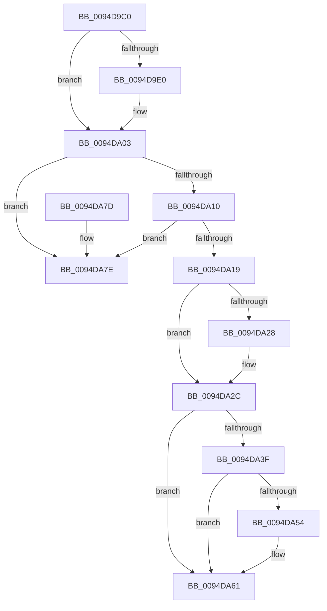

# PiSwBusRelationRemove

- RVA: `0x0094D9C0`–`0x0094DA85` (길이 `197` bytes)
- VA: `0x000000014094D9C0`
- 실행 섹션: `PAGE`
- PDB 이름 있음: `예`; PDB Function 태그: `아니요`
- unwind 정보 RVA: `0x0009194C`
- 디코드: `55`개 명령, `197/197` bytes 표시
- 미해석 바이트: `0` (있으면 어셈블리에 `.byte`로 보존)

> 이 문서는 커널 이미지의 기계어와 PDB 기호를 분석해 생성했습니다. 4번과 5번은 함수 원형과 자료형을 바이너리 사용 방식에서 추정한 C 해석이며 원본 소스 복구 결과는 아닙니다.

## 1. Dependencies

- 직접 호출 지점: **4**; 고유 호출 대상: **4**
- 직접 호출자로 확인된 함수: **3**
- RIP 상대 이미지 참조: **3**

### Outgoing calls
- `0x0094D9FE` → [McTemplateK0zzz_EtwWriteTransfer](../../text/5A/McTemplateK0zzz_EtwWriteTransfer_function_005A96BC.md) (function, `0x005A96BC`)
- `0x0094DA4A` → [RtlDeleteElementGenericTableAvl](../../text/3E/RtlDeleteElementGenericTableAvl_function_003EE750.md) (function, `0x003EE750`)
- `0x0094DA5C` → [ExFreePoolWithTag](../../poolcode/B8/ExFreePoolWithTag_function_00B82870.md) (function, `0x00B82870`)
- `0x0094DA68` → [PiSwDeviceDereference](PiSwDeviceDereference_function_0094E8A8.md) (function, `0x0094E8A8`)

### Direct callers
- [PiSwProcessRemove](PiSwProcessRemove_function_0094E3B8.md) at `0x0094E463`
- [PiSwCloseDevice](../AA/PiSwCloseDevice_function_00AAB6F4.md) at `0x00AAB798`
- [sub_00B1C4F6](../B1/Unknown_function_00B1C4F6.md) at `0x00B1C6F4`
- [sub_00B1C4F6](../B1/Unknown_function_00B1C4F6.md) at `0x00B1C87B`

### Static image references
- `0x0094D9D0` → RVA `0x00EF012C` (`.data`; read)
- `0x0094D9F3` → RVA `0x00027410` (`.rdata`; read)
- `0x0094DA43` → RVA `0x00F8ABA0` (`.data`; read)

## 2. Other-region calls and transfers

- 다른 실행 섹션으로 향하는 call: **3**
  - `0x0094D9FE` → [McTemplateK0zzz_EtwWriteTransfer](../../text/5A/McTemplateK0zzz_EtwWriteTransfer_function_005A96BC.md) (`PAGE` → `.text`)
  - `0x0094DA4A` → [RtlDeleteElementGenericTableAvl](../../text/3E/RtlDeleteElementGenericTableAvl_function_003EE750.md) (`PAGE` → `.text`)
  - `0x0094DA5C` → [ExFreePoolWithTag](../../poolcode/B8/ExFreePoolWithTag_function_00B82870.md) (`PAGE` → `POOLCODE`)
- 별도 외부 분기/꼬리 이동을 확인하지 못했습니다.

## 3. Assembly (complete function range)

```asm
0094D9C0  4C 8B DC                        mov r11, rsp
0094D9C3  49 89 5B 08                     mov qword ptr [r11 + 8], rbx
0094D9C7  49 89 73 10                     mov qword ptr [r11 + 0x10], rsi
0094D9CB  57                              push rdi
0094D9CC  48 83 EC 30                     sub rsp, 0x30
0094D9D0  F6 05 55 27 5A 00 40            test byte ptr [rip + 0x5a2755], 0x40
0094D9D7  48 8D 79 70                     lea rdi, [rcx + 0x70]
0094D9DB  48 8B D9                        mov rbx, rcx
0094D9DE  74 23                           je 0x14094da03
0094D9E0  48 8B 07                        mov rax, qword ptr [rdi]
0094D9E3  4C 8B 49 08                     mov r9, qword ptr [rcx + 8]
0094D9E7  48 8B 50 08                     mov rdx, qword ptr [rax + 8]
0094D9EB  48 8B 41 10                     mov rax, qword ptr [rcx + 0x10]
0094D9EF  49 89 53 F0                     mov qword ptr [r11 - 0x10], rdx
0094D9F3  48 8D 15 16 9A 6D FF            lea rdx, [rip - 0x9265ea]
0094D9FA  49 89 43 E8                     mov qword ptr [r11 - 0x18], rax
0094D9FE  E8 B9 BC C5 FF                  call 0x1405a96bc
0094DA03  48 8D 43 60                     lea rax, [rbx + 0x60]
0094DA07  48 8B 10                        mov rdx, qword ptr [rax]
0094DA0A  48 39 42 08                     cmp qword ptr [rdx + 8], rax
0094DA0E  75 6E                           jne 0x14094da7e
0094DA10  48 8B 48 08                     mov rcx, qword ptr [rax + 8]
0094DA14  48 39 01                        cmp qword ptr [rcx], rax
0094DA17  75 65                           jne 0x14094da7e
0094DA19  48 89 11                        mov qword ptr [rcx], rdx
0094DA1C  48 8B F7                        mov rsi, rdi
0094DA1F  48 89 4A 08                     mov qword ptr [rdx + 8], rcx
0094DA23  48 3B CA                        cmp rcx, rdx
0094DA26  74 04                           je 0x14094da2c
0094DA28  48 8D 73 70                     lea rsi, [rbx + 0x70]
0094DA2C  48 89 40 08                     mov qword ptr [rax + 8], rax
0094DA30  48 89 00                        mov qword ptr [rax], rax
0094DA33  48 8B 17                        mov rdx, qword ptr [rdi]
0094DA36  48 8D 42 10                     lea rax, [rdx + 0x10]
0094DA3A  48 39 00                        cmp qword ptr [rax], rax
0094DA3D  75 22                           jne 0x14094da61
0094DA3F  48 8B 7A 08                     mov rdi, qword ptr [rdx + 8]
0094DA43  48 8D 0D 56 D1 63 00            lea rcx, [rip + 0x63d156]
0094DA4A  E8 01 0D AA FF                  call 0x1403ee750
0094DA4F  48 85 FF                        test rdi, rdi
0094DA52  74 0D                           je 0x14094da61
0094DA54  BA 50 6E 70 57                  mov edx, 0x57706e50
0094DA59  48 8B CF                        mov rcx, rdi
0094DA5C  E8 0F 4E 23 00                  call 0x140b82870
0094DA61  48 83 26 00                     and qword ptr [rsi], 0
0094DA65  48 8B CB                        mov rcx, rbx
0094DA68  E8 3B 0E 00 00                  call 0x14094e8a8
0094DA6D  48 8B 5C 24 40                  mov rbx, qword ptr [rsp + 0x40]
0094DA72  48 8B 74 24 48                  mov rsi, qword ptr [rsp + 0x48]
0094DA77  48 83 C4 30                     add rsp, 0x30
0094DA7B  5F                              pop rdi
0094DA7C  C3                              ret
0094DA7D  CC                              int3
0094DA7E  B9 03 00 00 00                  mov ecx, 3
0094DA83  CD 29                           int 0x29
```

## 4. C-style interpretation (structured pseudocode)

```c
__int64 __fastcall PiSwBusRelationRemove(__int64 a1)
{
    __int64 result;
    __int64 v_rsi;
    __int64 v_rsp;
    unsigned __int64 v_stack_p10;
    unsigned __int64 v_stack_p8;

    *(unsigned __int64 *)(v_rsp + 8) = v_rbx;
    *(unsigned __int64 *)(v_rsp + 16) = v_rsi;
    v_rsp = (v_rsp) - (48);
    if (((*(unsigned __int8 *)(v_rip + 5908309)) & (64)) != 0) {
        result = *(unsigned __int64 *)(a1 + 112);
        a4 = *(unsigned __int64 *)(a1 + 8);
        a2 = *(unsigned __int64 *)(result + 8);
        result = *(unsigned __int64 *)(a1 + 16);
        *(unsigned __int64 *)(v_rsp - 16) = a2;
        a2 = v_rip - 9594346;
        *(unsigned __int64 *)(v_rsp - 24) = result;
        result = McTemplateK0zzz_EtwWriteTransfer(a1, a2, a3, a4);
    }
    if ((*(unsigned __int64 *)(*(unsigned __int64 *)(a1 + 96) + 8)) != (a1 + 96)) goto loc_0094DA7E;
    if ((*(unsigned __int64 *)(*(unsigned __int64 *)(a1 + 96 + 8))) != (a1 + 96)) goto loc_0094DA7E;
    *(unsigned __int64 *)(*(unsigned __int64 *)(a1 + 96 + 8)) = *(unsigned __int64 *)(a1 + 96);
    *(unsigned __int64 *)(*(unsigned __int64 *)(a1 + 96) + 8) = *(unsigned __int64 *)(a1 + 96 + 8);
    v_rsi = a1 + 112;
    if ((*(unsigned __int64 *)(a1 + 96 + 8)) != (*(unsigned __int64 *)(a1 + 96))) {
        v_rsi = a1 + 112;
    }
    *(unsigned __int64 *)(a1 + 96 + 8) = a1 + 96;
    *(unsigned __int64 *)(a1 + 96) = a1 + 96;
    if ((*(unsigned __int64 *)(*(unsigned __int64 *)(a1 + 112) + 16)) != (*(unsigned __int64 *)(a1 + 112) + 16)) goto loc_0094DA61;
    result = RtlDeleteElementGenericTableAvl(v_rip + 6541654, *(unsigned __int64 *)(a1 + 112), a3, a4);
    if (*(unsigned __int64 *)(*(unsigned __int64 *)(a1 + 112) + 8) != 0) {
        a2 = 0x57706E50ULL;
        a1 = *(unsigned __int64 *)(*(unsigned __int64 *)(a1 + 112) + 8);
        result = ExFreePoolWithTag(a1, a2, a3, a4);
    }
    result = PiSwDeviceDereference(a1, a2, a3, a4);
    v_rsp = (v_rsp) + (48);
    return result;
loc_0094DA7E:
    return result;
}
```

## 5. (Beta) C Style

```c
int64_t PiSwBusRelationRemove(void *Arg1)
{
    uint8_t *arg1 = (uint8_t *)Arg1;

    int64_t result;
    int64_t local_rsi;
    int64_t local_rsp;
    uint64_t v_stack_p10;
    uint64_t v_stack_p8;

    *(uint64_t *)(local_rsp + 0x8) = local_rbx;
    *(uint64_t *)(local_rsp + 0x10) = local_rsi;
    local_rsp = (local_rsp) - (48);
    if (((*(uint8_t *)(v_rip + 0x5A2755)) & (64)) != 0) {
        result = *(uint64_t *)(arg1 + 0x70);
        a4 = *(uint64_t *)(arg1 + 0x8);
        a2 = *(uint64_t *)(result + 0x8);
        result = *(uint64_t *)(arg1 + 0x10);
        *(uint64_t *)(local_rsp - 0x10) = a2;
        a2 = v_rip - 9594346;
        *(uint64_t *)(local_rsp - 0x18) = result;
        result = McTemplateK0zzz_EtwWriteTransfer(Arg1, a2, a3, a4);
    }
    if ((*(uint64_t *)(*(uint64_t *)(arg1 + 0x60) + 0x8)) != (Arg1 + 96)) goto loc_0094DA7E;
    if ((*(uint64_t *)(*(uint64_t *)(arg1 + 0x60 + 0x8))) != (Arg1 + 96)) goto loc_0094DA7E;
    *(uint64_t *)(*(uint64_t *)(arg1 + 0x60 + 0x8)) = *(uint64_t *)(arg1 + 0x60);
    *(uint64_t *)(*(uint64_t *)(arg1 + 0x60) + 0x8) = *(uint64_t *)(arg1 + 0x60 + 0x8);
    local_rsi = Arg1 + 112;
    if ((*(uint64_t *)(arg1 + 0x60 + 0x8)) != (*(uint64_t *)(arg1 + 0x60))) {
        local_rsi = Arg1 + 112;
    }
    *(void **)(arg1 + 0x60 + 0x8) = Arg1 + 96;
    *(void **)(arg1 + 0x60) = Arg1 + 96;
    if ((*(uint64_t *)(*(uint64_t *)(arg1 + 0x70) + 0x10)) != (*(uint64_t *)(arg1 + 0x70) + 16)) goto loc_0094DA61;
    result = RtlDeleteElementGenericTableAvl(v_rip + 6541654, *(uint64_t *)(arg1 + 0x70), a3, a4);
    if (*(uint64_t *)(*(uint64_t *)(arg1 + 0x70) + 0x8) != 0) {
        a2 = 0x57706E50ULL;
        Arg1 = *(uint64_t *)(*(uint64_t *)(arg1 + 0x70) + 0x8);
        result = ExFreePoolWithTag(Arg1, a2, a3, a4);
    }
    result = PiSwDeviceDereference(Arg1, a2, a3, a4);
    local_rsp = (local_rsp) + (48);
    return result;
loc_0094DA7E:
    return result;
}
```

### 관측된 메모리 오프셋

구조체 형식이 확인되지 않은 접근은 인자 기준의 오프셋으로만 기록했습니다.

| 기준 인자 | 오프셋 표현 | 폭 (bit) | 접근 |
|---|---:|---:|---|
| `Arg1` | `+ 0x0` | `64` | `R` |
| `Arg1` | `+ 0x0` | `64` | `R/W` |
| `Arg1` | `+ 0x0` | `64` | `W` |
| `Arg1` | `+ 0x8` | `64` | `R` |
| `Arg1` | `+ 0x8` | `64` | `W` |
| `Arg1` | `+ 0x10` | `64` | `R` |
| `Arg1` | `+ 0x60` | `64` | `R` |
| `Arg1` | `+ 0x70` | `64` | `R` |

## 6. Execution-region graph

[열기: 2D/3D 그래프와 함수 탐색 컨트롤 패널](../../../control-panel.html?section=page&rva=0x0094D9C0&view=graph)

- 2D 그래프는 위에서 아래로 흐르고, 3D 그래프는 빈 공간을 드래그해 회전합니다. Shift+드래그는 이동, 휠은 확대·축소, 함수 노드 선택은 대상 보고서 이동입니다.

### Static fallback


