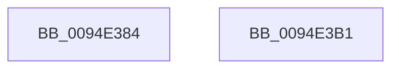

# PiSwDestroyDeviceObject

- RVA: `0x0094E384`–`0x0094E3B2` (길이 `46` bytes)
- VA: `0x000000014094E384`
- 실행 섹션: `PAGE`
- PDB 이름 있음: `예`; PDB Function 태그: `아니요`
- unwind 정보 RVA: `0x0005CAAC`
- 디코드: `14`개 명령, `46/46` bytes 표시
- 미해석 바이트: `0` (있으면 어셈블리에 `.byte`로 보존)

> 이 문서는 커널 이미지의 기계어와 PDB 기호를 분석해 생성했습니다. 4번과 5번은 함수 원형과 자료형을 바이너리 사용 방식에서 추정한 C 해석이며 원본 소스 복구 결과는 아닙니다.

## 1. Dependencies

- 직접 호출 지점: **2**; 고유 호출 대상: **2**
- 직접 호출자로 확인된 함수: **2**
- RIP 상대 이미지 참조: **0**

### Outgoing calls
- `0x0094E395` → [PiSwUnassociateDeviceObject](PiSwUnassociateDeviceObject_function_0094E868.md) (function, `0x0094E868`)
- `0x0094E3A1` → [IoDeleteDevice](../../text/26/IoDeleteDevice_function_0026FE90.md) (function, `0x0026FE90`)

### Direct callers
- [PiSwProcessParentRemoveIrp](../8F/PiSwProcessParentRemoveIrp_function_008FCD6C.md) at `0x008FCE01`
- [PiSwPdoPnPDispatch](PiSwPdoPnPDispatch_function_0094DDF0.md) at `0x0094E017`

### Static image references
- 디코드된 RIP-relative 메모리 참조가 없습니다.

## 2. Other-region calls and transfers

- 다른 실행 섹션으로 향하는 call: **1**
  - `0x0094E3A1` → [IoDeleteDevice](../../text/26/IoDeleteDevice_function_0026FE90.md) (`PAGE` → `.text`)
- 별도 외부 분기/꼬리 이동을 확인하지 못했습니다.

## 3. Assembly (complete function range)

```asm
0094E384  48 89 5C 24 08                  mov qword ptr [rsp + 8], rbx
0094E389  57                              push rdi
0094E38A  48 83 EC 20                     sub rsp, 0x20
0094E38E  48 8B 59 40                     mov rbx, qword ptr [rcx + 0x40]
0094E392  48 8B F9                        mov rdi, rcx
0094E395  E8 CE 04 00 00                  call 0x14094e868
0094E39A  83 4B 08 10                     or dword ptr [rbx + 8], 0x10
0094E39E  48 8B CF                        mov rcx, rdi
0094E3A1  E8 EA 1A 92 FF                  call 0x14026fe90
0094E3A6  48 8B 5C 24 30                  mov rbx, qword ptr [rsp + 0x30]
0094E3AB  48 83 C4 20                     add rsp, 0x20
0094E3AF  5F                              pop rdi
0094E3B0  C3                              ret
0094E3B1  CC                              int3
```

## 4. C-style interpretation (structured pseudocode)

```c
__int64 __fastcall PiSwDestroyDeviceObject(__int64 a1)
{
    __int64 result;
    __int64 v_rsp;
    unsigned __int64 v_stack_p8;

    v_stack_p8 = v_rbx;
    v_rsp = (v_rsp) - (32);
    result = PiSwUnassociateDeviceObject(a1, a2, a3, a4);
    result = IoDeleteDevice(a1, a2, a3, a4);
    v_rsp = (v_rsp) + (32);
    return result;
}
```

## 5. (Beta) C Style

```c
int64_t PiSwDestroyDeviceObject(void *Arg1)
{
    uint8_t *arg1 = (uint8_t *)Arg1;

    int64_t result;
    int64_t local_rsp;
    uint64_t v_stack_p8;

    v_stack_p8 = local_rbx;
    local_rsp = (local_rsp) - (32);
    result = PiSwUnassociateDeviceObject(Arg1, a2, a3, a4);
    result = IoDeleteDevice(Arg1, a2, a3, a4);
    local_rsp = (local_rsp) + (32);
    return result;
}
```

### 관측된 메모리 오프셋

구조체 형식이 확인되지 않은 접근은 인자 기준의 오프셋으로만 기록했습니다.

| 기준 인자 | 오프셋 표현 | 폭 (bit) | 접근 |
|---|---:|---:|---|
| `Arg1` | `+ 0x40` | `64` | `R` |

## 6. Execution-region graph

[열기: 2D/3D 그래프와 함수 탐색 컨트롤 패널](../../../control-panel.html?section=page&rva=0x0094E384&view=graph)

- 2D 그래프는 위에서 아래로 흐르고, 3D 그래프는 빈 공간을 드래그해 회전합니다. Shift+드래그는 이동, 휠은 확대·축소, 함수 노드 선택은 대상 보고서 이동입니다.

### Static fallback


