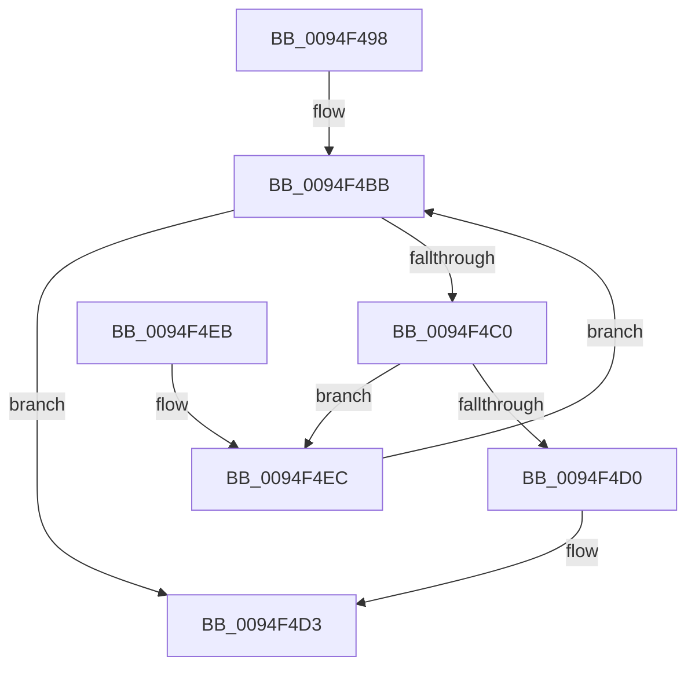

# PiSwDeviceFindInterfaceEntry

- RVA: `0x0094F498`–`0x0094F4F1` (길이 `89` bytes)
- VA: `0x000000014094F498`
- 실행 섹션: `PAGE`
- PDB 이름 있음: `예`; PDB Function 태그: `아니요`
- unwind 정보 RVA: `0x00091B44`
- 디코드: `27`개 명령, `89/89` bytes 표시
- 미해석 바이트: `0` (있으면 어셈블리에 `.byte`로 보존)

> 이 문서는 커널 이미지의 기계어와 PDB 기호를 분석해 생성했습니다. 4번과 5번은 함수 원형과 자료형을 바이너리 사용 방식에서 추정한 C 해석이며 원본 소스 복구 결과는 아닙니다.

## 1. Dependencies

- 직접 호출 지점: **1**; 고유 호출 대상: **1**
- 직접 호출자로 확인된 함수: **3**
- RIP 상대 이미지 참조: **0**

### Outgoing calls
- `0x0094F4C7` → [wcsicmp](../../text/50/wcsicmp_function_00500080.md) (function, `0x00500080`)

### Direct callers
- [PiSwIrpInterfacePropertySet](../8F/PiSwIrpInterfacePropertySet_function_008F7900.md) at `0x008F7A16`
- [PiSwIrpInterfaceSetState](PiSwIrpInterfaceSetState_function_0094DC24.md) at `0x0094DD10`
- [PiSwIrpInterfaceRegister](PiSwIrpInterfaceRegister_function_0094F01C.md) at `0x0094F2A3`

### Static image references
- 디코드된 RIP-relative 메모리 참조가 없습니다.

## 2. Other-region calls and transfers

- 다른 실행 섹션으로 향하는 call: **1**
  - `0x0094F4C7` → [wcsicmp](../../text/50/wcsicmp_function_00500080.md) (`PAGE` → `.text`)
- 별도 외부 분기/꼬리 이동을 확인하지 못했습니다.

## 3. Assembly (complete function range)

```asm
0094F498  48 89 5C 24 08                  mov qword ptr [rsp + 8], rbx
0094F49D  48 89 6C 24 10                  mov qword ptr [rsp + 0x10], rbp
0094F4A2  48 89 74 24 18                  mov qword ptr [rsp + 0x18], rsi
0094F4A7  57                              push rdi
0094F4A8  48 83 EC 20                     sub rsp, 0x20
0094F4AC  48 8D B1 B8 00 00 00            lea rsi, [rcx + 0xb8]
0094F4B3  48 8B EA                        mov rbp, rdx
0094F4B6  48 8B 1E                        mov rbx, qword ptr [rsi]
0094F4B9  33 FF                           xor edi, edi
0094F4BB  48 3B DE                        cmp rbx, rsi
0094F4BE  74 13                           je 0x14094f4d3
0094F4C0  48 8B 53 10                     mov rdx, qword ptr [rbx + 0x10]
0094F4C4  48 8B CD                        mov rcx, rbp
0094F4C7  E8 B4 0B BB FF                  call 0x140500080
0094F4CC  85 C0                           test eax, eax
0094F4CE  75 1C                           jne 0x14094f4ec
0094F4D0  48 8B FB                        mov rdi, rbx
0094F4D3  48 8B 5C 24 30                  mov rbx, qword ptr [rsp + 0x30]
0094F4D8  48 8B C7                        mov rax, rdi
0094F4DB  48 8B 6C 24 38                  mov rbp, qword ptr [rsp + 0x38]
0094F4E0  48 8B 74 24 40                  mov rsi, qword ptr [rsp + 0x40]
0094F4E5  48 83 C4 20                     add rsp, 0x20
0094F4E9  5F                              pop rdi
0094F4EA  C3                              ret
0094F4EB  CC                              int3
0094F4EC  48 8B 1B                        mov rbx, qword ptr [rbx]
0094F4EF  EB CA                           jmp 0x14094f4bb
```

## 4. C-style interpretation (structured pseudocode)

```c
__int64 __fastcall PiSwDeviceFindInterfaceEntry(__int64 a1, __int64 a2)
{
    __int64 result;
    __int64 v_rdi;
    __int64 v_rsp;
    unsigned __int64 v_stack_p10;
    unsigned __int64 v_stack_p18;
    unsigned __int64 v_stack_p8;

    v_stack_p8 = v_rbx;
    v_stack_p10 = v_rbp;
    v_stack_p18 = v_rsi;
    v_rsp = (v_rsp) - (32);
    v_rdi = 0;
loc_0094F4BB:
    if ((*(unsigned __int64 *)(a1 + 184)) == (a1 + 184)) goto loc_0094F4D3;
    result = wcsicmp(a2, *(unsigned __int64 *)(*(unsigned __int64 *)(a1 + 184) + 16), a3, a4);
    if ((unsigned int)(result) != 0) goto loc_0094F4EC;
loc_0094F4D3:
    v_rsp = (v_rsp) + (32);
    return *(unsigned __int64 *)(a1 + 184);
loc_0094F4EC:
    goto loc_0094F4BB;
}
```

## 5. (Beta) C Style

```c
int64_t PiSwDeviceFindInterfaceEntry(void *Arg1, int64_t Arg2)
{
    uint8_t *arg1 = (uint8_t *)Arg1;

    int64_t result;
    int64_t local_rdi;
    int64_t local_rsp;
    uint64_t v_stack_p10;
    uint64_t v_stack_p18;
    uint64_t v_stack_p8;

    v_stack_p8 = local_rbx;
    v_stack_p10 = local_rbp;
    v_stack_p18 = local_rsi;
    local_rsp = (local_rsp) - (32);
    local_rdi = 0;
loc_0094F4BB:
    if ((*(uint64_t *)(arg1 + 0xB8)) == (Arg1 + 184)) goto loc_0094F4D3;
    result = wcsicmp(Arg2, *(uint64_t *)(*(uint64_t *)(arg1 + 0xB8) + 0x10), a3, a4);
    if ((uint32_t)(result) != 0) goto loc_0094F4EC;
loc_0094F4D3:
    local_rsp = (local_rsp) + (32);
    return *(uint64_t *)(arg1 + 0xB8);
loc_0094F4EC:
    goto loc_0094F4BB;
}
```

### 관측된 메모리 오프셋

구조체 형식이 확인되지 않은 접근은 인자 기준의 오프셋으로만 기록했습니다.

| 기준 인자 | 오프셋 표현 | 폭 (bit) | 접근 |
|---|---:|---:|---|
| `Arg1` | `+ 0x0` | `64` | `R` |
| `Arg1` | `+ 0xB8` | `64` | `R` |

## 6. Execution-region graph

[열기: 2D/3D 그래프와 함수 탐색 컨트롤 패널](../../../control-panel.html?section=page&rva=0x0094F498&view=graph)

- 2D 그래프는 위에서 아래로 흐르고, 3D 그래프는 빈 공간을 드래그해 회전합니다. Shift+드래그는 이동, 휠은 확대·축소, 함수 노드 선택은 대상 보고서 이동입니다.

### Static fallback


