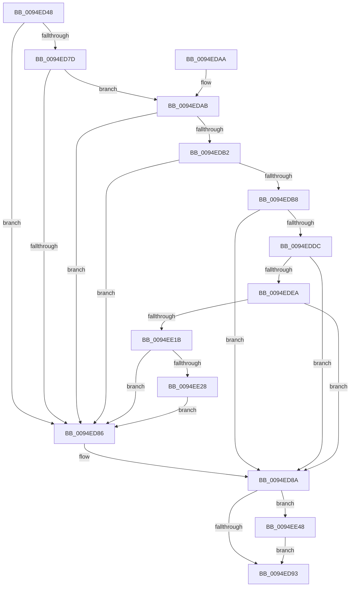

# PiSwDeviceInterfaceSetState

- RVA: `0x0094ED48`–`0x0094EE5A` (길이 `274` bytes)
- VA: `0x000000014094ED48`
- 실행 섹션: `PAGE`
- PDB 이름 있음: `예`; PDB Function 태그: `아니요`
- unwind 정보 RVA: `0x00091ACC`
- 디코드: `77`개 명령, `274/274` bytes 표시
- 미해석 바이트: `0` (있으면 어셈블리에 `.byte`로 보존)

> 이 문서는 커널 이미지의 기계어와 PDB 기호를 분석해 생성했습니다. 4번과 5번은 함수 원형과 자료형을 바이너리 사용 방식에서 추정한 C 해석이며 원본 소스 복구 결과는 아닙니다.

## 1. Dependencies

- 직접 호출 지점: **6**; 고유 호출 대상: **6**
- 직접 호출자로 확인된 함수: **2**
- RIP 상대 이미지 참조: **1**

### Outgoing calls
- `0x0094EDCC` → [PnpAllocatePWSTR](../8D/PnpAllocatePWSTR_function_008DE620.md) (function, `0x008DE620`)
- `0x0094EDDF` → [CmValidateDeviceInterfaceName](../8F/CmValidateDeviceInterfaceName_function_008F1A40.md) (function, `0x008F1A40`)
- `0x0094EDFF` → [RtlInitUnicodeString](../../text/42/RtlInitUnicodeString_function_0042A780.md) (function, `0x0042A780`)
- `0x0094EE0C` → [IoSetDeviceInterfaceState](../95/IoSetDeviceInterfaceState_function_00950740.md) (function, `0x00950740`)
- `0x0094EE3E` → [McTemplateK0zzzt_EtwWriteTransfer](../../text/5A/McTemplateK0zzzt_EtwWriteTransfer_function_005A9A94.md) (function, `0x005A9A94`)
- `0x0094EE50` → [ExFreePoolWithTag](../../poolcode/B8/ExFreePoolWithTag_function_00B82870.md) (function, `0x00B82870`)

### Direct callers
- [PiSwIrpInterfaceSetState](PiSwIrpInterfaceSetState_function_0094DC24.md) at `0x0094DD2D`
- [PiSwIrpInterfaceRegister](PiSwIrpInterfaceRegister_function_0094F01C.md) at `0x0094F32B`

### Static image references
- `0x0094EE1B` → RVA `0x00EF012C` (`.data`; read)

## 2. Other-region calls and transfers

- 다른 실행 섹션으로 향하는 call: **3**
  - `0x0094EDFF` → [RtlInitUnicodeString](../../text/42/RtlInitUnicodeString_function_0042A780.md) (`PAGE` → `.text`)
  - `0x0094EE3E` → [McTemplateK0zzzt_EtwWriteTransfer](../../text/5A/McTemplateK0zzzt_EtwWriteTransfer_function_005A9A94.md) (`PAGE` → `.text`)
  - `0x0094EE50` → [ExFreePoolWithTag](../../poolcode/B8/ExFreePoolWithTag_function_00B82870.md) (`PAGE` → `POOLCODE`)
- 별도 외부 분기/꼬리 이동을 확인하지 못했습니다.

## 3. Assembly (complete function range)

```asm
0094ED48  48 8B C4                        mov rax, rsp
0094ED4B  48 89 58 10                     mov qword ptr [rax + 0x10], rbx
0094ED4F  48 89 68 18                     mov qword ptr [rax + 0x18], rbp
0094ED53  56                              push rsi
0094ED54  57                              push rdi
0094ED55  41 56                           push r14
0094ED57  48 83 EC 50                     sub rsp, 0x50
0094ED5B  33 DB                           xor ebx, ebx
0094ED5D  41 0F B6 F0                     movzx esi, r8b
0094ED61  0F 57 C0                        xorps xmm0, xmm0
0094ED64  48 89 58 08                     mov qword ptr [rax + 8], rbx
0094ED68  0F 11 40 D8                     movups xmmword ptr [rax - 0x28], xmm0
0094ED6C  48 8B 41 78                     mov rax, qword ptr [rcx + 0x78]
0094ED70  33 FF                           xor edi, edi
0094ED72  48 8B EA                        mov rbp, rdx
0094ED75  4C 8B F1                        mov r14, rcx
0094ED78  48 85 C0                        test rax, rax
0094ED7B  74 09                           je 0x14094ed86
0094ED7D  48 8B 40 40                     mov rax, qword ptr [rax + 0x40]
0094ED81  48 85 C0                        test rax, rax
0094ED84  75 25                           jne 0x14094edab
0094ED86  40 88 75 24                     mov byte ptr [rbp + 0x24], sil
0094ED8A  48 85 DB                        test rbx, rbx
0094ED8D  0F 85 B5 00 00 00               jne 0x14094ee48
0094ED93  4C 8D 5C 24 50                  lea r11, [rsp + 0x50]
0094ED98  8B C7                           mov eax, edi
0094ED9A  49 8B 5B 28                     mov rbx, qword ptr [r11 + 0x28]
0094ED9E  49 8B 6B 30                     mov rbp, qword ptr [r11 + 0x30]
0094EDA2  49 8B E3                        mov rsp, r11
0094EDA5  41 5E                           pop r14
0094EDA7  5F                              pop rdi
0094EDA8  5E                              pop rsi
0094EDA9  C3                              ret
0094EDAA  CC                              int3
0094EDAB  8B 40 08                        mov eax, dword ptr [rax + 8]
0094EDAE  A8 01                           test al, 1
0094EDB0  74 D4                           je 0x14094ed86
0094EDB2  40 38 72 24                     cmp byte ptr [rdx + 0x24], sil
0094EDB6  74 CE                           je 0x14094ed86
0094EDB8  48 8B 4D 10                     mov rcx, qword ptr [rbp + 0x10]
0094EDBC  4C 8D 4C 24 70                  lea r9, [rsp + 0x70]
0094EDC1  BA FF FF FF 7F                  mov edx, 0x7fffffff
0094EDC6  41 B8 50 6E 70 57               mov r8d, 0x57706e50
0094EDCC  E8 4F F8 F8 FF                  call 0x1408de620
0094EDD1  48 8B 5C 24 70                  mov rbx, qword ptr [rsp + 0x70]
0094EDD6  8B F8                           mov edi, eax
0094EDD8  85 C0                           test eax, eax
0094EDDA  78 AE                           js 0x14094ed8a
0094EDDC  48 8B D3                        mov rdx, rbx
0094EDDF  E8 5C 2C FA FF                  call 0x1408f1a40
0094EDE4  8B F8                           mov edi, eax
0094EDE6  85 C0                           test eax, eax
0094EDE8  78 A0                           js 0x14094ed8a
0094EDEA  48 B8 5C 00 3F 00 3F 00 5C 00   movabs rax, 0x5c003f003f005c
0094EDF4  48 8D 4C 24 40                  lea rcx, [rsp + 0x40]
0094EDF9  48 8B D3                        mov rdx, rbx
0094EDFC  48 89 03                        mov qword ptr [rbx], rax
0094EDFF  E8 7C B9 AD FF                  call 0x14042a780
0094EE04  40 8A D6                        mov dl, sil
0094EE07  48 8D 4C 24 40                  lea rcx, [rsp + 0x40]
0094EE0C  E8 2F 19 00 00                  call 0x140950740
0094EE11  8B F8                           mov edi, eax
0094EE13  85 C0                           test eax, eax
0094EE15  0F 88 6F FF FF FF               js 0x14094ed8a
0094EE1B  F6 05 0A 13 5A 00 40            test byte ptr [rip + 0x5a130a], 0x40
0094EE22  0F 84 5E FF FF FF               je 0x14094ed86
0094EE28  49 8B 46 10                     mov rax, qword ptr [r14 + 0x10]
0094EE2C  4D 8B 4E 08                     mov r9, qword ptr [r14 + 8]
0094EE30  89 74 24 30                     mov dword ptr [rsp + 0x30], esi
0094EE34  48 89 5C 24 28                  mov qword ptr [rsp + 0x28], rbx
0094EE39  48 89 44 24 20                  mov qword ptr [rsp + 0x20], rax
0094EE3E  E8 51 AC C5 FF                  call 0x1405a9a94
0094EE43  E9 3E FF FF FF                  jmp 0x14094ed86
0094EE48  BA 50 6E 70 57                  mov edx, 0x57706e50
0094EE4D  48 8B CB                        mov rcx, rbx
0094EE50  E8 1B 3A 23 00                  call 0x140b82870
0094EE55  E9 39 FF FF FF                  jmp 0x14094ed93
```

## 4. C-style interpretation (structured pseudocode)

```c
__int64 __fastcall PiSwDeviceInterfaceSetState(__int64 a1, __int64 a2, unsigned __int8 a3)
{
    __int64 result;
    __int64 v_rbx;
    __int64 v_rdi;
    __int64 v_rsp;
    unsigned __int64 v_stack_m10;
    unsigned __int64 v_stack_m18;
    unsigned int v_stack_m20;
    unsigned __int64 v_stack_m28;
    unsigned __int64 v_stack_m30;
    unsigned __int64 v_stack_p20;

    *(unsigned __int64 *)(v_rsp + 16) = v_rbx;
    *(unsigned __int64 *)(v_rsp + 24) = v_rbp;
    v_rsp = (v_rsp) - (80);
    v_rbx = 0;
    *(unsigned __int64 *)(v_rsp + 8) = 0;
    *(unsigned __int64 *)(v_rsp - 40) = v_xmm0;
    v_rdi = 0;
    if (*(unsigned __int64 *)(a1 + 120) == 0) goto loc_0094ED86;
    if (*(unsigned __int64 *)(*(unsigned __int64 *)(a1 + 120) + 64) != 0) goto loc_0094EDAB;
loc_0094ED86:
    *(unsigned __int8 *)(a2 + 36) = a3;
loc_0094ED8A:
    if (0 != 0) goto loc_0094EE48;
loc_0094ED93:
    return 0;
loc_0094EDAB:
    if ((((unsigned __int8)((unsigned int)(*(unsigned int *)(0 + 8)))) & (1)) == 0) goto loc_0094ED86;
    if ((*(unsigned __int8 *)(a2 + 36)) == a3) goto loc_0094ED86;
    result = PnpAllocatePWSTR(*(unsigned __int64 *)(*(unsigned __int64 *)(v_stack_m18 + 48) + 16), (unsigned int)(0x7FFFFFFFULL), (unsigned int)(0x57706E50ULL), v_stack_p20);
    if (sign_flag) goto loc_0094ED8A;
    result = CmValidateDeviceInterfaceName(*(unsigned __int64 *)(*(unsigned __int64 *)(v_stack_m18 + 48) + 16), v_stack_p20, (unsigned int)(0x57706E50ULL), v_stack_p20);
    if (sign_flag) goto loc_0094ED8A;
    *(unsigned __int64 *)(v_stack_p20) = result;
    result = RtlInitUnicodeString(v_stack_m10, v_stack_p20, (unsigned int)(0x57706E50ULL), v_stack_p20);
    result = IoSetDeviceInterfaceState(v_stack_m10, a3, (unsigned int)(0x57706E50ULL), v_stack_p20);
    if (sign_flag) goto loc_0094ED8A;
    if (((*(unsigned __int8 *)(v_rip + 5903114)) & (64)) == 0) goto loc_0094ED86;
    v_stack_m20 = a3;
    v_stack_m28 = v_stack_p20;
    v_stack_m30 = *(unsigned __int64 *)(a1 + 16);
    result = McTemplateK0zzzt_EtwWriteTransfer(v_stack_m10, a3, (unsigned int)(0x57706E50ULL), *(unsigned __int64 *)(a1 + 8));
    goto loc_0094ED86;
loc_0094EE48:
    result = ExFreePoolWithTag(v_stack_p20, (unsigned int)(0x57706E50ULL), (unsigned int)(0x57706E50ULL), *(unsigned __int64 *)(a1 + 8));
    goto loc_0094ED93;
}
```

## 5. (Beta) C Style

```c
int64_t PiSwDeviceInterfaceSetState(void *Arg1, void *Arg2, uint8_t Arg3)
{
    uint8_t *arg1 = (uint8_t *)Arg1;
    uint8_t *arg2 = (uint8_t *)Arg2;

    int64_t result;
    int64_t local_rbx;
    int64_t local_rdi;
    int64_t local_rsp;
    uint64_t v_stack_m10;
    uint64_t v_stack_m18;
    uint32_t v_stack_m20;
    uint64_t v_stack_m28;
    uint64_t v_stack_m30;
    uint64_t v_stack_p20;

    *(uint64_t *)(local_rsp + 0x10) = local_rbx;
    *(uint64_t *)(local_rsp + 0x18) = local_rbp;
    local_rsp = (local_rsp) - (80);
    local_rbx = 0;
    *(uint64_t *)(local_rsp + 0x8) = 0;
    *(uint64_t *)(local_rsp - 0x28) = v_xmm0;
    local_rdi = 0;
    if (*(uint64_t *)(arg1 + 0x78) == 0) goto loc_0094ED86;
    if (*(uint64_t *)(*(uint64_t *)(arg1 + 0x78) + 0x40) != 0) goto loc_0094EDAB;
loc_0094ED86:
    *(uint8_t *)(arg2 + 0x24) = Arg3;
loc_0094ED8A:
    if (0 != 0) goto loc_0094EE48;
loc_0094ED93:
    return 0;
loc_0094EDAB:
    if ((((uint8_t)((uint32_t)(*(uint32_t *)(0 + 0x8)))) & (1)) == 0) goto loc_0094ED86;
    if ((*(uint8_t *)(arg2 + 0x24)) == Arg3) goto loc_0094ED86;
    result = PnpAllocatePWSTR(*(uint64_t *)(*(uint64_t *)(v_stack_m18 + 0x30) + 0x10), (uint32_t)(0x7FFFFFFFULL), (uint32_t)(0x57706E50ULL), v_stack_p20);
    if (sign_flag) goto loc_0094ED8A;
    result = CmValidateDeviceInterfaceName(*(uint64_t *)(*(uint64_t *)(v_stack_m18 + 0x30) + 0x10), v_stack_p20, (uint32_t)(0x57706E50ULL), v_stack_p20);
    if (sign_flag) goto loc_0094ED8A;
    *(uint64_t *)(v_stack_p20) = result;
    result = RtlInitUnicodeString(v_stack_m10, v_stack_p20, (uint32_t)(0x57706E50ULL), v_stack_p20);
    result = IoSetDeviceInterfaceState(v_stack_m10, Arg3, (uint32_t)(0x57706E50ULL), v_stack_p20);
    if (sign_flag) goto loc_0094ED8A;
    if (((*(uint8_t *)(v_rip + 0x5A130A)) & (64)) == 0) goto loc_0094ED86;
    v_stack_m20 = Arg3;
    v_stack_m28 = v_stack_p20;
    v_stack_m30 = *(uint64_t *)(arg1 + 0x10);
    result = McTemplateK0zzzt_EtwWriteTransfer(v_stack_m10, Arg3, (uint32_t)(0x57706E50ULL), *(uint64_t *)(arg1 + 0x8));
    goto loc_0094ED86;
loc_0094EE48:
    result = ExFreePoolWithTag(v_stack_p20, (uint32_t)(0x57706E50ULL), (uint32_t)(0x57706E50ULL), *(uint64_t *)(arg1 + 0x8));
    goto loc_0094ED93;
}
```

### 관측된 메모리 오프셋

구조체 형식이 확인되지 않은 접근은 인자 기준의 오프셋으로만 기록했습니다.

| 기준 인자 | 오프셋 표현 | 폭 (bit) | 접근 |
|---|---:|---:|---|
| `Arg1` | `+ 0x8` | `64` | `R` |
| `Arg1` | `+ 0x10` | `64` | `R` |
| `Arg1` | `+ 0x78` | `64` | `R` |
| `Arg2` | `+ 0x10` | `64` | `R` |
| `Arg2` | `+ 0x24` | `8` | `R` |
| `Arg2` | `+ 0x24` | `8` | `W` |

## 6. Execution-region graph

[열기: 2D/3D 그래프와 함수 탐색 컨트롤 패널](../../../control-panel.html?section=page&rva=0x0094ED48&view=graph)

- 2D 그래프는 위에서 아래로 흐르고, 3D 그래프는 빈 공간을 드래그해 회전합니다. Shift+드래그는 이동, 휠은 확대·축소, 함수 노드 선택은 대상 보고서 이동입니다.

### Static fallback


