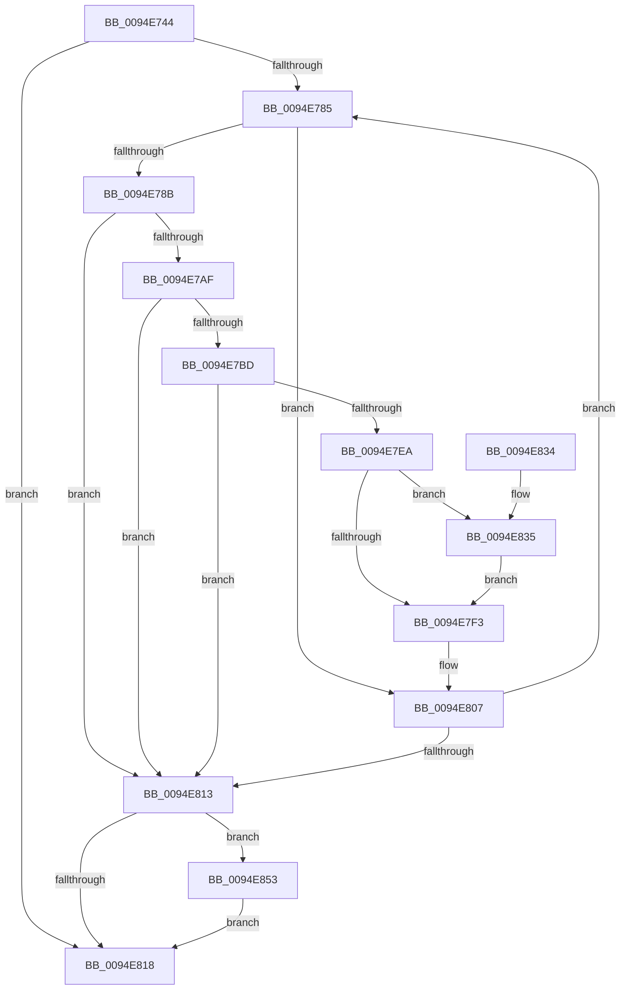

# PiSwDeviceInterfacesUpdateState

- RVA: `0x0094E744`–`0x0094E862` (길이 `286` bytes)
- VA: `0x000000014094E744`
- 실행 섹션: `PAGE`
- PDB 이름 있음: `예`; PDB Function 태그: `아니요`
- unwind 정보 RVA: `0x00091A34`
- 디코드: `80`개 명령, `286/286` bytes 표시
- 미해석 바이트: `0` (있으면 어셈블리에 `.byte`로 보존)

> 이 문서는 커널 이미지의 기계어와 PDB 기호를 분석해 생성했습니다. 4번과 5번은 함수 원형과 자료형을 바이너리 사용 방식에서 추정한 C 해석이며 원본 소스 복구 결과는 아닙니다.

## 1. Dependencies

- 직접 호출 지점: **7**; 고유 호출 대상: **6**
- 직접 호출자로 확인된 함수: **2**
- RIP 상대 이미지 참조: **1**

### Outgoing calls
- `0x0094E79F` → [PnpAllocatePWSTR](../8D/PnpAllocatePWSTR_function_008DE620.md) (function, `0x008DE620`)
- `0x0094E7B2` → [CmValidateDeviceInterfaceName](../8F/CmValidateDeviceInterfaceName_function_008F1A40.md) (function, `0x008F1A40`)
- `0x0094E7D2` → [RtlInitUnicodeString](../../text/42/RtlInitUnicodeString_function_0042A780.md) (function, `0x0042A780`)
- `0x0094E7DF` → [IoSetDeviceInterfaceState](../95/IoSetDeviceInterfaceState_function_00950740.md) (function, `0x00950740`)
- `0x0094E7FB` → [ExFreePoolWithTag](../../poolcode/B8/ExFreePoolWithTag_function_00B82870.md) (function, `0x00B82870`)
- `0x0094E84C` → [McTemplateK0zzzt_EtwWriteTransfer](../../text/5A/McTemplateK0zzzt_EtwWriteTransfer_function_005A9A94.md) (function, `0x005A9A94`)
- `0x0094E85B` → [ExFreePoolWithTag](../../poolcode/B8/ExFreePoolWithTag_function_00B82870.md) (function, `0x00B82870`)

### Direct callers
- [PiSwPdoPnPDispatch](PiSwPdoPnPDispatch_function_0094DDF0.md) at `0x0094E107`
- [PiSwPdoPnPDispatch](PiSwPdoPnPDispatch_function_0094DDF0.md) at `0x0094E223`
- [PiSwProcessRemove](PiSwProcessRemove_function_0094E3B8.md) at `0x0094E433`

### Static image references
- `0x0094E7EA` → RVA `0x00EF012C` (`.data`; read)

## 2. Other-region calls and transfers

- 다른 실행 섹션으로 향하는 call: **4**
  - `0x0094E7D2` → [RtlInitUnicodeString](../../text/42/RtlInitUnicodeString_function_0042A780.md) (`PAGE` → `.text`)
  - `0x0094E7FB` → [ExFreePoolWithTag](../../poolcode/B8/ExFreePoolWithTag_function_00B82870.md) (`PAGE` → `POOLCODE`)
  - `0x0094E84C` → [McTemplateK0zzzt_EtwWriteTransfer](../../text/5A/McTemplateK0zzzt_EtwWriteTransfer_function_005A9A94.md) (`PAGE` → `.text`)
  - `0x0094E85B` → [ExFreePoolWithTag](../../poolcode/B8/ExFreePoolWithTag_function_00B82870.md) (`PAGE` → `POOLCODE`)
- 별도 외부 분기/꼬리 이동을 확인하지 못했습니다.

## 3. Assembly (complete function range)

```asm
0094E744  48 8B C4                        mov rax, rsp
0094E747  48 89 58 10                     mov qword ptr [rax + 0x10], rbx
0094E74B  48 89 68 18                     mov qword ptr [rax + 0x18], rbp
0094E74F  48 89 70 20                     mov qword ptr [rax + 0x20], rsi
0094E753  57                              push rdi
0094E754  41 56                           push r14
0094E756  41 57                           push r15
0094E758  48 83 EC 50                     sub rsp, 0x50
0094E75C  4C 8D B1 B8 00 00 00            lea r14, [rcx + 0xb8]
0094E763  44 0F B6 FA                     movzx r15d, dl
0094E767  49 8B 3E                        mov rdi, qword ptr [r14]
0094E76A  33 DB                           xor ebx, ebx
0094E76C  33 F6                           xor esi, esi
0094E76E  48 89 58 08                     mov qword ptr [rax + 8], rbx
0094E772  0F 57 C0                        xorps xmm0, xmm0
0094E775  48 8B E9                        mov rbp, rcx
0094E778  0F 11 40 D8                     movups xmmword ptr [rax - 0x28], xmm0
0094E77C  49 3B FE                        cmp rdi, r14
0094E77F  0F 84 93 00 00 00               je 0x14094e818
0094E785  80 7F 24 00                     cmp byte ptr [rdi + 0x24], 0
0094E789  74 7C                           je 0x14094e807
0094E78B  48 8B 4F 10                     mov rcx, qword ptr [rdi + 0x10]
0094E78F  4C 8D 4C 24 70                  lea r9, [rsp + 0x70]
0094E794  BA FF FF FF 7F                  mov edx, 0x7fffffff
0094E799  41 B8 50 6E 70 57               mov r8d, 0x57706e50
0094E79F  E8 7C FE F8 FF                  call 0x1408de620
0094E7A4  48 8B 5C 24 70                  mov rbx, qword ptr [rsp + 0x70]
0094E7A9  8B F0                           mov esi, eax
0094E7AB  85 C0                           test eax, eax
0094E7AD  78 64                           js 0x14094e813
0094E7AF  48 8B D3                        mov rdx, rbx
0094E7B2  E8 89 32 FA FF                  call 0x1408f1a40
0094E7B7  8B F0                           mov esi, eax
0094E7B9  85 C0                           test eax, eax
0094E7BB  78 56                           js 0x14094e813
0094E7BD  48 B8 5C 00 3F 00 3F 00 5C 00   movabs rax, 0x5c003f003f005c
0094E7C7  48 8D 4C 24 40                  lea rcx, [rsp + 0x40]
0094E7CC  48 8B D3                        mov rdx, rbx
0094E7CF  48 89 03                        mov qword ptr [rbx], rax
0094E7D2  E8 A9 BF AD FF                  call 0x14042a780
0094E7D7  41 8A D7                        mov dl, r15b
0094E7DA  48 8D 4C 24 40                  lea rcx, [rsp + 0x40]
0094E7DF  E8 5C 1F 00 00                  call 0x140950740
0094E7E4  8B F0                           mov esi, eax
0094E7E6  85 C0                           test eax, eax
0094E7E8  78 29                           js 0x14094e813
0094E7EA  F6 05 3B 19 5A 00 40            test byte ptr [rip + 0x5a193b], 0x40
0094E7F1  75 42                           jne 0x14094e835
0094E7F3  BA 50 6E 70 57                  mov edx, 0x57706e50
0094E7F8  48 8B CB                        mov rcx, rbx
0094E7FB  E8 70 40 23 00                  call 0x140b82870
0094E800  33 DB                           xor ebx, ebx
0094E802  48 89 5C 24 70                  mov qword ptr [rsp + 0x70], rbx
0094E807  48 8B 3F                        mov rdi, qword ptr [rdi]
0094E80A  49 3B FE                        cmp rdi, r14
0094E80D  0F 85 72 FF FF FF               jne 0x14094e785
0094E813  48 85 DB                        test rbx, rbx
0094E816  75 3B                           jne 0x14094e853
0094E818  4C 8D 5C 24 50                  lea r11, [rsp + 0x50]
0094E81D  8B C6                           mov eax, esi
0094E81F  49 8B 5B 28                     mov rbx, qword ptr [r11 + 0x28]
0094E823  49 8B 6B 30                     mov rbp, qword ptr [r11 + 0x30]
0094E827  49 8B 73 38                     mov rsi, qword ptr [r11 + 0x38]
0094E82B  49 8B E3                        mov rsp, r11
0094E82E  41 5F                           pop r15
0094E830  41 5E                           pop r14
0094E832  5F                              pop rdi
0094E833  C3                              ret
0094E834  CC                              int3
0094E835  48 8B 45 10                     mov rax, qword ptr [rbp + 0x10]
0094E839  4C 8B 4D 08                     mov r9, qword ptr [rbp + 8]
0094E83D  44 89 7C 24 30                  mov dword ptr [rsp + 0x30], r15d
0094E842  48 89 5C 24 28                  mov qword ptr [rsp + 0x28], rbx
0094E847  48 89 44 24 20                  mov qword ptr [rsp + 0x20], rax
0094E84C  E8 43 B2 C5 FF                  call 0x1405a9a94
0094E851  EB A0                           jmp 0x14094e7f3
0094E853  BA 50 6E 70 57                  mov edx, 0x57706e50
0094E858  48 8B CB                        mov rcx, rbx
0094E85B  E8 10 40 23 00                  call 0x140b82870
0094E860  EB B6                           jmp 0x14094e818
```

## 4. C-style interpretation (structured pseudocode)

```c
__int64 __fastcall PiSwDeviceInterfacesUpdateState(__int64 a1, unsigned __int8 a2)
{
    __int64 result;
    __int64 v_rbx;
    __int64 v_rsi;
    __int64 v_rsp;
    unsigned __int64 v_stack_m18;
    unsigned int v_stack_m20;
    unsigned __int64 v_stack_m28;
    unsigned __int64 v_stack_m30;
    unsigned __int64 v_stack_p8;

    *(unsigned __int64 *)(v_rsp + 16) = v_rbx;
    *(unsigned __int64 *)(v_rsp + 24) = v_rbp;
    *(unsigned __int64 *)(v_rsp + 32) = v_rsi;
    v_rsp = (v_rsp) - (80);
    v_rbx = 0;
    v_rsi = 0;
    *(unsigned __int64 *)(v_rsp + 8) = 0;
    *(unsigned __int64 *)(v_rsp - 40) = v_xmm0;
    if ((*(unsigned __int64 *)(a1 + 184)) == (a1 + 184)) goto loc_0094E818;
loc_0094E785:
    if ((*(unsigned __int8 *)(*(unsigned __int64 *)(a1 + 184) + 36)) == 0) goto loc_0094E807;
    result = PnpAllocatePWSTR(*(unsigned __int64 *)(*(unsigned __int64 *)(a1 + 184) + 16), (unsigned int)(0x7FFFFFFFULL), (unsigned int)(0x57706E50ULL), v_stack_p8);
    if (sign_flag) goto loc_0094E813;
    result = CmValidateDeviceInterfaceName(*(unsigned __int64 *)(*(unsigned __int64 *)(a1 + 184) + 16), v_stack_p8, (unsigned int)(0x57706E50ULL), v_stack_p8);
    if (sign_flag) goto loc_0094E813;
    *(unsigned __int64 *)(v_stack_p8) = result;
    result = RtlInitUnicodeString(v_stack_m28, v_stack_p8, (unsigned int)(0x57706E50ULL), v_stack_p8);
    result = IoSetDeviceInterfaceState(v_stack_m28, a2, (unsigned int)(0x57706E50ULL), v_stack_p8);
    if (sign_flag) goto loc_0094E813;
    if (((*(unsigned __int8 *)(v_rip + 5904699)) & (64)) != 0) goto loc_0094E835;
loc_0094E7F3:
    result = ExFreePoolWithTag(v_stack_p8, (unsigned int)(0x57706E50ULL), (unsigned int)(0x57706E50ULL), v_stack_p8);
    v_rbx = 0;
    v_stack_p8 = 0;
loc_0094E807:
    if ((*(unsigned __int64 *)(*(unsigned __int64 *)(a1 + 184))) != (a1 + 184)) goto loc_0094E785;
loc_0094E813:
    if (0 != 0) goto loc_0094E853;
loc_0094E818:
    return (unsigned int)((unsigned int)((unsigned int)((unsigned int)(result))));
loc_0094E835:
    v_stack_m20 = a2;
    v_stack_m28 = *(unsigned __int64 *)(v_stack_m18 + 40);
    v_stack_m30 = *(unsigned __int64 *)(*(unsigned __int64 *)(v_stack_m18 + 48) + 16);
    result = McTemplateK0zzzt_EtwWriteTransfer(v_stack_p8, (unsigned int)(0x57706E50ULL), (unsigned int)(0x57706E50ULL), *(unsigned __int64 *)(*(unsigned __int64 *)(v_stack_m18 + 48) + 8));
    goto loc_0094E7F3;
loc_0094E853:
    result = ExFreePoolWithTag(*(unsigned __int64 *)(v_stack_m18 + 40), (unsigned int)(0x57706E50ULL), (unsigned int)(0x57706E50ULL), *(unsigned __int64 *)(*(unsigned __int64 *)(v_stack_m18 + 48) + 8));
    goto loc_0094E818;
}
```

## 5. (Beta) C Style

```c
int64_t PiSwDeviceInterfacesUpdateState(void *Arg1, uint8_t Arg2)
{
    uint8_t *arg1 = (uint8_t *)Arg1;

    int64_t result;
    int64_t local_rbx;
    int64_t local_rsi;
    int64_t local_rsp;
    uint64_t v_stack_m18;
    uint32_t v_stack_m20;
    uint64_t v_stack_m28;
    uint64_t v_stack_m30;
    uint64_t v_stack_p8;

    *(uint64_t *)(local_rsp + 0x10) = local_rbx;
    *(uint64_t *)(local_rsp + 0x18) = local_rbp;
    *(uint64_t *)(local_rsp + 0x20) = local_rsi;
    local_rsp = (local_rsp) - (80);
    local_rbx = 0;
    local_rsi = 0;
    *(uint64_t *)(local_rsp + 0x8) = 0;
    *(uint64_t *)(local_rsp - 0x28) = v_xmm0;
    if ((*(uint64_t *)(arg1 + 0xB8)) == (Arg1 + 184)) goto loc_0094E818;
loc_0094E785:
    if ((*(uint8_t *)(*(uint64_t *)(arg1 + 0xB8) + 0x24)) == 0) goto loc_0094E807;
    result = PnpAllocatePWSTR(*(uint64_t *)(*(uint64_t *)(arg1 + 0xB8) + 0x10), (uint32_t)(0x7FFFFFFFULL), (uint32_t)(0x57706E50ULL), v_stack_p8);
    if (sign_flag) goto loc_0094E813;
    result = CmValidateDeviceInterfaceName(*(uint64_t *)(*(uint64_t *)(arg1 + 0xB8) + 0x10), v_stack_p8, (uint32_t)(0x57706E50ULL), v_stack_p8);
    if (sign_flag) goto loc_0094E813;
    *(uint64_t *)(v_stack_p8) = result;
    result = RtlInitUnicodeString(v_stack_m28, v_stack_p8, (uint32_t)(0x57706E50ULL), v_stack_p8);
    result = IoSetDeviceInterfaceState(v_stack_m28, Arg2, (uint32_t)(0x57706E50ULL), v_stack_p8);
    if (sign_flag) goto loc_0094E813;
    if (((*(uint8_t *)(v_rip + 0x5A193B)) & (64)) != 0) goto loc_0094E835;
loc_0094E7F3:
    result = ExFreePoolWithTag(v_stack_p8, (uint32_t)(0x57706E50ULL), (uint32_t)(0x57706E50ULL), v_stack_p8);
    local_rbx = 0;
    v_stack_p8 = 0;
loc_0094E807:
    if ((*(uint64_t *)(*(uint64_t *)(arg1 + 0xB8))) != (Arg1 + 184)) goto loc_0094E785;
loc_0094E813:
    if (0 != 0) goto loc_0094E853;
loc_0094E818:
    return (uint32_t)((uint32_t)((uint32_t)((uint32_t)(result))));
loc_0094E835:
    v_stack_m20 = Arg2;
    v_stack_m28 = *(uint64_t *)(v_stack_m18 + 0x28);
    v_stack_m30 = *(uint64_t *)(*(uint64_t *)(v_stack_m18 + 0x30) + 0x10);
    result = McTemplateK0zzzt_EtwWriteTransfer(v_stack_p8, (uint32_t)(0x57706E50ULL), (uint32_t)(0x57706E50ULL), *(uint64_t *)(*(uint64_t *)(v_stack_m18 + 0x30) + 0x8));
    goto loc_0094E7F3;
loc_0094E853:
    result = ExFreePoolWithTag(*(uint64_t *)(v_stack_m18 + 0x28), (uint32_t)(0x57706E50ULL), (uint32_t)(0x57706E50ULL), *(uint64_t *)(*(uint64_t *)(v_stack_m18 + 0x30) + 0x8));
    goto loc_0094E818;
}
```

### 관측된 메모리 오프셋

구조체 형식이 확인되지 않은 접근은 인자 기준의 오프셋으로만 기록했습니다.

| 기준 인자 | 오프셋 표현 | 폭 (bit) | 접근 |
|---|---:|---:|---|
| `Arg1` | `+ 0x0` | `64` | `R` |
| `Arg1` | `+ 0x8` | `64` | `R` |
| `Arg1` | `+ 0x10` | `64` | `R` |
| `Arg1` | `+ 0xB8` | `64` | `R` |

## 6. Execution-region graph

[열기: 2D/3D 그래프와 함수 탐색 컨트롤 패널](../../../control-panel.html?section=page&rva=0x0094E744&view=graph)

- 2D 그래프는 위에서 아래로 흐르고, 3D 그래프는 빈 공간을 드래그해 회전합니다. Shift+드래그는 이동, 휠은 확대·축소, 함수 노드 선택은 대상 보고서 이동입니다.

### Static fallback


