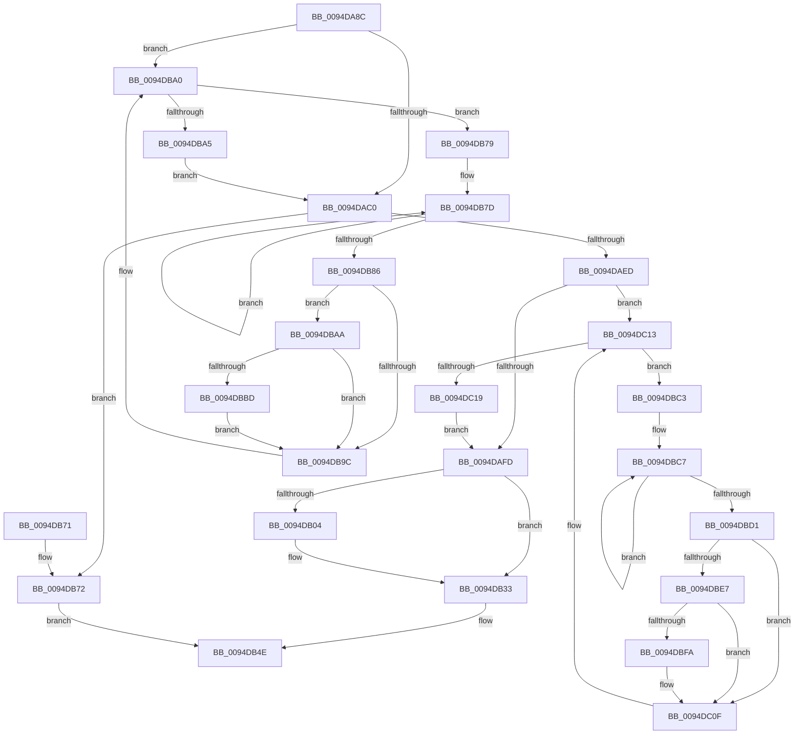

# PiSwDeviceMakeCompatibleIds

- RVA: `0x0094DA8C`–`0x0094DC1E` (길이 `402` bytes)
- VA: `0x000000014094DA8C`
- 실행 섹션: `PAGE`
- PDB 이름 있음: `예`; PDB Function 태그: `아니요`
- unwind 정보 RVA: `0x00091960`
- 디코드: `109`개 명령, `402/402` bytes 표시
- 미해석 바이트: `0` (있으면 어셈블리에 `.byte`로 보존)

> 이 문서는 커널 이미지의 기계어와 PDB 기호를 분석해 생성했습니다. 4번과 5번은 함수 원형과 자료형을 바이너리 사용 방식에서 추정한 C 해석이며 원본 소스 복구 결과는 아닙니다.

## 1. Dependencies

- 직접 호출 지점: **6**; 고유 호출 대상: **3**
- 직접 호출자로 확인된 함수: **1**
- RIP 상대 이미지 참조: **6**

### Outgoing calls
- `0x0094DADC` → [ExAllocatePool2](../../poolcode/B8/ExAllocatePool2_function_00B820F0.md) (function, `0x00B820F0`)
- `0x0094DB93` → [wcsicmp](../../text/50/wcsicmp_function_00500080.md) (function, `0x00500080`)
- `0x0094DBB4` → [wcsicmp](../../text/50/wcsicmp_function_00500080.md) (function, `0x00500080`)
- `0x0094DBDE` → [wcsicmp](../../text/50/wcsicmp_function_00500080.md) (function, `0x00500080`)
- `0x0094DBF1` → [wcsicmp](../../text/50/wcsicmp_function_00500080.md) (function, `0x00500080`)
- `0x0094DC07` → [memcpy](../../text/6C/memcpy_function_006C6840.md) (function, `0x006C6840`)

### Direct callers
- [PiSwPdoPnPDispatch](PiSwPdoPnPDispatch_function_0094DDF0.md) at `0x0094E1A7`

### Static image references
- `0x0094DB04` → RVA `0x000122B8` (`.rdata`; read)
- `0x0094DB0E` → RVA `0x000122C8` (`.rdata`; read)
- `0x0094DB1B` → RVA `0x000122D0` (`.rdata`; read)
- `0x0094DB24` → RVA `0x000122D4` (`.rdata`; read)
- `0x0094DB33` → RVA `0x000122A0` (`.rdata`; read)
- `0x0094DB3D` → RVA `0x000122B0` (`.rdata`; read)

## 2. Other-region calls and transfers

- 다른 실행 섹션으로 향하는 call: **6**
  - `0x0094DADC` → [ExAllocatePool2](../../poolcode/B8/ExAllocatePool2_function_00B820F0.md) (`PAGE` → `POOLCODE`)
  - `0x0094DB93` → [wcsicmp](../../text/50/wcsicmp_function_00500080.md) (`PAGE` → `.text`)
  - `0x0094DBB4` → [wcsicmp](../../text/50/wcsicmp_function_00500080.md) (`PAGE` → `.text`)
  - `0x0094DBDE` → [wcsicmp](../../text/50/wcsicmp_function_00500080.md) (`PAGE` → `.text`)
  - `0x0094DBF1` → [wcsicmp](../../text/50/wcsicmp_function_00500080.md) (`PAGE` → `.text`)
  - `0x0094DC07` → [memcpy](../../text/6C/memcpy_function_006C6840.md) (`PAGE` → `.text`)
- 별도 외부 분기/꼬리 이동을 확인하지 못했습니다.

## 3. Assembly (complete function range)

```asm
0094DA8C  48 89 5C 24 08                  mov qword ptr [rsp + 8], rbx
0094DA91  48 89 6C 24 10                  mov qword ptr [rsp + 0x10], rbp
0094DA96  48 89 74 24 18                  mov qword ptr [rsp + 0x18], rsi
0094DA9B  57                              push rdi
0094DA9C  41 54                           push r12
0094DA9E  41 55                           push r13
0094DAA0  41 56                           push r14
0094DAA2  41 57                           push r15
0094DAA4  48 83 EC 20                     sub rsp, 0x20
0094DAA8  48 8B 59 20                     mov rbx, qword ptr [rcx + 0x20]
0094DAAC  33 FF                           xor edi, edi
0094DAAE  4C 8B EA                        mov r13, rdx
0094DAB1  48 8B E9                        mov rbp, rcx
0094DAB4  44 8B F7                        mov r14d, edi
0094DAB7  48 85 DB                        test rbx, rbx
0094DABA  0F 85 E0 00 00 00               jne 0x14094dba0
0094DAC0  8B 45 40                        mov eax, dword ptr [rbp + 0x40]
0094DAC3  49 8D 56 1E                     lea rdx, [r14 + 0x1e]
0094DAC7  A8 08                           test al, 8
0094DAC9  B9 00 01 00 00                  mov ecx, 0x100
0094DACE  41 B8 50 6E 70 57               mov r8d, 0x57706e50
0094DAD4  49 0F 45 D6                     cmovne rdx, r14
0094DAD8  48 83 C2 1A                     add rdx, 0x1a
0094DADC  E8 0F 46 23 00                  call 0x140b820f0
0094DAE1  4C 8B E0                        mov r12, rax
0094DAE4  48 85 C0                        test rax, rax
0094DAE7  0F 84 85 00 00 00               je 0x14094db72
0094DAED  4C 8B 75 20                     mov r14, qword ptr [rbp + 0x20]
0094DAF1  48 8B F0                        mov rsi, rax
0094DAF4  4D 85 F6                        test r14, r14
0094DAF7  0F 85 16 01 00 00               jne 0x14094dc13
0094DAFD  8B 45 40                        mov eax, dword ptr [rbp + 0x40]
0094DB00  A8 08                           test al, 8
0094DB02  75 2F                           jne 0x14094db33
0094DB04  0F 10 05 AD 47 6C FF            movups xmm0, xmmword ptr [rip - 0x93b853]
0094DB0B  0F 11 06                        movups xmmword ptr [rsi], xmm0
0094DB0E  F2 0F 10 05 B2 47 6C FF         movsd xmm0, qword ptr [rip - 0x93b84e]
0094DB16  F2 0F 11 46 10                  movsd qword ptr [rsi + 0x10], xmm0
0094DB1B  8B 05 AF 47 6C FF               mov eax, dword ptr [rip - 0x93b851]
0094DB21  89 46 18                        mov dword ptr [rsi + 0x18], eax
0094DB24  0F B7 05 A9 47 6C FF            movzx eax, word ptr [rip - 0x93b857]
0094DB2B  66 89 46 1C                     mov word ptr [rsi + 0x1c], ax
0094DB2F  48 83 C6 1E                     add rsi, 0x1e
0094DB33  0F 10 05 66 47 6C FF            movups xmm0, xmmword ptr [rip - 0x93b89a]
0094DB3A  0F 11 06                        movups xmmword ptr [rsi], xmm0
0094DB3D  F2 0F 10 05 6B 47 6C FF         movsd xmm0, qword ptr [rip - 0x93b895]
0094DB45  F2 0F 11 46 10                  movsd qword ptr [rsi + 0x10], xmm0
0094DB4A  66 89 7E 18                     mov word ptr [rsi + 0x18], di
0094DB4E  48 8B 5C 24 50                  mov rbx, qword ptr [rsp + 0x50]
0094DB53  8B C7                           mov eax, edi
0094DB55  48 8B 6C 24 58                  mov rbp, qword ptr [rsp + 0x58]
0094DB5A  48 8B 74 24 60                  mov rsi, qword ptr [rsp + 0x60]
0094DB5F  4D 89 65 00                     mov qword ptr [r13], r12
0094DB63  48 83 C4 20                     add rsp, 0x20
0094DB67  41 5F                           pop r15
0094DB69  41 5E                           pop r14
0094DB6B  41 5D                           pop r13
0094DB6D  41 5C                           pop r12
0094DB6F  5F                              pop rdi
0094DB70  C3                              ret
0094DB71  CC                              int3
0094DB72  BF 9A 00 00 C0                  mov edi, 0xc000009a
0094DB77  EB D5                           jmp 0x14094db4e
0094DB79  48 83 CE FF                     or rsi, 0xffffffffffffffff
0094DB7D  48 FF C6                        inc rsi
0094DB80  66 39 3C 73                     cmp word ptr [rbx + rsi*2], di
0094DB84  75 F7                           jne 0x14094db7d
0094DB86  48 8D 15 2B 47 6C FF            lea rdx, [rip - 0x93b8d5]
0094DB8D  48 8B CB                        mov rcx, rbx
0094DB90  48 FF C6                        inc rsi
0094DB93  E8 E8 24 BB FF                  call 0x140500080
0094DB98  85 C0                           test eax, eax
0094DB9A  75 0E                           jne 0x14094dbaa
0094DB9C  48 8D 1C 73                     lea rbx, [rbx + rsi*2]
0094DBA0  66 39 3B                        cmp word ptr [rbx], di
0094DBA3  75 D4                           jne 0x14094db79
0094DBA5  E9 16 FF FF FF                  jmp 0x14094dac0
0094DBAA  48 8D 15 EF 46 6C FF            lea rdx, [rip - 0x93b911]
0094DBB1  48 8B CB                        mov rcx, rbx
0094DBB4  E8 C7 24 BB FF                  call 0x140500080
0094DBB9  85 C0                           test eax, eax
0094DBBB  74 DF                           je 0x14094db9c
0094DBBD  4D 8D 34 76                     lea r14, [r14 + rsi*2]
0094DBC1  EB D9                           jmp 0x14094db9c
0094DBC3  49 83 CF FF                     or r15, 0xffffffffffffffff
0094DBC7  49 FF C7                        inc r15
0094DBCA  66 43 39 3C 7E                  cmp word ptr [r14 + r15*2], di
0094DBCF  75 F6                           jne 0x14094dbc7
0094DBD1  48 8D 15 E0 46 6C FF            lea rdx, [rip - 0x93b920]
0094DBD8  49 8B CE                        mov rcx, r14
0094DBDB  49 FF C7                        inc r15
0094DBDE  E8 9D 24 BB FF                  call 0x140500080
0094DBE3  85 C0                           test eax, eax
0094DBE5  74 28                           je 0x14094dc0f
0094DBE7  48 8D 15 B2 46 6C FF            lea rdx, [rip - 0x93b94e]
0094DBEE  49 8B CE                        mov rcx, r14
0094DBF1  E8 8A 24 BB FF                  call 0x140500080
0094DBF6  85 C0                           test eax, eax
0094DBF8  74 15                           je 0x14094dc0f
0094DBFA  4B 8D 1C 3F                     lea rbx, [r15 + r15]
0094DBFE  49 8B D6                        mov rdx, r14
0094DC01  4C 8B C3                        mov r8, rbx
0094DC04  48 8B CE                        mov rcx, rsi
0094DC07  E8 34 8C D7 FF                  call 0x1406c6840
0094DC0C  48 03 F3                        add rsi, rbx
0094DC0F  4F 8D 34 7E                     lea r14, [r14 + r15*2]
0094DC13  66 41 39 3E                     cmp word ptr [r14], di
0094DC17  75 AA                           jne 0x14094dbc3
0094DC19  E9 DF FE FF FF                  jmp 0x14094dafd
```

## 4. C-style interpretation (structured pseudocode)

```c
__int64 __fastcall PiSwDeviceMakeCompatibleIds(__int64 a1, __int64 a2)
{
    __int64 result;
    __int64 v_r15;
    __int64 v_rbx;
    __int64 v_rdi;
    __int64 v_rsi;
    __int64 v_rsp;
    unsigned __int64 v_stack_p10;
    unsigned __int64 v_stack_p18;
    unsigned __int64 v_stack_p8;

    v_stack_p8 = v_rbx;
    v_stack_p10 = v_rbp;
    v_stack_p18 = v_rsi;
    v_rsp = (v_rsp) - (32);
    v_rdi = 0;
    if (*(unsigned __int64 *)(a1 + 32) != 0) goto loc_0094DBA0;
loc_0094DAC0:
    a2 = 0 + 30;
    if ((((unsigned __int8)((unsigned int)(*(unsigned int *)(a1 + 64)))) & (8)) != 0) { a2 = 0; }
    a2 = (a2) + (26);
    result = ExAllocatePool2(256, a2, (unsigned int)(0x57706E50ULL), a4);
    if (result == 0) goto loc_0094DB72;
    if (*(unsigned __int64 *)(a1 + 32) != 0) goto loc_0094DC13;
loc_0094DAFD:
    result = (unsigned int)(*(unsigned int *)(a1 + 64));
    v_rsi = result;
    if ((((unsigned __int8)((unsigned int)(*(unsigned int *)(a1 + 64)))) & (8)) == 0) {
        *(unsigned __int64 *)(result) = v_xmm0;
        *(unsigned __int64 *)(result + 16) = v_xmm0;
        result = *(unsigned int *)(v_rip - 9680977);
        *(unsigned int *)(result + 24) = (unsigned int)(result);
        result = *(unsigned __int16 *)(v_rip - 9680983);
        *(unsigned __int16 *)(result + 28) = (unsigned __int16)(result);
        v_rsi = (result) + (30);
    }
    *(unsigned __int64 *)(v_rsi) = v_xmm0;
    *(unsigned __int64 *)(v_rsi + 16) = v_xmm0;
    *(unsigned __int16 *)(v_rsi + 24) = 0;
loc_0094DB4E:
    *(unsigned __int64 *)(a2) = result;
    v_rsp = (v_rsp) + (32);
    return 0;
loc_0094DB72:
    goto loc_0094DB4E;
loc_0094DB79:
    v_rsi = (v_stack_p18) | (-1);
loc_0094DB7D:
    v_rsi = (v_rsi) + 1;
    if ((*(unsigned __int16 *)(v_stack_p8 + v_rsi * 2)) != ((unsigned __int16)((unsigned int)(0xC000009AULL)))) goto loc_0094DB7D;
    v_rsi = (v_rsi) + 1;
    result = wcsicmp(v_stack_p8, v_rip - 9681109, (unsigned int)(0x57706E50ULL), a4);
    if ((unsigned int)(result) != 0) goto loc_0094DBAA;
loc_0094DB9C:
loc_0094DBA0:
    if ((*(unsigned __int16 *)(v_stack_p8 + v_rsi * 2)) != ((unsigned __int16)((unsigned int)(0xC000009AULL)))) goto loc_0094DB79;
    goto loc_0094DAC0;
loc_0094DBAA:
    result = wcsicmp(v_stack_p8 + v_rsi * 2, v_rip - 9681169, (unsigned int)(0x57706E50ULL), a4);
    if ((unsigned int)(result) == 0) goto loc_0094DB9C;
    goto loc_0094DB9C;
loc_0094DBC3:
    v_r15 = (v_r15) | (-1);
loc_0094DBC7:
    v_r15 = (v_r15) + 1;
    if ((*(unsigned __int16 *)(*(unsigned __int64 *)(a1 + 32) + v_rsi * 2 + v_r15 * 2)) != ((unsigned __int16)((unsigned int)(0xC000009AULL)))) goto loc_0094DBC7;
    v_r15 = (v_r15) + 1;
    result = wcsicmp(*(unsigned __int64 *)(a1 + 32) + v_rsi * 2, v_rip - 9681184, (unsigned int)(0x57706E50ULL), a4);
    if ((unsigned int)(result) == 0) goto loc_0094DC0F;
    result = wcsicmp(*(unsigned __int64 *)(a1 + 32) + v_rsi * 2, v_rip - 9681230, (unsigned int)(0x57706E50ULL), a4);
    v_rbx = v_stack_p8 + v_rsi * 2;
    if ((unsigned int)(result) != 0) {
        v_rbx = v_r15 + v_r15 * 1;
        a2 = *(unsigned __int64 *)(a1 + 32) + v_rsi * 2;
        a3 = v_rbx;
        a1 = v_rsi;
        result = memcpy(a1, a2, a3, a4);
        v_rsi = (v_rsi) + (v_rbx);
    }
loc_0094DC13:
    if ((*(unsigned __int16 *)(*(unsigned __int64 *)(a1 + 32) + v_rsi * 2 + v_r15 * 2)) != ((unsigned __int16)((unsigned int)(0xC000009AULL)))) goto loc_0094DBC3;
    goto loc_0094DAFD;
}
```

## 5. (Beta) C Style

```c
int64_t PiSwDeviceMakeCompatibleIds(void *Arg1, void *Arg2)
{
    uint8_t *arg1 = (uint8_t *)Arg1;
    uint8_t *arg2 = (uint8_t *)Arg2;

    int64_t result;
    int64_t local_r15;
    int64_t local_rbx;
    int64_t local_rdi;
    int64_t local_rsi;
    int64_t local_rsp;
    uint64_t v_stack_p10;
    uint64_t v_stack_p18;
    uint64_t v_stack_p8;

    v_stack_p8 = local_rbx;
    v_stack_p10 = local_rbp;
    v_stack_p18 = local_rsi;
    local_rsp = (local_rsp) - (32);
    local_rdi = 0;
    if (*(uint64_t *)(arg1 + 0x20) != 0) goto loc_0094DBA0;
loc_0094DAC0:
    Arg2 = 0 + 30;
    if ((((uint8_t)((uint32_t)(*(uint32_t *)(arg1 + 0x40)))) & (8)) != 0) { Arg2 = 0; }
    Arg2 = (Arg2) + (26);
    result = ExAllocatePool2(256, Arg2, (uint32_t)(0x57706E50ULL), a4);
    if (result == 0) goto loc_0094DB72;
    if (*(uint64_t *)(arg1 + 0x20) != 0) goto loc_0094DC13;
loc_0094DAFD:
    result = (uint32_t)(*(uint32_t *)(arg1 + 0x40));
    local_rsi = result;
    if ((((uint8_t)((uint32_t)(*(uint32_t *)(arg1 + 0x40)))) & (8)) == 0) {
        *(uint64_t *)(result) = v_xmm0;
        *(uint64_t *)(result + 0x10) = v_xmm0;
        result = *(uint32_t *)(v_rip - 0x93B851);
        *(uint32_t *)(result + 0x18) = (uint32_t)(result);
        result = *(uint16_t *)(v_rip - 0x93B857);
        *(uint16_t *)(result + 0x1C) = (uint16_t)(result);
        local_rsi = (result) + (30);
    }
    *(uint64_t *)(local_rsi) = v_xmm0;
    *(uint64_t *)(local_rsi + 0x10) = v_xmm0;
    *(uint16_t *)(local_rsi + 0x18) = 0;
loc_0094DB4E:
    *(uint64_t *)(arg2) = result;
    local_rsp = (local_rsp) + (32);
    return 0;
loc_0094DB72:
    goto loc_0094DB4E;
loc_0094DB79:
    local_rsi = (v_stack_p18) | (-1);
loc_0094DB7D:
    local_rsi = (local_rsi) + 1;
    if ((*(uint16_t *)(v_stack_p8 + local_rsi * 2)) != ((uint16_t)((uint32_t)(0xC000009AULL)))) goto loc_0094DB7D;
    local_rsi = (local_rsi) + 1;
    result = wcsicmp(v_stack_p8, v_rip - 9681109, (uint32_t)(0x57706E50ULL), a4);
    if ((uint32_t)(result) != 0) goto loc_0094DBAA;
loc_0094DB9C:
loc_0094DBA0:
    if ((*(uint16_t *)(v_stack_p8 + local_rsi * 2)) != ((uint16_t)((uint32_t)(0xC000009AULL)))) goto loc_0094DB79;
    goto loc_0094DAC0;
loc_0094DBAA:
    result = wcsicmp(v_stack_p8 + local_rsi * 2, v_rip - 9681169, (uint32_t)(0x57706E50ULL), a4);
    if ((uint32_t)(result) == 0) goto loc_0094DB9C;
    goto loc_0094DB9C;
loc_0094DBC3:
    local_r15 = (local_r15) | (-1);
loc_0094DBC7:
    local_r15 = (local_r15) + 1;
    if ((*(uint16_t *)(*(uint64_t *)(arg1 + 0x20) + local_rsi * 2 + local_r15 * 2)) != ((uint16_t)((uint32_t)(0xC000009AULL)))) goto loc_0094DBC7;
    local_r15 = (local_r15) + 1;
    result = wcsicmp(*(uint64_t *)(arg1 + 0x20) + local_rsi * 2, v_rip - 9681184, (uint32_t)(0x57706E50ULL), a4);
    if ((uint32_t)(result) == 0) goto loc_0094DC0F;
    result = wcsicmp(*(uint64_t *)(arg1 + 0x20) + local_rsi * 2, v_rip - 9681230, (uint32_t)(0x57706E50ULL), a4);
    local_rbx = v_stack_p8 + local_rsi * 2;
    if ((uint32_t)(result) != 0) {
        local_rbx = local_r15 + local_r15 * 1;
        Arg2 = *(uint64_t *)(arg1 + 0x20) + local_rsi * 2;
        a3 = local_rbx;
        Arg1 = local_rsi;
        result = memcpy(Arg1, Arg2, a3, a4);
        local_rsi = (local_rsi) + (local_rbx);
    }
loc_0094DC13:
    if ((*(uint16_t *)(*(uint64_t *)(arg1 + 0x20) + local_rsi * 2 + local_r15 * 2)) != ((uint16_t)((uint32_t)(0xC000009AULL)))) goto loc_0094DBC3;
    goto loc_0094DAFD;
}
```

### 관측된 메모리 오프셋

구조체 형식이 확인되지 않은 접근은 인자 기준의 오프셋으로만 기록했습니다.

| 기준 인자 | 오프셋 표현 | 폭 (bit) | 접근 |
|---|---:|---:|---|
| `Arg1` | `+ 0x20` | `64` | `R` |
| `Arg1` | `+ 0x40` | `32` | `R` |
| `Arg2` | `+ 0x0` | `64` | `W` |

## 6. Execution-region graph

[열기: 2D/3D 그래프와 함수 탐색 컨트롤 패널](../../../control-panel.html?section=page&rva=0x0094DA8C&view=graph)

- 2D 그래프는 위에서 아래로 흐르고, 3D 그래프는 빈 공간을 드래그해 회전합니다. Shift+드래그는 이동, 휠은 확대·축소, 함수 노드 선택은 대상 보고서 이동입니다.

### Static fallback


