# PiSwIrpInterfaceRegister

- RVA: `0x0094F01C`–`0x0094F491` (길이 `1,141` bytes)
- VA: `0x000000014094F01C`
- 실행 섹션: `PAGE`
- PDB 이름 있음: `예`; PDB Function 태그: `아니요`
- unwind 정보 RVA: `0x00091B08`
- 디코드: `270`개 명령, `1,141/1,141` bytes 표시
- 미해석 바이트: `0` (있으면 어셈블리에 `.byte`로 보존)

> 이 문서는 커널 이미지의 기계어와 PDB 기호를 분석해 생성했습니다. 4번과 5번은 함수 원형과 자료형을 바이너리 사용 방식에서 추정한 C 해석이며 원본 소스 복구 결과는 아닙니다.

## 1. Dependencies

- 직접 호출 지점: **28**; 고유 호출 대상: **21**
- 직접 호출자로 확인된 함수: **1**
- RIP 상대 이미지 참조: **11**

### Outgoing calls
- `0x0094F099` → `msrpc.sys!MesDecodeBufferHandleCreate` (import, 간접 대상; import `msrpc.sys!MesDecodeBufferHandleCreate`)
- `0x0094F0DB` → `msrpc.sys!NdrMesTypeDecode3` (import, 간접 대상; import `msrpc.sys!NdrMesTypeDecode3`)
- `0x0094F155` → [PiSwValidatePropertyArray](../8F/PiSwValidatePropertyArray_function_008F75F4.md) (function, `0x008F75F4`)
- `0x0094F160` → [PiSwLock](../8F/PiSwLock_function_008F7D50.md) (function, `0x008F7D50`)
- `0x0094F168` → [PiSwDeviceOperationsAllowed](../8F/PiSwDeviceOperationsAllowed_function_008F8EF4.md) (function, `0x008F8EF4`)
- `0x0094F181` → [ExReleaseResourceLite](../../text/25/ExReleaseResourceLite_function_0025FA10.md) (function, `0x0025FA10`)
- `0x0094F186` → [KeLeaveCriticalRegion](../../text/25/KeLeaveCriticalRegion_function_0025D8B0.md) (function, `0x0025D8B0`)
- `0x0094F1A3` → [RtlStringCbCopyW](../../text/43/RtlStringCbCopyW_function_0043B910.md) (function, `0x0043B910`)
- `0x0094F1DF` → [ExFreePoolWithTag](../../poolcode/B8/ExFreePoolWithTag_function_00B82870.md) (function, `0x00B82870`)
- `0x0094F1F3` → [ExFreePoolWithTag](../../poolcode/B8/ExFreePoolWithTag_function_00B82870.md) (function, `0x00B82870`)
- `0x0094F202` → `msrpc.sys!MesHandleFree` (import, 간접 대상; import `msrpc.sys!MesHandleFree`)
- `0x0094F217` → [IofCompleteRequest](../../text/29/IofCompleteRequest_function_0029B5C0.md) (function, `0x0029B5C0`)
- `0x0094F272` → [IopRegisterDeviceInterface](../95/IopRegisterDeviceInterface_function_009501B0.md) (function, `0x009501B0`)
- `0x0094F2A3` → [PiSwDeviceFindInterfaceEntry](PiSwDeviceFindInterfaceEntry_function_0094F498.md) (function, `0x0094F498`)
- `0x0094F2CD` → [PiSwUpdateArrayProperties](PiSwUpdateArrayProperties_function_0094EBAC.md) (function, `0x0094EBAC`)
- `0x0094F2DB` → [ExReleaseResourceLite](../../text/25/ExReleaseResourceLite_function_0025FA10.md) (function, `0x0025FA10`)
- `0x0094F2E0` → [KeLeaveCriticalRegion](../../text/25/KeLeaveCriticalRegion_function_0025D8B0.md) (function, `0x0025D8B0`)
- `0x0094F308` → [PiSwPropertySet](../8F/PiSwPropertySet_function_008F5EEC.md) (function, `0x008F5EEC`)
- `0x0094F317` → [PiSwLock](../8F/PiSwLock_function_008F7D50.md) (function, `0x008F7D50`)
- `0x0094F32B` → [PiSwDeviceInterfaceSetState](PiSwDeviceInterfaceSetState_function_0094ED48.md) (function, `0x0094ED48`)
- `0x0094F361` → [PiSwInterfaceCreate](../8D/PiSwInterfaceCreate_function_008DA784.md) (function, `0x008DA784`)
- `0x0094F3D0` → [McTemplateK0zz_EtwWriteTransfer](../../text/5A/McTemplateK0zz_EtwWriteTransfer_function_005A9408.md) (function, `0x005A9408`)
- `0x0094F3F5` → [PiSwLock](../8F/PiSwLock_function_008F7D50.md) (function, `0x008F7D50`)
- `0x0094F422` → [ExReleaseResourceLite](../../text/25/ExReleaseResourceLite_function_0025FA10.md) (function, `0x0025FA10`)
- `0x0094F427` → [KeLeaveCriticalRegion](../../text/25/KeLeaveCriticalRegion_function_0025D8B0.md) (function, `0x0025D8B0`)
- `0x0094F42F` → [PiSwInterfaceFree](../8D/PiSwInterfaceFree_function_008DB064.md) (function, `0x008DB064`)
- `0x0094F465` → [McTemplateK0zzz_EtwWriteTransfer](../../text/5A/McTemplateK0zzz_EtwWriteTransfer_function_005A96BC.md) (function, `0x005A96BC`)
- `0x0094F487` → [McTemplateK0zzd_EtwWriteTransfer](../../text/42/McTemplateK0zzd_EtwWriteTransfer_function_00424414.md) (function, `0x00424414`)

### Direct callers
- [PiSwDispatch](../73/PiSwDispatch_function_0073AA90.md) at `0x0073AB66`

### Static image references
- `0x0094F06D` → RVA `0x00EF012C` (`.data`; read)
- `0x0094F099` → RVA `0x00151700` (`msrpc.sys!MesDecodeBufferHandleCreate (IAT)`; read)
- `0x0094F0C1` → RVA `0x00E07010` (`.data`; read)
- `0x0094F0C8` → RVA `0x00B4B210` (`PAGE`; read)
- `0x0094F0CF` → RVA `0x00B4B1A0` (`PAGE`; read)
- `0x0094F0DB` → RVA `0x001516F8` (`msrpc.sys!NdrMesTypeDecode3 (IAT)`; read)
- `0x0094F17A` → RVA `0x00F8AB20` (`.data`; read)
- `0x0094F202` → RVA `0x001516E0` (`msrpc.sys!MesHandleFree (IAT)`; read)
- `0x0094F3C9` → RVA `0x00026CD0` (`.rdata`; read)
- `0x0094F45E` → RVA `0x00027540` (`.rdata`; read)
- `0x0094F480` → RVA `0x00026FF0` (`.rdata`; read)

## 2. Other-region calls and transfers

- 다른 실행 섹션으로 향하는 call: **13**
  - `0x0094F181` → [ExReleaseResourceLite](../../text/25/ExReleaseResourceLite_function_0025FA10.md) (`PAGE` → `.text`)
  - `0x0094F186` → [KeLeaveCriticalRegion](../../text/25/KeLeaveCriticalRegion_function_0025D8B0.md) (`PAGE` → `.text`)
  - `0x0094F1A3` → [RtlStringCbCopyW](../../text/43/RtlStringCbCopyW_function_0043B910.md) (`PAGE` → `.text`)
  - `0x0094F1DF` → [ExFreePoolWithTag](../../poolcode/B8/ExFreePoolWithTag_function_00B82870.md) (`PAGE` → `POOLCODE`)
  - `0x0094F1F3` → [ExFreePoolWithTag](../../poolcode/B8/ExFreePoolWithTag_function_00B82870.md) (`PAGE` → `POOLCODE`)
  - `0x0094F217` → [IofCompleteRequest](../../text/29/IofCompleteRequest_function_0029B5C0.md) (`PAGE` → `.text`)
  - `0x0094F2DB` → [ExReleaseResourceLite](../../text/25/ExReleaseResourceLite_function_0025FA10.md) (`PAGE` → `.text`)
  - `0x0094F2E0` → [KeLeaveCriticalRegion](../../text/25/KeLeaveCriticalRegion_function_0025D8B0.md) (`PAGE` → `.text`)
  - `0x0094F3D0` → [McTemplateK0zz_EtwWriteTransfer](../../text/5A/McTemplateK0zz_EtwWriteTransfer_function_005A9408.md) (`PAGE` → `.text`)
  - `0x0094F422` → [ExReleaseResourceLite](../../text/25/ExReleaseResourceLite_function_0025FA10.md) (`PAGE` → `.text`)
  - `0x0094F427` → [KeLeaveCriticalRegion](../../text/25/KeLeaveCriticalRegion_function_0025D8B0.md) (`PAGE` → `.text`)
  - `0x0094F465` → [McTemplateK0zzz_EtwWriteTransfer](../../text/5A/McTemplateK0zzz_EtwWriteTransfer_function_005A96BC.md) (`PAGE` → `.text`)
  - `0x0094F487` → [McTemplateK0zzd_EtwWriteTransfer](../../text/42/McTemplateK0zzd_EtwWriteTransfer_function_00424414.md) (`PAGE` → `.text`)
- 별도 외부 분기/꼬리 이동을 확인하지 못했습니다.

## 3. Assembly (complete function range)

```asm
0094F01C  4C 8B DC                        mov r11, rsp
0094F01F  49 89 4B 08                     mov qword ptr [r11 + 8], rcx
0094F023  53                              push rbx
0094F024  56                              push rsi
0094F025  57                              push rdi
0094F026  41 54                           push r12
0094F028  41 55                           push r13
0094F02A  41 56                           push r14
0094F02C  41 57                           push r15
0094F02E  48 83 EC 70                     sub rsp, 0x70
0094F032  4C 8B E9                        mov r13, rcx
0094F035  4C 8B B9 B8 00 00 00            mov r15, qword ptr [rcx + 0xb8]
0094F03C  4C 89 7C 24 50                  mov qword ptr [rsp + 0x50], r15
0094F041  49 8B 47 30                     mov rax, qword ptr [r15 + 0x30]
0094F045  4C 8B 70 20                     mov r14, qword ptr [rax + 0x20]
0094F049  4C 89 74 24 58                  mov qword ptr [rsp + 0x58], r14
0094F04E  33 DB                           xor ebx, ebx
0094F050  49 89 5B A0                     mov qword ptr [r11 - 0x60], rbx
0094F054  49 89 5B 88                     mov qword ptr [r11 - 0x78], rbx
0094F058  8B F3                           mov esi, ebx
0094F05A  49 89 5B 98                     mov qword ptr [r11 - 0x68], rbx
0094F05E  49 89 5B 90                     mov qword ptr [r11 - 0x70], rbx
0094F062  41 89 5B 20                     mov dword ptr [r11 + 0x20], ebx
0094F066  88 9C 24 B8 00 00 00            mov byte ptr [rsp + 0xb8], bl
0094F06D  F6 05 B8 10 5A 00 40            test byte ptr [rip + 0x5a10b8], 0x40
0094F074  0F 85 42 03 00 00               jne 0x14094f3bc
0094F07A  4D 8D 65 18                     lea r12, [r13 + 0x18]
0094F07E  4C 89 64 24 60                  mov qword ptr [rsp + 0x60], r12
0094F083  49 8B 0C 24                     mov rcx, qword ptr [r12]
0094F087  48 85 C9                        test rcx, rcx
0094F08A  0F 84 4A 03 00 00               je 0x14094f3da
0094F090  4C 8D 44 24 48                  lea r8, [rsp + 0x48]
0094F095  41 8B 57 10                     mov edx, dword ptr [r15 + 0x10]
0094F099  48 FF 15 60 26 80 FF            call qword ptr [rip - 0x7fd9a0]
0094F0A0  0F 1F 44 00 00                  nop dword ptr [rax + rax]
0094F0A5  8B F8                           mov edi, eax
0094F0A7  85 C0                           test eax, eax
0094F0A9  0F 88 19 01 00 00               js 0x14094f1c8
0094F0AF  48 8D 44 24 30                  lea rax, [rsp + 0x30]
0094F0B4  48 89 44 24 28                  mov qword ptr [rsp + 0x28], rax
0094F0B9  C7 44 24 20 02 00 00 00         mov dword ptr [rsp + 0x20], 2
0094F0C1  4C 8D 0D 48 7F 4B 00            lea r9, [rip + 0x4b7f48]
0094F0C8  4C 8D 05 41 C1 1F 00            lea r8, [rip + 0x1fc141]
0094F0CF  48 8D 15 CA C0 1F 00            lea rdx, [rip + 0x1fc0ca]
0094F0D6  48 8B 4C 24 48                  mov rcx, qword ptr [rsp + 0x48]
0094F0DB  48 FF 15 16 26 80 FF            call qword ptr [rip - 0x7fd9ea]
0094F0E2  0F 1F 44 00 00                  nop dword ptr [rax + rax]
0094F0E7  EB 2D                           jmp 0x14094f116
0094F0E9  8B F8                           mov edi, eax
0094F0EB  48 83 64 24 30 00               and qword ptr [rsp + 0x30], 0
0094F0F1  33 DB                           xor ebx, ebx
0094F0F3  4C 8B AC 24 B0 00 00 00         mov r13, qword ptr [rsp + 0xb0]
0094F0FB  4C 8B 7C 24 50                  mov r15, qword ptr [rsp + 0x50]
0094F100  4C 8B 74 24 58                  mov r14, qword ptr [rsp + 0x58]
0094F105  48 8B 74 24 40                  mov rsi, qword ptr [rsp + 0x40]
0094F10A  88 9C 24 B8 00 00 00            mov byte ptr [rsp + 0xb8], bl
0094F111  4C 8B 64 24 60                  mov r12, qword ptr [rsp + 0x60]
0094F116  85 FF                           test edi, edi
0094F118  0F 88 C1 02 00 00               js 0x14094f3df
0094F11E  48 8B 4C 24 30                  mov rcx, qword ptr [rsp + 0x30]
0094F123  48 85 C9                        test rcx, rcx
0094F126  0F 84 14 02 00 00               je 0x14094f340
0094F12C  48 39 19                        cmp qword ptr [rcx], rbx
0094F12F  0F 84 0B 02 00 00               je 0x14094f340
0094F135  4C 8B 41 18                     mov r8, qword ptr [rcx + 0x18]
0094F139  4D 85 C0                        test r8, r8
0094F13C  0F 84 F5 01 00 00               je 0x14094f337
0094F142  48 8B 44 24 30                  mov rax, qword ptr [rsp + 0x30]
0094F147  8B 50 10                        mov edx, dword ptr [rax + 0x10]
0094F14A  85 D2                           test edx, edx
0094F14C  0F 84 E7 02 00 00               je 0x14094f439
0094F152  49 8B C8                        mov rcx, r8
0094F155  E8 9A 84 FA FF                  call 0x1408f75f4
0094F15A  8B F8                           mov edi, eax
0094F15C  85 C0                           test eax, eax
0094F15E  78 68                           js 0x14094f1c8
0094F160  E8 EB 8B FA FF                  call 0x1408f7d50
0094F165  49 8B CE                        mov rcx, r14
0094F168  E8 87 9D FA FF                  call 0x1408f8ef4
0094F16D  84 C0                           test al, al
0094F16F  0F 85 C7 00 00 00               jne 0x14094f23c
0094F175  BF BB 00 00 C0                  mov edi, 0xc00000bb
0094F17A  48 8D 0D 9F B9 63 00            lea rcx, [rip + 0x63b99f]
0094F181  E8 8A 08 91 FF                  call 0x14025fa10
0094F186  E8 25 E7 90 FF                  call 0x14025d8b0
0094F18B  85 FF                           test edi, edi
0094F18D  0F 88 4C 02 00 00               js 0x14094f3df
0094F193  41 8B 57 08                     mov edx, dword ptr [r15 + 8]
0094F197  4C 8B 7C 24 38                  mov r15, qword ptr [rsp + 0x38]
0094F19C  4D 8B C7                        mov r8, r15
0094F19F  49 8B 0C 24                     mov rcx, qword ptr [r12]
0094F1A3  E8 68 C7 AE FF                  call 0x14043b910
0094F1A8  8B F8                           mov edi, eax
0094F1AA  85 C0                           test eax, eax
0094F1AC  78 1A                           js 0x14094f1c8
0094F1AE  48 83 C8 FF                     or rax, 0xffffffffffffffff
0094F1B2  48 FF C0                        inc rax
0094F1B5  66 41 39 1C 47                  cmp word ptr [r15 + rax*2], bx
0094F1BA  75 F6                           jne 0x14094f1b2
0094F1BC  48 8D 04 45 02 00 00 00         lea rax, [rax*2 + 2]
0094F1C4  49 89 45 38                     mov qword ptr [r13 + 0x38], rax
0094F1C8  85 FF                           test edi, edi
0094F1CA  0F 88 0F 02 00 00               js 0x14094f3df
0094F1D0  48 8B 4C 24 30                  mov rcx, qword ptr [rsp + 0x30]
0094F1D5  48 85 C9                        test rcx, rcx
0094F1D8  74 0A                           je 0x14094f1e4
0094F1DA  BA 6B 72 70 63                  mov edx, 0x6370726b
0094F1DF  E8 8C 36 23 00                  call 0x140b82870
0094F1E4  4C 8B 7C 24 38                  mov r15, qword ptr [rsp + 0x38]
0094F1E9  4D 85 FF                        test r15, r15
0094F1EC  74 0A                           je 0x14094f1f8
0094F1EE  33 D2                           xor edx, edx
0094F1F0  49 8B CF                        mov rcx, r15
0094F1F3  E8 78 36 23 00                  call 0x140b82870
0094F1F8  48 8B 4C 24 48                  mov rcx, qword ptr [rsp + 0x48]
0094F1FD  48 85 C9                        test rcx, rcx
0094F200  74 0C                           je 0x14094f20e
0094F202  48 FF 15 D7 24 80 FF            call qword ptr [rip - 0x7fdb29]
0094F209  0F 1F 44 00 00                  nop dword ptr [rax + rax]
0094F20E  41 89 7D 30                     mov dword ptr [r13 + 0x30], edi
0094F212  33 D2                           xor edx, edx
0094F214  49 8B CD                        mov rcx, r13
0094F217  E8 A4 C3 94 FF                  call 0x14029b5c0
0094F21C  F6 05 09 0F 5A 00 40            test byte ptr [rip + 0x5a0f09], 0x40
0094F223  0F 85 46 02 00 00               jne 0x14094f46f
0094F229  8B C7                           mov eax, edi
0094F22B  48 83 C4 70                     add rsp, 0x70
0094F22F  41 5F                           pop r15
0094F231  41 5E                           pop r14
0094F233  41 5D                           pop r13
0094F235  41 5C                           pop r12
0094F237  5F                              pop rdi
0094F238  5E                              pop rsi
0094F239  5B                              pop rbx
0094F23A  C3                              ret
0094F23B  CC                              int3
0094F23C  41 8B 46 40                     mov eax, dword ptr [r14 + 0x40]
0094F240  A8 08                           test al, 8
0094F242  0F 85 2D FF FF FF               jne 0x14094f175
0094F248  48 8D 84 24 C8 00 00 00         lea rax, [rsp + 0xc8]
0094F250  48 89 44 24 28                  mov qword ptr [rsp + 0x28], rax
0094F255  48 8D 44 24 38                  lea rax, [rsp + 0x38]
0094F25A  48 89 44 24 20                  mov qword ptr [rsp + 0x20], rax
0094F25F  41 B1 01                        mov r9b, 1
0094F262  48 8B 54 24 30                  mov rdx, qword ptr [rsp + 0x30]
0094F267  4C 8B 42 08                     mov r8, qword ptr [rdx + 8]
0094F26B  48 8B 12                        mov rdx, qword ptr [rdx]
0094F26E  49 8B 4E 50                     mov rcx, qword ptr [r14 + 0x50]
0094F272  E8 39 0F 00 00                  call 0x1409501b0
0094F277  8B F8                           mov edi, eax
0094F279  85 C0                           test eax, eax
0094F27B  0F 88 F9 FE FF FF               js 0x14094f17a
0094F281  F6 05 A4 0E 5A 00 40            test byte ptr [rip + 0x5a0ea4], 0x40
0094F288  0F 85 B9 01 00 00               jne 0x14094f447
0094F28E  49 8B 4E 78                     mov rcx, qword ptr [r14 + 0x78]
0094F292  48 85 C9                        test rcx, rcx
0094F295  0F 85 FA 00 00 00               jne 0x14094f395
0094F29B  48 8B 54 24 38                  mov rdx, qword ptr [rsp + 0x38]
0094F2A0  49 8B CE                        mov rcx, r14
0094F2A3  E8 F0 01 00 00                  call 0x14094f498
0094F2A8  48 8B F0                        mov rsi, rax
0094F2AB  48 89 44 24 40                  mov qword ptr [rsp + 0x40], rax
0094F2B0  48 85 C0                        test rax, rax
0094F2B3  0F 84 91 00 00 00               je 0x14094f34a
0094F2B9  4C 8B 44 24 30                  mov r8, qword ptr [rsp + 0x30]
0094F2BE  45 8B 48 10                     mov r9d, dword ptr [r8 + 0x10]
0094F2C2  4D 8B 40 18                     mov r8, qword ptr [r8 + 0x18]
0094F2C6  8B 50 20                        mov edx, dword ptr [rax + 0x20]
0094F2C9  48 8B 48 18                     mov rcx, qword ptr [rax + 0x18]
0094F2CD  E8 DA F8 FF FF                  call 0x14094ebac
0094F2D2  8B F8                           mov edi, eax
0094F2D4  48 8D 0D 45 B8 63 00            lea rcx, [rip + 0x63b845]
0094F2DB  E8 30 07 91 FF                  call 0x14025fa10
0094F2E0  E8 CB E5 90 FF                  call 0x14025d8b0
0094F2E5  85 FF                           test edi, edi
0094F2E7  0F 88 F2 00 00 00               js 0x14094f3df
0094F2ED  48 8B 4C 24 30                  mov rcx, qword ptr [rsp + 0x30]
0094F2F2  4C 8B 41 18                     mov r8, qword ptr [rcx + 0x18]
0094F2F6  4D 85 C0                        test r8, r8
0094F2F9  74 14                           je 0x14094f30f
0094F2FB  44 8B 49 10                     mov r9d, dword ptr [rcx + 0x10]
0094F2FF  BA 03 00 00 00                  mov edx, 3
0094F304  48 8B 4E 10                     mov rcx, qword ptr [rsi + 0x10]
0094F308  E8 DF 6B FA FF                  call 0x1408f5eec
0094F30D  8B F8                           mov edi, eax
0094F30F  85 FF                           test edi, edi
0094F311  0F 88 C8 00 00 00               js 0x14094f3df
0094F317  E8 34 8A FA FF                  call 0x1408f7d50
0094F31C  4C 8B 44 24 30                  mov r8, qword ptr [rsp + 0x30]
0094F321  45 8A 40 20                     mov r8b, byte ptr [r8 + 0x20]
0094F325  48 8B D6                        mov rdx, rsi
0094F328  49 8B CE                        mov rcx, r14
0094F32B  E8 18 FA FF FF                  call 0x14094ed48
0094F330  8B F8                           mov edi, eax
0094F332  E9 43 FE FF FF                  jmp 0x14094f17a
0094F337  39 59 10                        cmp dword ptr [rcx + 0x10], ebx
0094F33A  0F 84 02 FE FF FF               je 0x14094f142
0094F340  BF 0D 00 00 C0                  mov edi, 0xc000000d
0094F345  E9 7E FE FF FF                  jmp 0x14094f1c8
0094F34A  4C 8D 4C 24 40                  lea r9, [rsp + 0x40]
0094F34F  48 8B 54 24 30                  mov rdx, qword ptr [rsp + 0x30]
0094F354  44 8B 42 10                     mov r8d, dword ptr [rdx + 0x10]
0094F358  48 8B 52 18                     mov rdx, qword ptr [rdx + 0x18]
0094F35C  48 8B 4C 24 38                  mov rcx, qword ptr [rsp + 0x38]
0094F361  E8 1E B4 F8 FF                  call 0x1408da784
0094F366  8B F8                           mov edi, eax
0094F368  85 C0                           test eax, eax
0094F36A  78 1F                           js 0x14094f38b
0094F36C  C6 84 24 B8 00 00 00 01         mov byte ptr [rsp + 0xb8], 1
0094F374  49 8D 86 B8 00 00 00            lea rax, [r14 + 0xb8]
0094F37B  48 8B 48 08                     mov rcx, qword ptr [rax + 8]
0094F37F  48 39 01                        cmp qword ptr [rcx], rax
0094F382  74 20                           je 0x14094f3a4
0094F384  B9 03 00 00 00                  mov ecx, 3
0094F389  CD 29                           int 0x29
0094F38B  48 8B 74 24 40                  mov rsi, qword ptr [rsp + 0x40]
0094F390  E9 E5 FD FF FF                  jmp 0x14094f17a
0094F395  8B 84 24 C8 00 00 00            mov eax, dword ptr [rsp + 0xc8]
0094F39C  09 41 30                        or dword ptr [rcx + 0x30], eax
0094F39F  E9 F7 FE FF FF                  jmp 0x14094f29b
0094F3A4  48 8B 74 24 40                  mov rsi, qword ptr [rsp + 0x40]
0094F3A9  48 89 06                        mov qword ptr [rsi], rax
0094F3AC  48 89 4E 08                     mov qword ptr [rsi + 8], rcx
0094F3B0  48 89 31                        mov qword ptr [rcx], rsi
0094F3B3  48 89 70 08                     mov qword ptr [rax + 8], rsi
0094F3B7  E9 18 FF FF FF                  jmp 0x14094f2d4
0094F3BC  49 8B 46 10                     mov rax, qword ptr [r14 + 0x10]
0094F3C0  48 89 44 24 20                  mov qword ptr [rsp + 0x20], rax
0094F3C5  4D 8B 4E 08                     mov r9, qword ptr [r14 + 8]
0094F3C9  48 8D 15 00 79 6D FF            lea rdx, [rip - 0x928700]
0094F3D0  E8 33 A0 C5 FF                  call 0x1405a9408
0094F3D5  E9 A0 FC FF FF                  jmp 0x14094f07a
0094F3DA  BF 0D 00 00 C0                  mov edi, 0xc000000d
0094F3DF  48 85 F6                        test rsi, rsi
0094F3E2  0F 84 E8 FD FF FF               je 0x14094f1d0
0094F3E8  38 9C 24 B8 00 00 00            cmp byte ptr [rsp + 0xb8], bl
0094F3EF  0F 84 DB FD FF FF               je 0x14094f1d0
0094F3F5  E8 56 89 FA FF                  call 0x1408f7d50
0094F3FA  48 8B 0E                        mov rcx, qword ptr [rsi]
0094F3FD  48 8B 46 08                     mov rax, qword ptr [rsi + 8]
0094F401  48 39 71 08                     cmp qword ptr [rcx + 8], rsi
0094F405  0F 85 79 FF FF FF               jne 0x14094f384
0094F40B  48 39 30                        cmp qword ptr [rax], rsi
0094F40E  0F 85 70 FF FF FF               jne 0x14094f384
0094F414  48 89 08                        mov qword ptr [rax], rcx
0094F417  48 89 41 08                     mov qword ptr [rcx + 8], rax
0094F41B  48 8D 0D FE B6 63 00            lea rcx, [rip + 0x63b6fe]
0094F422  E8 E9 05 91 FF                  call 0x14025fa10
0094F427  E8 84 E4 90 FF                  call 0x14025d8b0
0094F42C  48 8B CE                        mov rcx, rsi
0094F42F  E8 30 BC F8 FF                  call 0x1408db064
0094F434  E9 97 FD FF FF                  jmp 0x14094f1d0
0094F439  4D 85 C0                        test r8, r8
0094F43C  0F 85 FE FE FF FF               jne 0x14094f340
0094F442  E9 0B FD FF FF                  jmp 0x14094f152
0094F447  48 8B 44 24 38                  mov rax, qword ptr [rsp + 0x38]
0094F44C  48 89 44 24 28                  mov qword ptr [rsp + 0x28], rax
0094F451  49 8B 46 10                     mov rax, qword ptr [r14 + 0x10]
0094F455  48 89 44 24 20                  mov qword ptr [rsp + 0x20], rax
0094F45A  4D 8B 4E 08                     mov r9, qword ptr [r14 + 8]
0094F45E  48 8D 15 DB 80 6D FF            lea rdx, [rip - 0x927f25]
0094F465  E8 52 A2 C5 FF                  call 0x1405a96bc
0094F46A  E9 1F FE FF FF                  jmp 0x14094f28e
0094F46F  89 7C 24 28                     mov dword ptr [rsp + 0x28], edi
0094F473  49 8B 46 10                     mov rax, qword ptr [r14 + 0x10]
0094F477  48 89 44 24 20                  mov qword ptr [rsp + 0x20], rax
0094F47C  4D 8B 4E 08                     mov r9, qword ptr [r14 + 8]
0094F480  48 8D 15 69 7B 6D FF            lea rdx, [rip - 0x928497]
0094F487  E8 88 4F AD FF                  call 0x140424414
0094F48C  E9 98 FD FF FF                  jmp 0x14094f229
```

## 4. C-style interpretation (structured pseudocode)

```c
__int64 __fastcall PiSwIrpInterfaceRegister(__int64 a1)
{
    __int64 result;
    __int64 v_rbx;
    __int64 v_rdi;
    __int64 v_rsp;
    unsigned __int64 v_stack_m48;
    unsigned __int64 v_stack_m50;
    unsigned __int64 v_stack_m58;
    unsigned __int64 v_stack_m60;
    unsigned __int64 v_stack_m68;
    unsigned __int64 v_stack_m70;
    unsigned __int64 v_stack_m78;
    unsigned __int64 v_stack_m80;
    unsigned int v_stack_m88;
    unsigned __int8 v_stack_p10;
    unsigned __int64 v_stack_p20;
    unsigned __int64 v_stack_p28;
    unsigned __int64 v_stack_p30;
    unsigned __int64 v_stack_p38;
    unsigned __int64 v_stack_p40;
    unsigned __int64 v_stack_p8;
    unsigned __int8 v_stack_pB8;
    unsigned __int64 v_stack_pC8;

    *(unsigned __int64 *)(v_rsp + 8) = a1;
    v_rsp = (v_rsp) - (112);
    v_stack_m58 = *(unsigned __int64 *)(a1 + 184);
    v_stack_m50 = *(unsigned __int64 *)(*(unsigned __int64 *)(*(unsigned __int64 *)(a1 + 184) + 48) + 32);
    v_rbx = 0;
    *(unsigned __int64 *)(v_rsp - 96) = 0;
    *(unsigned __int64 *)(v_rsp - 120) = 0;
    *(unsigned __int64 *)(v_rsp - 104) = 0;
    *(unsigned __int64 *)(v_rsp - 112) = 0;
    *(unsigned int *)(v_rsp + 32) = 0;
    v_stack_p10 = 0;
    if (((*(unsigned __int8 *)(v_rip + 5902520)) & (64)) != 0) goto loc_0094F3BC;
loc_0094F07A:
    v_stack_m48 = a1 + 24;
    if (*(unsigned __int64 *)(a1 + 24) == 0) goto loc_0094F3DA;
    result = msrpc_sys_MesDecodeBufferHandleCreate(*(unsigned __int64 *)(a1 + 24), (unsigned int)(*(unsigned int *)(*(unsigned __int64 *)(a1 + 184) + 16)), v_stack_m60, a4);
    if (sign_flag) goto loc_0094F1C8;
    v_stack_m80 = v_stack_m78;
    v_stack_m88 = 2;
    result = msrpc_sys_NdrMesTypeDecode3(v_stack_m60, v_rip + 2080970, v_rip + 2081089, v_rip + 4947784);
    goto loc_0094F116;
loc_0094F116:
    if (sign_flag) goto loc_0094F3DF;
    if (v_stack_m78 == 0) goto loc_0094F340;
    if ((*(unsigned __int64 *)(v_stack_m78)) == 0) goto loc_0094F340;
    if (*(unsigned __int64 *)(v_stack_m78 + 24) == 0) goto loc_0094F337;
loc_0094F142:
    if ((unsigned int)((unsigned int)(*(unsigned int *)(v_stack_m78 + 16))) == 0) goto loc_0094F439;
loc_0094F152:
    result = PiSwValidatePropertyArray(*(unsigned __int64 *)(v_stack_m78 + 24), (unsigned int)(*(unsigned int *)(v_stack_m78 + 16)), *(unsigned __int64 *)(v_stack_m78 + 24), v_rip + 4947784);
    if (sign_flag) goto loc_0094F1C8;
    result = PiSwLock(*(unsigned __int64 *)(v_stack_m78 + 24), (unsigned int)(*(unsigned int *)(v_stack_m78 + 16)), *(unsigned __int64 *)(v_stack_m78 + 24), v_rip + 4947784);
    result = PiSwDeviceOperationsAllowed(*(unsigned __int64 *)(*(unsigned __int64 *)(*(unsigned __int64 *)(a1 + 184) + 48) + 32), (unsigned int)(*(unsigned int *)(v_stack_m78 + 16)), *(unsigned __int64 *)(v_stack_m78 + 24), v_rip + 4947784);
    if ((unsigned __int8)(result) != 0) goto loc_0094F23C;
loc_0094F175:
loc_0094F17A:
    result = ExReleaseResourceLite(v_rip + 6535583, (unsigned int)(*(unsigned int *)(v_stack_m78 + 16)), *(unsigned __int64 *)(v_stack_m78 + 24), v_rip + 4947784);
    result = KeLeaveCriticalRegion(v_rip + 6535583, (unsigned int)(*(unsigned int *)(v_stack_m78 + 16)), *(unsigned __int64 *)(v_stack_m78 + 24), v_rip + 4947784);
    if (sign_flag) goto loc_0094F3DF;
    result = RtlStringCbCopyW(*(unsigned __int64 *)(a1 + 24), (unsigned int)(*(unsigned int *)(*(unsigned __int64 *)(a1 + 184) + 8)), v_stack_m70, v_rip + 4947784);
    if (sign_flag) goto loc_0094F1C8;
    result = (result) | (-1);
loc_0094F1B2:
    result = (result) + 1;
    if ((*(unsigned __int16 *)(v_stack_m70 + result * 2)) != 0) goto loc_0094F1B2;
    *(unsigned __int64 *)(a1 + 56) = result * 2 + 2;
loc_0094F1C8:
    if (sign_flag) goto loc_0094F3DF;
loc_0094F1D0:
    result = result * 2 + 2;
    if (v_stack_m78 != 0) {
        a2 = 0x6370726BULL;
        result = ExFreePoolWithTag(v_stack_m78, a2, v_stack_m70, v_rip + 4947784);
    }
    if (v_stack_m70 != 0) {
        a2 = 0;
        a1 = v_stack_m70;
        result = ExFreePoolWithTag(a1, a2, v_stack_m70, v_rip + 4947784);
    }
    if (v_stack_m60 != 0) {
        result = msrpc_sys_MesHandleFree(v_stack_m60, a2, v_stack_m70, v_rip + 4947784);
    }
    *(unsigned int *)(a1 + 48) = (unsigned int)((unsigned int)((unsigned int)(result)));
    a2 = 0;
    result = IofCompleteRequest(a1, a2, v_stack_m70, v_rip + 4947784);
    if (((*(unsigned __int8 *)(v_rip + 5902089)) & (64)) != 0) goto loc_0094F46F;
loc_0094F229:
    v_rsp = (v_rsp) + (112);
    return (unsigned int)((unsigned int)((unsigned int)((unsigned int)(result))));
loc_0094F23C:
    if ((((unsigned __int8)((unsigned int)(*(unsigned int *)(*(unsigned __int64 *)(*(unsigned __int64 *)(*(unsigned __int64 *)(a1 + 184) + 48) + 32) + 64)))) & (8)) != 0) goto loc_0094F175;
    v_stack_p28 = v_stack_pC8;
    v_stack_p20 = v_stack_p38;
    result = IopRegisterDeviceInterface(*(unsigned __int64 *)(*(unsigned __int64 *)(*(unsigned __int64 *)(*(unsigned __int64 *)(a1 + 184) + 48) + 32) + 80), *(unsigned __int64 *)(v_stack_p30), *(unsigned __int64 *)(v_stack_p30 + 8), 1);
    if (sign_flag) goto loc_0094F17A;
    if (((*(unsigned __int8 *)(v_rip + 5901988)) & (64)) != 0) goto loc_0094F447;
loc_0094F28E:
    if (*(unsigned __int64 *)(*(unsigned __int64 *)(*(unsigned __int64 *)(*(unsigned __int64 *)(a1 + 184) + 48) + 32) + 120) != 0) goto loc_0094F395;
loc_0094F29B:
    result = PiSwDeviceFindInterfaceEntry(*(unsigned __int64 *)(*(unsigned __int64 *)(*(unsigned __int64 *)(a1 + 184) + 48) + 32), v_stack_p38, *(unsigned __int64 *)(v_stack_p30 + 8), 1);
    v_stack_p40 = result;
    if (result == 0) goto loc_0094F34A;
    result = PiSwUpdateArrayProperties(*(unsigned __int64 *)(result + 24), (unsigned int)(*(unsigned int *)(result + 32)), *(unsigned __int64 *)(v_stack_p30 + 24), (unsigned int)(*(unsigned int *)(v_stack_p30 + 16)));
loc_0094F2D4:
    result = ExReleaseResourceLite(v_rip + 6535237, (unsigned int)(*(unsigned int *)(result + 32)), *(unsigned __int64 *)(v_stack_p30 + 24), (unsigned int)(*(unsigned int *)(v_stack_p30 + 16)));
    result = KeLeaveCriticalRegion(v_rip + 6535237, (unsigned int)(*(unsigned int *)(result + 32)), *(unsigned __int64 *)(v_stack_p30 + 24), (unsigned int)(*(unsigned int *)(v_stack_p30 + 16)));
    if (sign_flag) goto loc_0094F3DF;
    v_rdi = (unsigned int)((unsigned int)(result));
    if (*(unsigned __int64 *)(v_stack_p30 + 24) != 0) {
        a4 = *(unsigned int *)(v_stack_p30 + 16);
        a2 = 3;
        a1 = *(unsigned __int64 *)(result + 16);
        result = PiSwPropertySet(a1, a2, *(unsigned __int64 *)(v_stack_p30 + 24), a4);
        v_rdi = (unsigned int)(result);
    }
    if (sign_flag) goto loc_0094F3DF;
    result = PiSwLock(a1, a2, *(unsigned __int64 *)(v_stack_p30 + 24), a4);
    result = PiSwDeviceInterfaceSetState(*(unsigned __int64 *)(*(unsigned __int64 *)(*(unsigned __int64 *)(a1 + 184) + 48) + 32), result, *(unsigned __int8 *)(v_stack_p30 + 32), a4);
    goto loc_0094F17A;
loc_0094F337:
    if ((*(unsigned int *)(*(unsigned __int64 *)(*(unsigned __int64 *)(*(unsigned __int64 *)(a1 + 184) + 48) + 32) + 16)) == 0) goto loc_0094F142;
loc_0094F340:
    goto loc_0094F1C8;
loc_0094F34A:
    result = PiSwInterfaceCreate(v_stack_p38, *(unsigned __int64 *)(v_stack_p30 + 24), (unsigned int)(*(unsigned int *)(v_stack_p30 + 16)), v_stack_p40);
    if (sign_flag) goto loc_0094F38B;
    v_stack_pB8 = 1;
    if ((*(unsigned __int64 *)(*(unsigned __int64 *)(*(unsigned __int64 *)(*(unsigned __int64 *)(*(unsigned __int64 *)(a1 + 184) + 48) + 32) + 184 + 8))) == (*(unsigned __int64 *)(*(unsigned __int64 *)(*(unsigned __int64 *)(a1 + 184) + 48) + 32) + 184)) goto loc_0094F3A4;
loc_0094F384:
loc_0094F38B:
    goto loc_0094F17A;
loc_0094F395:
    goto loc_0094F29B;
loc_0094F3A4:
    *(unsigned __int64 *)(v_stack_p40) = (unsigned int)(v_stack_pC8);
    *(unsigned __int64 *)(v_stack_p40 + 8) = 3;
    *(unsigned __int64 *)(3) = v_stack_p40;
    *(unsigned __int64 *)((unsigned int)(v_stack_pC8) + 8) = v_stack_p40;
    goto loc_0094F2D4;
loc_0094F3BC:
    v_stack_p20 = *(unsigned __int64 *)(*(unsigned __int64 *)(*(unsigned __int64 *)(*(unsigned __int64 *)(a1 + 184) + 48) + 32) + 16);
    result = McTemplateK0zz_EtwWriteTransfer(3, v_rip - 9602816, (unsigned int)(*(unsigned int *)(v_stack_p30 + 16)), *(unsigned __int64 *)(*(unsigned __int64 *)(*(unsigned __int64 *)(*(unsigned __int64 *)(a1 + 184) + 48) + 32) + 8));
    goto loc_0094F07A;
loc_0094F3DA:
loc_0094F3DF:
    if (v_stack_p40 == 0) goto loc_0094F1D0;
    if (v_stack_pB8 == 0) goto loc_0094F1D0;
    result = PiSwLock(3, v_rip - 9602816, (unsigned int)(*(unsigned int *)(v_stack_p30 + 16)), *(unsigned __int64 *)(*(unsigned __int64 *)(*(unsigned __int64 *)(*(unsigned __int64 *)(a1 + 184) + 48) + 32) + 8));
    if ((*(unsigned __int64 *)(*(unsigned __int64 *)(v_stack_p40) + 8)) != v_stack_p40) goto loc_0094F384;
    if ((*(unsigned __int64 *)(*(unsigned __int64 *)(v_stack_p40 + 8))) != v_stack_p40) goto loc_0094F384;
    *(unsigned __int64 *)(*(unsigned __int64 *)(v_stack_p40 + 8)) = *(unsigned __int64 *)(v_stack_p40);
    *(unsigned __int64 *)(*(unsigned __int64 *)(v_stack_p40) + 8) = *(unsigned __int64 *)(v_stack_p40 + 8);
    result = ExReleaseResourceLite(v_rip + 6534910, v_rip - 9602816, (unsigned int)(*(unsigned int *)(v_stack_p30 + 16)), *(unsigned __int64 *)(*(unsigned __int64 *)(*(unsigned __int64 *)(*(unsigned __int64 *)(a1 + 184) + 48) + 32) + 8));
    result = KeLeaveCriticalRegion(v_rip + 6534910, v_rip - 9602816, (unsigned int)(*(unsigned int *)(v_stack_p30 + 16)), *(unsigned __int64 *)(*(unsigned __int64 *)(*(unsigned __int64 *)(*(unsigned __int64 *)(a1 + 184) + 48) + 32) + 8));
    result = PiSwInterfaceFree(v_stack_p40, v_rip - 9602816, (unsigned int)(*(unsigned int *)(v_stack_p30 + 16)), *(unsigned __int64 *)(*(unsigned __int64 *)(*(unsigned __int64 *)(*(unsigned __int64 *)(a1 + 184) + 48) + 32) + 8));
    goto loc_0094F1D0;
loc_0094F439:
    if ((unsigned int)(*(unsigned int *)(v_stack_p30 + 16)) != 0) goto loc_0094F340;
    goto loc_0094F152;
loc_0094F447:
    v_stack_p28 = v_stack_p38;
    v_stack_p20 = *(unsigned __int64 *)(*(unsigned __int64 *)(*(unsigned __int64 *)(*(unsigned __int64 *)(a1 + 184) + 48) + 32) + 16);
    result = McTemplateK0zzz_EtwWriteTransfer(v_stack_p40, v_rip - 9600805, (unsigned int)(*(unsigned int *)(v_stack_p30 + 16)), *(unsigned __int64 *)(*(unsigned __int64 *)(*(unsigned __int64 *)(*(unsigned __int64 *)(a1 + 184) + 48) + 32) + 8));
    goto loc_0094F28E;
loc_0094F46F:
    v_stack_p28 = (unsigned int)((unsigned int)(0xC000000DULL));
    v_stack_p20 = *(unsigned __int64 *)(*(unsigned __int64 *)(*(unsigned __int64 *)(*(unsigned __int64 *)(a1 + 184) + 48) + 32) + 16);
    result = McTemplateK0zzd_EtwWriteTransfer(v_stack_p40, v_rip - 9602199, (unsigned int)(*(unsigned int *)(v_stack_p30 + 16)), *(unsigned __int64 *)(*(unsigned __int64 *)(*(unsigned __int64 *)(*(unsigned __int64 *)(a1 + 184) + 48) + 32) + 8));
    goto loc_0094F229;
}
```

## 5. (Beta) C Style

```c
int64_t PiSwIrpInterfaceRegister(void *Arg1)
{
    uint8_t *arg1 = (uint8_t *)Arg1;

    int64_t result;
    int64_t local_rbx;
    int64_t local_rdi;
    int64_t local_rsp;
    uint64_t v_stack_m48;
    uint64_t v_stack_m50;
    uint64_t v_stack_m58;
    uint64_t v_stack_m60;
    uint64_t v_stack_m68;
    uint64_t v_stack_m70;
    uint64_t v_stack_m78;
    uint64_t v_stack_m80;
    uint32_t v_stack_m88;
    uint8_t v_stack_p10;
    uint64_t v_stack_p20;
    uint64_t v_stack_p28;
    uint64_t v_stack_p30;
    uint64_t v_stack_p38;
    uint64_t v_stack_p40;
    uint64_t v_stack_p8;
    uint8_t v_stack_pB8;
    uint64_t v_stack_pC8;

    *(void **)(local_rsp + 0x8) = Arg1;
    local_rsp = (local_rsp) - (112);
    v_stack_m58 = *(uint64_t *)(arg1 + 0xB8);
    v_stack_m50 = *(uint64_t *)(*(uint64_t *)(*(uint64_t *)(arg1 + 0xB8) + 0x30) + 0x20);
    local_rbx = 0;
    *(uint64_t *)(local_rsp - 0x60) = 0;
    *(uint64_t *)(local_rsp - 0x78) = 0;
    *(uint64_t *)(local_rsp - 0x68) = 0;
    *(uint64_t *)(local_rsp - 0x70) = 0;
    *(uint32_t *)(local_rsp + 0x20) = 0;
    v_stack_p10 = 0;
    if (((*(uint8_t *)(v_rip + 0x5A10B8)) & (64)) != 0) goto loc_0094F3BC;
loc_0094F07A:
    v_stack_m48 = Arg1 + 24;
    if (*(uint64_t *)(arg1 + 0x18) == 0) goto loc_0094F3DA;
    result = kernel_indirect_call(*(uint64_t *)(arg1 + 0x18), (uint32_t)(*(uint32_t *)(*(uint64_t *)(arg1 + 0xB8) + 0x10)), v_stack_m60, a4);
    if (sign_flag) goto loc_0094F1C8;
    v_stack_m80 = v_stack_m78;
    v_stack_m88 = 2;
    result = kernel_indirect_call(v_stack_m60, v_rip + 2080970, v_rip + 2081089, v_rip + 4947784);
    goto loc_0094F116;
loc_0094F116:
    if (sign_flag) goto loc_0094F3DF;
    if (v_stack_m78 == 0) goto loc_0094F340;
    if ((*(uint64_t *)(v_stack_m78)) == 0) goto loc_0094F340;
    if (*(uint64_t *)(v_stack_m78 + 0x18) == 0) goto loc_0094F337;
loc_0094F142:
    if ((uint32_t)((uint32_t)(*(uint32_t *)(v_stack_m78 + 0x10))) == 0) goto loc_0094F439;
loc_0094F152:
    result = PiSwValidatePropertyArray(*(uint64_t *)(v_stack_m78 + 0x18), (uint32_t)(*(uint32_t *)(v_stack_m78 + 0x10)), *(uint64_t *)(v_stack_m78 + 0x18), v_rip + 4947784);
    if (sign_flag) goto loc_0094F1C8;
    result = PiSwLock(*(uint64_t *)(v_stack_m78 + 0x18), (uint32_t)(*(uint32_t *)(v_stack_m78 + 0x10)), *(uint64_t *)(v_stack_m78 + 0x18), v_rip + 4947784);
    result = PiSwDeviceOperationsAllowed(*(uint64_t *)(*(uint64_t *)(*(uint64_t *)(arg1 + 0xB8) + 0x30) + 0x20), (uint32_t)(*(uint32_t *)(v_stack_m78 + 0x10)), *(uint64_t *)(v_stack_m78 + 0x18), v_rip + 4947784);
    if ((uint8_t)(result) != 0) goto loc_0094F23C;
loc_0094F175:
loc_0094F17A:
    result = ExReleaseResourceLite(v_rip + 6535583, (uint32_t)(*(uint32_t *)(v_stack_m78 + 0x10)), *(uint64_t *)(v_stack_m78 + 0x18), v_rip + 4947784);
    result = KeLeaveCriticalRegion(v_rip + 6535583, (uint32_t)(*(uint32_t *)(v_stack_m78 + 0x10)), *(uint64_t *)(v_stack_m78 + 0x18), v_rip + 4947784);
    if (sign_flag) goto loc_0094F3DF;
    result = RtlStringCbCopyW(*(uint64_t *)(arg1 + 0x18), (uint32_t)(*(uint32_t *)(*(uint64_t *)(arg1 + 0xB8) + 0x8)), v_stack_m70, v_rip + 4947784);
    if (sign_flag) goto loc_0094F1C8;
    result = (result) | (-1);
loc_0094F1B2:
    result = (result) + 1;
    if ((*(uint16_t *)(v_stack_m70 + result * 2)) != 0) goto loc_0094F1B2;
    *(uint64_t *)(arg1 + 0x38) = result * 2 + 2;
loc_0094F1C8:
    if (sign_flag) goto loc_0094F3DF;
loc_0094F1D0:
    result = result * 2 + 2;
    if (v_stack_m78 != 0) {
        a2 = 0x6370726BULL;
        result = ExFreePoolWithTag(v_stack_m78, a2, v_stack_m70, v_rip + 4947784);
    }
    if (v_stack_m70 != 0) {
        a2 = 0;
        Arg1 = v_stack_m70;
        result = ExFreePoolWithTag(Arg1, a2, v_stack_m70, v_rip + 4947784);
    }
    if (v_stack_m60 != 0) {
        result = kernel_indirect_call(v_stack_m60, a2, v_stack_m70, v_rip + 4947784);
    }
    *(uint32_t *)(arg1 + 0x30) = (uint32_t)((uint32_t)((uint32_t)(result)));
    a2 = 0;
    result = IofCompleteRequest(Arg1, a2, v_stack_m70, v_rip + 4947784);
    if (((*(uint8_t *)(v_rip + 0x5A0F09)) & (64)) != 0) goto loc_0094F46F;
loc_0094F229:
    local_rsp = (local_rsp) + (112);
    return (uint32_t)((uint32_t)((uint32_t)((uint32_t)(result))));
loc_0094F23C:
    if ((((uint8_t)((uint32_t)(*(uint32_t *)(*(uint64_t *)(*(uint64_t *)(*(uint64_t *)(arg1 + 0xB8) + 0x30) + 0x20) + 0x40)))) & (8)) != 0) goto loc_0094F175;
    v_stack_p28 = v_stack_pC8;
    v_stack_p20 = v_stack_p38;
    result = IopRegisterDeviceInterface(*(uint64_t *)(*(uint64_t *)(*(uint64_t *)(*(uint64_t *)(arg1 + 0xB8) + 0x30) + 0x20) + 0x50), *(uint64_t *)(v_stack_p30), *(uint64_t *)(v_stack_p30 + 0x8), 1);
    if (sign_flag) goto loc_0094F17A;
    if (((*(uint8_t *)(v_rip + 0x5A0EA4)) & (64)) != 0) goto loc_0094F447;
loc_0094F28E:
    if (*(uint64_t *)(*(uint64_t *)(*(uint64_t *)(*(uint64_t *)(arg1 + 0xB8) + 0x30) + 0x20) + 0x78) != 0) goto loc_0094F395;
loc_0094F29B:
    result = PiSwDeviceFindInterfaceEntry(*(uint64_t *)(*(uint64_t *)(*(uint64_t *)(arg1 + 0xB8) + 0x30) + 0x20), v_stack_p38, *(uint64_t *)(v_stack_p30 + 0x8), 1);
    v_stack_p40 = result;
    if (result == 0) goto loc_0094F34A;
    result = PiSwUpdateArrayProperties(*(uint64_t *)(result + 0x18), (uint32_t)(*(uint32_t *)(result + 0x20)), *(uint64_t *)(v_stack_p30 + 0x18), (uint32_t)(*(uint32_t *)(v_stack_p30 + 0x10)));
loc_0094F2D4:
    result = ExReleaseResourceLite(v_rip + 6535237, (uint32_t)(*(uint32_t *)(result + 0x20)), *(uint64_t *)(v_stack_p30 + 0x18), (uint32_t)(*(uint32_t *)(v_stack_p30 + 0x10)));
    result = KeLeaveCriticalRegion(v_rip + 6535237, (uint32_t)(*(uint32_t *)(result + 0x20)), *(uint64_t *)(v_stack_p30 + 0x18), (uint32_t)(*(uint32_t *)(v_stack_p30 + 0x10)));
    if (sign_flag) goto loc_0094F3DF;
    local_rdi = (uint32_t)((uint32_t)(result));
    if (*(uint64_t *)(v_stack_p30 + 0x18) != 0) {
        a4 = *(uint32_t *)(v_stack_p30 + 0x10);
        a2 = 3;
        Arg1 = *(uint64_t *)(result + 0x10);
        result = PiSwPropertySet(Arg1, a2, *(uint64_t *)(v_stack_p30 + 0x18), a4);
        local_rdi = (uint32_t)(result);
    }
    if (sign_flag) goto loc_0094F3DF;
    result = PiSwLock(Arg1, a2, *(uint64_t *)(v_stack_p30 + 0x18), a4);
    result = PiSwDeviceInterfaceSetState(*(uint64_t *)(*(uint64_t *)(*(uint64_t *)(arg1 + 0xB8) + 0x30) + 0x20), result, *(uint8_t *)(v_stack_p30 + 0x20), a4);
    goto loc_0094F17A;
loc_0094F337:
    if ((*(uint32_t *)(*(uint64_t *)(*(uint64_t *)(*(uint64_t *)(arg1 + 0xB8) + 0x30) + 0x20) + 0x10)) == 0) goto loc_0094F142;
loc_0094F340:
    goto loc_0094F1C8;
loc_0094F34A:
    result = PiSwInterfaceCreate(v_stack_p38, *(uint64_t *)(v_stack_p30 + 0x18), (uint32_t)(*(uint32_t *)(v_stack_p30 + 0x10)), v_stack_p40);
    if (sign_flag) goto loc_0094F38B;
    v_stack_pB8 = 1;
    if ((*(uint64_t *)(*(uint64_t *)(*(uint64_t *)(*(uint64_t *)(*(uint64_t *)(arg1 + 0xB8) + 0x30) + 0x20) + 0xB8 + 0x8))) == (*(uint64_t *)(*(uint64_t *)(*(uint64_t *)(arg1 + 0xB8) + 0x30) + 0x20) + 184)) goto loc_0094F3A4;
loc_0094F384:
loc_0094F38B:
    goto loc_0094F17A;
loc_0094F395:
    goto loc_0094F29B;
loc_0094F3A4:
    *(uint64_t *)(v_stack_p40) = (uint32_t)(v_stack_pC8);
    *(uint64_t *)(v_stack_p40 + 0x8) = 3;
    *(uint64_t *)(3) = v_stack_p40;
    *(uint64_t *)((uint32_t)(v_stack_pC8) + 0x8) = v_stack_p40;
    goto loc_0094F2D4;
loc_0094F3BC:
    v_stack_p20 = *(uint64_t *)(*(uint64_t *)(*(uint64_t *)(*(uint64_t *)(arg1 + 0xB8) + 0x30) + 0x20) + 0x10);
    result = McTemplateK0zz_EtwWriteTransfer(3, v_rip - 9602816, (uint32_t)(*(uint32_t *)(v_stack_p30 + 0x10)), *(uint64_t *)(*(uint64_t *)(*(uint64_t *)(*(uint64_t *)(arg1 + 0xB8) + 0x30) + 0x20) + 0x8));
    goto loc_0094F07A;
loc_0094F3DA:
loc_0094F3DF:
    if (v_stack_p40 == 0) goto loc_0094F1D0;
    if (v_stack_pB8 == 0) goto loc_0094F1D0;
    result = PiSwLock(3, v_rip - 9602816, (uint32_t)(*(uint32_t *)(v_stack_p30 + 0x10)), *(uint64_t *)(*(uint64_t *)(*(uint64_t *)(*(uint64_t *)(arg1 + 0xB8) + 0x30) + 0x20) + 0x8));
    if ((*(uint64_t *)(*(uint64_t *)(v_stack_p40) + 0x8)) != v_stack_p40) goto loc_0094F384;
    if ((*(uint64_t *)(*(uint64_t *)(v_stack_p40 + 0x8))) != v_stack_p40) goto loc_0094F384;
    *(uint64_t *)(*(uint64_t *)(v_stack_p40 + 0x8)) = *(uint64_t *)(v_stack_p40);
    *(uint64_t *)(*(uint64_t *)(v_stack_p40) + 0x8) = *(uint64_t *)(v_stack_p40 + 0x8);
    result = ExReleaseResourceLite(v_rip + 6534910, v_rip - 9602816, (uint32_t)(*(uint32_t *)(v_stack_p30 + 0x10)), *(uint64_t *)(*(uint64_t *)(*(uint64_t *)(*(uint64_t *)(arg1 + 0xB8) + 0x30) + 0x20) + 0x8));
    result = KeLeaveCriticalRegion(v_rip + 6534910, v_rip - 9602816, (uint32_t)(*(uint32_t *)(v_stack_p30 + 0x10)), *(uint64_t *)(*(uint64_t *)(*(uint64_t *)(*(uint64_t *)(arg1 + 0xB8) + 0x30) + 0x20) + 0x8));
    result = PiSwInterfaceFree(v_stack_p40, v_rip - 9602816, (uint32_t)(*(uint32_t *)(v_stack_p30 + 0x10)), *(uint64_t *)(*(uint64_t *)(*(uint64_t *)(*(uint64_t *)(arg1 + 0xB8) + 0x30) + 0x20) + 0x8));
    goto loc_0094F1D0;
loc_0094F439:
    if ((uint32_t)(*(uint32_t *)(v_stack_p30 + 0x10)) != 0) goto loc_0094F340;
    goto loc_0094F152;
loc_0094F447:
    v_stack_p28 = v_stack_p38;
    v_stack_p20 = *(uint64_t *)(*(uint64_t *)(*(uint64_t *)(*(uint64_t *)(arg1 + 0xB8) + 0x30) + 0x20) + 0x10);
    result = McTemplateK0zzz_EtwWriteTransfer(v_stack_p40, v_rip - 9600805, (uint32_t)(*(uint32_t *)(v_stack_p30 + 0x10)), *(uint64_t *)(*(uint64_t *)(*(uint64_t *)(*(uint64_t *)(arg1 + 0xB8) + 0x30) + 0x20) + 0x8));
    goto loc_0094F28E;
loc_0094F46F:
    v_stack_p28 = (uint32_t)((uint32_t)(0xC000000DULL));
    v_stack_p20 = *(uint64_t *)(*(uint64_t *)(*(uint64_t *)(*(uint64_t *)(arg1 + 0xB8) + 0x30) + 0x20) + 0x10);
    result = McTemplateK0zzd_EtwWriteTransfer(v_stack_p40, v_rip - 9602199, (uint32_t)(*(uint32_t *)(v_stack_p30 + 0x10)), *(uint64_t *)(*(uint64_t *)(*(uint64_t *)(*(uint64_t *)(arg1 + 0xB8) + 0x30) + 0x20) + 0x8));
    goto loc_0094F229;
}
```

### 관측된 메모리 오프셋

구조체 형식이 확인되지 않은 접근은 인자 기준의 오프셋으로만 기록했습니다.

| 기준 인자 | 오프셋 표현 | 폭 (bit) | 접근 |
|---|---:|---:|---|
| `Arg1` | `+ 0x0` | `64` | `R` |
| `Arg1` | `+ 0x18` | `64` | `R` |
| `Arg1` | `+ 0x30` | `32` | `W` |
| `Arg1` | `+ 0x38` | `64` | `W` |
| `Arg1` | `+ 0xB8` | `64` | `R` |

## 6. Execution-region graph

[열기: 2D/3D 그래프와 함수 탐색 컨트롤 패널](../../../control-panel.html?section=page&rva=0x0094F01C&view=graph)

- 2D 그래프는 위에서 아래로 흐르고, 3D 그래프는 빈 공간을 드래그해 회전합니다. Shift+드래그는 이동, 휠은 확대·축소, 함수 노드 선택은 대상 보고서 이동입니다.

### Static fallback

```mermaid
flowchart TD
  bb_0094F01C[BB_0094F01C]
  bb_0094F07A[BB_0094F07A]
  bb_0094F090[BB_0094F090]
  bb_0094F0AF[BB_0094F0AF]
  bb_0094F0E9[BB_0094F0E9]
  bb_0094F116[BB_0094F116]
  bb_0094F11E[BB_0094F11E]
  bb_0094F12C[BB_0094F12C]
  bb_0094F135[BB_0094F135]
  bb_0094F142[BB_0094F142]
  bb_0094F152[BB_0094F152]
  bb_0094F160[BB_0094F160]
  bb_0094F175[BB_0094F175]
  bb_0094F17A[BB_0094F17A]
  bb_0094F193[BB_0094F193]
  bb_0094F1AE[BB_0094F1AE]
  bb_0094F1B2[BB_0094F1B2]
  bb_0094F1BC[BB_0094F1BC]
  bb_0094F1C8[BB_0094F1C8]
  bb_0094F1D0[BB_0094F1D0]
  bb_0094F1DA[BB_0094F1DA]
  bb_0094F1E4[BB_0094F1E4]
  bb_0094F1EE[BB_0094F1EE]
  bb_0094F1F8[BB_0094F1F8]
  bb_0094F202[BB_0094F202]
  bb_0094F20E[BB_0094F20E]
  bb_0094F229[BB_0094F229]
  bb_0094F23B[BB_0094F23B]
  bb_0094F23C[BB_0094F23C]
  bb_0094F248[BB_0094F248]
  bb_0094F281[BB_0094F281]
  bb_0094F28E[BB_0094F28E]
  bb_0094F29B[BB_0094F29B]
  bb_0094F2B9[BB_0094F2B9]
  bb_0094F2D4[BB_0094F2D4]
  bb_0094F2ED[BB_0094F2ED]
  bb_0094F2FB[BB_0094F2FB]
  bb_0094F30F[BB_0094F30F]
  bb_0094F317[BB_0094F317]
  bb_0094F337[BB_0094F337]
  bb_0094F340[BB_0094F340]
  bb_0094F34A[BB_0094F34A]
  bb_0094F36C[BB_0094F36C]
  bb_0094F384[BB_0094F384]
  bb_0094F38B[BB_0094F38B]
  bb_0094F395[BB_0094F395]
  bb_0094F3A4[BB_0094F3A4]
  bb_0094F3BC[BB_0094F3BC]
  bb_0094F3DA[BB_0094F3DA]
  bb_0094F3DF[BB_0094F3DF]
  bb_0094F3E8[BB_0094F3E8]
  bb_0094F3F5[BB_0094F3F5]
  bb_0094F40B[BB_0094F40B]
  bb_0094F414[BB_0094F414]
  bb_0094F439[BB_0094F439]
  bb_0094F442[BB_0094F442]
  bb_0094F447[BB_0094F447]
  bb_0094F46F[BB_0094F46F]
  bb_0094F01C -->|branch| bb_0094F3BC
  bb_0094F01C -->|fallthrough| bb_0094F07A
  bb_0094F07A -->|branch| bb_0094F3DA
  bb_0094F07A -->|fallthrough| bb_0094F090
  bb_0094F090 -->|branch| bb_0094F1C8
  bb_0094F090 -->|fallthrough| bb_0094F0AF
  bb_0094F0AF -->|branch| bb_0094F116
  bb_0094F0E9 -->|flow| bb_0094F116
  bb_0094F116 -->|branch| bb_0094F3DF
  bb_0094F116 -->|fallthrough| bb_0094F11E
  bb_0094F11E -->|branch| bb_0094F340
  bb_0094F11E -->|fallthrough| bb_0094F12C
  bb_0094F12C -->|branch| bb_0094F340
  bb_0094F12C -->|fallthrough| bb_0094F135
  bb_0094F135 -->|branch| bb_0094F337
  bb_0094F135 -->|fallthrough| bb_0094F142
  bb_0094F142 -->|branch| bb_0094F439
  bb_0094F142 -->|fallthrough| bb_0094F152
  bb_0094F152 -->|branch| bb_0094F1C8
  bb_0094F152 -->|fallthrough| bb_0094F160
  bb_0094F160 -->|branch| bb_0094F23C
  bb_0094F160 -->|fallthrough| bb_0094F175
  bb_0094F175 -->|flow| bb_0094F17A
  bb_0094F17A -->|branch| bb_0094F3DF
  bb_0094F17A -->|fallthrough| bb_0094F193
  bb_0094F193 -->|branch| bb_0094F1C8
  bb_0094F193 -->|fallthrough| bb_0094F1AE
  bb_0094F1AE -->|flow| bb_0094F1B2
  bb_0094F1B2 -->|branch| bb_0094F1B2
  bb_0094F1B2 -->|fallthrough| bb_0094F1BC
  bb_0094F1BC -->|flow| bb_0094F1C8
  bb_0094F1C8 -->|branch| bb_0094F3DF
  bb_0094F1C8 -->|fallthrough| bb_0094F1D0
  bb_0094F1D0 -->|branch| bb_0094F1E4
  bb_0094F1D0 -->|fallthrough| bb_0094F1DA
  bb_0094F1DA -->|flow| bb_0094F1E4
  bb_0094F1E4 -->|branch| bb_0094F1F8
  bb_0094F1E4 -->|fallthrough| bb_0094F1EE
  bb_0094F1EE -->|flow| bb_0094F1F8
  bb_0094F1F8 -->|branch| bb_0094F20E
  bb_0094F1F8 -->|fallthrough| bb_0094F202
  bb_0094F202 -->|flow| bb_0094F20E
  bb_0094F20E -->|branch| bb_0094F46F
  bb_0094F20E -->|fallthrough| bb_0094F229
  bb_0094F23B -->|flow| bb_0094F23C
  bb_0094F23C -->|branch| bb_0094F175
  bb_0094F23C -->|fallthrough| bb_0094F248
  bb_0094F248 -->|branch| bb_0094F17A
  bb_0094F248 -->|fallthrough| bb_0094F281
  bb_0094F281 -->|branch| bb_0094F447
  bb_0094F281 -->|fallthrough| bb_0094F28E
  bb_0094F28E -->|branch| bb_0094F395
  bb_0094F28E -->|fallthrough| bb_0094F29B
  bb_0094F29B -->|branch| bb_0094F34A
  bb_0094F29B -->|fallthrough| bb_0094F2B9
  bb_0094F2B9 -->|flow| bb_0094F2D4
  bb_0094F2D4 -->|branch| bb_0094F3DF
  bb_0094F2D4 -->|fallthrough| bb_0094F2ED
  bb_0094F2ED -->|branch| bb_0094F30F
  bb_0094F2ED -->|fallthrough| bb_0094F2FB
  bb_0094F2FB -->|flow| bb_0094F30F
  bb_0094F30F -->|branch| bb_0094F3DF
  bb_0094F30F -->|fallthrough| bb_0094F317
  bb_0094F317 -->|branch| bb_0094F17A
  bb_0094F337 -->|branch| bb_0094F142
  bb_0094F337 -->|fallthrough| bb_0094F340
  bb_0094F340 -->|branch| bb_0094F1C8
  bb_0094F34A -->|branch| bb_0094F38B
  bb_0094F34A -->|fallthrough| bb_0094F36C
  bb_0094F36C -->|branch| bb_0094F3A4
  bb_0094F36C -->|fallthrough| bb_0094F384
  bb_0094F384 -->|flow| bb_0094F38B
  bb_0094F38B -->|branch| bb_0094F17A
  bb_0094F395 -->|branch| bb_0094F29B
  bb_0094F3A4 -->|branch| bb_0094F2D4
  bb_0094F3BC -->|branch| bb_0094F07A
  bb_0094F3DA -->|flow| bb_0094F3DF
  bb_0094F3DF -->|branch| bb_0094F1D0
  bb_0094F3DF -->|fallthrough| bb_0094F3E8
  bb_0094F3E8 -->|branch| bb_0094F1D0
  bb_0094F3E8 -->|fallthrough| bb_0094F3F5
  bb_0094F3F5 -->|branch| bb_0094F384
  bb_0094F3F5 -->|fallthrough| bb_0094F40B
  bb_0094F40B -->|branch| bb_0094F384
  bb_0094F40B -->|fallthrough| bb_0094F414
  bb_0094F414 -->|branch| bb_0094F1D0
  bb_0094F439 -->|branch| bb_0094F340
  bb_0094F439 -->|fallthrough| bb_0094F442
  bb_0094F442 -->|branch| bb_0094F152
  bb_0094F447 -->|branch| bb_0094F28E
  bb_0094F46F -->|branch| bb_0094F229
```


